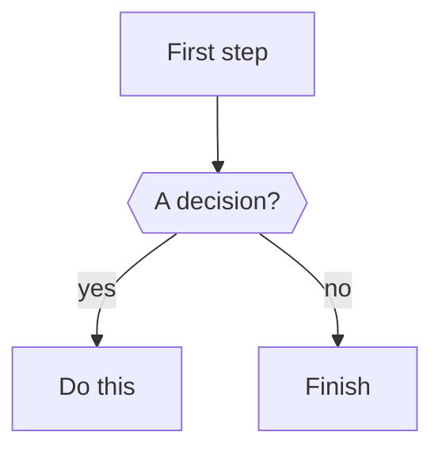

# Cómo enviar una entrada

Se aceptan entradas de cualquier persona. Este repositorio es, a propósito, una colección de programas que ejecutan código donde no debería ejecutarse. Son motores de regex, analizadores sintácticos de marcado, herramientas de compilación y el puntero de análisis de un intérprete de texto. Por eso tratamos una entrada de alguien desconocido como no confiable. Sigue así hasta que la hemos leído, la hemos entendido y la hemos ejecutado en un lugar donde no pueda hacer daño a nadie. Nada de esto es personal: es la misma revisión seas quien seas.

## Qué puede contener una solicitud de cambios (*pull request*)

- **Una carpeta nueva dentro de `src/`** y, de forma opcional, una fila nueva en la tabla de resultados de `README.md`. Nada más: ningún cambio en `sandbox/`, `.github/`, los archivos de compilación de la raíz, el *wrapper* de Gradle ni otras entradas. `sandbox/scope-check.sh` rechaza todo lo que quede fuera de eso.
- **Solo texto.** Sin binarios (se compilan en el momento de la comprobación), sin archivos de más de 256 KiB, sin enlaces simbólicos ni submódulos, con nombres de archivo simples (`A-Z a-z 0-9 . _ - /`) y sin caracteres Unicode invisibles ni que cambien la dirección del texto. Los glifos de APL y otros caracteres Unicode visibles están permitidos.
- **Un `README.md`** con una sección **Cómo funciona el truco**: un recorrido en lenguaje sencillo del mecanismo. Esta es la parte más importante. Si no podemos seguir cómo funciona tu entrada, no podemos incorporarla, por ingeniosa que sea. En ese caso, con gusto la enlazaremos desde tu propio repositorio (mira más abajo).
- **Metadatos (*frontmatter*) y etiquetas de informática al inicio de tu `README.md`.** El libro ["Aprende a programar como un bicho raro"](lessons/README.md) se construye a partir de este bloque, así que sus tablas y capítulos siempre coinciden con el código. **Etiqueta tu reto con tantas etiquetas de informática como puedas. ¡Mira los retos hermanos para ver ejemplos!** Las reglas completas están más abajo, en [Cómo encaja tu entrada en el libro](#how-your-entry-plugs-into-the-book). `scope-check.sh` rechaza una entrada cuyo bloque de metadatos falta o está incompleto.
- **Un script de comprobación** que compila la entrada, la ejecuta sin supervisión, verifica sus propias reglas y termina con un estado de salida distinto de cero ante cualquier fallo. Mira cualquier `check.sh` existente para ver el patrón.
  - `check.sh` para el entorno aislado (*sandbox*) de Linux, que limita el acceso al sistema anfitrión. Se ejecuta **sin red**, como usuario sin privilegios, en un sistema de solo lectura con una carpeta de trabajo escribible. Escribe tus datos de demostración en `$XDG_DATA_HOME` (o `mktemp -d`) y termina en 15 minutos como máximo.
  - `check.ps1` para entradas solo de Windows (WPF y similares). Se ejecuta en Windows Sandbox sin red y restaura los paquetes de NuGet únicamente a partir de lo que ya tenemos.
- **Una forma de que el revisor lo pruebe de forma segura: un `Dockerfile` o instrucciones de Windows Sandbox.** `scope-check.sh` rechaza una entrada que no tenga ninguno de los dos. Toda entrada existente tiene uno, y eso agiliza mucho la revisión de tu solicitud de cambios.
  - **Entradas de Linux: un `Dockerfile`** que construye una imagen pequeña para ejecutar tu entrada y mostrar sus resultados (`sandbox/container/run-image.sh src/your-entry`). Copia el de la entrada existente más cercana. Compila en una etapa a partir de nuestra imagen de herramientas y luego copia el programa terminado a una de nuestras bases de ejecución diminutas. Se rige por reglas estrictas (sin `ADD`, sin `RUN` en la etapa de ejecución, solo variables `CC_*` en su `ENV`; mira [`sandbox/dockerfile-lint.sh`](sandbox/dockerfile-lint.sh)). La compuerta nunca lo construye, así que es una comodidad para quien quiera probar tu entrada de forma segura, no una manera de traer tus propios paquetes. Añade a tu README una sección "Ejecútalo en un contenedor", como las otras entradas.
  - **Entradas solo de Windows (WPF y similares): una sección "Ejecútalo en Windows Sandbox"** en tu README, con el comando exacto (`sandbox\windows\run.ps1 src\your-entry`) y las herramientas que necesita. Copia el texto de [`xaml`](src/xaml/README.md#ejecútalo-en-windows-sandbox). El encabezado debe ser exactamente `## Run it in Windows Sandbox`.
- Tu contribución queda bajo la [licencia MIT](LICENSE) del repositorio.

## Cómo encaja tu entrada en el libro

Este repositorio también es un libro de texto, y **el README de tu entrada es su material de origen.** Nadie copia tus palabras al libro a mano. Un script de compilación (`lessons/book/build.py`) lee el bloque que hay al inicio de cada `src/*/README.md`. Con él genera los capítulos de informática, las tablas comparativas y las listas "En este repositorio" de cada concepto. Por eso el bloque debe ser correcto y las etiquetas importan: cada etiqueta que añades pone tu entrada ante los lectores de ese concepto.

Solo editas tu propia carpeta. Después, un mantenedor añade el texto de la lección, regenera el libro y reconstruye el PDF y el EPUB. El resto de esta sección te dice qué escribir.

### 1. El bloque de metadatos

Lo primero de tu `README.md` es un bloque entre dos líneas `---`. Cópialo de tu entrada hermana más cercana en `src/` y cámbialo. Este es el de `src/forth/`:

```yaml
---
name: "Forth"
teaches: "that a stack language needs one `begin ... until` and a pipe to be a whole program."
kind: idiomatic
languages: [forth]
lesson: "lenguajes/forth.md"
loop-by: loop-statement
evaluation: eager
assurance: guaranteed
pairs-with: forth-weird
tags: [control-flow, stack-data-structure, stack-machine, transaction]
---
```

| Clave | Obligatoria | Qué escribir |
| --- | --- | --- |
| `name` | sí | El lenguaje o la herramienta, como lo diría un lector: `"Forth"`, `"GNU sed"`, `".NET regex"`. |
| `teaches` | sí | Una cláusula `that` en minúsculas que diga qué aprende un lector. Si tu README tiene una línea `**Teaches you:**`, usa exactamente las mismas palabras (la compilación lo comprueba). |
| `kind` | sí | `idiomatic` (la forma ordinaria), `weird` (la acrobacia) o `port` (la misma acrobacia en otro lenguaje). |
| `languages` | sí | Una lista de identificadores de lenguaje, en minúsculas, tomados de [`lessons/cs-source/languages.txt`](lessons/cs-source/languages.txt): `[forth]`, `[c-sharp, linq]`. Enumera todos los lenguajes en que está escrita la entrada o sobre los que se ejecuta (el lenguaje anfitrión, el lenguaje de consultas, la variante de regex). El índice de lenguajes y las tablas del libro se construyen a partir de esto. Si falta el tuyo, usa el identificador más cercano y dilo en tu solicitud de cambios. |
| `lesson` | sí | La página de lección que lo cubre, relativa a `lessons/`, con un `#anchor` opcional: `"languages/forth.md"`. Si todavía no hay página para tu lenguaje, usa la más cercana. Un mantenedor la corrige cuando añada la tuya. |
| `loop-by` | sí | Lo que hace de bucle en tu entrada. Elige un nombre de archivo de [`lessons/cs-source/roles/`](lessons/cs-source/roles/); por ejemplo `loop-statement`, `lazy-demand`, `rewrite-and-rescan`, `self-modifying-control`, `backtracking-search`, `dispatch-and-triggers`, `input-driven`, `document-order`, `bulk-array`. El [capítulo comparativo](lessons/informatica/09-casos-de-estudio-comparativos.md) muestra qué significa cada uno. |
| `evaluation` | sí | La estrategia que conduce el cálculo principal: `eager`, `lazy`, `deferred`, `rewriting`, `search` o `declarative`. Describe aparte las operaciones incrustadas. |
| `assurance` | sí | La *dependencia necesaria más débil* del truco: `guaranteed` (una especificación o API con nombre documenta el comportamiento), `implementation-permitted` (una implementación concreta lo permite) o `accidentally-exploited` (el truco exige un comportamiento no prometido). Explica qué respalda cada afirmación individual, incluido el ámbito de una garantía documentada de la API. La [introducción](lessons/introduccion.md#tres-tipos-de-conocimiento) explica las tres. |
| `tags` | sí | Una lista de conceptos de informática. Mira más abajo. |
| `pairs-with` | no | Tu entrada hermana más cercana: la versión ordinaria de una entrada rara, o al revés. |
| `analogies`, `counterexamples` | no | Identificadores de concepto (el mismo vocabulario que `tags`). Usa `tags` solo para ideas que tu entrada **demuestra**. Usa `analogies` para una idea a la que tu entrada *se parece* sin ser una instancia de ella (un `generateSequence` de Kotlin no es una corrutina, pero es un primo). Usa `counterexamples` para una idea que tu entrada muestra por *no ser* eso (una clausura, *closure*: una función que recuerda las variables de donde se creó, no es una continuación). Una entrada puede relacionarse con un concepto de una sola de las tres maneras. La tabla "En este repositorio" del concepto dice cuál. |
| `machine`, `state` | sí | Las dos frases de la tabla "nombra la máquina" del libro: *¿qué máquina es en realidad tu entrada?* y *¿dónde vive su estado?* Toda entrada da ambas, para que las tablas comparativas no tengan celdas vacías. Si tu entrada es un programa ordinario sin nada oculto, dilo con palabras: ``machine: "Ordinary: a `while` loop that draws first and saves afterwards"``. |

El bloque es un subconjunto pequeño y estricto de YAML, así que no hace falta ninguna biblioteca de analizador sintáctico: `key: value`, `key: "quoted text"` y `key: [a, b]`. Pon entre comillas el texto que contenga dos puntos o un `#`. Las líneas de comentario empiezan con `#`. No se permite nada más, y la compilación te dice la línea que no entendió.

### 2. Etiquetas y lenguajes: los vocabularios del libro

Las etiquetas conectan tu entrada con los conceptos del libro: flujo de control, evaluación perezosa, retroceso, homoiconicidad, transacciones y otros. **Usa tantas como apliquen con honestidad.** Una regla práctica: si tuviste que entender una idea para escribir la entrada, o si la entrada es un buen ejemplo de ella, etiquétala.

- El vocabulario es la lista de nombres de archivo de [`lessons/cs-source/concepts/`](lessons/cs-source/concepts/). El [índice de conceptos](lessons/informatica/README.md#concept-index) muestra cada etiqueta con su capítulo y las entradas que ya la usan. Tus entradas hermanas son los mejores ejemplos.
- Escribe una etiqueta exactamente como su nombre de archivo, sin `.md`: `reflection-and-metaprogramming`.
- **No edites `lessons/`.** Si necesitas un concepto que no existe, usa la etiqueta más cercana y di en tu solicitud de cambios qué concepto falta. Un mantenedor decide si lo añade. `scope-check.sh` solo imprime una nota ante una etiqueta desconocida, pero la compilación del libro falla hasta que un mantenedor añade el concepto o corrige la etiqueta.
- Los lenguajes funcionan igual, con una sola lista: [`lessons/cs-source/languages.txt`](lessons/cs-source/languages.txt). Un *lenguaje* dice en qué está escrita la entrada o sobre qué se ejecuta. Una *etiqueta* dice qué idea de informática muestra. El **Índice** del libro (el último capítulo) se construye con ambos. Por eso una entrada con los lenguajes y las etiquetas correctos aparece donde un lector la buscaría.
- **No etiquetes para que un concepto parezca usado.** Un concepto que ninguna entrada demuestra con honestidad se fundamenta de otra manera: una analogía, un contraejemplo, una declaración de que se aplica a toda entrada (`applies-to`) o un ejercicio. `python lessons/book/build.py --orphans` lista cómo se fundamenta cada concepto y falla si alguno no tiene nada detrás.
- Cada página de concepto explica *por qué existe, por qué se usa, cuándo usarlo y cuándo no*, con enlaces a Wikipedia y a otras fuentes duraderas y de libre reutilización. Lee las de las etiquetas que uses y comprueba que tu entrada de verdad es un ejemplo.

### 3. Los encabezados de sección que todos los README comparten

Todas las entradas usan los **mismos títulos de sección**, así que un lector, el libro y los enlaces de otras páginas siempre saben dónde mirar. Usa estos títulos exactamente, como encabezados `## `. No inventes sinónimos como "Cómo funciona" o "Letra pequeña".

| Encabezado | Obligatorio | Qué contiene |
| --- | --- | --- |
| `# Title` | sí | Una línea de título. Opcionalmente, sigue con una frase `**Teaches you:**`, luego un aviso `DEMO ONLY` (tus datos son ficticios y nunca tocan un sistema real) y una introducción breve: qué hace la entrada y la restricción con que juega. |
| `## Run it` | sí | Cómo ejecutarla en tu propia máquina. |
| `## Run it in a container` o `## Run it in Windows Sandbox` | sí, uno de los dos | Mira la regla del Dockerfile más arriba. El encabezado de Windows se comprueba palabra por palabra. |
| `## Program Flow` | sí | Un diagrama de Mermaid de **cómo se ejecuta este programa**, y dos párrafos breves. Mira [Flujo del programa: una imagen de la máquina](#program-flow-a-picture-of-the-machine) más abajo. Ponlo justo antes de `## How the stunt works` |
| `## How the stunt works` | sí | El mecanismo en lenguaje sencillo, y la sección más importante. Di dónde vive el estado del programa, qué hace de bucle y qué hace de regla de parada. Si tu entrada es "rara", di también cómo sería la versión ordinaria. Pon los subpasos bajo encabezados `###`. |
| ``## What `check.sh` enforces`` | sí (``## What `check.ps1` enforces`` para un script de comprobación de Windows) | Las reglas que tu script de comprobación intenta romper. |
| `## Gotchas worth knowing` | sí | Los muros con los que chocaste, las partes que dependen de una sola implementación y todo lo que te sorprendió. Marca cada truco como garantizado, permitido por la implementación o aprovechado por accidente, con las mismas palabras que la clave `assurance`. |

Estos encabezados opcionales también tienen títulos fijos. Úsalos cuando encajen: `## What it does`, `## Why this is weird` (o `## Why this is idiomatic`, para la versión ordinaria de una entrada rara), `## What you can learn`, `## Layout`, `## Format and lint`. Añade cualquier otra sección `##` que tu entrada necesite, con su propio título específico.

El orden de arriba es el recomendado, pero no se impone. `sandbox/scope-check.sh` rechaza una entrada nueva a la que le falte alguno de los encabezados obligatorios. Las primeras adaptaciones de una sentencia (Go, Java, Kotlin, Python y Rust) no tienen script de comprobación, así que no tienen sección de comprobación. Una entrada nueva debe tener ambos.

### Flujo del programa: una imagen de la máquina

Todo README tiene exactamente una sección `## Program Flow`. Responde **"¿qué hace en realidad el entorno de ejecución, el intérprete, el compilador, el planificador o la función del lenguaje que hace funcionar este programa?"** No es una imagen de la tarea (la introducción del libro muestra la tarea y lista las diferencias de implementación). Si tu diagrama pudiera pegarse sin cambios en otros diez README, no está enseñando el punto de tu entrada.

La sección es exactamente esto y nada más (sin subencabezados):

````markdown
## Program Flow



**What this shows:** two to four sentences.

**Why this mechanism matters:** two to four sentences.
````

- **Elige el tipo de diagrama que encaje con la máquina.** `flowchart` para ramas y bucles, `sequenceDiagram` para funciones de devolución de llamada (*callbacks*: funciones que entregas para que otro código las llame después), despacho y quién llama a quién, `stateDiagram-v2` para un estado que cambia (un destino de `GO TO`, un puntero de análisis) y un diagrama de flujo de datos y demanda para la evaluación perezosa. No dibujes un bucle `while` para un programa que no lo tiene. La compilación acepta cualquier familia de diagramas que Mermaid pueda dibujar.
- **Dibuja lo que se ejecuta.** Lee el código fuente y ejecútalo primero. No muestres algo que el programa no hace, y no copies la descripción de la tarea.
- **Hazlo pequeño.** Aproximadamente de 5 a 10 nodos o mensajes, con etiquetas de menos de unos 60 caracteres. Dibuja las decisiones como hexágonos (`{{"text"}}`): un rombo crece demasiado alto alrededor de su texto. Sin etiquetas HTML en los textos, sin colores que lleven significado y sin `;` en un mensaje de diagrama de secuencia (termina la sentencia).
- **`accTitle` y `accDescr` son obligatorios.** El primero es el pie de la figura y el segundo es su texto alternativo.
- **Los enlaces** a otros archivos están bien (se reorientan cuando la sección se copia a una página de lección). Los enlaces a un encabezado de tu propio README no.
- **La compilación lo comprueba.** `python lessons/book/build.py --check` comprueba la estructura de la sección. `python lessons/book/build.py --check-diagrams` dibuja cada diagrama y falla si alguno no se puede dibujar o si se imprimiría a menos de unos 8.4 pt en una página Letter. Si tu diagrama es demasiado alto o ancho, acorta las etiquetas o usa menos nodos. Mira [`lessons/book/README.md`](lessons/book/README.md#diagramas) para la configuración de una sola vez.

### 4. Voz y tono

Sigue la [guía de estilo](guia-de-estilo.md) para la prosa de los README, el texto de las lecciones y las guías de estudio. Da a los lectores un ejemplo concreto y mantén la explicación clara para lectores que usan un traductor.

### 5. Compruébalo antes de enviarlo

Ejecuta `python lessons/book/build.py --check` desde la raíz del repositorio (necesita [pandoc](https://pandoc.org)). Valida el bloque de metadatos y las etiquetas de cada entrada, comprueba que las páginas generadas del libro estén al día, compila el libro y verifica cada enlace interno. Verás un mensaje claro que nombra el archivo y la línea. Corrige los problemas en tu propia carpeta. Si el único mensaje trata de una etiqueta o un papel que aún no existe, envía la solicitud de cambios de todos modos y explícalo, como se describe más arriba.

## Las herramientas de tu lenguaje

Las entradas se ejecutan solo con lo que ya está en [`sandbox/linux/Dockerfile`](sandbox/linux/Dockerfile): GNU APL, Gforth, GHC, Perl, PCRE2, sed, Make, CMake, un compilador de C, .NET 10 y SQLite. Si la tuya necesita algo más, dilo en la solicitud de cambios e indícanos dónde está su distribución oficial. Lo añadimos nosotros a la imagen, en un *commit* de Git aparte (un punto guardado del historial del código), fijado a una versión y a una suma de verificación. Por favor, no envíes scripts de instalación ni nos pidas instalar un intérprete desde tu propio repositorio.

## Antes de abrir la solicitud de cambios

Configura Docker (y Windows Sandbox, para las entradas de Windows) una sola vez, siguiendo [`SANDBOX-SETUP.md`](SANDBOX-SETUP.md). Luego, desde un intérprete de comandos (*shell*) de Linux, macOS o WSL (o Git Bash con Docker Desktop):

```bash
sandbox/run.sh src/your-entry                 # the same sandbox the gate uses
sandbox/container/run-image.sh src/your-entry # if you ship a Dockerfile: see what it does
sandbox/scope-check.sh origin/master HEAD     # the same scope rules, plus the reviewer report
```

El informe para el revisor al final de `scope-check.sh` lista cada línea que toca la red, inicia un proceso, evalúa código o parece un bloque de datos codificado. Es normal que las entradas de este repositorio tengan algunas. Espera explicar cada una en tu README.

## Qué pasa después

1. `scope-check.sh` se ejecuta contra tu solicitud de cambios sin descargarla.
2. Personas y algunos revisores de IA leen el código junto con tu README. A cada revisor de IA se le pide una traducción de tu código a lenguaje sencillo y una lista de todo lo que puede tocar.
3. Un mantenedor ejecuta la compuerta: tu comprobación, en el entorno aislado, en una máquina desechable.
4. Luego pasa una de dos cosas:
   - **Incorporada**, con crédito en la tabla de resultados.
   - **Enlazada**: añadimos una fila que apunta a tu propio repositorio en un *commit* de Git concreto. Esto no es un rechazo. Significa que lo disfrutamos, pero no podemos responder por cada línea, normalmente porque el lenguaje está más allá de lo que podemos leer con confianza.

Una compuerta superada significa que tu entrada compiló, se ejecutó y se comportó bien en un entorno aislado. Por sí sola, no es la razón por la que incorporamos una entrada. La razón es entenderla.
