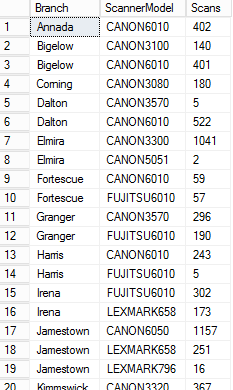

# De dónde salió el reto de XAML

Esta fue la inspiración original del [reto de XAML](../src/xaml/README.md). Microsoft nunca renuncia a una idea.

A fines de 2013, ASP.NET Web Forms tenía la misma promesa que aún tiene el XAML de WPF. El marcado *describe* las cosas y el código subyacente (*code-behind*) *hace* las cosas. El artículo siguiente trata de negarse a escribir ese código subyacente. Un gráfico que "obviamente" necesitaba C# para construir sus series resultó no necesitar nada. Un `PIVOT` de SQL dejó los datos en la forma correcta, y el [control Chart de ASP.NET](https://learn.microsoft.com/en-us/dotnet/api/system.web.ui.datavisualization.charting.chart?view=netframework-4.8.1), enlazado a un [`SqlDataSource`](https://learn.microsoft.com/en-us/dotnet/api/system.web.ui.webcontrols.sqldatasource?view=netframework-4.8.1), hizo el resto solo con marcado.

Es la misma jugada, años después y en otra pila tecnológica. Cuando notas que el marcado construye cualquier objeto que nombres y lo conecta con lo que le dé datos, "sin código subyacente" deja de ser una regla de estilo. Es un desafío. La entrada de XAML de este repositorio lleva ese desafío hasta el límite. Su archivo `.xaml` *es* el programa.

Antes de leer, ten en cuenta unas notas:

- **Se reproduce tal como se escribió.** La prosa y el código no cambian respecto a la publicación original. Las únicas ediciones son de formato (encabezados, lenguajes de los bloques de código) y estas notas.
- **No se ha vuelto a probar.** Está pensado para .NET Framework 4.x Web Forms y el ensamblado `System.Web.DataVisualization`. Ninguno de los dos existe en .NET moderno, así que este repositorio no contiene nada que lo compile. Trátalo como historia, no como receta.
- **Faltan dos de las tres capturas de pantalla.** La publicación original tenía tres imágenes: la salida "irregular" de la consulta, la salida pivotada y el gráfico terminado. Solo la primera sobrevivió en una copia de seguridad del blog. Las otras dos están marcadas abajo con sus pies de foto originales.
- **Lecturas adicionales** sobre las piezas que usa: [`PIVOT` y `UNPIVOT`](https://learn.microsoft.com/en-us/sql/t-sql/queries/from-using-pivot-and-unpivot) (T-SQL), [`SeriesChartType.StackedBar`](https://learn.microsoft.com/en-us/dotnet/api/system.web.ui.datavisualization.charting.seriescharttype?view=netframework-4.8.1) y [`Series.XValueMember` / `YValueMembers`](https://learn.microsoft.com/en-us/dotnet/api/system.web.ui.datavisualization.charting.series?view=netframework-4.8.1) (las propiedades de enlace de datos que hacen el trabajo real aquí).

---

## Gráficos de barras apiladas en ASP.NET sin código subyacente

*Publicado originalmente el 19 de diciembre de 2013 en el blog de la Ed Norton Engineering Society. Etiquetas: ASP.NET, SQL.*

Esto se publica como un ejercicio intelectual que a otra persona le puede resultar interesante o útil.

**NOTA:** Esto **NO** es una sugerencia de cómo implementar algo en producción (aunque allí sí tenemos una aplicación como esta).

### Introducción

Actualmente trabajo en un proyecto de mi empresa que incluye, entre otras tareas, reunir métricas de nuestros escáneres en todas nuestras sedes. Tenemos un entorno heterogéneo de escáneres (lo cual plantea sus propios problemas) con 16 modelos de Canon, Fujitsu, Lexmark y Xerox repartidos en 24 sitios distintos. Algunos sitios tienen un solo escáner; otros tienen dos o tres. Quería mostrar el volumen total de los escáneres por sitio, desglosado por modelo de escáner en cada sitio. Es una aplicación perfecta para un gráfico de barras apiladas.

### El problema

He usado el control de gráficos de ASP.NET para otros gráficos de este proyecto. Por pura casualidad (no por diseño), había resuelto todo lo que necesitaba de cada gráfico con marcado puro y SQL. Para la página web no había escrito código subyacente hasta que necesité este gráfico de barras apiladas. Entonces me costó mucho encontrar información en Internet sobre cómo crear un gráfico de barras apiladas solo con marcado (porque quería ver si podía).

El problema es que un gráfico de barras apiladas necesita varias series (en mi caso, modelos de escáner). Y cada serie debe tener el mismo número de puntos de datos; es decir, en mi caso cada serie debe tener 24 ubicaciones. Esto se debe a que el gráfico de barras apiladas es "tonto". Simplemente apila la primera columna de cada serie en la primera barra, la segunda en la segunda barra y así sucesivamente. Pero cada ubicación tiene solo de uno a tres escáneres, así que, como máximo, cada ubicación tiene aproximadamente un 20 % de los modelos de escáner disponibles. Huelga decir que una consulta parecida a esta:

```sql
SELECT
    Branch,
    ScannerModel,
    COUNT (*) AS Scans
FROM ScanMetrics
GROUP BY Branch, ScannerModel
ORDER BY Branch, ScannerModel
```

...va a producir una salida como esta:



Esto no es lo que necesitamos, porque la salida es "irregular" (cada sede tiene un número distinto de modelos de escáner).

### Las tablas dinámicas al rescate

Lo pensé un poco más y por fin me di cuenta de que necesitaba tener mis datos en una tabla dinámica. Con la salida de esa tabla, podía hacer el gráfico de barras apiladas solo con marcado de ASP.NET. Esta es una vista que creé para obtener la salida dinámica que necesitaba:

```sql
CREATE VIEW BranchScannerScansPivot
AS
WITH Branches AS
(
    SELECT DISTINCT
        Branch
    FROM ScanMetrics
),
Scanners AS
(
    SELECT DISTINCT
        Branch,
        ScannerModel
    FROM ScanMetrics
),
BranchScannerCombos AS
(
    SELECT DISTINCT
        B.Branch,
        S.ScannerModel
    FROM Branches B
    CROSS JOIN Scanners S
),
BranchScannerCounts AS
(
    SELECT
        BSC.Branch,
        BSC.ScannerModel,
        COUNT (SM.ScannerModel) AS Scans
    FROM ScanMetrics SM
    RIGHT OUTER JOIN BranchScannerCombos BSC ON
        SM.Branch= BSC.Branch
        AND SM.ScannerModel= BSC.ScannerModel
    GROUP BY
        BSC.Branch,
        BSC.ScannerModel
)
SELECT
    *
FROM BranchScannerCounts BSC
PIVOT(SUM(Scans) FOR ScannerModel IN
(
    [CANON2200],
    [CANON3080],
    [CANON3100],
    [CANON3300],
    [CANON3320],
    [CANON3570],
    [CANON4035],
    [CANON4080],
    [CANON5035],
    [CANON5051],
    [CANON6010],
    [CANON6050],
    [FUJITSU6010],
    [LEXMARK658],
    [LEXMARK796],
    [XEROX5745]
)) AS Scans
```

Al seleccionar de esta vista se obtiene un conjunto de resultados de 24 filas con exactamente la salida que necesito:

> *[Captura de pantalla no conservada, con el pie "Yup": los resultados pivotados, con una fila por rama y una columna por modelo de escáner.]*

Es una cuadrícula "rectangular" de valores para cada combinación de ubicación y modelo de escáner.

### La solución

Con esos datos a mano, crear el gráfico de barras apiladas solo con marcado es un ejercicio de copiar y pegar. Son 16 series (una por cada modelo de escáner). Este es el archivo `Metrics.aspx` completo:

```aspx
<%@ Page Title="Metrics" Language="C#" MasterPageFile="~/Site.Master" AutoEventWireup="true"
    CodeBehind="Metrics.aspx.cs" Inherits="ScanMetrics"%>
<%@ Register Assembly="System.Web.DataVisualization, Version=4.0.0.0, Culture=neutral, PublicKeyToken=31bf3856ad364e35"
    Namespace="System.Web.UI.DataVisualization.Charting" TagPrefix="asp"%>
<asp:Content runat="server" ID="FeaturedContent" ContentPlaceHolderID="FeaturedContent">
    <section class="featured">
        <div class="content-wrapper">
            <hgroup class="title">
                <h1><%:Title%>.</h1>
                <h2>Scan statistics.</h2>
            </hgroup>
        </div>
    </section>
</asp:Content>
<asp:Content runat="server" ID="BodyContent" ContentPlaceHolderID="MainContent">
    <asp:Chart ID="Chart1" runat="server" DataSourceID="SqlDataSource1" Height="800" Width="800">
        <Titles>
            <asp:Title Text="Scans by Branch and Scanner Model"></asp:Title>
        </Titles>
        <ChartAreas>
            <asp:ChartArea Name="Branch">
                <Area3DStyle Enable3D="true"/>
                <AxisX Interval="1">
                    <MajorGrid Enabled="false"/>
                </AxisX>
            </asp:ChartArea>
        </ChartAreas>
        <Series>
            <asp:Series Name="CANON2200" ChartType="StackedBar" ChartArea="Branch"
                XValueMember="Branch" YValueMembers="CANON2200">
            </asp:Series>
            <asp:Series Name="CANON3080" ChartType="StackedBar" ChartArea="Branch"
                XValueMember="Branch" YValueMembers="CANON3080">
            </asp:Series>
            <asp:Series Name="CANON3100" ChartType="StackedBar" ChartArea="Branch"
                XValueMember="Branch" YValueMembers="CANON3100">
            </asp:Series>
            <asp:Series Name="CANON3300" ChartType="StackedBar" ChartArea="Branch"
                XValueMember="Branch" YValueMembers="CANON3300">
            </asp:Series>
            <asp:Series Name="CANON3320" ChartType="StackedBar" ChartArea="Branch"
                XValueMember="Branch" YValueMembers="CANON3320">
            </asp:Series>
            <asp:Series Name="CANON3570" ChartType="StackedBar" ChartArea="Branch"
                XValueMember="Branch" YValueMembers="CANON3570">
            </asp:Series>
            <asp:Series Name="CANON4035" ChartType="StackedBar" ChartArea="Branch"
                XValueMember="Branch" YValueMembers="CANON4035">
            </asp:Series>
            <asp:Series Name="CANON4080" ChartType="StackedBar" ChartArea="Branch"
                XValueMember="Branch" YValueMembers="CANON4080">
            </asp:Series>
            <asp:Series Name="CANON5035" ChartType="StackedBar" ChartArea="Branch"
                XValueMember="Branch" YValueMembers="CANON5035">
            </asp:Series>
            <asp:Series Name="CANON5051" ChartType="StackedBar" ChartArea="Branch"
                XValueMember="Branch" YValueMembers="CANON5051">
            </asp:Series>
            <asp:Series Name="CANON6010" ChartType="StackedBar" ChartArea="Branch"
                XValueMember="Branch" YValueMembers="CANON6010">
            </asp:Series>
            <asp:Series Name="CANON6050" ChartType="StackedBar" ChartArea="Branch"
                XValueMember="Branch" YValueMembers="CANON6050">
            </asp:Series>
            <asp:Series Name="FUJITSU6010" ChartType="StackedBar" ChartArea="Branch"
                XValueMember="Branch" YValueMembers="FUJITSU6010">
            </asp:Series>
            <asp:Series Name="LEXMARK658" ChartType="StackedBar" ChartArea="Branch"
                XValueMember="Branch" YValueMembers="LEXMARK658">
            </asp:Series>
            <asp:Series Name="LEXMARK796" ChartType="StackedBar" ChartArea="Branch"
                XValueMember="Branch" YValueMembers="LEXMARK796">
            </asp:Series>
            <asp:Series Name="XEROX5745" ChartType="StackedBar" ChartArea="Branch"
                XValueMember="Branch" YValueMembers="XEROX5745">
            </asp:Series>
        </Series>
        <Legends>
            <asp:Legend Enabled="true" Alignment="Center"></asp:Legend>
        </Legends>
    </asp:Chart>
    <asp:SqlDataSource ID="SqlDataSource1" runat="server"
        ConnectionString="<%$ConnectionStrings:ConnectionString1%>"
        ProviderName="<%$ConnectionStrings:ConnectionString1.ProviderName%>"
        SelectCommand="SELECT Branch, CANON2200, CANON3080, CANON3100, CANON3300, CANON3320, CANON3570, CANON4035, CANON4080, CANON5035, CANON5051, CANON6010, CANON6050, FUJITSU6010, LEXMARK658, LEXMARK796, XEROX5745 FROM BranchScannerScansPivot ORDER BY 1 DESC">
    </asp:SqlDataSource>
</asp:Content>
```

Y esta es la salida:

> *[Captura de pantalla no conservada, con el pie "¡Tachán!". Muestra el gráfico de barras apiladas en 3D terminado, con una barra por rama y cada barra dividida en segmentos de colores según el modelo de escáner.]*

Misión cumplida.

### Conclusión

Ahora bien, no digo que esto deba ser un enfoque estándar. Por un lado, me parece una solución "frágil". Exige que el pivote SQL y el marcado de las series del gráfico conozcan de antemano el número y los nombres de los modelos de escáner. Por eso, agregar un modelo nuevo exigiría cambios de código tanto en la vista como en la página web.

Sin embargo, quise publicar esto porque he comprobado, al trabajar con el control de gráficos de Microsoft, que a menudo existen enfoques bastante sencillos que usan solo marcado. Pero la mayoría de los ejemplos de la Web tienden a ser una mezcla de marcado y código. Y casi ninguno ofrece una buena explicación de por qué una propiedad se fija en el marcado y otra en el código subyacente. Además, según tu entorno, puede ser más fácil cambiar el marcado y las vistas SQL en producción que el código compilado. Sin duda, puede ser más fácil "ajustar" el marcado.

Y por último, simplemente me pareció un reto intelectual, y espero que a ti también te haya parecido interesante.

---

Vuelve al [reto de XAML](../src/xaml/README.md) o al [README raíz](../README.md).
