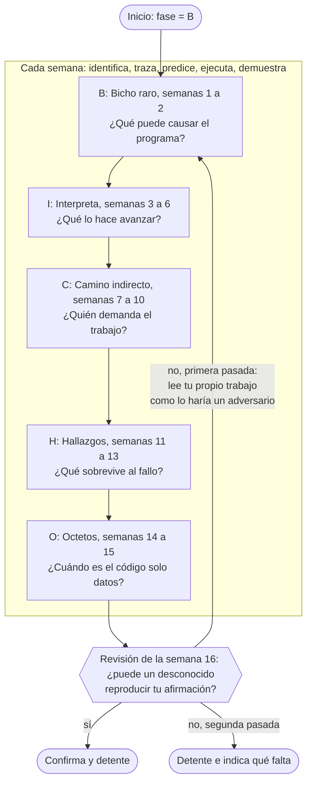

# Plan de estudios

Un curso de 16 semanas basado en *¡Aprende a programar como un bicho raro!*

Este plan de estudios convierte el repositorio en un semestre. Enseña informática mediante un recorrido por lenguajes e implementaciones. La mayoría son antiguos, extraños o ambas cosas. Las ideas son el tema. Los lenguajes son la evidencia.

**BICHO** significa **Bicho raro, Interpreta, Camino indirecto, Hallazgos y Octetos**. La B es recursiva. Es la de Bicho raro: el bicho aparece hasta en su propio nombre. Las cinco letras también dan al curso sus cinco fases.

## Para quién es este curso

- Estudiantes avanzados de licenciatura y estudiantes de posgrado.
- Programadores autodidactas que escriben código que funciona y quieren la teoría que lo explica.
- Lectores curiosos a quienes les gustan los acertijos.

Necesitas un lenguaje que conozcas bien, un intérprete de comandos (*shell*) y un entorno de ejecución de contenedores. No necesitas un título universitario. No necesitas instalar COBOL, APL ni Forth. El [entorno aislado (*sandbox*)](../SANDBOX-SETUP.md), que limita el acceso al sistema anfitrión, los incluye.

## Lo que podrás hacer

1. Identificar la máquina dentro de un programa: lo que se repite, dónde vive el estado, lo que hace avanzar el paso siguiente, qué lo detiene y qué confirma.
2. Leer un programa desconocido y hacer una lista de lo que puede causar antes de ejecutarlo.
3. Predecir una traza y luego poner a prueba la predicción con una ejecución.
4. Clasificar una afirmación con una de estas etiquetas: **garantizado**, **permitido por la implementación** o **aprovechado por accidente**, y dar la evidencia.
5. Resolver un problema bajo una restricción y comparar los diseños por algo más que el número de líneas.
6. Explicar qué problema de su época resolvió un lenguaje y cuáles de sus ideas sigues usando.

## El semestre como algoritmo

El curso sigue las reglas que enseña. No usa una variable como contador. La fase es el estado, como en los programas que leerás. Una revisión al final decide si el curso se detiene. Si la revisión falla, la segunda pasada vuelve a empezar en B.

La B es recursiva. En la primera pasada lees programas de otras personas. En la segunda pasada lees tus propios programas.

El bucle tiene un límite. Una segunda revisión fallida termina el curso con un informe de lo que falta. Una afirmación fallida, reportada con honestidad, es un resultado.

## Cómo funciona cada semana

Una semana tiene los mismos cuatro pasos. Vienen de las [guías de estudio](../lessons/guias-de-estudio/README.md).

1. **Identifica la máquina.** Lee la guía y el comienzo del capítulo del libro. Encuentra el bucle, el estado, el reloj, la decisión y la confirmación.
2. **Traza una ejecución.** Sigue a mano la ejecución fija de la guía. Escribe el estado antes y después de cada paso.
3. **Predice y luego ejecuta.** Escribe tu predicción en el archivo de registro y registra la predicción con un *commit* de Git, un punto fijo en el historial del proyecto. Luego ejecuta el ejercicio verificado en el entorno aislado. La hora del *commit* demuestra el orden. Compara la predicción con lo observado.
4. **Demuestra.** Responde la pregunta de evidencia de la guía. Una afirmación necesita una prueba que pueda fallar.

Todos los programas usan datos ficticios marcados con **DEMO ONLY**. Lee primero el código fuente. Ejecútalo solo en el entorno aislado. Consulta [Ejecutar cosas con seguridad](../lessons/exercises.md#ejecutar-con-seguridad).

### Cuánto debes hacer

El conjunto completo es demasiado para la mayoría de las semanas, así que el trabajo se organiza en tres niveles.

- **Obligatorio (unas 6 horas).** La guía en negrita de la columna Lee, los cuatro pasos y el primer ejercicio de la columna Haz.
- **Elige una (unas 2 horas más).** Un segundo ejercicio de la columna Haz, o una segunda guía de la columna Lee.
- **Profundización opcional.** El resto del capítulo, el capítulo del libro sobre el lenguaje de la semana y el código fuente.

### El registro

Cada semana, añade una entrada a la bitácora de predicciones. Usa las mismas cuatro filas cada vez.

| Antes de la ejecución (registra primero la predicción) | Después de la ejecución | Evidencia |
| --- | --- | --- |
| Máquina: ¿qué ejecuta el bucle? | Traza observada | El comando y la línea de código fuente |
| Estado: ¿dónde vive? | Cómo cambió el estado | Grado de garantía, con la especificación o la implementación en que se basa |
| Regla de parada | Resultado o fallo | Control negativo: un cambio que debe romper la afirmación |
| Punto de confirmación | Efectos que persistieron | Identificador del *commit* del repositorio, versiones de las herramientas y pasos para reproducir |

## Semana a semana

Los enlaces llevan a los capítulos del libro, a las guías de estudio y a los ejercicios. Este plan de estudios no cambia ninguno de ellos. Los números de capítulo son los del libro impreso, donde la introducción es el capítulo 1. La primera guía en negrita es la obligatoria.

| Semana | Pregunta | Lee | Haz |
| --- | --- | --- | --- |
| | **B: Bicho raro** | | |
| 1 | ¿Qué puede causar un programa antes de que yo lo ejecute? | [Cap. 4](../lessons/informatica/01-lectura-de-un-programa-adversarial.md), **[guía](../lessons/guias-de-estudio/conceptos/lectura-de-programas-adversariales.md)** | [A1](../lessons/exercises.md#a1-lee-las-filas-verificado), [F2](../lessons/exercises.md#f2-trojan-source-oculta-un-carácter-y-luego-encuéntralo-verificado) |
| 2 | ¿Qué cuenta como una máquina? COBOL: un salto es el bucle. | [Cap. 5](../lessons/informatica/02-que-cuenta-como-maquina.md), **[guía de COBOL](../lessons/guias-de-estudio/lenguajes/cobol.md)** | [B1](../lessons/exercises.md#b1-cobol-predice-y-luego-rompe-alter-verificado) |
| | **I: Interpreta** | | |
| 3 | ¿Dónde está el contador de programa? Forth: la posición de lectura del intérprete. | [Cap. 6](../lessons/informatica/03-flujo-de-control-y-continuaciones.md), **[guía de Forth](../lessons/guias-de-estudio/lenguajes/forth.md)** | [B3](../lessons/exercises.md#b3-forth-mueve-el-ancla-verificado) |
| 4 | ¿Quién elige el siguiente paso? Make y CMake: un grafo de dependencias. | **[guía de Make y CMake](../lessons/guias-de-estudio/lenguajes/make-y-cmake.md)** | [B4](../lessons/exercises.md#b4-make-quita-la-operación-sin-efecto-y-sobrescribe-el-reloj-verificado), [B5](../lessons/exercises.md#b5-cmake-muta-el-literal-verificado) |
| 5 | ¿Dónde vive el estado? ed y Ex: un búfer de texto. | [Cap. 9](../lessons/informatica/06-estado-mas-alla-de-las-variables.md), **[guía de ed y Ex](../lessons/guias-de-estudio/lenguajes/ed-y-ex.md)**, [guía de estado](../lessons/guias-de-estudio/conceptos/estado-y-control-mas-alla-de-las-variables.md) | [B18](../lessons/exercises.md#b18-ed-mueve-la-regla-de-parada-y-rompe-la-limpieza-verificado), [B19](../lessons/exercises.md#b19-ex-mueve-el-límite-en-la-cinta-y-corta-el-bucle-verificado), [C3](../lessons/exercises.md#c3-un-bucle-cuyo-estado-no-es-una-variable-verificado) |
| 6 | ¿Qué reemplaza al bucle? APL: arreglos completos. | **[guía de APL](../lessons/guias-de-estudio/lenguajes/apl.md)** | [B6](../lessons/exercises.md#b6-apl-la-reescritura-del-error-por-uno-verificada), [C1](../lessons/exercises.md#c1-lo-raro-junto-a-lo-aburrido-verificado) |
| | **C: Camino indirecto** | | |
| 7 | ¿Quién demanda el trabajo? Haskell: pereza. | [Cap. 7](../lessons/informatica/04-evaluacion-y-demanda.md), **[guía de la demanda](../lessons/guias-de-estudio/conceptos/evaluacion-demanda-y-pereza.md)**, [guía de Haskell](../lessons/guias-de-estudio/lenguajes/haskell.md) | [B2](../lessons/exercises.md#b2-haskell-rompe-la-pereza-verificado) |
| 8 | ¿Pueden las reglas de despacho ser un bucle? Lisp. **Examen parcial.** | **[guía de Lisp](../lessons/guias-de-estudio/lenguajes/common-lisp.md)** | [B10](../lessons/exercises.md#b10-lisp-cambia-la-combinación-de-métodos-verificado) |
| 9 | ¿Qué recuerda una clausura (*closure*: función que conserva las variables del lugar donde se creó)? JavaScript. | **[guía de JavaScript](../lessons/guias-de-estudio/lenguajes/javascript.md)** | [B20](../lessons/exercises.md#b20-javascript-lee-las-cláusulas-mueve-el-límite-y-haz-fallar-la-comprobación-de-estructura-verificado), [B21](../lessons/exercises.md#b21-javascript-más-raro-mueve-la-regla-de-parada-a-una-clausura-closure-y-observa-la-demanda-verificado) |
| 10 | ¿De quién es el siguiente turno? Eventos y funciones de devolución de llamada (*callbacks*: funciones que otro componente invoca cuando corresponde, por ejemplo al emitir un evento). | [Cap. 13](../lessons/informatica/10-eventos-retrollamadas-y-flujo-de-control-reactivo.md), **[guía de eventos](../lessons/guias-de-estudio/conceptos/eventos-retrollamadas-y-control-reactivo.md)** | [B22](../lessons/exercises.md#b22-javascript-dirigido-por-eventos-predice-la-traza-y-luego-elimina-el-límite-verificado) |
| | **H: Hallazgos** | | |
| 11 | ¿Qué se confirma de verdad? Efectos, errores y consultas. | [Cap. 10](../lessons/informatica/07-efectos-errores-y-confirmacion.md), **[guía de efectos](../lessons/guias-de-estudio/conceptos/efectos-errores-y-confirmacion.md)**, [guía de C# y LINQ](../lessons/guias-de-estudio/lenguajes/csharp-linq-xaml-y-adaptaciones.md) | [B7](../lessons/exercises.md#b7-linq-enumera-dos-veces-verificado) |
| 12 | ¿Qué sobrevive a una coincidencia fallida? Regex y sed. | **[guía de regex y sed](../lessons/guias-de-estudio/lenguajes/motores-de-regex-y-sed.md)** | [B8](../lessons/exercises.md#b8-regex-qué-sobrevive-a-una-coincidencia-fallida-verificado), [B9](../lessons/exercises.md#b9-sed-observa-un-cálculo-verificado) |
| 13 | ¿Qué promete la especificación? AWK y find. | [Cap. 11](../lessons/informatica/08-fugas-de-abstraccion-y-dependencia-de-la-implementacion.md), **[guía de portabilidad](../lessons/guias-de-estudio/conceptos/portabilidad-abstraccion-y-costo.md)** | [B13](../lessons/exercises.md#b13-awk-el-rt-que-falta-verificado), [B15](../lessons/exercises.md#b15-gnu-find-mueve-la-regla-de-parada-lee-el-perfil-verificado) |
| | **O: Octetos** | | |
| 14 | ¿Cuándo es una notación una máquina? Lenguajes formales y m4. | [Cap. 8](../lessons/informatica/05-lenguajes-formales-como-sustratos-de-computacion.md), **[guía de lenguajes formales](../lessons/guias-de-estudio/conceptos/lenguajes-formales-y-maquinas-raras.md)**, [guía de m4](../lessons/guias-de-estudio/lenguajes/m4.md) | [B11](../lessons/exercises.md#b11-m4-cita-la-recursión-verificado) |
| 15 | ¿Cuándo son los datos un programa? Tcl y tar. | Cap. 12, solo las secciones 12.11 y 12.12: [dónde vive el programa](../lessons/informatica/09-casos-de-estudio-comparativos.md#where-does-the-program-live-and-what-makes-the-next-step-run) y [ponerlo por escrito](../lessons/informatica/09-casos-de-estudio-comparativos.md#writing-a-program-down-reading-it-back-running-it), **[guía de Tcl](../lessons/guias-de-estudio/lenguajes/tcl.md)**, [guía de tar](../lessons/guias-de-estudio/lenguajes/tar.md) | [B12](../lessons/exercises.md#b12-tcl-edita-el-programa-en-la-base-de-datos-verificado), [B16](../lessons/exercises.md#b16-tar-lee-el-programa-y-luego-ejecútalo-verificado) |
| 16 | ¿Puede un desconocido reproducir tu afirmación? Proyecto final. | **[guía comparativa](../lessons/guias-de-estudio/conceptos/diseno-comparativo-de-maquinas.md)** | Uno de [D](../lessons/exercises.md#d-adapta-el-reto-verificado-respuesta-de-referencia-en-awk) o [F1](../lessons/exercises.md#f1-prueba-una-afirmación-de-tu-elección) |

## Lenguajes antiguos, problemas reales

Un lenguaje histórico no es una curiosidad. Cada uno resolvió un problema de su época. Los problemas cambiaron de forma. No desaparecieron.

| Lenguaje | Época | Problema de la época | Idea que conservas |
| --- | --- | --- | --- |
| [Lisp](https://en.wikipedia.org/wiki/Lisp_(programming_language)) | 1958 | La investigación en IA necesitaba procesar símbolos y listas, no solo números. | El código se puede tratar como datos. Recolección de basura. |
| [COBOL](https://en.wikipedia.org/wiki/COBOL) | 1959 | Las empresas necesitaban programas legibles para los auditores y utilizables en computadoras de distintas marcas. | Datos declarados como un contrato. Aritmética decimal exacta. |
| [APL](https://en.wikipedia.org/wiki/APL_(programming_language)) | Década de 1960 | Los matemáticos necesitaban una sola notación para las operaciones sobre arreglos completos. | Piensa en arreglos, no en bucles. |
| [ed](https://en.wikipedia.org/wiki/Ed_(software)) | 1969 | Las terminales imprimían en papel, así que los usuarios editaban texto sin ver una pantalla. | Los comandos como un lenguaje pequeño. Un comando fallido como condición. |
| [Forth](https://en.wikipedia.org/wiki/Forth_(programming_language)) | Alrededor de 1970 | Las computadoras pequeñas que controlaban instrumentos tenían muy poca memoria. | Una pila y un diccionario bastan para un lenguaje. |
| [sed](https://en.wikipedia.org/wiki/Sed) y [AWK](https://en.wikipedia.org/wiki/AWK) | Década de 1970 | Había demasiados archivos para editarlos a mano, así que las canalizaciones filtraban flujos. | Patrón y acción. El bucle implícito. |
| [m4](https://en.wikipedia.org/wiki/M4_(computer_language)) | Década de 1970 | Un solo texto fuente tenía que producir código para muchos destinos. | La expansión y el reescaneo son cómputo. |
| [Make](https://en.wikipedia.org/wiki/Make_(software)) | 1976 | Reconstruir a mano después de cada cambio era lento y propenso a errores. | Declara las dependencias. Deja que la herramienta elija el orden. |
| [tar](https://en.wikipedia.org/wiki/Tar_(computing)) | Finales de la década de 1970 | Las unidades de cinta leían y escribían mejor en secuencia, y desplazar la cinta hasta una posición concreta era lento. | Serialización. Un archivo empaquetado puede llevar efectos cuando algo lo interpreta. |
| [Tcl](https://en.wikipedia.org/wiki/Tcl) | 1988 | Los autores de herramientas necesitaban un lenguaje de comandos para integrar en sus programas. | Todo es una cadena de texto. El código se puede tratar como datos. |
| [Haskell](https://en.wikipedia.org/wiki/Haskell) | 1990 | Los investigadores tenían muchos lenguajes funcionales perezosos y necesitaban un estándar compartido. | Pereza. Pureza. La demanda impulsa la evaluación. |
| [JavaScript](https://en.wikipedia.org/wiki/JavaScript) | 1995 | Los navegadores necesitaban programas pequeños que reaccionaran a los eventos del usuario. | El bucle de eventos. Clausuras. Funciones de devolución de llamada. |

## Cómo pensar sobre los programas adversariales

Un programa adversarial se escribe para sorprender a su lector. Trata todo programa como si pudiera serlo.

- **Pregunta qué puede causar, no qué dice.** Los nombres, los comentarios y el texto del README son afirmaciones. El código fuente es la evidencia.
- **Distingue entre leer y ejecutar.** Lee primero. Usa un inspector pasivo antes de usar un intérprete. Las entradas de tar muestran los dos papeles.
- **Trata el texto como entrada de datos que lleva una intención.** Un carácter oculto, un nombre de archivo o un miembro de un archivo empaquetado pueden cambiar lo que hace un programa. El ejercicio F2 muestra cómo.
- **Etiqueta cada afirmación.** ¿Qué etiqueta recibe: *garantizado* por una especificación, *permitido por la implementación* o *aprovechado por accidente*? Da la evidencia de la etiqueta.
- **Sigue la confirmación.** Averigua qué efectos sobreviven a un fallo. Averigua qué se confirma de verdad.
- **Prueba el límite.** El reto compartido conserva la primera tarjeta con la que el total pasa de 40. Un total de exactamente 40 continúa. En los límites se esconden los bichos.
- **Cambia de lado.** Escribe el programa como su autor. Después léelo como su revisor.

## Cómo pensar de otra manera sobre la resolución de problemas

- **Usa una restricción como herramienta de diseño.** Quita el bucle, la variable o el reloj. Luego pregunta qué cosa cumple ese papel. Práctica: [C2](../lessons/exercises.md#c2-haz-real-la-restricción-verificada). Consulta [Problemas superados](../lessons/problemas-superados.md).
- **Hazle cinco preguntas a cada máquina.** ¿Qué hace de bucle, de estado, de reloj, de decisión y de confirmación? Consulta [Por patrón de solución](../lessons/patrones.md).
- **Cambia la representación.** Cada representación (el texto, los arreglos, los grafos y los archivos empaquetados) facilita resolver un tipo de problema distinto. Elige el sustrato antes de elegir el algoritmo.
- **Compara lo raro con lo aburrido.** Juzga el par por representación, pruebas, depuración, portabilidad y costo. No juzgues por el número de líneas. Práctica: [C1](../lessons/exercises.md#c1-lo-raro-junto-a-lo-aburrido-verificado). Consulta [Lo raro junto a lo aburrido](../lessons/introduccion.md#lo-raro-junto-a-lo-aburrido).
- **Aprende de la escasez.** Los diseñadores de aquella época tenían poca memoria y una cinta lenta. Sus límites los obligaron a tener ideas claras.
- **Reconoce cuándo conviene dejar de ser raro.** Cada diseño raro tiene un costo. Indica cuándo lo usarías y cuándo lo evitarías.

## Evaluación

| Parte | Cuándo | Peso |
| --- | --- | --- |
| Registro de predicciones: una predicción, una ejecución y una respuesta con evidencia cada semana | Semanas de 1 a 15 | 30 % |
| Examen parcial: haz la traza y la predicción de una entrada que no has visto, y luego prueba la predicción | Semana 8 | 20 % |
| Proyecto final: adapta el reto a un lenguaje nuevo o demuestra una afirmación del README con una prueba que pueda fallar | Semana 16 | 40 % |
| Revisión por pares: lee el proyecto final de un compañero como un adversario e informa qué puede causar | Semana 16 | 10 % |

### Rúbrica

Asigna de 0 a 2 puntos a cada dimensión: 0 si falta, 1 si está incompleta y 2 si está completa. La última columna indica dónde se aplica cada dimensión. L es el registro de predicciones, C es el proyecto final y P es la revisión por pares.

| Dimensión | Una puntuación de 2 requiere | Se usa en |
| --- | --- | --- |
| Traza y predicción | Una traza a mano y una predicción registrada antes de la ejecución. El informe indica dónde difirió la ejecución. | L, C |
| Evidencia | Cada afirmación cita un comando o una línea de código fuente. Un control negativo muestra que la afirmación puede fallar. | L, C, P |
| Grado de garantía | Garantizado, permitido por la implementación o aprovechado por accidente, con la especificación o la implementación nombrada. | L, C, P |
| Mecanismo | Las cinco preguntas tienen respuesta: qué hace de bucle, qué hace de estado, qué hace de reloj, qué hace de decisión y qué hace de confirmación. | L, C |
| Reproducibilidad | Una persona ajena puede seguir los pasos y obtener el mismo resultado. Las versiones y las entradas de datos están fijadas. | C, P |
| Ventajas y desventajas | El informe dice qué costo tiene el diseño y cuándo evitarlo. Compara por algo más que el número de líneas. | C |
| Seguridad | Primero se leyó el código fuente. Todas las ejecuciones se hicieron en el entorno aislado, con datos marcados con DEMO ONLY. | L, C, P |

La bitácora de predicciones usa las cuatro dimensiones marcadas con L, de hasta 2 puntos cada una, así que una entrada vale hasta 8 puntos. El proyecto final usa las siete dimensiones. La revisión por pares se califica según el informe del revisor, con las dimensiones marcadas con P. El informe también nombra una cosa que el programa del compañero de clase puede causar y que el autor no indicó.

Los lectores autodidactas pueden mantener el mismo orden y prescindir de las ponderaciones. Sustituye la revisión por pares: comparte tu programa con una persona o publícalo en un foro. Pide que encuentren lo que tu programa puede causar.

## Alcance

Este documento es un plan. No cambia el [libro](../lessons/README.md), las [guías de estudio](../lessons/guias-de-estudio/README.md), el [reto](../RETO.md), los ejercicios ni las soluciones. El código fuente y los programas de ejemplo están en el [README del repositorio](../README.md).
