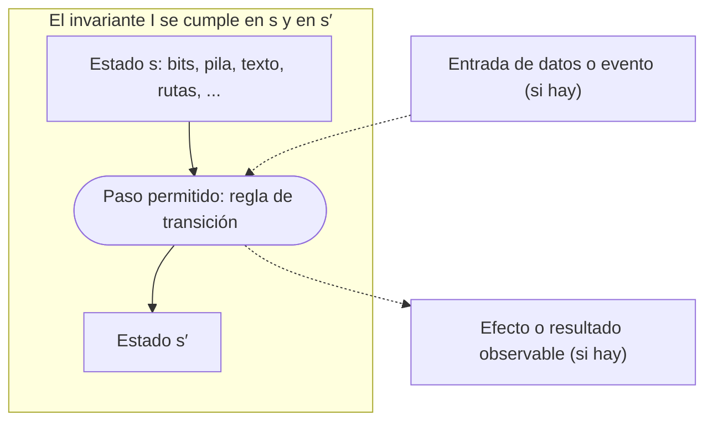

Para una lectura avanzada con trazas y experimentos, consulta la [guía de estudio sobre el estado y el control más allá de las variables](../guias-de-estudio/conceptos/estado-y-control-mas-alla-de-las-variables.md).

Antes de decir que un motor de expresiones regulares, una herramienta de compilación o un archivo de marcado "computa", tienes que decir qué es una máquina. La respuesta es más sencilla de lo que quizá imaginas. Una máquina tiene un **estado**, un conjunto de **pasos** permitidos y una forma de **representar** sus valores. También tiene hechos que se mantienen durante la ejecución (**invariantes**). Si puedes nombrar esos cuatro elementos, ya identificaste la máquina.

La imagen muestra las cuatro partes sin nombrar ningún componente físico: el estado y su representación, un paso permitido y el invariante que se cumple antes y después del paso. La pila de capturas de un motor de expresiones regulares, un grafo de dependencias de Make y un búfer de editor encajan en esta plantilla. La plantilla no exige un número finito de estados, una entrada de datos y una salida explícitas ni instrucciones de máquina.

El primer objetivo de este libro es precisamente que adquieras ese hábito: *identifica la máquina que se esconde en el lenguaje*. Una máquina de pila, una máquina de registros y un sistema de reescritura pueden computar lo mismo, pero guardan su memoria en lugares distintos. Los conceptos de este capítulo te dan el vocabulario: sistemas de transición, semántica operacional (estado, un paso a la vez), máquinas de Turing, algoritmos de Márkov y completitud de Turing. Hay otra pregunta: ¿qué parte de un diseño *computa* y qué parte solo decide qué se ejecuta después ([[computation-versus-orchestration]])? El capítulo "Estado más allá de las variables" retoma la pregunta que más importa en este repositorio: ¿dónde vive el estado?
