Para una lectura avanzada con trazas y experimentos, consulta la [guía de estudio sobre evaluación, demanda y pereza](../guias-de-estudio/conceptos/evaluacion-demanda-y-pereza.md).

¿Cuándo se calcula un valor: cuando lo escribes, cuando lo necesitas por primera vez o cada vez que lo pides? Esa es la pregunta de la **estrategia de evaluación**. El código puede verse igual en distintos lenguajes y dar respuestas distintas.

Haskell usa evaluación perezosa: un solo `span` sobre una lista infinita basta como regla de parada porque solo se calcula la parte necesaria. LINQ usa ejecución diferida: una canalización no hace nada hasta que alguien la enumera. APL usa evaluación inmediata y trabaja con arreglos enteros a la vez. Por eso, sortea más números de los que necesita y recorta el resultado. Cuando hay efectos, la elección deja de ser un detalle. Si una lista perezosa realiza operaciones de entrada de datos y salida, *leer la lista* es lo que hace el trabajo. Este capítulo explica el vocabulario: estrategias y cortocircuitos, iteradores y generadores, funciones de primera clase y de orden superior, funtores y `map`. También abarca monoides y pliegues (y por qué `reduce` no puede detenerse antes del final) y el flujo de datos. La tabla final reúne las estrategias de todas las entradas.

```mermaid
flowchart TB
    accTitle: Pedir el mismo prefijo puede implicar distinto trabajo
    accDescr: Tres filas muestran a un consumidor que pide solo los dos primeros elementos de una secuencia de cinco. En la fila de evaluación inmediata, primero se calculan los cinco valores, del 1 al 5. El consumidor toma 1 y 2. Los valores del 3 al 5 se calcularon y quedaron sin usar. En la fila de evaluación perezosa por necesidad se crean thunks, cálculos suspendidos que se evalúan cuando se fuerzan. El consumidor pide el valor 1, que se evalúa y se guarda. Luego pide el 2, que también se evalúa y se guarda. Los valores del 3 al 5 nunca se evalúan. En la fila de la canalización diferida, al definirla no se hace ningún cálculo. Al enumerarla, se calculan y se entregan los valores 1 y 2. Enumerarla de nuevo puede repetir el trabajo porque la ejecución diferida no memoiza resultados automáticamente.
    subgraph DEFER["Diferida, como en LINQ"]
        D1["Definir: aún sin cálculo"] --> D2["Enumerar: 1, 2"] --> D3["Volver a enumerar: puede recalcular"]
    end
    subgraph LAZY["Perezosa, por necesidad"]
        L1["Crear thunks"] --> L2["Demanda del 1: guardar"] --> L3["Demanda del 2: guardar"] --> L4["Del 3 al 5: sin ejecución"]
    end
    subgraph EAGER["Inmediata, como en un arreglo"]
        E1["Construir"] --> E2["Calcular del 1 al 5"] --> E3["El consumidor toma 1, 2"] --> E4["Del 3 al 5: sin usar"]
    end
    classDef unused stroke-dasharray: 5 3
    class E4,L4,D3 unused
```

Los valores del 1 al 5 son solo una muestra. La llamada por necesidad de Haskell *recuerda* un valor evaluado. En cambio, una canalización enumerable diferida suele recalcularlo cada vez que la enumeras. APL suele evaluar un arreglo entero, así que se parece más a la fila de evaluación inmediata. La imagen compara estrategias sin reproducir la traza exacta de ninguna entrada.

{{table:evaluation}}
