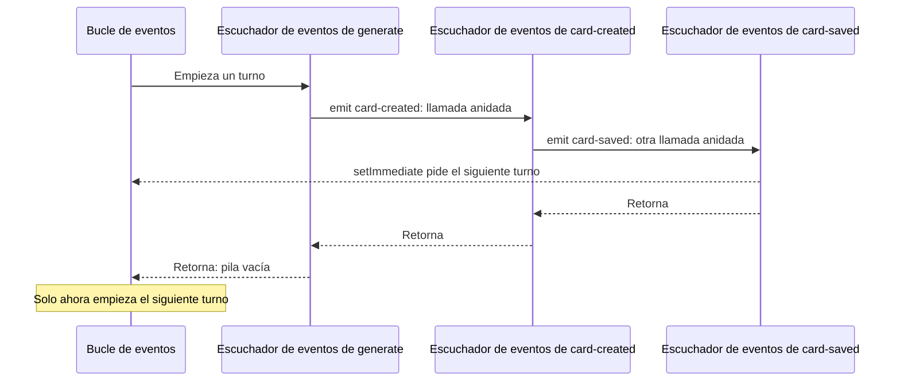

Para una ruta de lectura avanzada con trazas y experimentos, consulta la [guía de estudio sobre eventos, funciones de devolución de llamada y control reactivo](../guias-de-estudio/conceptos/eventos-retrollamadas-y-control-reactivo.md). Una función de devolución de llamada (*callback*) es una función que se entrega para que otro código la llame.

Cada entrada de este libro responde una pregunta: **¿quién decide qué se ejecuta después?** En un bucle `for`, el bucle decide. En una canalización con evaluación perezosa, decide quien pide el siguiente valor. En este capítulo decide otra cosa: un *evento*, un aviso de que ocurrió algo. Un programa registra funciones pequeñas y otra parte del sistema las llama cuando ocurre algo. El programa no dice cuándo.

Eso suena a una ventana con botones, pero es una forma general de organizar el flujo de control. Este libro la muestra con ejemplos pequeños y sin trucos ocultos. [[entry:javascript-events]] usa solo diez escuchadores de eventos en un emisor. Un escuchador es una función que se registra para un evento y el emisor anuncia el evento. No hay ninguna sentencia de bucle. Los demás capítulos muestran cómo un contador, una demanda o una reescritura decide qué código se ejecuta. Este muestra qué cambia cuando la que decide es una *notificación*.

## ¿Quién decide qué se ejecuta después?

Las entradas dan tres respuestas para la misma tarea (dejar de sacar tarjetas cuando el total pasa de 40):

- **El programa decide** (un bucle). `while (total <= 40) { ... }`. El programa se hace la pregunta antes de cada tarjeta. [[entry:javascript]] y [[entry:cobol]] funcionan así.
- **El consumidor decide** (por demanda). No ocurre nada hasta que alguien pide el siguiente valor. [[entry:javascript-weird]] y [[entry:haskell]] funcionan así. Pedir una y otra vez es el bucle.
- **El productor decide** (por envío). Algo anuncia "esto ocurrió" y se ejecutan todas las funciones que se registraron para ese aviso. [[entry:javascript-events]] funciona así. También [[entry:tar-gnu-weird]]: tar anuncia "se escribió un registro más" y una máquina de estados avanza un paso.

Hay dos formas de saber que algo ocurrió: **sondeo** y **notificación**. El sondeo es un bucle que pregunta "¿ya está?" una y otra vez. La notificación requiere registrarse: "llámame cuando esté". En el sondeo, el costo es el tiempo que pasa sin que ocurra nada. En la notificación, el costo es de *estructura*: el orden del programa queda repartido entre los lugares donde se registran y se anuncian los avisos.

## Tres formas de ejecutar el mismo proceso con las tarjetas

| | Un bucle | Un emisor síncrono | Eventos programados |
|---|---|---|---|
| Ejemplo | [[entry:javascript]] | Los mismos escuchadores de eventos, con `emit('generate')` en lugar de `later('generate')` | [[entry:javascript-events]] |
| Quién inicia la siguiente tarjeta | La sentencia `for` | El último escuchador de eventos, que llama a `emit` | El último escuchador de eventos, que se lo pide al bucle de eventos |
| La pila de llamadas (que guarda las llamadas activas) entre dos tarjetas | Vacía | **Crece** unos cuantos marcos por cada tarjeta | Vacía |
| Una ejecución de un millón de tarjetas | Sin problemas | `RangeError: Maximum call stack size exceeded` | Sin problemas |
| Un escuchador de eventos que lanza una excepción | No aplica | La excepción sube a quien llamó a `emit` y pasa por todas las tarjetas anteriores | La excepción llega a la función de devolución de llamada programada, así que cada escuchador captura la suya |
| Qué más se puede ejecutar entre dos tarjetas | Nada | Nada | Cualquier tarea del bucle de eventos: temporizadores, entrada y salida (I/O) u otros escuchadores de eventos |

La columna del medio tiene trampa. *Parece* un caso de eventos, pero se comporta como una recursión. En Node, `EventEmitter.emit()` llama a todos los escuchadores del evento en el orden en que se registraron **antes de retornar**. Si un escuchador de eventos vuelve a emitir, la pila crece. El bucle de eventos no interviene en absoluto. Solo una llamada a algo como `setImmediate()` le deja el siguiente paso al bucle de eventos. Primero se vacía la pila.

## Lee una traza

Una ejecución de [[entry:javascript-events]] con tres tarjetas de 19 horas. `>name` marca el inicio de un `emit` y `<name` marca su retorno:

```text
>start <start                              <- turn 1: asks for the first card, returns
>generate >card-created >card-saved >total-updated
<total-updated <card-saved <card-created <generate     <- turn 2: card 1, then the stack is empty
>generate >card-created >card-saved >total-updated
<total-updated <card-saved <card-created <generate     <- turn 3: card 2
>generate >card-created >card-saved >total-updated >finished >done
<done <finished <total-updated <card-saved <card-created <generate   <- turn 4: card 3 (57 hours)
```

El anidamiento muestra la pila de llamadas. Dentro de un turno, los eventos son *llamadas*: `card-created` se ejecuta dentro de `generate` y `generate` no puede retornar hasta que termine esa llamada. Entre turnos, la pila queda vacía y el bucle de eventos retoma el control. El diagrama:



## Qué reglas de Node importan aquí

Las fuentes son la [documentación de `events`](https://nodejs.org/api/events.html) de Node.js y su guía sobre el [bucle de eventos, los temporizadores y `process.nextTick()`](https://nodejs.org/en/learn/asynchronous-work/event-loop-timers-and-nexttick).

- **`emit()` es síncrono.** Los escuchadores de eventos se ejecutan en el orden en que se registraron, antes de que `emit` retorne. La documentación lo promete. No ocurre por accidente.
- **El nombre `error` es especial.** Si no hay un escuchador de eventos, `emit('error', e)` *lanza* `e`. Si no hay un escuchador para cualquier otro nombre, no pasa nada.
- **Cada `emit` usa una copia de la lista de escuchadores de eventos.** Si un escuchador quita o agrega escuchadores, cambia lo que hará el *siguiente* emit. La emisión en curso no cambia.
- **Los temporizadores, los trabajos inmediatos y las microtareas tienen un orden** que quizá no esperas. Cuando termina el código actual, Node ejecuta las funciones de devolución de llamada de `process.nextTick` y luego las de las promesas (microtareas). Después recorre el bucle de eventos: primero los temporizadores vencidos, luego las funciones de devolución de llamada de entrada y salida, después las de `setImmediate` y así sucesivamente. Si el módulo principal llama a `setTimeout(fn, 0)` y `setImmediate(fn)`, *no hay garantía* de cuál se ejecuta primero: depende de cuánto tardó en arrancar el proceso. Dentro de una función de devolución de llamada de entrada y salida, `setImmediate` siempre se ejecuta primero. Este comportamiento depende de la implementación. Es del tipo que describe [[hyrums-law]]. Por eso [[entry:javascript-events]] usa solo `setImmediate` y nunca depende del orden entre los dos.
- **Un `try` alrededor de `emit` no captura el fallo de un escuchador de eventos `async`.** El escuchador devuelve una promesa y `emit` ya retornó. La opción `captureRejections` convierte ese rechazo en un evento `error`.
- **Alguien debe hacerse cargo de los escuchadores de eventos.** Un escuchador que nadie retira puede mantener vivo un objeto entero. Node avisa cuando un evento tiene más de diez escuchadores, porque eso suele indicar una fuga. Un temporizador o un trabajo inmediato pendiente puede impedir que el proceso termine. Al terminar, [[entry:javascript-events]] retira todos los escuchadores. Su laboratorio comprueba que no quede ningún temporizador ni trabajo inmediato.

## Máquinas de estados, reentrada y finalización

Un programa de escuchadores de eventos es un [[transition-system]]: tiene un estado y los eventos provocan transiciones. [[entry:javascript-events]] guarda su estado en un solo objeto al que solo acceden los escuchadores. Cada escuchador es una transición. Dos preguntas permiten saber si un programa así está bien construido.

**¿Se puede volver a llamar a un escuchador de eventos mientras aún se ejecuta?** Eso es la *reentrada*. Un `emit` síncrono lo permite: un escuchador emite un evento y el escuchador de ese evento vuelve a emitir el primero. Eso es justo lo que ocurre en la columna síncrona de arriba. La pila paga el precio. La versión programada no admite esa reentrada porque la siguiente tarjeta se procesa en otro turno.

**¿Termina?** Una cadena de eventos que nunca se detiene es un bucle que nadie ve. El programa debe tener un escuchador de eventos que *no* anuncie el siguiente paso. También debe revertir lo que no se confirmó, cerrar la base de datos, retirar los escuchadores y detener los temporizadores. En [[entry:javascript-events]] esa función corresponde a `finished` (o a `failed`). Luego `done` retira todo.

Un escuchador de eventos no puede pausarse a mitad de camino y reanudarse después. Por eso una cadena de escuchadores no es una [[coroutine]]. Cada escuchador se ejecuta hasta el final y retorna. El siguiente empieza de cero. El estado debe quedar fuera de los escuchadores. Lo mismo ocurre con un [[closure]] que se usa como función de devolución de llamada: conserva variables, pero no conserva un *punto* para reanudar la ejecución.

## Contrapresión y cuándo conviene evitar los eventos

Una fuente de eventos anuncia lo que ocurre a su propio ritmo. Los eventos no tienen cómo decir "más despacio". Si el productor va más rápido que el consumidor, la cola crece sin límite o se pierden eventos. La **contrapresión** permite que el consumidor frene al productor. La demanda es la forma más simple: el consumidor pide un valor cuando está listo. [[entry:javascript-weird]] no se puede saturar, porque no extrae nada hasta que alguien llama a `next()`. [[entry:tar-gnu-weird]] muestra lo contrario. tar sigue escribiendo registros y llamando al reloj después de que la máquina termina. Esos tics solo cuentan como inactividad.

```mermaid
flowchart TB
    accTitle: Avisar no regula el flujo. La contrapresión se diseña
    accDescr: Dos paneles. En el envío sin regulación, un productor rápido manda eventos a una cola con 1, 2, 3, 4 y así sucesivamente. La cola sigue creciendo mientras un consumidor lento lee de ella. Por eso la cola crece o se pierden eventos. En el flujo por demanda, el consumidor pide un elemento cuando está listo. El productor emite uno. El consumidor lo procesa y pide el siguiente, así que marca el ritmo.
    subgraph PULL["Demanda del consumidor"]
        RDY["Consumidor: ¿listo?"] --> REQ["Pide un elemento"] --> EMIT["El productor emite uno"] --> PROC["El consumidor lo procesa"] --> NXT["Pide el siguiente"]
    end
    subgraph PUSH["Envío sin regulación"]
        FP["Productor rápido"] -->|"eventos"| Q["Cola: 1, 2, 3, 4, ... Crece o pierde eventos"] --> SC["Consumidor lento"]
    end
```



Decirle al consumidor "ocurrió algo" no le dice al productor que baje el ritmo. A la izquierda, nada limita el ritmo. A la derecha, lo limita la solicitud del consumidor. Una cola acotada o un flujo que se pueda pausar y reanudar también pueden ejercer contrapresión. El `EventEmitter` básico de Node carece de contrapresión. Un `emit()` síncrono es una llamada, no una cola. La traza de arriba muestra el orden de las llamadas. Este diagrama muestra sus *ritmos*.

[[entry:javascript-events]] evita la avalancha por una razón sencilla: cada tarjeta espera a la anterior, así que el productor y el consumidor son el mismo programa. Una fuente real de eventos, como un socket de red, necesita una cola acotada o un flujo.

Los eventos tampoco convienen cuando:

- hay exactamente un escuchador de eventos y siempre es el mismo. Una llamada a una función dice lo mismo y es más corta. Un depurador permite recorrerla paso a paso;
- el orden debe ser evidente. Con eventos, el orden está en los nombres y en la secuencia de registro;
- necesitas que te devuelvan un resultado. Un evento anuncia algo y no responde.

## Eventos en este repositorio y casos que solo se les parecen

No toda función de devolución de llamada es un evento ni toda ventana se rige por eventos. La tabla muestra qué tiene realmente cada entrada.

| Entrada | Qué tiene | ¿El programa se rige por eventos? |
|---|---|---|
| [[entry:javascript-events]] | Diez escuchadores de eventos en un emisor, `setImmediate` entre tarjetas y un temporizador para el pulso | **Sí.** Los escuchadores de eventos son el programa |
| [[entry:javascript]] | Una sentencia `for` y luego una función de devolución de llamada de `setInterval` para el pulso | Solo el pulso. Un bucle procesa las tarjetas |
| [[entry:javascript-weird]] | Una canalización por demanda y luego el mismo temporizador | Solo el pulso. Las tarjetas se obtienen bajo demanda |
| [[entry:tar-gnu-weird]] | tar ejecuta un comando en cada punto de control | **Sí.** Una función de devolución de llamada externa hace que una máquina de estados avance un paso. No hay bucle en el programa |
| [[entry:regex-pcre2]] | El motor llama a una función en cada callout | Una **función de devolución de llamada** síncrona. El motor la llama directamente, sin poner un evento en una cola |
| [[entry:tcl-weird]] | Un disparador llama a una función de SQL que a su vez llama a Tcl | Una **cadena de funciones de devolución de llamada** en una sola pila de llamadas. La base de datos despacha las llamadas y nada espera en una cola |
| [[entry:ModernChallenge1]], [[entry:LinqChallenge1]], [[entry:xaml]] | Una ventana de WPF con su bucle de mensajes (`Application.Run`) y una animación iniciada por un disparador `Loaded` | **No.** La infraestructura de la interfaz de usuario tiene un bucle de eventos. El programa declara una animación, sin suscribirse a ella. Las tarjetas salen de una sentencia `for`, una canalización de LINQ y un analizador sintáctico |
| [[entry:PythonChallenge1]], [[entry:RustChallenge1]] | Un `mainloop` de Tk y un `MainLoop` de GLib, con un temporizador que cambia un color | **No.** Igual que antes: la ventana ejecuta su propio bucle y las tarjetas se crean antes de abrirla |
| [[entry:JavaChallenge1]], [[entry:KotlinChallenge1]], [[entry:GoChallenge1]] | Un cuadro de diálogo modal de Swing con un temporizador que atenúa los colores (Java, Kotlin) y una página que se sirve al navegador (Go) | **No.** La ventana se abre al final y las tarjetas salen de una sentencia `for` o de una secuencia |

Una infraestructura de animación, el enlace de datos y el propio bucle de una ventana son *mecanismos* que usan eventos. Eso no hace que el programa que los inicia se rija por eventos. La prueba es sencilla: **¿la lógica de las tarjetas se ejecuta porque llegó un evento?** Si la respuesta es "no, la ejecuta un bucle o una canalización y luego se abre una ventana", la entrada es un bucle con ventana.

## Predice y luego ejecuta

El [ejercicio B22](../exercises.md#b22-javascript-dirigido-por-eventos-predice-la-traza-y-luego-elimina-el-límite-verificado) te pide que escribas la traza de una ejecución *antes* de verla y que predigas qué imprimen `emit` y `setImmediate`. También te pide que quites la separación entre turnos y veas cómo un millón de tarjetas agotan la pila. Haz primero la predicción en papel. La gracia está en la sorpresa.
