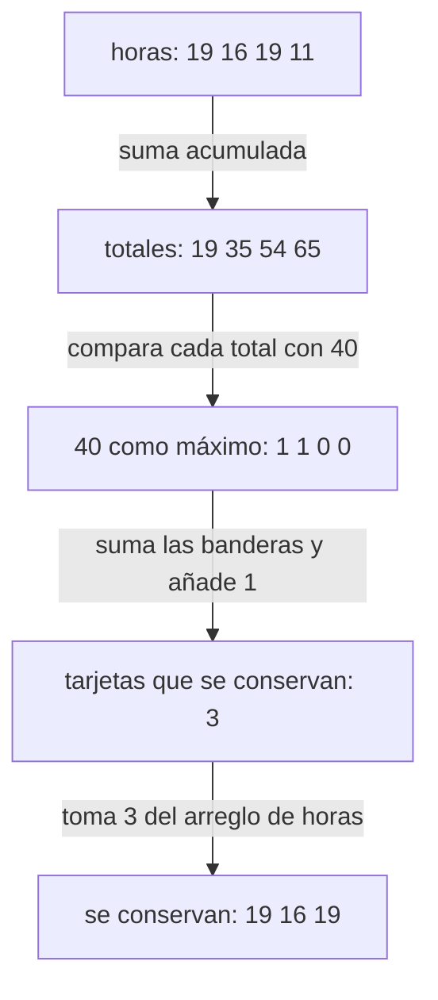

La programación con arreglos aplica una operación a todo un arreglo de una vez. Los escalares se extienden para ajustarse al arreglo y los bucles explícitos casi desaparecen. Kenneth Iverson inventó APL para esto en los años 1960 y la idea sigue viva en J, K, R, MATLAB y NumPy. Existe porque acorta el código y porque el hardware puede procesar muchos elementos a la vez (SIMD y GPU). [[entry:apl]] muestra el estilo. Cinco extracciones al azar, una suma acumulada `+\` y una selección que se detiene cuando deja de cumplirse la condición sustituyen al bucle. Describe la respuesta completa y luego recórtala.

Lee la imagen de arriba abajo. Cada paso es una operación sobre un arreglo completo. Ningún paso es un bucle. La comparación da una bandera para cada total, todas a la vez. Cada bandera indica si el total cumple la condición. Cuenta las banderas con valor 1 y añade uno. Ese es el número de tarjetas que se conservan, porque también se guarda la tarjeta con la que el total pasa de 40. [[entry:apl]] funciona así. Estos números solo son un ejemplo. La idea no depende de los símbolos de APL.

- **Úsala cuando:** trabajes con números, tablas y señales.
- **Evítala cuando:** el algoritmo deba avanzar un paso tras otro o los arreglos intermedios no quepan en memoria. Recuerda también que una notación densa es difícil para un equipo que no la sabe leer.

**Lee más:**

- [Programación con arreglos](https://en.wikipedia.org/wiki/Array_programming) (Wikipedia)
- [APL (lenguaje de programación)](https://en.wikipedia.org/wiki/APL_(programming_language)) (Wikipedia)
- [Kenneth E. Iverson](https://en.wikipedia.org/wiki/Kenneth_E._Iverson) (Wikipedia)
- [Una instrucción, múltiples datos](https://en.wikipedia.org/wiki/Single_instruction,_multiple_data) (Wikipedia)
