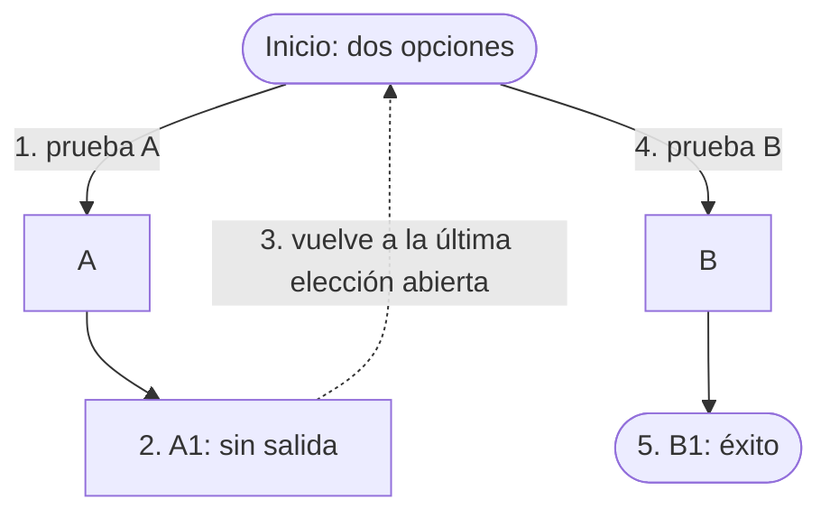

El retroceso es una búsqueda sistemática. Prueba una opción y sigue. Si te atascas, deshaz la elección y prueba la siguiente. Sirve para problemas con muchas respuestas posibles y reglas para descartar algunas: acertijos, análisis sintáctico y búsqueda de coincidencias con patrones. Los motores de expresiones regulares de Perl, PCRE2 y .NET funcionan así. Las entradas de este repositorio le dan la vuelta: *haz el trabajo mediante efectos secundarios y luego provoca un fallo a propósito.* La coincidencia devuelve falso solo después de escribir todas las filas. Lo que sobrevive al fallo es toda la lección. El motor restaura las variables `local` de Perl, pero no puede deshacer sus llamadas a `INSERT` y `print`. [[entry:regex-dotnet]] no puede jugar a esto porque .NET descarta las capturas de una coincidencia fallida.

La búsqueda recuerda las elecciones que aún tienen alternativas sin probar. Cuando falla un camino, vuelve a la más reciente. Aquí vuelve al inicio, donde `B` sigue pendiente. Deshacer una elección revierte el estado de la búsqueda, pero no el mundo exterior. Como dice el párrafo anterior, una fila escrita en un camino fallido queda escrita.

- **Úsalo cuando:** el espacio de búsqueda sea pequeño o puedas reducirlo pronto.
- **Evítalo cuando:** los efectos no se puedan deshacer o la entrada de datos venga de un atacante (consulta [[redos]]).

**Lee más:**

- [Retroceso](https://en.wikipedia.org/wiki/Backtracking) (Wikipedia)
- [Expresión regular](https://en.wikipedia.org/wiki/Regular_expression) (Wikipedia)
