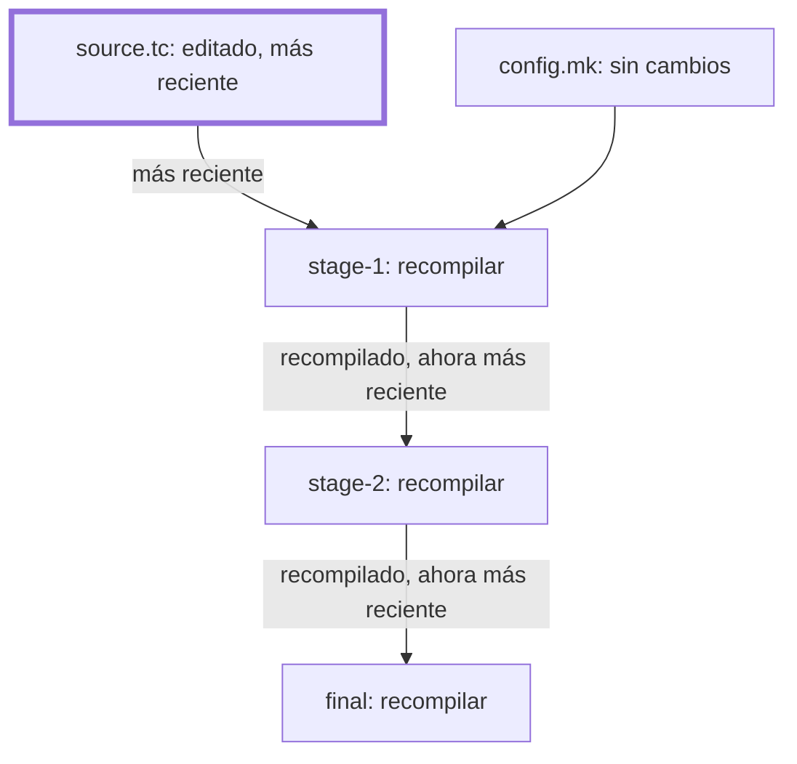

Las herramientas de automatización de la compilación solo reconstruyen lo que cambió y siguen el orden de las dependencias. El ejemplo clásico es Make, creado en Bell Labs en 1976. CMake y Gradle son ejemplos modernos. Existen porque compilar todo cada vez es lento y porque compilar en el orden equivocado da mal resultado. El estado de una compilación son *archivos*: cuáles existen y cuáles son más recientes que sus dependencias. Eso convierte a una herramienta de compilación en una computadora extraña. [[entry:make-gnu]] cuenta con archivos que crea de uno en uno en cada vuelta. Para repetir el bucle, hace que Make vuelva a leer un makefile generado. [[entry:cmake]] forma un bucle con un `while()` cuya expresión regular deja los resultados en variables.

La herramienta compara las fechas de los archivos siguiendo las flechas. `source.tc` es más reciente que `stage-1`, así que `stage-1` queda obsoleto y se recompila. Así se vuelve más reciente que `stage-2` y el proceso sigue por la cadena. `config.mk` no cambió, así que no hay trabajo por hacer ahí. La herramienta decide qué ejecutar y en qué orden. No pasa valores de un paso al siguiente como lo hace [[dataflow-programming]]. Algunas entradas convierten este mecanismo de decisión en un bucle. [[entry:make-gnu]] vuelve a crear un makefile generado y luego empieza de nuevo el recorrido.

- **Úsala cuando:** compiles, empaquetes o generes archivos a partir de otros archivos.
- **Evita usarla como computadora de propósito general.** Las marcas de tiempo pueden tener poca resolución (WSL y algunos sistemas de archivos). Una compilación que depende de estado oculto no es reproducible.

**Lee más:**

- [Automatización de la compilación](https://en.wikipedia.org/wiki/Build_automation) (Wikipedia)
- [Make (programa)](https://en.wikipedia.org/wiki/Make_(software)) (Wikipedia)
- [Compilaciones reproducibles](https://en.wikipedia.org/wiki/Reproducible_builds) (Wikipedia), la idea detrás de la compilación determinista de este libro
