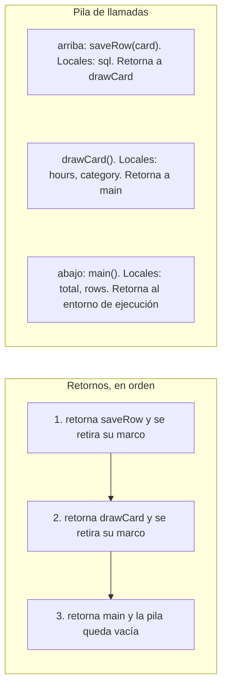

La pila de llamadas es una pila de *marcos*. Cada llamada a una función que sigue activa tiene un marco. Este guarda su dirección de retorno y sus variables locales. Así una función puede llamar a otra y la recursión funciona. Para la mayoría de los programadores, la pila de llamadas *es* la respuesta a "¿en qué parte del programa estoy?". Varias entradas prescinden de ella o la esquivan. Un script de sed no hace llamadas. m4 y Make repiten al volver a leer texto. En [[entry:tcl-weird]], el límite a la recursión de disparadores lo impone la base de datos y no una pila que puedas ver.

Cada llamada activa tiene su propio marco y el marco más reciente queda arriba. Cuando `saveRow` retorna, se retira su marco. La ejecución sigue en la dirección de retorno que guardaba el marco, dentro de `drawCard`. Los nombres son ejemplos. La estructura exacta de un marco varía entre lenguajes y procesadores. Consulta [[stack-data-structure]] para ver la idea general de una pila.

- **Úsala cuando:** leas una traza de pila o razones sobre la profundidad de la recursión.
- **Evítala cuando:** la profundidad de la recursión no tenga límite. Un desbordamiento de pila termina el programa. En lenguajes sin garantías de seguridad, puede abrir una brecha de seguridad.

**Lee más:**

- [Pila de llamadas](https://en.wikipedia.org/wiki/Call_stack) (Wikipedia)
- [Desbordamiento de búfer en la pila](https://en.wikipedia.org/wiki/Stack_buffer_overflow) (Wikipedia)
- [Llamada de cola](https://en.wikipedia.org/wiki/Tail_call) (Wikipedia)
