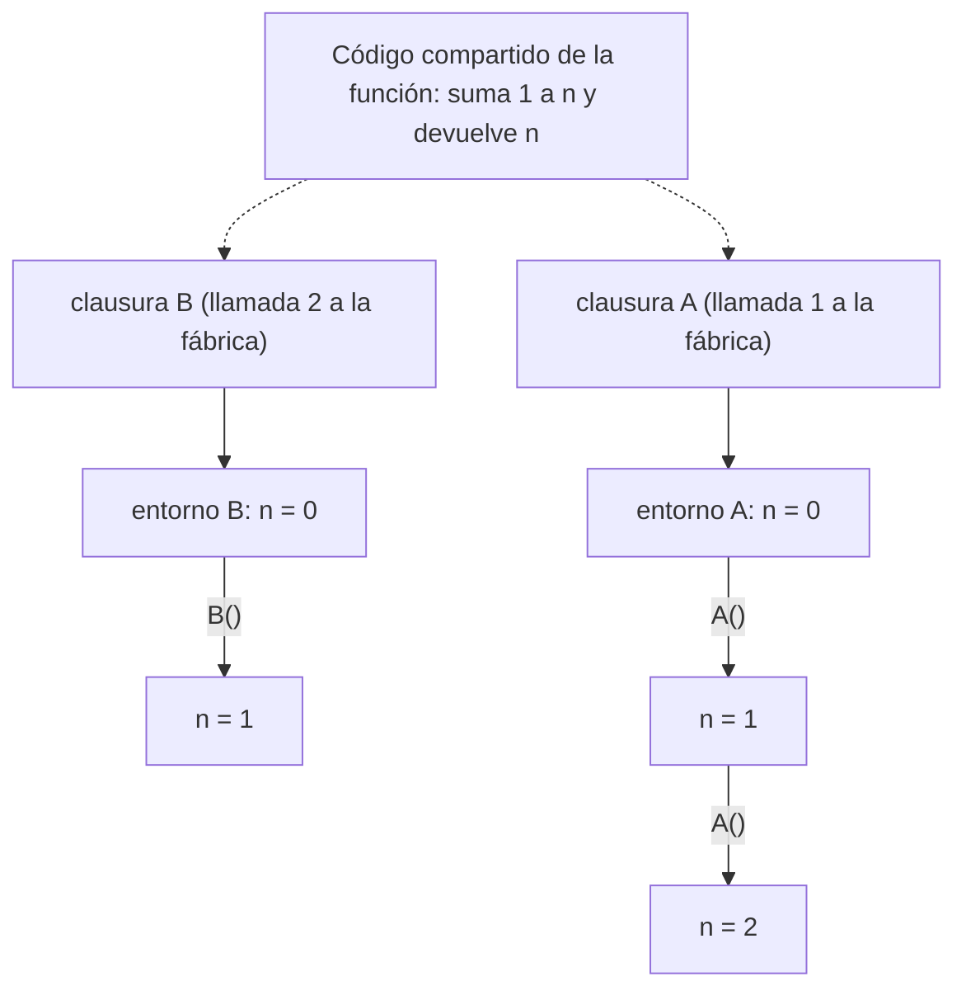

Una **clausura** (*closure*) es una función junto con las variables que tenía a su alrededor al crearse. Esas variables son su **entorno léxico**: los nombres que estaban en el ámbito donde se escribió la función. La función las mantiene vivas después de que termina el código que las creó. Por eso una función puede recordar un conteo, un total o una semilla entre llamadas y nada más puede acceder a esos datos.

```js
const counter = () => { let n = 0; return () => ++n; };   // `n` lives on, inside the returned function
const next = counter(); next(); next();                   // 1, then 2
```



Cada cuadro debajo de una clausura es su *propio* entorno. Al crear la clausura, el número no se copia al código. El marco de la llamada a la fábrica puede retirarse y la variable capturada sigue viva mientras se pueda acceder a la clausura. Son dos llamadas distintas a la fábrica. Dos funciones creadas en *una sola* llamada a la fábrica que capturaran la misma variable la compartirían, como se explica abajo.

Sé preciso en tres puntos:

- **Una clausura captura variables, no valores.** Dos clausuras que capturan la misma variable la comparten. Si una la cambia, la otra ve el cambio. Cada llamada a una fábrica como `counter()` crea una variable *nueva*, así que dos contadores nunca comparten estado. Las lambdas de C# se comportan igual.
- **La sintaxis lambda no es una clausura.** `x => x + 1` no usa ninguna variable externa, así que no hay nada interesante que capturar. Una función flecha que actualiza una variable que sobrevive a la llamada sí es una clausura que importa.
- **Una clausura no es una continuación.** Puedes volver a llamarla y ejecutará el paso *siguiente*. No puedes entregarle "el resto del cálculo", reanudarla a mitad de algo ni volver atrás. Consulta [[continuation]]. `this` tampoco es una variable capturada. Un método que usa `this.n` pierde su `n` cuando lo separas de su objeto, mientras que una clausura conserva su variable.

El entorno vive mientras se pueda acceder a la función. Cuando nada apunta a la función, el motor puede recuperar su memoria y la de sus variables. [[entry:javascript-weird]] arma todo su algoritmo con tres clausuras: una fuente de números con semilla, una máquina de tarjetas y un iterador que la envuelve. Su script de comprobación demuestra cada afirmación de esta página, incluida la del tiempo de vida, con un `WeakRef` y una recolección de basura forzada. [[entry:javascript]] usa una clausura que captura la semilla de sus números aleatorios. [[entry:RustChallenge1]] y [[entry:ModernChallenge1]] usan clausuras (y una lambda de C#) para llevar trabajo a lugares que esperan un valor.

- **Úsala cuando:** necesites estado privado sin una clase, una función que configuras una vez y llamas muchas veces o una función de devolución de llamada (*callback*) que deba recordar algo.
- **Evítala cuando:** el estado oculto haga difícil probar o leer el programa. Las variables capturadas no aparecen en el depurador como los campos. Una cadena larga de clausuras es difícil de seguir.

**Lee más:**

- [Clausura (programación)](https://en.wikipedia.org/wiki/Closure_(computer_programming)) (Wikipedia)
- [Ámbito (ciencias de la computación)](https://en.wikipedia.org/wiki/Scope_(computer_science)) (Wikipedia)
- [Clausuras](https://developer.mozilla.org/en-US/docs/Web/JavaScript/Guide/Closures) (MDN)
