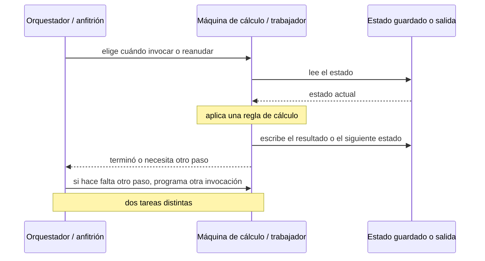

En cada programa se esconden dos tareas. El **cálculo** produce valores nuevos: la suma, la decisión de detenerse o la siguiente tarjeta. La **orquestación** decide qué se ejecuta después y en qué orden: el bucle, las funciones de devolución de llamada (*callbacks*) o el despacho. Cuando una entrada dice "el motor de expresiones regulares hace el trabajo" o "tar es el bucle", pregunta a cuál de las dos tareas se refiere.

Las entradas responden de distintas maneras:

- En [[entry:tar-gnu]], tar *orquesta*: recorre los miembros en orden. Un despachador pequeño *calcula*: le da sentido a cada uno de los cinco tipos de registro. Los datos del programa (los dados, el orden y el límite) están en el archivo.
- En [[entry:tar-gnu-weird]], tar solo aporta el *tiempo*: un pulso por registro. Una sola transacción SQL calcula todo lo demás.
- En [[entry:ed-weird]] y [[entry:ex-weird]], un lanzador se ocupa de los *extremos* (cinco dígitos al azar y una escritura en la base de datos). El editor hace los cálculos y ordena los pasos.
- En [[entry:regex-pcre2]], el motor de expresiones regulares orquesta mediante coincidencias y retrocesos. Un despachador de C sin cuerpo calcula qué significa cada callout. [[entry:xaml]] deja que el analizador sintáctico orqueste: el orden del documento determina el orden de ejecución.
- En [[entry:javascript-weird]], el consumidor orquesta (pide la siguiente tarjeta) y tres clausuras calculan. Las partes impuras, como la base de datos, el reloj y la pantalla, quedan en el borde.

Nombrar esa división te dice dónde puede estar un bicho, qué probar y de qué tomaría control un atacante. También aclara el truco. Si la parte "rara" solo orquesta mientras un programa común calcula, lo único que cambia es el disfraz.

El anfitrión decide *cuándo* y el trabajador decide *cuál es el siguiente valor*. En [[entry:tar-gnu-weird]], los puntos de control de tar hacen de anfitrión y una transacción SQL hace de trabajador. En [[entry:tar-gnu]], tar recorre el archivo y un despachador le da sentido a cada registro. La imagen muestra dos *papeles*. Un componente de software puede cumplir ambos. Un orquestador también puede calcular.

- **Usa la distinción cuando:** revises un diseño inusual o escribas una prueba que deba demostrar que una herramienta específica hace el trabajo de interés.
- **Evita la distinción cuando:** las dos tareas sean la misma, como en una expresión pura. No inventes una separación.

**Lee más:**

- [Separación de responsabilidades](https://en.wikipedia.org/wiki/Separation_of_concerns) (Wikipedia)
- [Orquestación (informática)](https://en.wikipedia.org/wiki/Orchestration_(computing)) (Wikipedia)
