Una continuación es "el resto del cálculo" a partir de un punto, tratado como un valor. Si pudieras pausar un programa y preguntar "¿qué harás después?", la respuesta sería la continuación. En el *estilo de paso de continuaciones*, cada función recibe un argumento extra: una función que indica qué hacer con el resultado. Existe porque permite expresar la salida anticipada, las excepciones, los generadores, el retroceso y `async`/`await` con llamadas a funciones comunes. Basta con que "¿qué sigue?" sea un valor. Las entradas de aquí eligen a propósito "¿qué sigue?". El `ALTER` de COBOL reescribe la respuesta. El `>in` de Forth la rebobina. El reinicio de Make es "el resto de la compilación, otra vez".

```mermaid
flowchart TB
    accTitle: Una continuación identifica lo que falta por calcular. Una llamada común solo retorna a quien la hizo
    accDescr: Dos paneles en paralelo. En una llamada común, quien llama hace A y luego llama a B. B termina y devuelve el control a quien lo llamó, que hace C. La pila de quien llama guarda el punto de retorno. Con una continuación explícita, el programa hace A y captura K, el valor que representa lo que sigue. Ejecuta otra cosa, invoca K más tarde y luego hace C. K aparece en un cuadro aparte porque es un valor que representa el control pendiente.
    subgraph CONT["Continuación explícita"]
        A2["Haz A"] --> CAP[("captura K: lo que sigue")] --> OTH["ejecuta otra cosa"] --> RES["invoca K"] --> C2["Haz C"]
    end
    subgraph CALL["Llamada y retorno comunes"]
        A1["Quien llama: haz A"] --> B1["llama a B: el punto de retorno queda en la pila"] --> B2["B termina"] --> C1["Quien llama: haz C"]
    end
```

A la izquierda, el punto de retorno queda oculto en la pila de quien llama. La función llamada no puede nombrarlo. A la derecha es un valor, `K`, que se puede guardar, pasar y usar después (o nunca). El destino mutable de `GO TO` en COBOL, `>in` en Forth y el estado de reinicio de Make son *analogías* del control guardado fuera de la pila de llamadas. Ninguno captura una continuación de primera clase. Una función de devolución de llamada (*callback*) común o una clausura (*closure*) tampoco lo son.

- **Úsala cuando:** escribas un compilador, una biblioteca asíncrona o un marco de trabajo web con funciones de devolución de llamada.
- **Evítala cuando:** programes a mano en un lenguaje sin llamadas de cola. El código se vuelve una serie de funciones de devolución de llamada anidadas. La pila crece.

**Lee más:**

- [Continuación](https://en.wikipedia.org/wiki/Continuation) (Wikipedia)
- [Estilo de paso de continuaciones](https://en.wikipedia.org/wiki/Continuation-passing_style) (Wikipedia)
- [Llamada con la continuación actual](https://en.wikipedia.org/wiki/Call-with-current-continuation) (Wikipedia)
