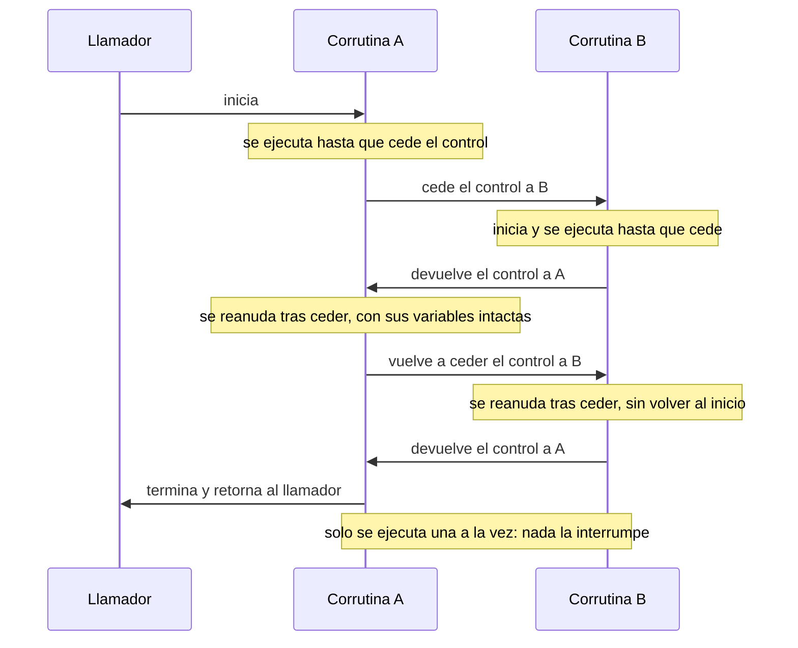

Una corrutina es una función que puede pausarse a mitad de su ejecución y reanudarse después con sus variables locales intactas. Las funciones comunes se ejecutan de principio a fin. Una corrutina puede entregar un valor a quien la llamó, esperar y seguir cuando se lo pidan. Sirve para productores y consumidores, para generadores y para la multitarea cooperativa (`async`/`await` se basa en esta idea). Varias entradas son corrutinas disfrazadas. Un iterador de Rust hecho con `successors`, un `generateSequence` de Kotlin y el `iter(step, False)` de Python producen el siguiente valor solo cuando el bucle lo pide.

El control cambia solo cuando una corrutina lo cede, así que solo se ejecuta una rutina a la vez. Esa es la diferencia con los hilos. Nada interrumpe a una corrutina para quitarle el control y nada se ejecuta en paralelo. Una corrutina que se reanuda sigue después de su último `yield`, con sus variables locales tal como las dejó. Una llamada común volvería a empezar desde el principio.

- **Úsala cuando:** proceses un flujo o quieras que dos partes del código se turnen sin hilos.
- **Evítala cuando:** necesites paralelismo real o los muchos puntos de pausa dificulten seguir el programa.

**Lee más:**

- [Corrutina](https://en.wikipedia.org/wiki/Coroutine) (Wikipedia)
- [[generators]] en "Evaluación y demanda"
