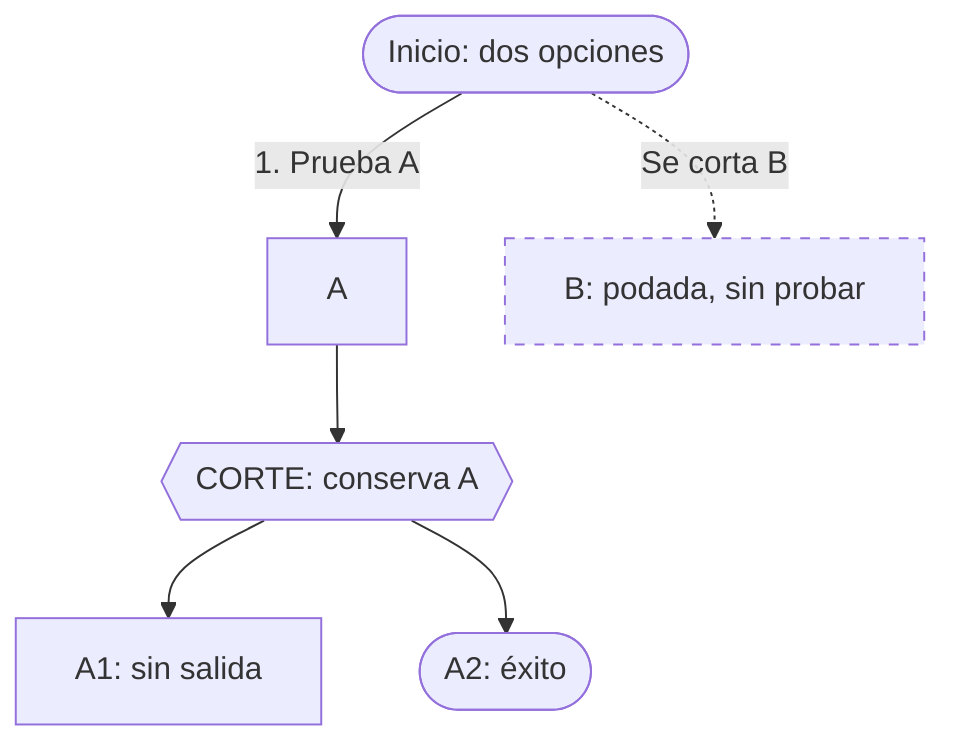

El *corte* es una idea de Prolog: una vez que el programa pasa por ese punto, conserva las opciones elegidas hasta allí y descarta las demás. Sirve para ganar velocidad y determinismo: no quieres que la búsqueda explore alternativas o repita trabajo que ya das por resuelto. Los motores de expresiones regulares tienen las mismas herramientas: `(*COMMIT)` de PCRE, grupos atómicos y cuantificadores posesivos. [[entry:regex-pcre2]] y las entradas afines terminan el patrón con `(*COMMIT)(*FAIL)`. Sin `(*COMMIT)` el motor volvería a probar con bucles más cortos y ejecutaría el finalizador más de una vez. Quienes programan en Prolog distinguen los cortes "verdes" (solo ganan velocidad) de los cortes "rojos" (cambian la respuesta).

Compara este dibujo con el retroceso simple. En ese caso, la búsqueda probaría `B` si fallara `A`. Aquí el corte conserva primero `A` y poda `B`. La búsqueda aún puede probar las alternativas que vienen *después* del corte (`A1` y luego `A2`). Si todas fallan, falla toda la búsqueda. No vuelve a `B`. Eso significa que "el corte cambia el espacio de búsqueda". El corte de Prolog también descarta las opciones elegidas antes en la misma cláusula. El dibujo muestra solo el caso más sencillo.

- **Úsalo cuando:** sepas que un fallo posterior nunca debe llevar a otro intento.
- **Evítalo cuando:** no sepas qué tipo de corte tienes. Un corte rojo esconde un cambio de lógica en un truco para ganar velocidad.

**Lee más:**

- [Corte (programación lógica)](https://en.wikipedia.org/wiki/Cut_(logic_programming)) (Wikipedia)
- [Prolog](https://en.wikipedia.org/wiki/Prolog) (Wikipedia)
