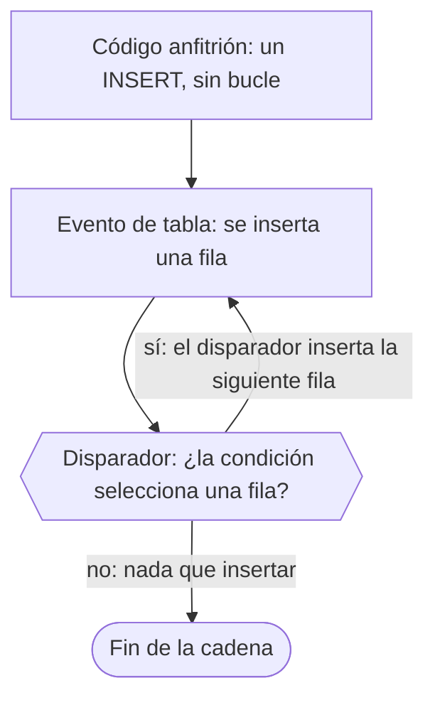

Un disparador es código que la base de datos ejecuta por sí sola al insertar, actualizar o borrar una fila. Sirve para mantener las reglas cerca de los datos: registros de auditoría, columnas derivadas y comprobaciones que una restricción `CHECK` no puede expresar. En [[entry:tcl-weird]] un disparador hace de bucle. Cada inserción activa el disparador, que inserta la siguiente fila hasta que una cláusula `WHERE` no encuentra nada que insertar. El costo es un flujo de control invisible. Nada en el código de la aplicación dice "esto también ocurre". El orden y la profundidad de los disparadores pueden sorprenderte.

El código anfitrión ejecuta un solo `INSERT` y no tiene bucle. El disparador pertenece a la tabla, así que cada inserción es un evento que lo activa. El `INSERT` del disparador también es un evento. Así un cambio causa el siguiente. Una cadena así solo termina porque al final la condición no selecciona ninguna fila. Las bases de datos toman precauciones. SQLite solo permite que un disparador se active a sí mismo si `PRAGMA recursive_triggers` está habilitado. [[entry:tcl-weird]] lo habilita a propósito.

- **Úsalo cuando:** necesites registros de auditoría o reglas que deban cumplirse sin importar quién escriba los datos.
- **Evítalo cuando:** quieras meter procesos de negocio en disparadores o usarlos como bucle del programa (como hace esta entrada a propósito).

**Lee más:**

- [Disparador de base de datos](https://en.wikipedia.org/wiki/Database_trigger) (Wikipedia)
- [SQLite](https://en.wikipedia.org/wiki/SQLite) (Wikipedia)
