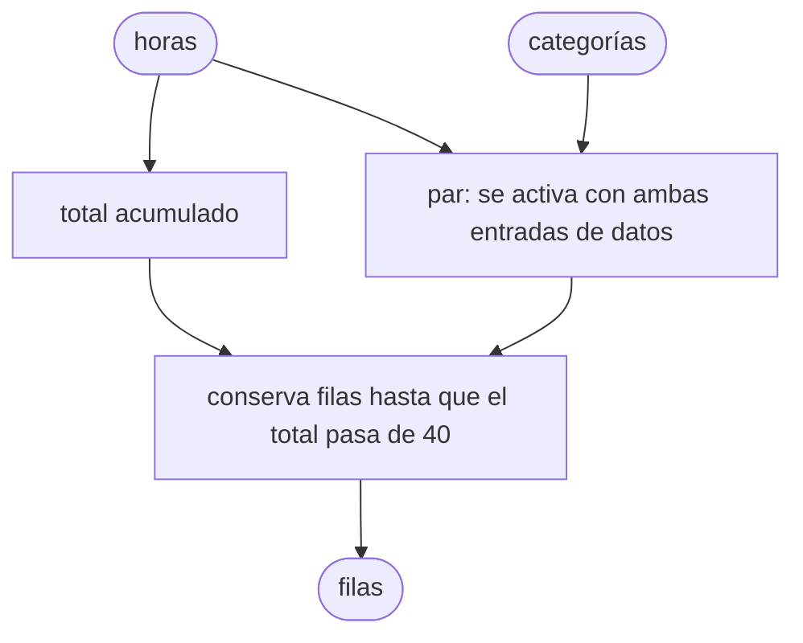

En la **programación por flujo de datos** describes cómo fluyen los valores de un paso al siguiente. Los datos determinan el orden de ejecución: un paso se ejecuta cuando su entrada de datos está lista o cuando alguien pide su salida. Una hoja de cálculo es el ejemplo conocido. Una consulta de LINQ y una canalización de iteradores son ejemplos pequeños. El programa es un grafo de pasos. La máquina decide cuándo ejecutar cada uno.

Cada flecha es una dependencia de datos: el nodo en la punta necesita un valor del nodo en la base. El nodo `pair` tiene dos entradas de datos y solo puede activarse cuando llegan ambas. El dibujo no dice qué nodo llama primero un programa. La llegada de valores lo decide. [[dependency-graph]] también dibuja flechas entre elementos, pero allí indican qué rehacer después de un cambio.

Esto importa aquí porque varias entradas trasladan el control de las sentencias a un grafo de este tipo. En [[entry:LinqChallenge1]] y [[entry:LinqChallenge2]] una consulta describe las tarjetas y el operador final las pide. En [[entry:javascript-weird]] la canalización `Iterator.from(...).map(...).map(...).toArray()` es una cadena de pasos. Cada tarjeta pasa por todos antes de que se pida la siguiente. [[entry:make-gnu]] tiene una forma parecida: un grafo de dependencias decide qué se ejecuta y en qué orden. Eso es *dependencia*, algo distinto del flujo de datos. Aquí sirve de analogía.

- **Úsala cuando:** el problema sea una serie de transformaciones y quieras que las dependencias determinen el orden.
- **Evítala cuando:** los pasos tengan efectos cuyo orden importe. El grafo de flujo de datos oculta el orden y un efecto que depende de él se convierte en un bicho.

**Lee más:**

- [Programación por flujo de datos](https://en.wikipedia.org/wiki/Dataflow_programming) (Wikipedia)
- [Canalización (software)](https://en.wikipedia.org/wiki/Pipeline_(software)) (Wikipedia)
