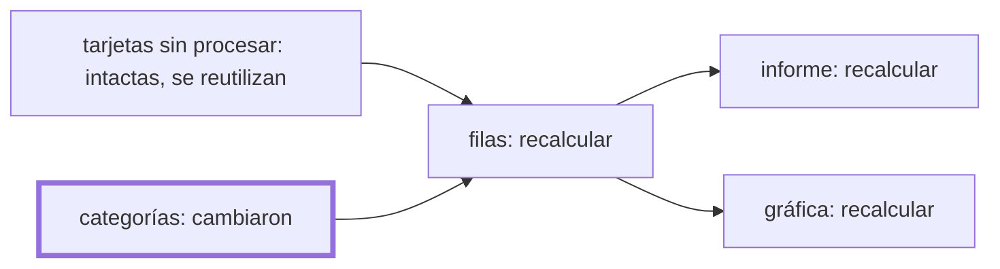

Un grafo de dependencias tiene un nodo por elemento y una flecha para decir "esto necesita aquello". Si no tiene ciclos, es un grafo dirigido acíclico. Una *ordenación topológica* da un orden que siempre funciona: primero construye lo que los demás elementos necesitan. Así las herramientas hacen solo el trabajo necesario, en el orden correcto y en paralelo cuando pueden. Make, los gestores de paquetes, las hojas de cálculo y los planificadores son motores de dependencias. Lo inusual de [[entry:make-gnu]] es que el grafo puede *cambiar durante el recorrido*: Make vuelve a generar un makefile incluido y empieza de nuevo con el grafo nuevo. Ese reinicio es el bucle.

Aquí cada flecha va de una entrada de datos al elemento que se construye a partir de ella. Así los cambios viajan por las flechas. (Algunos libros dibujan la flecha al revés, de un elemento al que necesita. Los hechos son los mismos). Solo cambió `categories`, así que solo hay que rehacer lo que depende de ese nodo. `raw cards` conserva su resultado anterior. El grafo dice qué se *debe* recalcular, pero no cuándo llegan los valores. Para eso, consulta [[dataflow-programming]].

- **Úsalo cuando:** el problema tenga la forma "A debe ir antes de B".
- **Evítalo cuando:** las dependencias formen un ciclo o el grafo deje algunas implícitas. Una dependencia oculta da resultados incorrectos en las compilaciones incrementales.

**Lee más:**

- [Grafo de dependencias](https://en.wikipedia.org/wiki/Dependency_graph) (Wikipedia)
- [Grafo dirigido acíclico](https://en.wikipedia.org/wiki/Directed_acyclic_graph) (Wikipedia)
- [Ordenación topológica](https://en.wikipedia.org/wiki/Topological_sorting) (Wikipedia)
