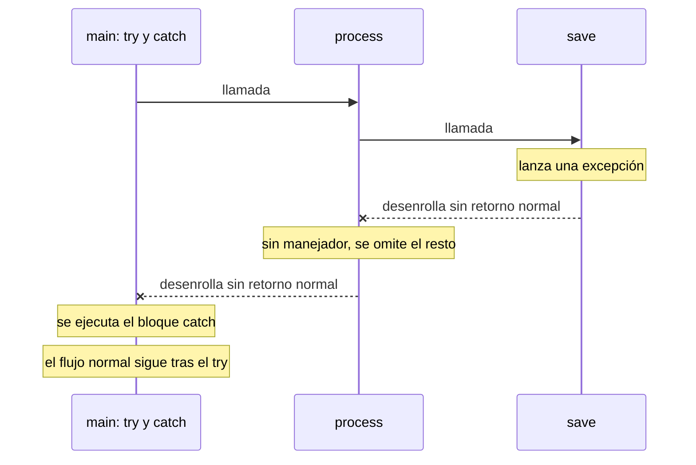

El manejo de excepciones es una función del lenguaje para tratar errores: lanza una señal, desenrolla la pila y deja que un manejador se ocupe de ella. Así el recorrido normal del código queda libre de comprobaciones de errores. COBOL tiene una forma más antigua y sencilla. `ON SIZE ERROR` se ejecuta cuando un resultado aritmético no cabe en el campo, que queda intacto. En [[entry:cobol-weird]] ese desbordamiento *es* la regla de parada: un contador de dos dígitos se desborda a propósito y la rama de error termina el bucle. Usar errores como flujo de control funciona, pero le oculta el diseño real al siguiente lector.

El `return` normal de `save` y `process` nunca se ejecuta. La excepción sale de cada llamada hasta que un `catch` la acepta. Entonces el flujo normal se reanuda tras el `try` en `main`. Si nada la atrapa, sale del programa. Desenrollar la pila solo desplaza el control. No deshace lo que ya hizo el código que se omite. Una fila que escribió `save` queda escrita, salvo que una transacción revierta el cambio (consulta [[transaction]]).

- **Úsalo cuando:** ocurra algo realmente inesperado y quien llama pueda recuperarse o deba enterarse.
- **Evítalo cuando:** el "error" sea un resultado normal y frecuente (como "fin de la entrada de datos") o cuando atrapes todo y sigas sin avisar.

**Lee más:**

- [Manejo de excepciones](https://en.wikipedia.org/wiki/Exception_handling) (Wikipedia)
- [Sistema de fallo rápido](https://en.wikipedia.org/wiki/Fail-fast_system) (Wikipedia)
