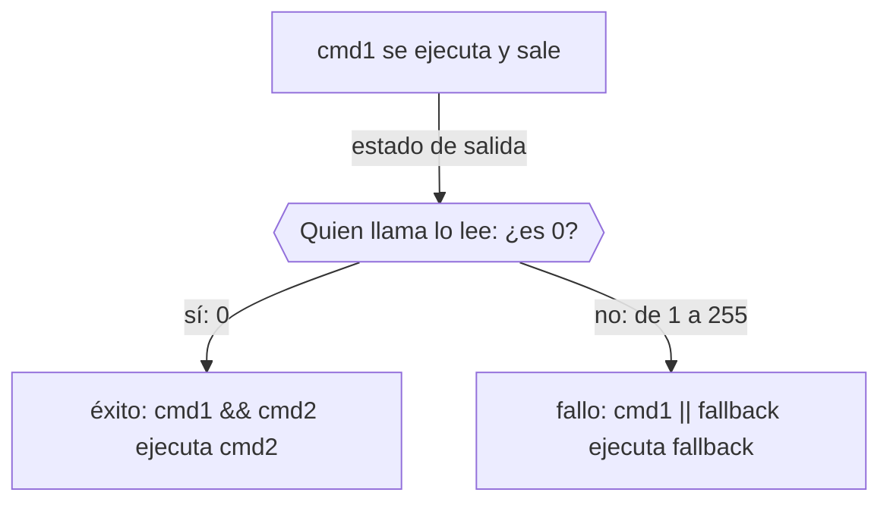

Un estado de salida es el número que un proceso, al finalizar, devuelve a quien lo inició. En Unix, `0` indica éxito y cualquier otro valor indica un fallo, en el rango de 0 a 255. Sirve para enlazar programas: `if`, `&&` y `||` en un intérprete de comandos (*shell*) leen ese estado. También es una señal de control en este repositorio. En [[entry:regex-pcre2grep]] el estado de salida de un programa pequeño dirige la coincidencia de la expresión regular. En [[entry:regex-sed]] el script sale con `1` a propósito y el envoltorio lo interpreta como éxito. Cada `check.sh` sale con un valor distinto de cero ante cualquier fallo. Así el control del entorno aislado (*sandbox*), que limita el acceso al sistema anfitrión, puede evaluar una ejecución sin leerla.

El estado es un solo número pequeño. Quien llama solo aprende qué rama tomar, sin saber qué salió mal. En `cmd1 && cmd2` el intérprete de comandos ejecuta `cmd2` tras un 0. En `cmd1 || fallback` ejecuta `fallback` tras cualquier otro valor. Un `if` del intérprete de comandos lee el mismo estado. Un programa que necesite decir más también debe imprimir un mensaje o escribir un archivo.

- **Úsalo cuando:** otras herramientas llamen a tus scripts o herramientas. Documenta qué significa cada código.
- **Evítalo cuando:** necesites devolver datos más ricos o conservar un número fuera del rango de estados de salida de la plataforma.

**Lee más:**

- [Estado de salida](https://en.wikipedia.org/wiki/Exit_status) (Wikipedia)
