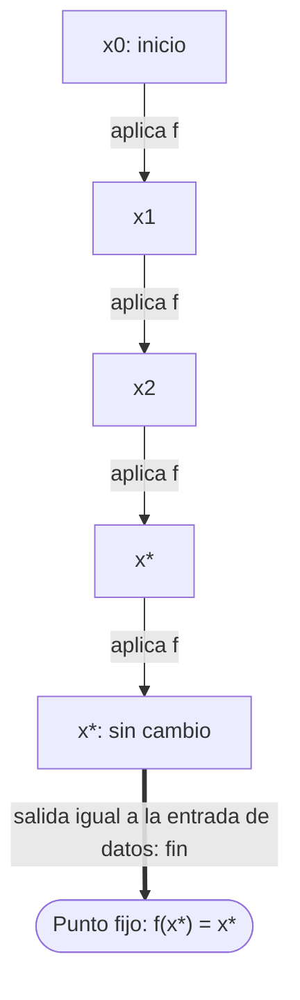

Un *punto fijo* de una función es un valor que la función deja intacto: f(x) = x. La iteración de punto fijo encuentra uno al aplicar la función una y otra vez hasta que nada cambia. Sirve porque muchos problemas se resumen en "sigue hasta que se estabilice": balancear una ecuación, calcular una clausura matemática o simplificar una expresión. El repositorio está lleno de casos. [[entry:regex-sed]] aplica sustituciones hasta que ninguna coincide. [[entry:make-gnu]] vuelve a generar su propio makefile hasta que está al día. El optimizador de un compilador hace lo mismo: recorre el código hasta que ya no encuentra mejoras.

Cada pasada aplica la misma función `f`. La ejecución se detiene cuando una pasada devuelve su propia entrada de datos, de modo que `f(x*) = x*`. El valor `x` no tiene que ser un número. Puede ser una línea de texto (como en [[entry:regex-sed]]), un makefile o un fragmento de código. Un programa real también necesita un límite por si los valores nunca se estabilizan.

- **Úsala cuando:** cada paso sea una mejora clara y "sin cambios" sea una señal clara para detenerse.
- **Evítala cuando:** el proceso quizá nunca se estabilice. Puede rebotar sin fin entre dos estados. Añade siempre un límite, que puede ser de tiempo. El entorno aislado (*sandbox*), que limita el acceso al sistema anfitrión, da a cada `check.sh` un límite de tiempo.

**Lee más:**

- [Iteración de punto fijo](https://en.wikipedia.org/wiki/Fixed-point_iteration) (Wikipedia)
- [Punto fijo (matemáticas)](https://en.wikipedia.org/wiki/Fixed_point_(mathematics)) (Wikipedia)
