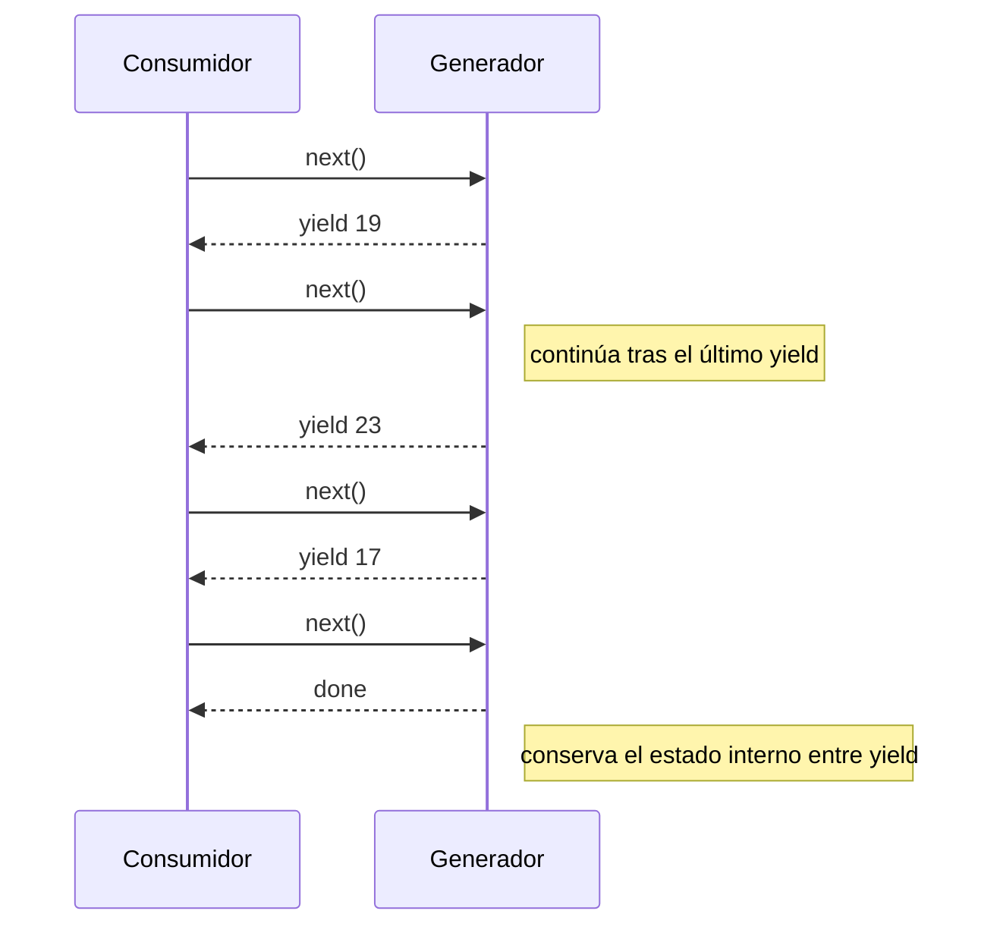

Un *iterador* es un objeto que responde a "dame el siguiente". Un *generador* es una función que escribes como código secuencial común y que entrega valores de uno en uno con `yield`. Ambos permiten manejar secuencias demasiado grandes para almacenarlas o que no tienen fin. También separan el código que produce los valores del que los usa. Cuatro entradas se basan en la idea: `successors` de Rust, `generateSequence` de Kotlin, `iter(step, False)` de Python y las listas perezosas de Haskell. En cada una, el bucle "se detiene" porque el consumidor deja de pedir. JavaScript detalla la idea en el **protocolo de iteración**: un iterable tiene un método `[Symbol.iterator]()` que devuelve un objeto con un método `next()`. `next()` devuelve `{ value, done }`. [[entry:javascript-weird]] escribe uno a mano con una clausura (*closure*), una función que conserva acceso a su entorno. Un consumidor como `toArray()` o `take(1)` decide cuántos valores llegan a existir. También muestra la trampa del único recorrido: en una segunda pasada por el mismo iterador ya no queda nada.

El consumidor pide y el generador responde. Esto es *demanda* (*pull*): nada se ejecuta hasta que alguien llama a `next()`. El generador solo trabaja lo suficiente para llegar al siguiente `yield`. Un diseño por envío, como el que usa una función de devolución de llamada (*callback*), dibujaría las flechas al revés (consulta [[callback]]). El consumidor también puede detenerse antes si no vuelve a pedir.

- **Úsalos cuando:** manejes un flujo de datos o describas una serie sin límite y tomes su parte inicial.
- **Evítalos cuando:** el iterador tenga efectos ocultos o quien lo llama espere reutilizar un iterador de un solo recorrido.

**Lee más:**

- [Iterador](https://en.wikipedia.org/wiki/Iterator) (Wikipedia)
- [Generador (programación)](https://en.wikipedia.org/wiki/Generator_(computer_programming)) (Wikipedia)
- [Flujo (informática)](https://en.wikipedia.org/wiki/Stream_(computing)) (Wikipedia)
- [Iteradores y generadores](https://developer.mozilla.org/en-US/docs/Web/JavaScript/Guide/Iterators_and_generators) (MDN), un tutorial claro sobre la idea
