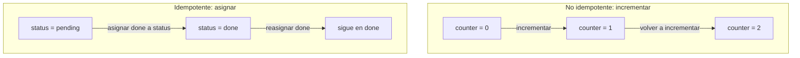

Una operación es idempotente si hacerla dos veces tiene el mismo efecto que hacerla una vez. Las redes y las máquinas fallan. De ahí la idempotencia: la forma más segura de recuperarse es "vuelve a intentarlo". Si repetir es inocuo, puedes hacerlo sin miedo. HTTP define `PUT` y `DELETE` como idempotentes (RFC 9110, sección 9.2.2). `POST` queda fuera de esa categoría. En este repositorio, los scripts de comprobación borran y vuelven a crear sus datos temporales. Así, la segunda ejecución parte del mismo punto que la primera. Lo mismo ocurre con una herramienta de compilación. Ejecuta `make` dos veces y la segunda ejecución no debería hacer nada.

Para una operación `f` sobre un estado `s`, la idempotencia significa `f(f(s)) = f(s)`. Fíjate en qué le hace la segunda llamada al *estado*, en vez de fijarte en si los dos valores de retorno coinciden. Compara con el reloj de [[referential-transparency]]. Llamar a `now()` dos veces puede dar respuestas distintas. Eso por sí solo no le quita la idempotencia, porque no cambia nada.

- **Úsala cuando:** diseñes una API, una cola de trabajos o un script de despliegue.
- **Evita darla por sentada:** "suma uno al contador" no es idempotente. Si la operación no puede serlo, asigna a cada solicitud una clave única e ignora las repeticiones.

**Lee más:**

- [Idempotencia](https://en.wikipedia.org/wiki/Idempotence) (Wikipedia)
- [Idempotente](https://developer.mozilla.org/en-US/docs/Glossary/Idempotent) (glosario de MDN)
- [RFC 9110, sección 9.2.2: métodos idempotentes](https://www.rfc-editor.org/rfc/rfc9110)
