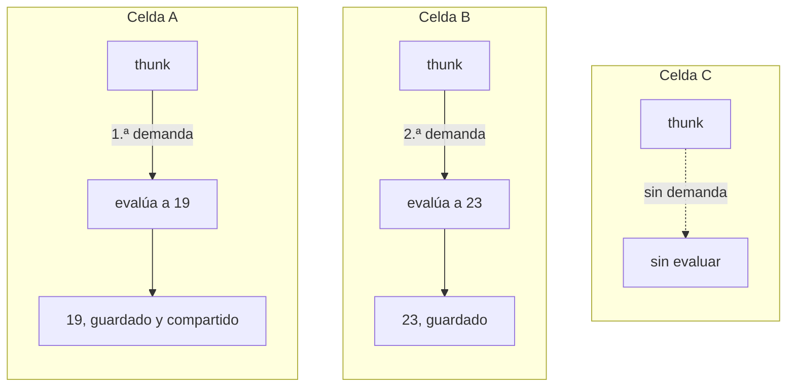

La evaluación perezosa aplaza un cálculo hasta que se necesita su resultado. Entonces guarda la respuesta. El cálculo pendiente se llama *thunk*. Así puedes describir la respuesta *entera* y tomar solo lo que quieres. En [[entry:haskell]], un solo `span` sobre una lista perezosa infinita es toda la regla de parada. El precio es que cuesta responder "¿cuándo se ejecuta esto?". En [[entry:haskell-weird]], los elementos de la lista realizan operaciones de entrada de datos y salida. Así que el trabajo se hace al *leer la lista*. Leer demasiado pronto o demasiado tarde cambia el resultado.

Un thunk promete calcular un valor. La demanda de una celda ejecuta una vez su thunk y guarda el valor. Así que otra demanda de `A` no tiene costo. Nadie pide la celda `C` y su cálculo nunca se hace. Guardar el valor es parte de la evaluación perezosa en sentido estricto. Una canalización que solo aplaza el trabajo, como un generador, puede volver a calcular el mismo valor en cada pasada. Consulta [[generators]].

- **Úsala cuando:** el código sea puro (sin efectos), quieras secuencias infinitas o quizá no necesites ciertos resultados.
- **Evítala cuando:** haya efectos o importe el uso de memoria. Una pila de thunks sin evaluar puede usar mucha memoria (una *fuga de espacio*).

**Lee más:**

- [Evaluación perezosa](https://en.wikipedia.org/wiki/Lazy_evaluation) (Wikipedia)
- [Thunk](https://en.wikipedia.org/wiki/Thunk) (Wikipedia)
- [Reducción de grafos](https://en.wikipedia.org/wiki/Graph_reduction) (Wikipedia)
