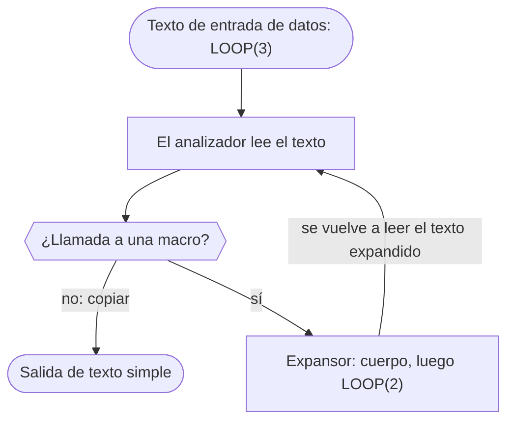

Una macro es un nombre que se sustituye por texto o código *antes* de que lo vea el lenguaje propiamente dicho. El preprocesador de C es el ejemplo más conocido. m4 es un procesador de macros de propósito general. Las macros de Lisp tratan el código como datos, en vez de texto. Permiten crear abstracciones fuera del alcance de las funciones: plantillas repetitivas, sintaxis nueva y código generado durante la compilación. [[entry:m4]] no tiene sentencias de bucle ni variables. Arma un bucle con una macro que aparece en su propio texto de reemplazo. Así, el analizador vuelve a leer la salida. [[entry:lisp-weird]] usa una macro `defcard` para escribir cinco clases y métodos similares durante la compilación.

La flecha importante es la que vuelve atrás. El expansor no se limita a imprimir el texto de reemplazo. Lo devuelve al analizador, que también expande cualquier llamada a una macro que aparezca en ese texto. Aquí `LOOP(3)` deja `LOOP(2)`. El proceso termina cuando el reemplazo queda sin llamadas a macros. [[entry:m4]] funciona así. Otros sistemas de macros quizá no vuelvan a leer su propia salida.

- **Úsalas cuando:** generes código repetitivo o definas un lenguaje pequeño sobre otro mayor.
- **Evítalas cuando:** baste una función común. Cuesta depurar los bichos de las macros y las macros de texto pueden capturar nombres por accidente. Las macros *higiénicas* al estilo de Lisp reducen ese peligro.

**Lee más:**

- [Macro (informática)](https://en.wikipedia.org/wiki/Macro_(computer_science)) (Wikipedia)
- [M4 (lenguaje de programación)](https://en.wikipedia.org/wiki/M4_(computer_language)) (Wikipedia)
- [Macro higiénica](https://en.wikipedia.org/wiki/Hygienic_macro) (Wikipedia)
