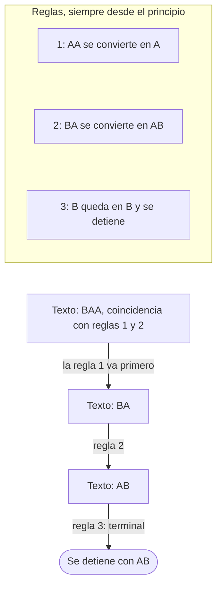

Un algoritmo de Markov es una lista ordenada de reglas de búsqueda y reemplazo. Busca la primera regla cuyo patrón aparezca en el texto. Reemplaza esa coincidencia y vuelve al principio de la lista. Detente cuando no se aplique ninguna regla o una regla diga "detente". El matemático ruso Andréi Márkov hijo lo describió en la década de 1950. Puede calcular todo lo que puede calcular una máquina de Turing. Su propósito es mostrar que *reescribir texto es computar*. [[entry:regex-sed]] es justo eso: una línea de texto y un script de sustituciones que la reescriben hasta que no hay coincidencia. Toda la memoria cabe en esa línea.

Lo que decide es el orden de las reglas, no la posición en el texto. `BAA` tiene coincidencias con las reglas 1 y 2 y gana la regla 1 porque es la primera. Tras cada reescritura, la búsqueda de una regla vuelve a empezar por la regla 1. La ejecución termina cuando se aplica una regla terminal (aquí, la regla 3) o cuando no hay coincidencia con ninguna regla. Otros sistemas de reescritura, como los de [[term-rewriting]], no siempre eligen las reglas así.

- **Úsalo cuando:** transformes o normalices texto o quieras enseñar que un programa puede ser "solo reglas".
- **Evítalo en programas grandes:** el orden de las reglas *es* el flujo de control. Cuesta razonar sobre él y cuesta predecir la velocidad.

**Lee más:**

- [Algoritmo de Markov](https://en.wikipedia.org/wiki/Markov_algorithm) (Wikipedia)
- [[term-rewriting]] en "Los lenguajes formales como sustratos de cómputo"
