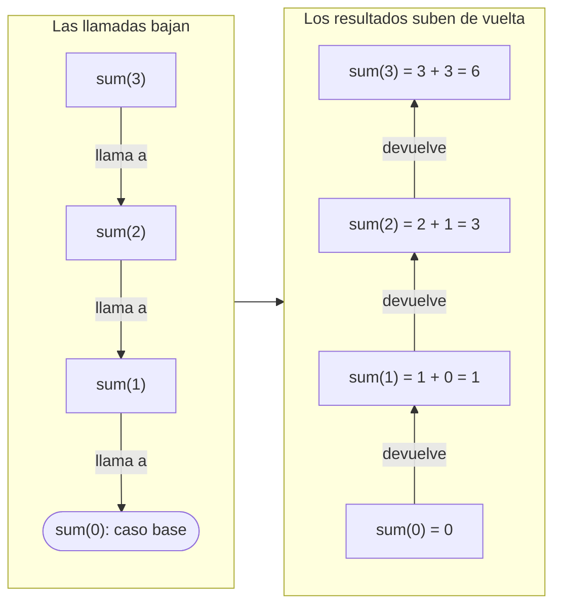

Una definición recursiva se usa a sí misma. Una función se llama a sí misma sobre un problema más pequeño, hasta que el problema es tan pequeño que la respuesta es obvia. La recursión existe porque muchas cosas son anidadas por naturaleza: árboles, carpetas, gramáticas, expresiones aritméticas. Los bucles y la recursión son igual de potentes, y los lenguajes funcionales usan recursión en lugar de bucles. Varias entradas de aquí son recursivas sin parecerlo. En [[entry:m4]], una macro cuyo texto de reemplazo se contiene a sí mismo se lee de nuevo, lo que produce un bucle. En [[entry:tcl-weird]], un disparador de base de datos inserta una fila, lo que activa de nuevo el mismo disparador. La regla de parada es una consulta que no encuentra nada.

Al bajar, cada llamada pasa un problema más pequeño a la siguiente llamada. El caso base, `sum(0)`, es la única llamada que responde sin volver a llamar. Sin él, las llamadas nunca se detienen. Al subir, cada llamada termina el trabajo que tenía pendiente. [[call-stack]] muestra dónde se guardan esas llamadas en espera.

- **Úsala cuando:** los datos están anidados, o el problema se divide en copias más pequeñas de sí mismo.
- **Evítala cuando:** la profundidad no tiene límite y el lenguaje no elimina las llamadas de cola. La *pila* (*stack*) puede agotarse. Conoce siempre la regla de parada y sabe qué pasa si nunca se activa.

**Lee más:**

- [Recursión (informática)](https://en.wikipedia.org/wiki/Recursion_(computer_science)) (Wikipedia)
- [Llamada final](https://en.wikipedia.org/wiki/Tail_call) (Wikipedia)
- [Recursión](https://developer.mozilla.org/en-US/docs/Glossary/Recursion) (glosario de MDN)
