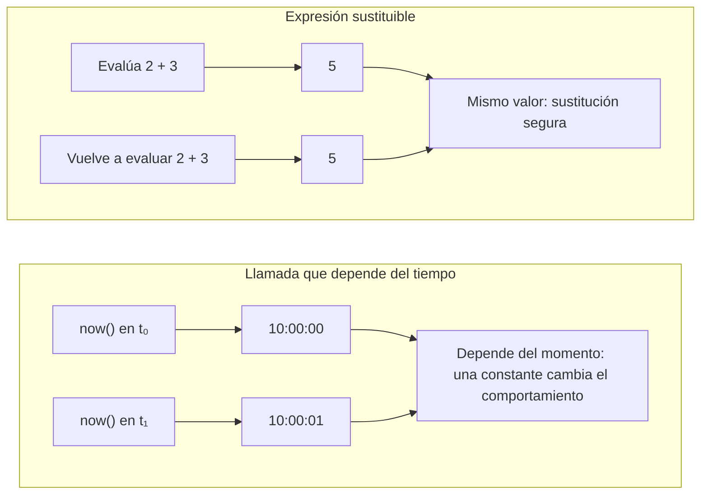

Una expresión es referencialmente transparente si puedes reemplazarla por su valor y el programa no cambia. `2 + 3` lo es. `readLine()` no lo es, porque da una respuesta distinta cada vez. Esta es la regla de las funciones *puras*: son fáciles de probar, guardar en caché, ejecutar en paralelo y reordenar. Los efectos rompen esta propiedad. De eso se trata [[entry:haskell-weird]]: oculta la entrada de datos y la salida dentro de una lista que parece contener solo datos. Cuando se permita romper la regla, el código debe decirlo bien claro.

Puedes sustituir el lado izquierdo por `5` en cualquier parte. No puedes hacer lo mismo con el lado derecho: el valor de la llamada depende de *cuándo* se ejecuta y las horas del ejemplo son ilustrativas. Esto trata de la transparencia referencial, que aquí equivale a la repetibilidad. No trata de [[idempotence]]. Una función que lee el reloj no cambia nada, así que no es "no idempotente". Solo le falta repetibilidad. [[idempotence]] trata de lo que una operación le hace al estado.

- **Úsala cuando:** sea posible. Mantén un núcleo puro grande y lleva los efectos a los bordes.
- **Evita fingir transparencia:** los números aleatorios, los relojes, los archivos y las redes no son transparentes.

**Lee más:**

- [Transparencia referencial](https://en.wikipedia.org/wiki/Referential_transparency) (Wikipedia)
- [Función pura](https://en.wikipedia.org/wiki/Pure_function) (Wikipedia)
- [Programación funcional](https://en.wikipedia.org/wiki/Functional_programming) (Wikipedia)
