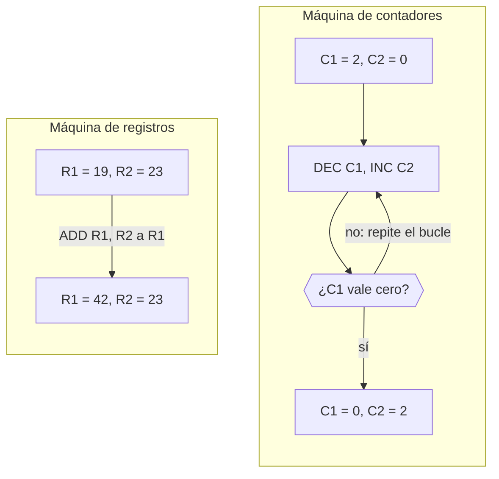

Una máquina de registros guarda sus valores en unas pocas casillas numeradas que se llaman registros. Los procesadores reales son máquinas de registros. La versión más pequeña, una *máquina de contadores*, solo tiene dos operaciones: sumar uno a un registro o restarle uno y saltar si el resultado es cero. Sirve para razonar. Es lo bastante simple como para demostrar sus propiedades y lo bastante potente como para calcular cualquier cosa (bastan dos contadores). Varias entradas son máquinas de registros disfrazadas. En CMake, de `CMAKE_MATCH_1` a `CMAKE_MATCH_5` son los registros de [[entry:cmake]]. Los grupos de equilibrio de .NET en [[entry:regex-dotnet]] forman un contador.

A la izquierda, la instrucción nombra sus celdas (`R1` y `R2`). A la derecha, la máquina tiene dos contadores y tres acciones: contar hacia abajo, contar hacia arriba y comprobar si el valor es cero. Pasar la cuenta de `C1` a `C2` requiere una vuelta del bucle por unidad. Por eso una máquina de contadores es lenta a propósito. Muestra con qué poca maquinaria basta.

- **Úsala cuando:** quieras explicar qué *es* un sistema insólito al identificar sus registros.
- **Evítala como estilo de programación:** es un modelo para razonar, no una forma de escribir programas.

**Lee más:**

- [Máquina de registros](https://en.wikipedia.org/wiki/Register_machine) (Wikipedia)
- [Máquina de contadores](https://en.wikipedia.org/wiki/Counter_machine) (Wikipedia)
