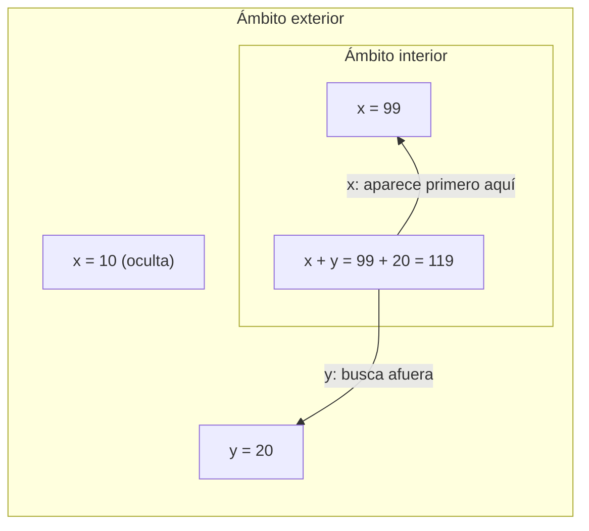

El *ámbito* es la parte de un programa donde un nombre es visible. El *enlace* es la asociación entre un nombre y un valor. La mayoría de los lenguajes usa el ámbito *léxico*: el significado de un nombre depende de dónde está escrito. Algunos usan el ámbito *dinámico*: el nombre significa lo que le asignó el invocador más reciente. El ámbito dinámico puede ser útil y también peligroso. En [[entry:apl-weird]] permitiría que una función reescrita sobrescribiera las variables de su función padre. Por eso cada encabezado generado vuelve a declarar sus variables locales. En Tcl, `uplevel` ejecuta código en el ámbito de otro marco de pila. [[entry:tcl-weird]] usa `uplevel #0`, que indica el ámbito global. En m4 y Make todos los nombres son globales.

La búsqueda de un nombre empieza en el ámbito más interno y sigue hacia afuera. Aquí la búsqueda encuentra `x` de inmediato en el ámbito interior. Ese enlace *oculta* el `x = 10` exterior. El nombre `y` no tiene enlace en el ámbito interior, así que la búsqueda sigue hacia afuera. El ámbito decide dónde buscar y el enlace es lo que la búsqueda encuentra. El dibujo muestra el ámbito léxico: los recuadros representan cómo se anida el texto fuente.

- **Usa el ámbito léxico** casi siempre. Te permite leer una función sin saber quién la llama.
- **Evítalo cuando:** un nombre necesite un ámbito dinámico o global sin un motivo deliberado y documentado.

**Lee más:**

- [Ámbito (programación informática)](https://en.wikipedia.org/wiki/Scope_(computer_programming)) (Wikipedia)
- [Enlace de nombres](https://en.wikipedia.org/wiki/Name_binding) (Wikipedia)
- [Clausura (programación informática)](https://en.wikipedia.org/wiki/Closure_(computer_programming)) (Wikipedia)
- [Ámbito](https://developer.mozilla.org/en-US/docs/Glossary/Scope) (glosario de MDN)
