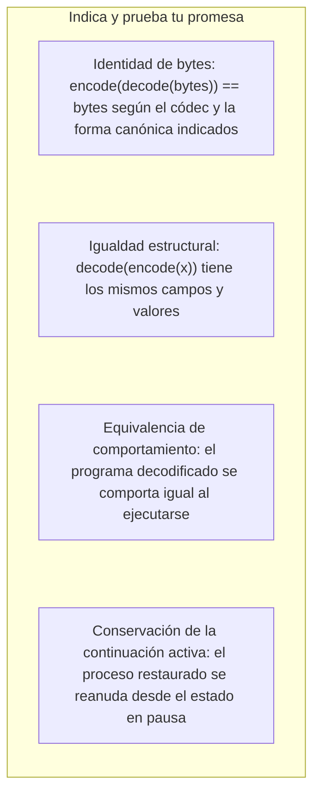

La **serialización** convierte algo abstracto en bytes que puedes guardar o enviar: un objeto, un estado o una lista de instrucciones. La **deserialización** vuelve a leer esos bytes. Son dos actos distintos y detrás acecha un tercero: la **interpretación**, que da un efecto a los datos decodificados. Puedes analizar un archivo y no hacer nada con él. También puedes analizar un archivo y ejecutarlo. Casi todo el peligro está en la distancia entre esas dos acciones.

El **pickling de objetos** es la serialización de un grafo de objetos. `pickle` de Python escribe la *receta* para reconstruir un objeto: qué clase, qué argumentos y qué atributos. Leer un pickle puede llamar a cualquier función que indique la receta. Por eso deserializar bytes no confiables con pickle ejecuta código del remitente. La documentación de Python lo dice en un recuadro de advertencia. Un **programa** serializado es la misma idea un nivel más arriba: texto fuente, árbol sintáctico, código de bytes o una secuencia corta de instrucciones guardada como registros. [[entry:tar-gnu]] guarda un programa en los miembros de un archivo tar: cada nombre de miembro es una instrucción y cada cuerpo es su operando. [[entry:tcl-weird]] guarda código fuente Tcl en filas de SQLite y lo ejecuta bajo demanda. [[entry:apl-weird]] lee el código fuente de una función, lo reescribe y define la copia. [[entry:xaml]] guarda un grafo de objetos como marcado que un analizador sintáctico convierte en objetos activos.

¿Qué conserva un viaje de ida y vuelta? Sé preciso, porque "lo mismo" tiene cuatro significados distintos:

- **Identidad de bytes.** `encode(decode(bytes))` da los mismos bytes. [[entry:tar-gnu]] crea un archivo idéntico byte por byte si parte de la misma semilla, porque fija el orden, las horas y los propietarios.
- **Igualdad estructural.** La estructura decodificada tiene los mismos campos y valores. El inspector de [[entry:tar-gnu]] y las filas de la base de datos coinciden en cada tarjeta.
- **Equivalencia de comportamiento.** Ejecutar el programa decodificado da los mismos resultados. Dos ejecuciones de un archivo en dos bases de datos nuevas producen las mismas tarjetas.
- **Conservación de la continuación o del estado activo.** Un proceso en pausa, con su pila, sus archivos abiertos y su posición, se reanuda donde se detuvo. Es una promesa mucho más fuerte. Casi ningún formato la hace y las entradas de tar tampoco hacen esa afirmación.

Las cuatro tarjetas representan promesas distintas y ninguna implica otra. Que los bytes sean iguales no promete que un programa se comporte igual. Un serializador que conserva todos los campos tampoco reanuda un proceso. [[entry:tar-gnu]], [[entry:tcl-weird]], [[entry:apl-weird]], [[entry:xaml]] y `pickle` de Python hacen promesas distintas. Recuerda que la propia deserialización puede ejecutar código (consulta la siguiente sección, Seguridad).

`decode(encode(x))` puede conservar algunas de estas propiedades y perder otras. Una ida y vuelta en JSON conserva la estructura y pierde la identidad del objeto, sus métodos y sus valores indefinidos. Di qué prometes antes de prometerlo.

**Seguridad.** Los bytes son inertes hasta que un consumidor les da significado. Un archivo tar no puede registrar un gancho por sí mismo: `tar -xf` solo escribe archivos. La opción `--to-command` que pasa el operador hace que tar inicie un programa por cada miembro. JSON tampoco es "seguro por naturaleza". Solo son datos hasta que un consumidor pasa un campo a `eval`, a un intérprete de comandos (*shell*) o a una cadena de texto SQL. Los ataques de deserialización insegura encadenan las *funciones de devolución de llamada* (*callbacks*) que el formato permite al reconstruir (constructores, `__reduce__`, `readObject`). Así ejecutan código que hace algo que el autor no había previsto. Las defensas ya son viejas y aburridas. No deserialices bytes no confiables para obtener objetos activos. Comprueba cada registro con una gramática estricta. Rechaza lo que no conozcas. Ejecuta el consumidor con el mínimo privilegio que necesite.

**Teoría de categorías.** Un codificador y un decodificador son funciones cuya composición debería cumplir una ley explícita: `decode ∘ encode = id` para los valores que te interesan. Eso vale para algunos tipos y formatos, pero no para otros (un formato puede asignar dos valores a una misma cadena de texto). No llames isomorfismo a un códec a menos que puedas demostrar la ley en ambas direcciones. [[category-theory]] explica qué te exige esa palabra.

| | Qué guardan los bytes | Qué reconstruye el consumidor | ¿Puede ejecutarse código durante la lectura? | Dónde está la frontera de confianza |
| --- | --- | --- | --- | --- |
| Python `pickle` | Una receta: clases, argumentos y estado | Objetos activos de Python | Sí, por diseño | Alrededor de los bytes: nunca leas pickles que no hayas escrito |
| JSON | Números, cadenas de texto, listas y mapas | Solo datos | No, salvo que tu código interprete un campo | En el código que usa los campos |
| tar | Archivos: nombres, bytes, tamaños, horas y modos | Archivos en disco o un flujo de miembros | No, salvo que el operador pase `--to-command` o `--checkpoint-action` | En la línea de comandos que escribió el operador |

- **Úsala cuando:** debas guardar un estado, enviar un valor o distribuir un programa y puedas decir en qué sentido esperas recuperar "lo mismo".
- **Evítala cuando:** los bytes vengan de alguien en quien no confías y el formato pueda reconstruir objetos arbitrarios. Usa un formato que solo represente datos y un analizador sintáctico estricto.

**Lee más:**

- [Serialización](https://en.wikipedia.org/wiki/Serialization) (Wikipedia)
- [Pickle (Python)](https://en.wikipedia.org/wiki/Pickle_(Python)) (Wikipedia)
- [Tar (informática)](https://en.wikipedia.org/wiki/Tar_(computing)) (Wikipedia)
- [Deserialización de datos no confiables](https://owasp.org/www-community/vulnerabilities/Deserialization_of_untrusted_data) (OWASP)
- [Guía rápida de deserialización](https://cheatsheetseries.owasp.org/cheatsheets/Deserialization_Cheat_Sheet.html) (OWASP)
- [`JSON`](https://developer.mozilla.org/en-US/docs/Web/JavaScript/Reference/Global_Objects/JSON) (MDN)
