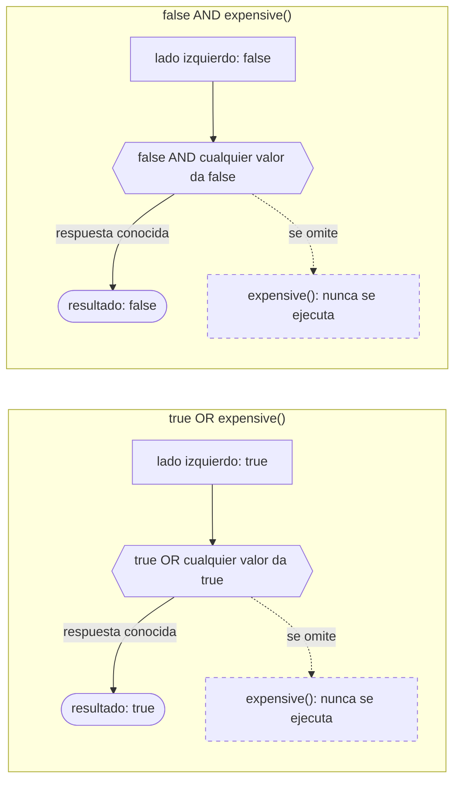

La evaluación de cortocircuito significa que `and` y `or` paran en cuanto se conoce la respuesta. En `a && b`, si `a` es falso, `b` nunca se ejecuta. Sirve para ganar velocidad y para un hábito muy útil: comprueba la condición de protección antes de actuar (`x != null && x.length > 0`). La misma idea puede convertirse en un bucle. En [[entry:lisp-weird]] la combinación de métodos `or` llama a los métodos uno tras otro y se detiene en el primero que devuelve un valor verdadero. La jerarquía de clases se convierte en el bucle y `or` en la regla de parada.

En ambos paneles, el operando izquierdo determina la respuesta y el derecho se omite. Nada de lo que haría llega a ocurrir, ya sea una consulta lenta, una escritura o la impresión de una línea. Por eso `x != null && x.length > 0` es seguro. También significa que un efecto en el operando derecho no está asegurado. Consulta [[side-effect]].

- **Úsala cuando:** protejas una operación arriesgada o elijas la primera respuesta válida.
- **Evítala cuando:** esperes que un efecto del segundo operando ocurra siempre. Puede no ocurrir y no habrá aviso.

**Lee más:**

- [Evaluación de cortocircuito](https://en.wikipedia.org/wiki/Short-circuit_evaluation) (Wikipedia)
- [Sistema de objetos de Common Lisp](https://en.wikipedia.org/wiki/Common_Lisp_Object_System) (Wikipedia)
- [AND lógico (`&&`)](https://developer.mozilla.org/en-US/docs/Web/JavaScript/Reference/Operators/Logical_AND) (MDN), que explica el cortocircuito en palabras sencillas
