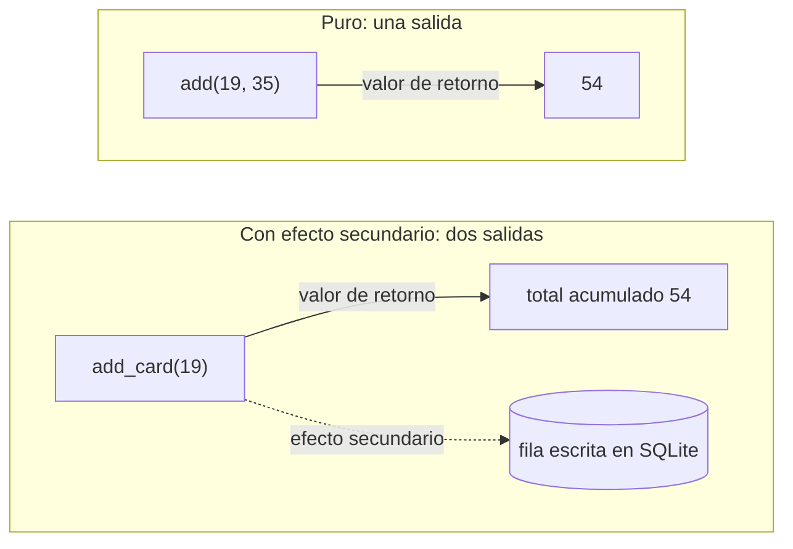

Un efecto secundario es cualquier cosa que una operación hace además de devolver un valor: escribir un archivo, cambiar una variable, imprimir o insertar una fila en una base de datos. Los programas existen para producir efectos, así que los efectos no son malos. El problema es que *el orden, la cantidad y el momento* empiezan a importar. Ejecuta la operación dos veces y podrías obtener dos filas. Ejecútala más tarde y podrías obtener otra respuesta. Varias entradas esconden un efecto en lo que parece una simple descripción: una lista perezosa de Haskell, una consulta LINQ o un árbol XAML. De ahí sale una regla: **quien lee la estructura decide si ocurre el efecto y cuándo.** `evaluate (length cards)` en Haskell y el `Aggregate` final en LINQ significan "fuerza la evaluación ahora".

Ambas llamadas devuelven un valor. Solo la segunda cambia también algo fuera de sí misma: ahora hay una fila en la base de datos y sigue ahí aunque quien llama ignore el valor de retorno. Por eso un efecto secundario no es simplemente otro valor de retorno. Quien llama solo ve el valor de retorno si lo consulta, pero el efecto ya ocurrió. Compara con [[referential-transparency]]: puedes sustituir una llamada pura por su valor, pero no la segunda llamada.

- **Usa efectos** en los bordes de un programa, donde se comunica con el mundo. Úsalos también en los lugares donde puedas decir con exactitud cuándo se ejecutan.
- **Evita los efectos cuando:** se ocultan en código perezoso o "de apariencia pura", donde nadie puede decir quién los activa.

**Lee más:**

- [Efecto secundario (informática)](https://en.wikipedia.org/wiki/Side_effect_(computer_science)) (Wikipedia)
- [[referential-transparency]] en "Evaluación y demanda"
