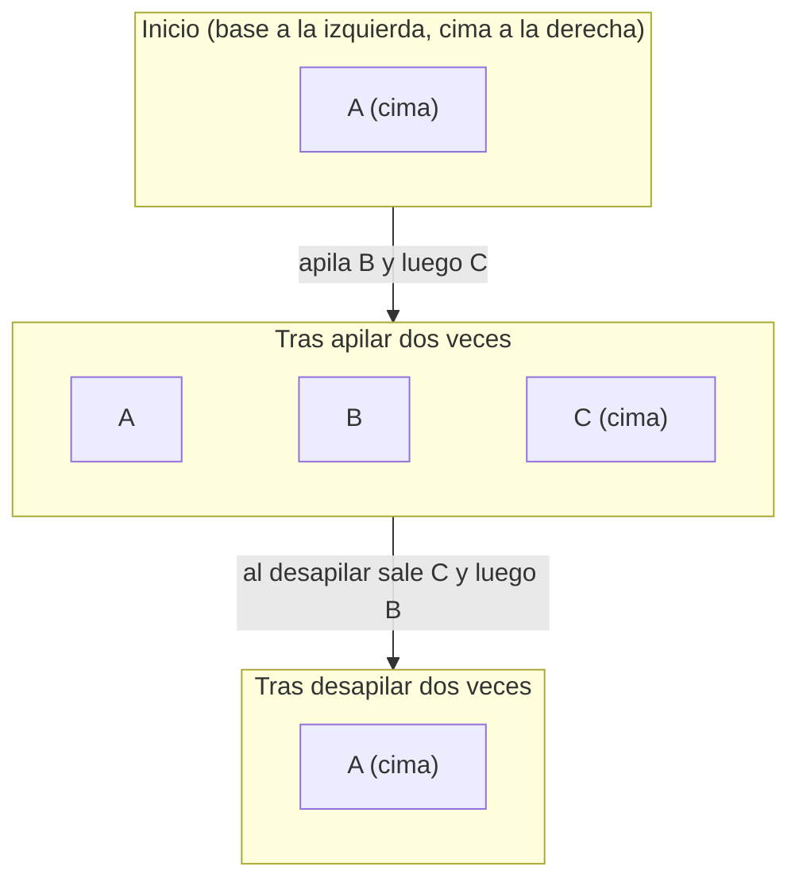

Una pila es un montón donde solo agregas y retiras elementos por la cima: el último en entrar es el primero en salir. Sirve cuando hay anidamiento: deshacer acciones, evaluar expresiones, emparejar delimitadores y aplicar retroceso. En este repositorio la pila aparece en dos lugares insólitos. En [[entry:forth-weird]] la pila de datos es la única memoria. En [[entry:regex-dotnet]] los *grupos de equilibrio* apilan una captura al ver una marca de apertura y la desapilan al ver una de cierre. Una pila de marcas sirve de contador, así que una expresión regular puede comparar dos recuentos.

Solo puedes acceder a la cima. Apilar agrega un elemento en la cima y desapilar lo retira de allí. Así, el último en entrar es el primero en salir. [[call-stack]] usa esta estructura con marcos como elementos. Las listas para deshacer acciones, la comprobación de pares de delimitadores y la pila de datos de [[entry:forth-weird]] son otros usos.

- **Úsala cuando:** el problema tenga elementos anidados o debas deshacer acciones en orden inverso.
- **Evítala cuando:** necesites acceso aleatorio o que el primero en entrar sea el primero en salir. Usa un arreglo o una cola.

**Lee más:**

- [Pila (tipo abstracto de datos)](https://en.wikipedia.org/wiki/Stack_(abstract_data_type)) (Wikipedia)
- [Autómata de pila](https://en.wikipedia.org/wiki/Pushdown_automaton) (Wikipedia)
