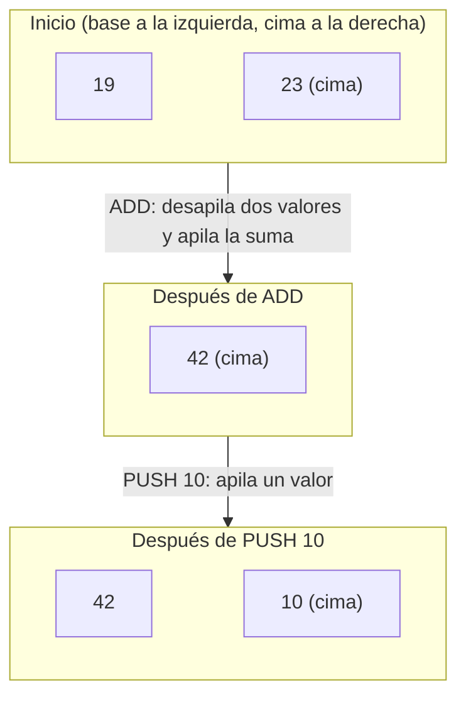

Una máquina de pila guarda sus valores de trabajo en una pila. Una instrucción toma sus entradas de la cima y deja allí su resultado. No hay registros con nombre. Existe porque las instrucciones pueden ser diminutas (`+` no necesita operandos) y un compilador puede generarlas con facilidad. Por eso la JVM, el IL de .NET, WebAssembly, PostScript y Forth usan la idea. En [[entry:forth-weird]] la pila de datos es la *única* memoria: el programa no tiene ningún `variable`.

Lee el dibujo de arriba abajo. `ADD` no dice dónde están sus entradas: desapila los dos valores de la cima y apila un resultado. Una máquina de pila real también tiene otra memoria (la JVM tiene variables locales y un montículo, por ejemplo). La pila solo guarda los valores que necesita la siguiente instrucción.

- **Úsala cuando:** construyas una máquina virtual pequeña o un intérprete, o quieras código compacto.
- **Evítala cuando:** necesites acceso aleatorio a muchos valores. El código que reordena la pila con `dup`, `swap` y `rot` pronto se vuelve ilegible.

**Lee más:**

- [Máquina de pila](https://en.wikipedia.org/wiki/Stack_machine) (Wikipedia)
- [Notación polaca inversa](https://en.wikipedia.org/wiki/Reverse_Polish_notation) (Wikipedia)
- [Forth (lenguaje de programación)](https://en.wikipedia.org/wiki/Forth_(programming_language)) (Wikipedia)
