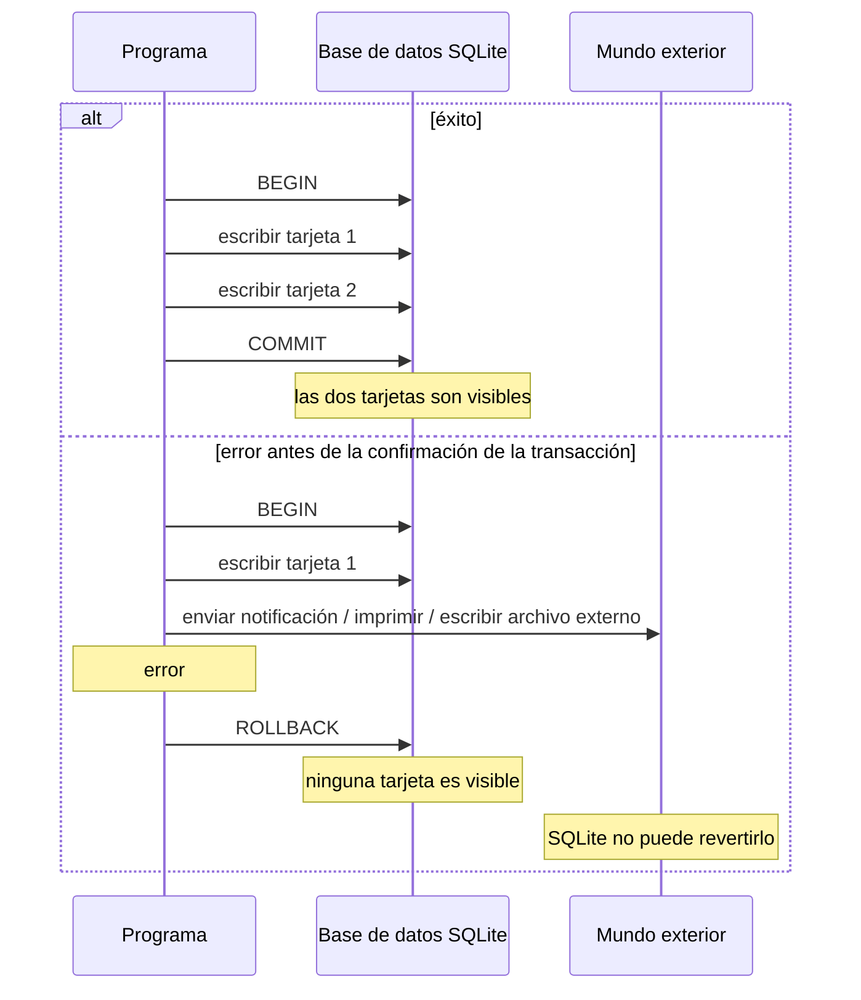

Una transacción es un grupo de operaciones que ocurren *todas* o no ocurre *ninguna*. La promesa clásica se llama ACID: atómica, consistente, aislada y durable. Existe porque una caída o un error en mitad de una actualización dejaría los datos a medio cambiar. Cada entrada de script escribe sus tarjetas de demostración en una sola transacción de SQLite, y la **confirmación de la transacción** es el punto sin retorno. Ahí es donde la pereza puede hacer daño. En [[entry:haskell-weird]] un `let` perezoso se forzó solo después de cerrar la tubería hacia SQLite, así que el trabajo ocurrió demasiado tarde. `evaluate (length cards)` antes de la confirmación lo arregló.

`COMMIT` hace visibles las dos filas a la vez, y `ROLLBACK` las quita las dos. Ninguno llega más allá de la base de datos. Una notificación, una impresión o un archivo escrito fuera de ella ya ocurrió. Por eso [[entry:haskell-weird]] tuvo que forzar sus efectos perezosos *antes* de la confirmación de la transacción, y por eso esta imagen trata del límite de la transacción y no de las tarjetas. No todas las entradas colocan los límites de su transacción en el mismo sitio.

- **Úsalo cuando:** cambies datos almacenados en varios pasos.
- **Evítalo cuando:** la transacción retendría bloqueos durante mucho tiempo. Los efectos fuera de la base de datos, como un correo o la escritura de un archivo, permanecen después de la reversión.

**Más información:**

- [Transacción de base de datos](https://en.wikipedia.org/wiki/Database_transaction) (Wikipedia)
- [ACID](https://en.wikipedia.org/wiki/ACID) (Wikipedia)
- [Confirmación (gestión de datos)](https://en.wikipedia.org/wiki/Commit_(data_management)) (Wikipedia)
