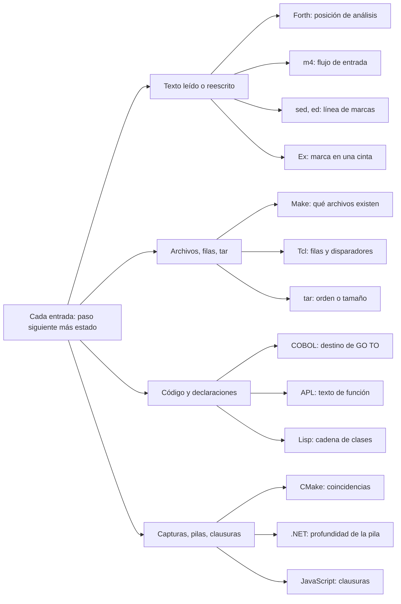

# Guía de estudio de diseño comparado de máquinas

## Para qué sirve esta guía

Un bucle sin cuerpo, una búsqueda con expresión regular y un Makefile que se relee a sí mismo abordan la tarea de la tarjeta de horas. También la abordan una lista cuyos elementos escriben en una base de datos, un búfer de editor y un archivo tar. Algunas búsquedas terminan fallando después de sus efectos secundarios. La búsqueda de .NET tiene éxito para que el anfitrión pueda leer sus capturas. Esta guía los pone lado a lado con una sola hoja de trabajo. La pregunta central es: **¿qué hace de bucle, de estado, de reloj, de decisión y de confirmación en cada uno, y qué evidencia lo demuestra?**

Cuando termines, deberías poder:

1. Completar la hoja de trabajo de siete preguntas de cualquier entrada: dónde está el programa, dónde está el estado, lo que se repite, lo que hace avanzar el paso siguiente, qué toma una decisión, qué confirma los efectos y qué evidencia respalda la afirmación.
2. Decir qué *papel* cumple cada pieza aunque no se parezca al habitual: una bandera, un archivo, una captura, un método, un tic.
3. Agrupar las entradas según la respuesta a "¿dónde vive el programa?" y decir qué puede y qué no puede hacer cada grupo.
4. Explicar por qué la semana laboral fija de LINQ termina en 40 y por qué XAML puede quedarse sin pasadas en ese punto.
5. Elegir, para una necesidad dada (facilidad de prueba, observabilidad, portabilidad), el diseño que mejor la satisface y decir cuál es su costo.
6. Etiquetar cada afirmación con una de estas tres etiquetas: garantizado, permitido por la implementación o aprovechado por accidente.

**Límites del alcance.** La guía compara, pero no vuelve a enseñar cada entrada. Usa hechos comprobados en las guías de lenguaje y en las guías de concepto. Sus fuentes son [Casos de estudio comparados](../../informatica/09-casos-de-estudio-comparativos.md) y [Patrones de solución](../../patrones.md).

## Antes de empezar

**Modelo de seguridad.** Las tarjetas son datos ficticios marcados con **DEMO ONLY**. Los programas pueden escribir en archivos o bases de datos locales de prueba y pueden iniciar procesos. Lee primero el código fuente y ejecútalo antes en un entorno aislado (*sandbox*) que limita el acceso al sistema anfitrión. Trabaja con copias ([Ejecutar cosas con seguridad](../../exercises.md#running-things-safely)). Comparar entradas implica ejecutar varias: ejecútalas una a una y usa un directorio de datos de prueba.

**Regla de predicción.** Para cada entrada que compares, completa la hoja de trabajo *antes* de leer la respuesta del README. Después comprueba la evidencia. Una celda de la hoja que no puedas respaldar con una ejecución o con una línea de código fuente es una conjetura.

**La hoja de trabajo.**

```text
Where is the program?
Where is the state?
What repeats?
What advances the next step?
What makes a decision?
What commits effects?
What evidence proves the claim?
```

**Vocabulario.**

| Término | Significado aquí |
| --- | --- |
| Papel | Un trabajo que toda solución debe cumplir: bucle, estado, reloj, decisión, confirmación. |
| Máquina | La pieza que cumple un papel en una entrada: una bandera, un archivo, una captura, un método. |
| Techo | Un límite que impone un suministro finito (cuatro nombres, cinco dados), no la regla. |

## El reto compartido

La [especificación del reto](../../introduccion.md#what-the-challenge-does) pide tarjetas con una categoría y de 10 a 19 horas enteras. Las categorías se repiten en ciclo: `Meetings`, `Coding`, `Debugging` y `Learning`. Suma las horas de cada tarjeta al total acumulado. Detente cuando el total pasa de 40. Conserva la **primera tarjeta con la que el total pasa de 40**. Un total de exactamente 40 continúa. Cuatro tarjetas de 10 horas necesitan una quinta tarjeta, de la categoría `Meetings`. Las ejecuciones conformes tienen de 3 a 5 tarjetas y un total de 41 a 59 horas.

El libro registra [dónde difieren las entradas](../../introduccion.md#where-entries-differ). Las demostraciones de LINQ usan cinco días fijos de 8 horas, y XAML puede quedarse sin pasadas en 40. Las entradas de expresiones regulares siguen la regla numérica: los ejemplos en C y .NET usan TSV, mientras que pcre2grep guarda las tarjetas en llamadas separadas a SQLite. Un resumen puede aparecer en una terminal o en una ventana. Antes de comparar el mecanismo, pregunta qué resultado demuestra la entrada.

## La máquina que hay que identificar

Compara en dos cortes. Empieza por identificar los papeles y luego contrasta las decisiones y los efectos con la traza.

**¿Dónde está el programa?** Las entradas guardan sus programas en lugares distintos.

- Las entradas idiomáticas y las adaptaciones usan sentencias de código fuente.
- `cobol-weird` usa un destino de salto.
- `forth-weird` lee una misma línea de código fuente varias veces.
- GNU Make reescribe su propia entrada.
- Las entradas de expresiones regulares usan un patrón.
- `tcl-weird` usa filas de una tabla.
- `tar-gnu` usa miembros del archivo tar. `tar-gnu-weird` usa el tamaño del archivo tar.
- `ex-weird` usa un registro del editor.
- `lisp-weird` usa una cadena de clases.
- `apl-weird` escribe texto de funciones en tiempo de ejecución.
- `xaml` usa un documento.

**Dónde vive el estado.** Mira el diagrama de abajo: agrupa las entradas según lo que guarda el paso siguiente y el estado recordado.

**Qué se repite.** Lo que ocurre otra vez: un párrafo ejecutado, una línea rebobinada, una compilación reiniciada, un cuantificador, un evento, un método, un tic, un disparador que se activa.

**Qué hace avanzar el paso siguiente.** A menudo es el *entorno*: el intérprete de texto, el recorrido de `find`, los puntos de control de tar, la maquinaria de disparadores de SQLite, el bucle de eventos. En otras entradas, es el propio programa.

**Qué lo detiene.** Una bandera, una ausencia (ningún archivo, ninguna entrada de datos pendiente), la longitud de un literal, un comentario, una compresión vacía, una coincidencia fallida. La regla de parada es un valor o una estructura, pocas veces un `if` visible.

**Qué confirma.** Algunas entradas confirman todas las tarjetas juntas, y otras guardan en cada paso. Los callouts de PCRE2 escriben el TSV durante la coincidencia. El anfitrión de .NET escribe su TSV a partir de las capturas devueltas. pcre2grep usa procesos de SQLite separados. El verbo de expresión regular `(*COMMIT)` descarta los reintentos por retroceso. Las transacciones de SQLite pertenecen a la función auxiliar.

<!-- diagram-new: cross-language-state - groups every entry by what holds its next step and its remembered state, a relationship no single entry's diagram shows -->



## Traza una ejecución

La hoja de trabajo, completada para entradas representativas. El testigo habitual usa 15, 19, 12. La fila de sed nombra su traza con otra semilla. Cada celda de "evidencia" es una ejecución o una línea de código fuente verificada en las guías de lenguaje.

| Entrada | Dónde está el programa | Dónde está el estado | Lo que se repite |
| --- | --- | --- | --- |
| `cobol-weird` | párrafos y un `GO TO` reescrito | `WS-TOTAL`, `WS-HEADROOM`, el destino del salto | el circuito `NEXT-CARD` hacia una categoría hacia `RECORD-CARD` |
| `forth-weird` | una línea de código fuente | la pila de datos `( n total anchor )` | el intérprete de texto, rebobinado por `>in` |
| `make-gnu` | un Makefile que se reinicia | archivos `.tc-N.mk`, `MAKE_RESTARTS` | todo el proceso de Make |
| `cmake` | un `while()` sin cuerpo | `CMAKE_MATCH_1`..`5` | la condición, expandida de nuevo |
| `haskell-weird` | una lista perezosa de celdas con efectos | el total de cada tarjeta, leído de la tarjeta anterior | la demanda de `span` |
| `javascript-weird` | tres clausuras | variables que ellas capturan | llamadas a `next()` |
| `javascript-events` | escuchadores de eventos en un emisor | el objeto `s` y los registros | eventos, un turno por tarjeta |
| `lisp-weird` | cinco clases, un método cada una | el objeto `ledger`, la cadena de clases | métodos que ejecuta `or` |
| `tcl-weird` | filas de texto de Tcl, un disparador | filas de tabla | el disparador que se activa a sí mismo |
| `apl-weird` | funciones escritas en tiempo de ejecución | líneas "gene" del código fuente | llamadas a lo largo de una cadena |
| `tar-gnu` | miembros del archivo tar | fila `runs` de SQLite | el recorrido de tar por los miembros |
| `tar-gnu-weird` | `tick.sql` | una fila `fsm` | los puntos de control de tar |
| `regex-pcre2` | un patrón con callouts | una estructura de C | el cuantificador |
| `regex-dotnet` | un patrón de grupos de equilibrio | dos pilas de captura | el cuantificador |
| `regex-sed` | un script de sustituciones | una línea de texto | saltos de vuelta a `:entry` |
| `ed-weird` | un script de comandos de ed | `x` marcas en las líneas | un comando global |
| `ex-weird` | un registro que se ejecuta a sí mismo | la marca `t` en una cinta | `@n` |
| `m4` | una macro que se nombra a sí misma | macros de estado | relectura |

| Entrada | Lo que hace avanzar el paso siguiente | Qué toma la decisión | Qué confirma | Evidencia que respalda la afirmación |
| --- | --- | --- | --- | --- |
| `cobol-weird` | `ALTER` | `ON SIZE ERROR` | `sqlite3` en un script | ejecución de prueba que imprime `WS-HEADROOM` (74, 93 y luego el desbordamiento se queda en 93) |
| `forth-weird` | `>in` movido hacia atrás | una bandera enmascara la distancia | `sqlite3` como tubería, `COMMIT` | ejecución de prueba que imprime `>in` (10, 15, 23) y la pila |
| `make-gnu` | un archivo escrito, y por eso un reinicio | la regla se niega cuando existe una palabra 41 | `sqlite3` en `.rows.sql` | ejecución de prueba que imprime archivos y totales por pasada |
| `cmake` | la evaluación siguiente de `while()` | una coincidencia de 41 `x` | `sqlite3` | ejecución de prueba que imprime los registros |
| `haskell-weird` | forzar una celda | el predicado de `span` | `COMMIT` y luego `hClose` | ejecución de prueba con una lista de horas con un error al final |
| `javascript-weird` | la petición del consumidor | asignación de `over` | `save` por petición | script de prueba que cuenta las peticiones (4 para 3 tarjetas) |
| `javascript-events` | `emit` y `setImmediate` | `total > limit` en un escuchador de eventos | `COMMIT` en `finished` | script de prueba que registra cada emisión y cada turno |
| `lisp-weird` | el siguiente método aplicable | `or` se detiene en true | un método `:around`, un `sqlite3` | ejecución de prueba que imprime el valor de retorno de cada método |
| `tcl-weird` | el final de la inserción del disparador | `WHERE NEW.running_total <= 40` | un `db transaction` | ejecución de prueba que registra `hours` y `born` |
| `apl-weird` | `⎕FX` y `⍎` | compresión `Alive/` | `COMMIT` tras la cadena | `⎕CR` de `Card2` que muestra los genes `T←46` |
| `tar-gnu` | el recorrido de tar | un miembro `stop-over` | el SQL del despachador | los miembros decodificados del inspector y la ejecución |
| `tar-gnu-weird` | un punto de control | `done = total > 40` | una transacción por tic | línea final: último tic 64, 18 ociosos |
| `regex-pcre2` | la siguiente pasada del motor | `gate` devuelve 1 | los callouts escriben | registro de callouts (compuerta 0, 0, 0 y luego 1) |
| `regex-dotnet` | el motor | `(?(b)...\|(?!))` veta la pasada siguiente y la coincidencia tiene éxito | el anfitrión agrega el TSV a partir de las capturas | sortea `15 19 12 17 11`: tres filas, las dos últimas sin usar |
| `regex-sed` | `b` salta | `/ tot:#{41}/` | `fd 3` en `sqlite3` | testigo alterno: la semilla documentada da `TRACE=1` totales de 15, 29, 43 marcas |
| `ed-weird` | el comando global | qué `s` coincide | el lanzador | búfer impreso después de cada etapa |
| `ex-weird` | `@n` | la línea de la cinta: `@a` o `"` | el lanzador | `'tp` que imprime las líneas de la cinta 15, 34, 46 |
| `m4` | relectura | `ifelse(eval(...))` | `syscmd` | traza de `-t tc_card` y límite de `-L` |

**Qué papel cumple cada pieza.** La columna de *decisión* muestra cómo cada entrada cumple el mismo papel.

**Exactamente 40 y el techo.** Aquí la comparación encontró algo que las entradas por separado no decían. La especificación dice que un total de exactamente 40 continúa, así que una quinta tarjeta debe ser posible. Las entradas cuyo suministro de categorías o de tarjetas era una lista finita de *cuatro* no podían repartirla. Eso se descubrió al escribir estas guías, y ahora todas las entradas menos una están corregidas.

| Grupo | Entradas | Suministro | Evidencia |
| --- | --- | --- | --- |
| Eran cuatro nombres, ahora son cinco | `regex-perl`, `regex-pcre2`, `regex-pcre2grep`, `regex-dotnet`, `regex-sed` | una lista de sujetos, de andamios, de cintas o de `cats:`, ahora con `Meetings` repetido | **ejecución**: antes de la corrección, cuatro sorteos de 10 horas daban `total=40 entries=4` (PCRE2 y .NET; el verificador compartido decía `FAIL: final total 40 does not pass 40`). Cada `check.sh` ahora fuerza tarjetas de 10 horas en todas y exige cinco filas que terminan en 50, y cada verificación nueva falla con el código anterior |
| Eran cuatro nombres, ahora son cinco | `ModernChallenge1` y las adaptaciones a Java, Go, Kotlin, Python y Rust | un iterador o lista de categorías de una sola pasada, ahora con `Meetings` repetido | **ejecución para el encabezado de C#** (una reducción): `stop: total 50 after 5 cards`. Las pruebas unitarias de Rust lo afirman. Go, Java y Kotlin compilan. El cambio de lista de Python se comprobó con una reducción de su condición |
| Semana laboral fija | `LinqChallenge1`, `LinqChallenge2` | cinco días de 8 horas | lectura del código fuente: 40.0 horas en cinco filas, fuera del reto aleatorio |
| Siguen siendo cuatro pasadas | `xaml` | cuatro pasadas copiadas en el marcado | se lee en el README, no se ejecutó (solo Windows). Con la semilla incluida siempre reparte cuatro tarjetas que suman 53, así que el caso nunca se presenta |
| Cinco ranuras | `tar-gnu`, `ed-weird`, `ex-weird`, `lisp-weird`, `apl` | exactamente el peor caso (cinco tarjetas de al menos 10 horas suman 50) | las cinco ranuras cubren el peor caso, según se lee en el código fuente. **Ejecución** para `ed-weird` (B18: los dados que dan todos 10 producen cinco tarjetas, con totales de 10 a 50) |
| Ciclo | `cobol`, `cobol-weird`, `haskell`, `forth`, `make-gnu`, `cmake`, familia `javascript`, `m4`, `tcl` | la categoría se calcula a partir de un contador | **ejecución** para `cobol-weird` (una ejecución de prueba con todas las horas en 10), `m4` (semilla 4020, ahora también en su `check.sh`) y `tcl-weird` (B12 paso 2). El resto se lee en el código fuente |

La probabilidad era de una ejecución en 10,000, así que nada de esto se veía en las pruebas ordinarias. Las verificaciones propias de las entradas aceptaban "cuatro entradas" como una parada legítima, así que pasaban. Solo el verificador compartido detectó el caso. La lección sigue en pie tras la corrección: una especificación y sus verificaciones deben coincidir *en el borde*. La forma de lograrlo es una prueba que *fuerce* el borde. Eso hace cada nuevo `check.sh`.

## Compara los diseños ordinarios y los raros

| Dimensión | Diseños ordinarios | Diseños raros | Qué añade la comparación |
| --- | --- | --- | --- |
| **Representación** | Variables, bucles, funciones | Un salto, una posición, archivos, capturas, filas, texto | La misma máquina, distinta sustancia |
| **Observabilidad** | Imprimir variables | Imprimir el estado de *control* (`>in`, el destino del salto, los archivos) | Elige el diseño según cómo necesites observarlo |
| **Pruebas** | Pruebas unitarias | Ejecuta con una entrada de datos controlada (`DICE`, `SEED`, `--hours`, `NOW`) y compara | Registra la entrada de datos y etiqueta la evidencia que solo viene del código fuente cuando no hay un entorno de ejecución |
| **Debugging** | Herramientas estándar | Instrumenta sin perturbar (los registros de CMake, el búfer de ed) | El acto de mirar puede cambiar la máquina |
| **Portabilidad** | Amplia | Estrecha, con una etiqueta declarada | Mira la columna de etiquetas más abajo |
| **Costo** | Normal | Revisabilidad, reentrada, un suministro finito | El techo es un costo que nadie anunció |

**Cómo elegir.** Si necesitas *probar la regla sola*, usa un diseño idiomático. Si necesitas *observar toda la máquina*, prefiere un diseño con estado imprimible: sed (`TRACE=1`), ed (`,p`), Ex (`'tp`). Si necesitas *el lenguaje de entrada más débil*, prefiere el que no tiene efectos secundarios: la expresión regular de .NET solo puede capturar. Si necesitas *una parada que no se pueda olvidar*, prefiere una parada estructural (un literal, una cinta, una restricción) a una bandera que una edición posterior podría omitir.

## Qué demuestran los ejercicios

| Ejercicio | Predice primero | Qué muestra la evidencia |
| --- | --- | --- |
| [C1. Lo raro junto a lo aburrido](../../exercises.md#c1-weird-next-to-boring-verified) | Para una pareja de entradas, ¿qué probarías con pruebas unitarias y qué mostraría un depurador? | El mismo contrato de salida con un estado visible distinto. |
| [C2. Haz real la restricción](../../exercises.md#c2-make-the-constraint-real-verified) | Escribe una verificación que prohíba las palabras de bucle en Forth. | Debe quitar los comentarios y las cadenas de texto, y luego fallar con cada mutación. |
| [C3. Un bucle cuyo estado no es una variable](../../exercises.md#c3-a-loop-whose-state-is-not-a-variable-verified) | En awk sin palabras clave de bucle, ¿dónde puede vivir el estado? | En la entrada de datos. |
| [A1. Lee las filas](../../exercises.md#a1-read-the-rows-verified) | Ejecuta tres entradas de lenguajes distintos y una cuarta. | El invariante compartido se ve en todas, y predecir el número de tarjetas de una cuarta pone a prueba la comprensión. |
| [D. Adapta el reto](../../exercises.md#d-port-the-challenge-verified-reference-answer-in-awk) | Adáptalo a un lenguaje de tu elección. | Una adaptación debe decidir su regla de parada y su suministro de categorías. El techo es una decisión de diseño que ahora tomas tú. |
| [F. Demuestra una afirmación del README](../../exercises.md#f-prove-a-readme-claim-verified) | ¿Qué afirmación de una tabla de comparación podrías probar? | Cualquier fila de la hoja de trabajo con una celda verificable. |

## Modos de fallo, costos y límites

La clave `assurance` del README resume la dependencia más débil que necesita el mecanismo. La tabla cuenta esas declaraciones: **17** garantizado, **16** permitido por la implementación y **7** aprovechado por accidente. (`tcl-weird` pasó del último grupo al del medio cuando se eliminó su dependencia del orden de evaluación.)

| Afirmación | Etiqueta | Por qué |
| --- | --- | --- |
| En `tcl-weird`, un total de 40 admite una inserción siguiente | **garantizado** por la comparación de enteros en el disparador | El disparador evalúa `NEW.running_total <= 40`. La cadena de disparadores y su transacción tienen sus propios requisitos previos. |
| Tres entradas comparten la etiqueta de regla de parada "aprovechado por accidente" por un comportamiento observado concreto (la reconstrucción de Make, `AND` de CMake, el `s` silencioso de ed) | **aprovechado por accidente** | Cada uno se observa, no se promete. |
| El número de nombres o ranuras limita el número de tarjetas | **garantizado** por construcción y probado | Un límite de cinco es exactamente el peor caso. Con cuatro nombres (antes de la corrección y todavía en `xaml`) contradecía el reto compartido en exactamente 40. |
| Los grupos de equilibrio de .NET restan capturas de un grupo con nombre | **garantizado** dentro del motor de expresiones regulares documentado de .NET | La coincidencia exitosa es el canal de retorno. Un motor sin grupos de equilibrio no puede ejecutar este patrón. |

**Costos que hay que declarar.**

- **Una tabla de comparación oculta el borde.** Todas las filas parecen iguales hasta que preguntas por exactamente 40.
- **Mecanismos distintos no son problemas distintos.** El riesgo de leer dieciocho mecanismos de decisión es pensar que cada uno es nuevo. Cada uno responde a "¿cuándo paramos y cómo lo sabemos?"
- **La evidencia difiere en fuerza.** Una ejecución, una línea de código fuente y una afirmación del README no son iguales. Esta guía marca cuál es cuál.
- **Dónde es legítimo esto.** Comparar diseños por papel es como los ingenieros eligen entre marcos de trabajo. La proeza está en la variedad de sustratos.

## Conexiones a lo largo del repositorio

- **Cada guía de lenguaje** es una fila de la hoja de trabajo: [COBOL](../lenguajes/cobol.md), [Haskell](../lenguajes/haskell.md), [Forth](../lenguajes/forth.md), [Make y CMake](../lenguajes/make-y-cmake.md), [Motores de expresiones regulares y sed](../lenguajes/motores-de-regex-y-sed.md), [APL](../lenguajes/apl.md), [JavaScript](../lenguajes/javascript.md), [Common Lisp](../lenguajes/common-lisp.md), [m4](../lenguajes/m4.md), [Tcl](../lenguajes/tcl.md), [ed y Ex](../lenguajes/ed-y-ex.md), [tar](../lenguajes/tar.md) y [C#, LINQ, XAML y adaptaciones](../lenguajes/csharp-linq-xaml-y-adaptaciones.md).
- **Dónde se guarda el paso siguiente.** [Estado y control más allá de las variables](estado-y-control-mas-alla-de-las-variables.md) desarrolla el primer diagrama.
- **Quién demanda el trabajo.** [Evaluación, demanda y pereza](evaluacion-demanda-y-pereza.md) desarrolla la columna "qué hace avanzar el paso siguiente".
- **Qué confirma.** [Efectos, errores y confirmación](efectos-errores-y-confirmacion.md) desarrolla las últimas columnas.
- **Qué se promete.** [Portabilidad, abstracción y costo](portabilidad-abstraccion-y-costo.md) desarrolla las etiquetas.
- **En el libro.** [Casos de estudio comparados](../../informatica/09-casos-de-estudio-comparativos.md), con la tabla de todas las entradas de un vistazo, y [Patrones de solución](../../patrones.md), en particular [Estado de control fuera de las variables](../../patrones.md#control-state-outside-variables) y [Programas guardados como datos](../../patrones.md#programs-stored-as-data).

## Autoevaluación

Responde cada pregunta con tus propias palabras antes de leer el texto en cursiva. Di qué evidencia respaldaría cada respuesta.

1. **Traza.** Completa la hoja de trabajo de `lisp-weird`: dónde está el programa, el estado, qué se repite, qué decide. *(El programa son cinco clases con un método `or` cada una. El estado es el objeto `ledger` más la posición en la lista de precedencia de clases. Lo que se repite es el siguiente método aplicable, que ejecuta la combinación `or`. La decisión es un método que devuelve true.)*
2. **Explica.** ¿Por qué un total de exactamente 40 pone a prueba el *suministro* de una entrada y no solo su regla de parada? *(La regla de parada dice que se continúa en 40, así que una quinta tarjeta debe ser posible. Una entrada con solo cuatro nombres de categoría no tiene quinta, así que se detiene en 40 diga lo que diga su regla. Eso era cierto de las entradas de expresiones regulares y de las entradas con encabezado `for` antes de corregirlas, y sigue siendo cierto de `xaml`.)*
3. **Transfiere.** Elige un programa que mantengas. Completa la hoja de trabajo de su bucle principal. ¿Qué celda es la más difícil de responder? *(A menudo "qué toma una decisión" está repartido en varios lugares, y falta "qué evidencia respalda la afirmación". La celda más difícil te dice dónde es más difícil revisar tu programa.)*
4. **Evidencia.** Un colega dice: "Toda entrada que repite categorías en ciclo continúa cuando el total es exactamente 40". Diseña una prueba que pueda fallar. *(Ejecuta cada una con una entrada forzada de todo 10 (`DICE`, `SEED`, `--hours`, una lista fija). Comprueba que haya cinco filas y totales de 10, 20, 30, 40, 50. El control negativo es una entrada de cuatro nombres, que se detiene en 40.)*

## Lecturas adicionales

- [Casos de estudio comparados](../../informatica/09-casos-de-estudio-comparativos.md) (este libro): las tablas de papeles y la tabla de todas las entradas de un vistazo.
- [Patrones de solución](../../patrones.md) (este libro): mecanismos agrupados entre lenguajes.
- [Completitud de Turing](https://en.wikipedia.org/wiki/Turing_completeness) (Wikipedia): qué significa "puede expresar cualquier cómputo" y por qué muchos sistemas insólitos califican.
- [Sistema de transiciones](https://en.wikipedia.org/wiki/Transition_system) (Wikipedia): la lectura formal de "estado más paso permitido".
