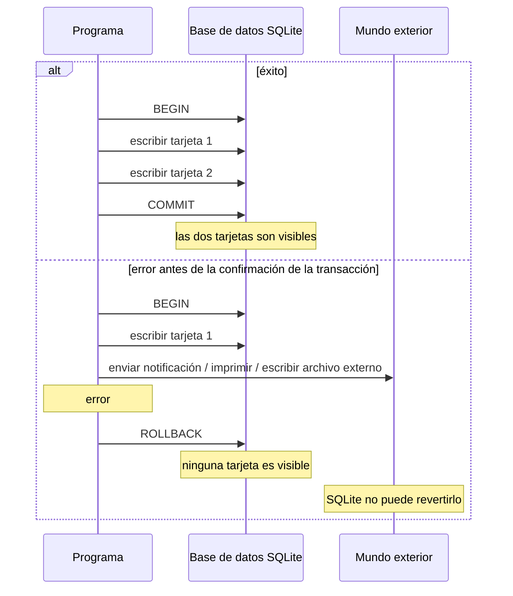

# Guía de estudio de efectos, errores y confirmación

## Para qué sirve esta guía

Un programa que no hace nada fuera de sí mismo es un calefactor caro. Los programas útiles imprimen, escriben archivos e insertan filas y entonces algo sale mal. Esta guía pregunta: **¿qué efectos sobreviven a un fallo y qué se confirma de verdad?** Las entradas del libro vuelven concreta la pregunta, porque varias terminan *fallando a propósito*. Una coincidencia de expresión regular devuelve "sin coincidencia" después de guardar una transacción. Una violación de restricción es la regla de parada. Un estado de salida 1 significa éxito.

Cuando termines, deberías poder:

1. Distinguir un efecto *revertido* (transacción de base de datos), uno *desenrollado* (el `local` de Perl) y uno que *queda hecho* (fila impresa, escritura en archivo, proceso ya ejecutado).
2. Explicar qué es una confirmación y por qué es el punto sin retorno, e identificar la confirmación en varias entradas.
3. Explicar por qué los efectos perezosos y un recurso cerrado rompen una confirmación, con los ejemplos de Haskell y PCRE2.
4. Explicar cómo un error puede ser una *señal*: un error de tamaño, una violación de restricción, un estado de salida.
5. Decir cómo se ve desde fuera una función de devolución de llamada fallida, una coincidencia fallida y un proceso fallido.
6. Etiquetar afirmaciones como garantizado, permitido por la implementación o aprovechado por accidente.

**Límites del alcance.** La guía usa hechos comprobados en las guías de lenguaje y en los ejercicios. No enseña el funcionamiento interno de las bases de datos ni las jerarquías de excepciones. Su capítulo de origen es [Efectos, errores y confirmación](../../informatica/07-efectos-errores-y-confirmacion.md).

## Antes de empezar

**Modelo de seguridad.** Las tarjetas son datos ficticios marcados con **DEMO ONLY**. Los programas pueden escribir en archivos o bases de datos locales de prueba y pueden iniciar procesos. Lee primero el código fuente y ejecútalo antes en un entorno aislado (*sandbox*) que limita el acceso al sistema anfitrión, por ejemplo `sandbox/container/run-image.sh src/regex-perl`. Trabaja con copias ([Ejecutar cosas con seguridad](../../exercises.md#ejecutar-con-seguridad)). Los experimentos de fallo pueden dejar archivos de prueba escritos a medias, así que usa una copia y una carpeta de datos de prueba.

**Regla de predicción.** Antes de cada experimento de fallo, escribe tres listas: qué se *deshará*, qué *permanecerá* y qué *verás en la terminal*. Suelen ser distintas.

**Vocabulario.**

| Término | Significado aquí |
| --- | --- |
| Efecto secundario | Un cambio que va más allá de devolver un valor: imprimir, escribir una fila, iniciar un proceso. |
| Transacción | Un grupo de operaciones que ocurren todas o no ocurre ninguna. |
| Confirmación | El punto en que un cambio se vuelve definitivo. |
| Reversión | Deshacer los cambios no confirmados de una transacción. No deshace los efectos que ocurren fuera de ella. |
| Restricción de integridad | Una regla que la base de datos aplica en cada escritura, como `CHECK(demo_only=1)`. |
| Estado de salida | Un número que devuelve un proceso para indicar cómo terminó. |

## El reto compartido

La [especificación del reto](../../introduccion.md#qué-hace-el-reto) pide tarjetas con una categoría y de 10 a 19 horas enteras. Las categorías se repiten en ciclo: `Meetings`, `Coding`, `Debugging` y `Learning`. Suma las horas de cada tarjeta al total acumulado. Detente cuando el total pasa de 40. Conserva la **primera tarjeta con la que el total pasa de 40**. Un total de exactamente 40 continúa. Cuatro tarjetas de 10 horas necesitan una quinta tarjeta, de la categoría `Meetings`. Las ejecuciones conformes tienen de 3 a 5 tarjetas y un total de 41 a 59 horas.

Comprueba por separado las *filas mostradas*, las *filas guardadas* y el *resumen*. Una tabla de SQLite puede aplicar `CHECK(demo_only=1)`. Un escritor de TSV aplica sus propias reglas. Algunas demos guardan en una sola transacción. pcre2grep guarda en llamadas separadas. .NET informa `captured` como resultado de la expresión regular. El resumen es una afirmación sobre la ejecución. Esta guía la contrasta con los efectos.

## La máquina que hay que identificar

Aquí las cinco preguntas tratan de los *efectos*.

**Qué se repite.** El paso que produce el efecto: se crea una tarjeta, se imprime y se guarda. En la mayoría de las entradas se repite hasta que salta la regla de parada. En `haskell-weird`, el efecto está dentro de cada celda perezosa, así que se repite a medida que se fuerzan las celdas.

**Dónde vive el estado.** Los efectos viven en tres lugares que fallan de forma distinta. *Dentro de la transacción*: las filas guardadas. *Fuera de ella*: las filas impresas, los archivos y la salida de los procesos. *En el motor*: el estado de retroceso que se desenrolla (el `local` de Perl), frente al estado que no se desenrolla (una estructura C de PCRE2).

**Qué hace avanzar el paso siguiente.** En el código con efectos, el orden de los efectos sigue el orden de *evaluación*. En programas perezosos o dirigidos por funciones de devolución de llamada, ese orden no coincide con el del texto fuente. Una función de devolución de llamada de tar ignora el estado de salida del comando que ejecuta, así que un tic fallido no hace avanzar nada.

**Qué lo detiene.** Un efecto puede detener una ejecución *fallando*. Por ejemplo: una violación de restricción (`stop rule fired: total exceeds 40`), un error de tamaño controlado, una rama de callout vetada, una bandera de parada o un estado de salida. Detenerse por fallo solo funciona si el fallo es *distinguible* de un error real.

**Qué confirma.** Algunas entradas emiten un solo `COMMIT` de SQLite después del bucle. En pcre2grep, las conexiones separadas de SQLite confirman automáticamente cuando terminan las sentencias auxiliares. CMake y Make emiten su sondeo final de la regla de parada después de las escrituras de las tarjetas. El anfitrión de .NET añade un informe TSV después de la coincidencia. El anfitrión de PCRE2 en C escribe y cierra un TSV en los callouts antes del fallo final. En ed y Ex, SQLite recibe las filas del lanzador cuando el editor termina.

<!-- diagram-source: lessons/cs-source/concepts/transaction.md#block-1 -->

La imagen del libro: la base de datos revierte su transacción, no todos los efectos que causó el programa. Una notificación enviada antes del error sigue enviada.

## Traza una ejecución

La traza decisiva aquí es la de un *fallo*. Para cada entrada, la tabla da el fallo que produjo un ejercicio verificado o una ejecución de prueba, y las tres listas.

| Entrada y fallo | Deshecho | Permanece | Visto desde fuera |
| --- | --- | --- | --- |
| `haskell-weird`, conteo vuelto perezoso (B2) | nada: sin confirmación | se imprimió la primera tarjeta | `handle is closed`, y la línea de resumen imprimió basura antes del cierre abrupto |
| `regex-dotnet`, añadir `(?!)` (B8) | todas las capturas | el anfitrión aún añade un informe de una ejecución vacía | `match returned: false`, `total=0 entries=0`, estado de salida 1 |
| `regex-pcre2grep`, ruta relativa del callout (B8) | no ocurrió nada | nada | **sin salida, estado de salida 0**: un callout que no puede iniciarse parece una rama vetada |
| `regex-perl` ejecución normal | `local` total e índice | filas impresas, los `INSERT`, la transacción | la coincidencia devuelve *falso* y los datos se guardan |
| `regex-pcre2` ejecución normal | no se revierte nada | el archivo, las filas, el resumen | `pcre2_match returned -1` y los datos se guardan |
| `make-gnu`, borrar `@:` (B4) | no se escribió ningún archivo de tarjetas que haya que rehacer | nada | `entries=0`, `re-executed 0 times` |
| `tcl-weird`, recursión desactivada (B12) | el segundo disparador nunca se activa | la tarjeta 2 se insertó y se contó | se imprimió una fila, `entries=2` |
| `tar-gnu-weird`, reloj demasiado corto (B17) | la tercera tarjeta nunca se cierra | dos tarjetas | `the clock ran out`, estado de salida 3 |
| `cobol-weird`, error de tamaño | la suma que desborda deja el campo | la tarjeta se registra primero | el manejador reconecta `NEXT-CARD`: un *error como regla de parada* |
| `javascript-events`, un escuchador de eventos lanza una excepción | una inserción sin confirmar: `ROLLBACK` una vez | filas ya impresas | `timecards: <message>` y estado de salida 1 |

**Cómo leer la tabla.** Las inserciones de SQLite, las impresiones en Perl y las escrituras de archivos en los callouts de C sobreviven al fallo final de la coincidencia. En .NET el motor solo devuelve el estado de la coincidencia. Una coincidencia fallida no deja capturas de tarjetas al anfitrión, aunque este aún escribe su encabezado de informe y su resumen. En el experimento de ruta relativa de pcre2grep, el proceso auxiliar inicial no logra iniciarse, así que no hay filas ni salida.

**Los tres tipos de "error como señal".** En `cobol-weird`, `ON SIZE ERROR` es un control local de errores aritméticos: el campo es demasiado pequeño, la cláusula se ejecuta y el programa la toma como regla de parada. En `make-gnu` y `cmake`, la última sentencia inserta `total <= 40` en una columna `CHECK(ok=1)`. SQLite la rechaza, imprime en stderr un error de restricción con nombre y la ejecución sigue hasta imprimir su resumen. La comprobación de la entrada exige que ese error aparezca *exactamente una vez*. El envoltorio de pcre2grep convierte en éxito el estado 1 de "sin coincidencia" del motor. El programa de sed también termina a propósito con estado 1. Su envoltorio exige además que SQLite termine con 0.

**Exactamente 40.** El límite muestra qué puede afirmar la confirmación. Antes de la corrección de los cinco nombres, una ejecución de regex o con encabezado `for` podía detenerse con cuatro tarjetas y un total de exactamente 40. Aun así confirmaba e imprimía `# committed total=40 entries=4`. El comprobador compartido la rechazaba. La afirmación de éxito de la propia entrada y el comprobador compartido discrepan: "confirmado" dice que los *datos se guardaron*, y el comprobador pregunta si se cumplió la *regla*. La confirmación no es corrección.

## Compara los diseños ordinarios y los raros

| Dimensión | Ordinario: hacer el trabajo y luego guardar | Efectos dentro de la maquinaria |
| --- | --- | --- |
| **Representación** | Calcular una lista y luego escribirla | Una escritura por paso, mientras el motor se ejecuta |
| **Observabilidad** | Inspeccionar la lista antes de guardar | La terminal y la base de datos pueden discrepar a mitad de la ejecución |
| **Pruebas** | Comparar la lista final con la base de datos | Comparar las filas impresas, las filas de la base de datos y el resumen: los comprobadores hacen las tres cosas |
| **Debugging** | Un fallo significa que no se guardó nada | Un fallo deja *algunos* efectos: debes saber cuáles |
| **Portabilidad** | E/S estándar | Depende de si la semántica del fallo está especificada (el estado de salida de un callout, el de un punto de control) |
| **Costo** | Un búfer de tarjetas | Efectos parciales y el riesgo de informar éxito por una ejecución parcial |

La entrada ordinaria `haskell` construye todo el script SQL como una cadena de texto pura, ejecuta `sqlite3` y solo entonces imprime las filas. La entrada rara imprime sobre la marcha. Ambas confirman una sola vez, pero solo la primera garantiza que *lo que se imprime es lo que se guardó*.

## Qué demuestran los ejercicios

| Ejercicio | Predice primero | Qué muestra la evidencia |
| --- | --- | --- |
| [B2. Haskell: rompe la pereza](../../exercises.md#b2-haskell-rompe-la-pereza-verificado) | Haz perezoso `entries`. | `handle is closed`. Forzar después de que el recurso se cerró. |
| [B8. Regex: qué sobrevive a una coincidencia fallida](../../exercises.md#b8-regex-qué-sobrevive-a-una-coincidencia-fallida-verificado) | `(?!)` en .NET; una ruta relativa en pcre2grep. | La coincidencia fallida de .NET no entrega capturas de tarjetas, y el anfitrión escribe un informe de cero filas. En pcre2grep el fallo del proceso auxiliar es silencioso. |
| [B12. Tcl: edita el programa en la base de datos](../../exercises.md#b12-tcl-edita-el-programa-en-la-base-de-datos-verificado) | Desactiva los disparadores recursivos. | Se imprime una fila, `entries=2`. |
| [B17. tar, más raro: predice el reloj](../../exercises.md#b17-tar-más-raro-predice-el-reloj-verificado) | Ejecuta con un diseño corto por un tic. | `the clock ran out`, estado de salida 3, dos tarjetas. Un reloj corto se atasca en lugar de dar error. |
| [A1. Lee las filas](../../exercises.md#a1-lee-las-filas-verificado) | ¿Qué tarjeta pasó de 40? | La salida por sí sola prueba que "el total antes de la última tarjeta es como máximo 40". |
| [F. Demuestra una afirmación de un README](../../exercises.md#f-demuestra-una-afirmación-del-readme-verificada) | ¿Puede fallar tu prueba? | Una afirmación necesita un control negativo. |

## Modos de fallo, costos y límites

| Comportamiento | Etiqueta | Por qué |
| --- | --- | --- |
| Los cambios no confirmados de una transacción se deshacen con la reversión, pero no los efectos fuera de ella | **garantizado** | Semántica de las bases de datos. |
| Un error de tamaño deja sin cambios el campo receptor | **garantizado** | Semántica especificada de COBOL. |
| Perl desenrolla `local` en el retroceso, no las impresiones | **garantizado** | Perl documentado. |
| Un `Match` fallido de .NET no entrega capturas de tarjetas | **garantizado** dentro de la API de expresiones regulares de .NET | El ejercicio B8 demuestra esta propiedad. El anfitrión aún puede escribir su informe de una ejecución vacía. |
| Una inserción normal de 0 en `demo_only INTEGER NOT NULL CHECK(demo_only=1)` falla | **garantizado** con las comprobaciones de restricciones de SQLite activadas | SQLite aplica las restricciones de columna declaradas. Las entradas de TSV no usan ninguna restricción así. |
| `SYSTEM` devuelve un estado de espera sin procesar (el estado de salida 3 aparece como 768) | **permitido por la implementación** | Un detalle del anfitrión del entorno de ejecución de COBOL probado. |
| tar ignora el estado de salida del comando de punto de control | **aprovechado por accidente** | Observado en las versiones probadas. La entrada hace que la máquina sea segura frente a ello. |
| `pcre2grep` no puede distinguir un callout que no logró iniciarse de una rama vetada | **permitido por la implementación** | Es su propio diseño y la causa del resultado silencioso de B8. |
| SQLite rechaza una inserción que viola un `CHECK` e imprime un error con nombre | **garantizado** | Semántica de las bases de datos. Las entradas *eligen* que ese mensaje sea el anuncio de la regla de parada y lo exigen exactamente una vez. |

**Costos que debes declarar.**

- **Informar éxito por un trabajo parcial.** La línea de resumen dice `committed` pase lo que pase. Los comprobadores la comparan con las filas.
- **Fallo silencioso.** Un callout que no se inicia, un `s` fallido, un reloj demasiado corto, una receta que se expande a nada: todos se detienen en silencio.
- **Efectos fuera de la transacción.** Nada de lo que se imprime, envía o escribe en otro lugar se revierte.
- **Idempotencia.** Volver a ejecutar una entrada añade *otra* ejecución a la base de datos. Las tablas conservan el historial de cada ejecución. Reintentar no es inofensivo.
- **Dónde es legítimo.** Un error usado como señal normal es habitual en los scripts del intérprete de comandos (*shell*) y en el diseño basado en restricciones. Por ejemplo, `grep` termina con estado 1 para "sin coincidencia". La acrobacia consiste en terminar un programa de esa manera.

## Conexiones a lo largo del repositorio

- **Guías de lenguaje.** [Haskell](../lenguajes/haskell.md), [Motores de expresiones regulares y sed](../lenguajes/motores-de-regex-y-sed.md), [Make y CMake](../lenguajes/make-y-cmake.md), [COBOL](../lenguajes/cobol.md), [Tcl](../lenguajes/tcl.md), [tar](../lenguajes/tar.md), [JavaScript](../lenguajes/javascript.md) y [ed y Ex](../lenguajes/ed-y-ex.md) tienen cada una un caso de fallo más arriba.
- **Demanda.** [Evaluación, demanda y pereza](evaluacion-demanda-y-pereza.md) explica por qué los efectos perezosos se confirman tarde.
- **Autoridad.** [Lectura de programas adversariales](lectura-de-programas-adversariales.md): el `CHECK` de la base de datos es autoridad a nivel de datos.
- **Portabilidad.** [Portabilidad, abstracción y costo](portabilidad-abstraccion-y-costo.md) trata qué semánticas de fallo se prometen.
- **En el libro.** [Efectos secundarios](../../informatica/07-efectos-errores-y-confirmacion.md#efectos-secundarios), [Manejo de excepciones](../../informatica/07-efectos-errores-y-confirmacion.md#manejo-de-excepciones), [Estado de salida](../../informatica/07-efectos-errores-y-confirmacion.md#estado-de-salida), [Restricciones de integridad](../../informatica/07-efectos-errores-y-confirmacion.md#restricciones-de-integridad), [Retroceso](../../informatica/07-efectos-errores-y-confirmacion.md#retroceso), [El corte](../../informatica/07-efectos-errores-y-confirmacion.md#el-corte-cómo-fijar-una-elección), [Transacciones](../../informatica/07-efectos-errores-y-confirmacion.md#transacciones) e [Idempotencia](../../informatica/07-efectos-errores-y-confirmacion.md#idempotencia).

## Autoevaluación

Responde cada pregunta con tus propias palabras antes de leer el texto en cursiva. Di qué evidencia respaldaría cada respuesta.

1. **Traza.** En `regex-perl`, la coincidencia termina devolviendo falso después de tres tarjetas. ¿Cuáles de estos elementos sobreviven: los `INSERT`, las filas impresas, el total de `local`, la transacción? *(Los `INSERT`, las filas impresas y la transacción confirmada sobreviven. El total de `local` se restaura cuando el motor retrocede.)*
2. **Explica.** ¿Por qué la ejecución de CMake imprime `CHECK constraint failed: stop rule fired` y aun así informa `committed`? *(La inserción fallida es el testigo de la regla de parada, y es la última sentencia. Las filas de las tarjetas ya estaban guardadas, sin transacción externa, así que el error anuncia la parada y no se pierde nada. La comprobación de la entrada exige el error exactamente una vez.)*
3. **Transfiere.** En un servicio que conozcas, nombra un efecto fuera de la transacción de la base de datos que una reversión no desharía. *(Por ejemplo, un correo enviado, un mensaje publicado o un archivo escrito. Haz que ocurra después de la confirmación, o hazlo idempotente.)*
4. **Evidencia.** Un revisor dice: "El programa `javascript-events` revierte exactamente una vez al fallar". Diseña una prueba que pueda fallar. *(Inyecta un mundo cuyo `open` o `rng` lance una excepción, cuenta las llamadas a `ROLLBACK` y las líneas de error, y comprueba que haya una de cada una. El control negativo quita el `removeAllListeners` en `failed`, lo que debería permitir que un segundo fallo informe otra vez.)*

## Lecturas adicionales

- [Transacción de base de datos](https://en.wikipedia.org/wiki/Database_transaction) (Wikipedia): atomicidad y confirmación.
- [ACID](https://en.wikipedia.org/wiki/ACID) (Wikipedia): las cuatro promesas que hace una transacción.
- [Estado de salida](https://en.wikipedia.org/wiki/Exit_status) (Wikipedia): la forma en que un proceso dice cómo terminó.
- [Restricción de integridad](https://en.wikipedia.org/wiki/Integrity_constraint) (Wikipedia): reglas que aplica la base de datos.
- [Idempotencia](https://en.wikipedia.org/wiki/Idempotence) (Wikipedia): por qué un reintento puede ser seguro o no.
