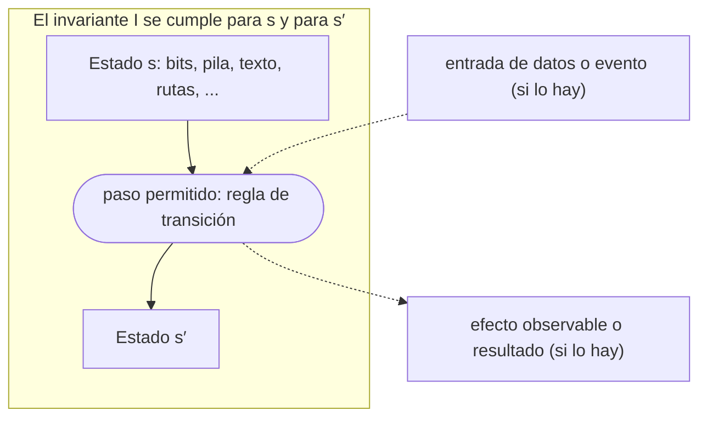

# Guía de estudio de estado y control más allá de las variables

## Para qué sirve esta guía

Esta guía responde dos preguntas sobre cada programa: **¿qué se ejecuta después y qué recuerda?** La mayoría de los lenguajes responden con un contador de programa, una pila de llamadas y variables. Las entradas del libro responden en otro sitio. Pueden ser un destino de salto, una posición de análisis o el conjunto de archivos que existen. Pueden ser las capturas de una regex, el texto fuente o las filas de una tabla. Pueden ser una cadena de clases o el tamaño de un archivo tar. La guía te enseña a encontrar la respuesta en un programa que no tiene un bucle evidente ni una variable evidente.

Cuando termines, deberías poder:

1. Describir cualquier programa como una máquina: un estado, un conjunto de pasos permitidos, una representación y un invariante.
2. Para COBOL, Forth, Make, CMake, Tcl, APL, Common Lisp, ed, Ex y tar, decir dónde se guarda el *paso siguiente* y dónde el *estado recordado*. Decir también en qué se diferencian.
3. Explicar por qué un depurador que muestra variables puede dar una imagen incompleta de un programa así.
4. Distinguir dos tipos de estado de control. El primero son *datos que el programa edita* (un destino de salto, una marca, texto fuente). El segundo se *deriva* (un contador, una posición).
5. Enunciar un invariante de un programa y decir cómo su salida podría probarlo o refutarlo.
6. Etiquetar cada afirmación como comportamiento garantizado, permitido por la implementación o aprovechado por accidente.

**Límites del alcance.** Esta guía usa hechos verificados en las guías de lenguaje y no repite sus trazas. No trata la concurrencia ni el bucle de eventos (consulta [Eventos, funciones de devolución de llamada y control reactivo](eventos-retrollamadas-y-control-reactivo.md)). Sus capítulos de origen son [¿Qué cuenta como una máquina?](../../informatica/02-que-cuenta-como-maquina.md), [Flujo de control y continuaciones](../../informatica/03-flujo-de-control-y-continuaciones.md) y [Estado más allá de las variables](../../informatica/06-estado-mas-alla-de-las-variables.md). `find` y AWK se citan aquí en lugar de tener su propia guía.

## Antes de empezar

**Modelo de seguridad.** Las tarjetas son datos ficticios marcados con **DEMO ONLY**. Los programas pueden escribir en archivos o bases de datos locales de prueba y pueden iniciar procesos. Lee primero el código fuente y ejecútalo antes en un entorno aislado (*sandbox*) que limita el acceso al sistema anfitrión, por ejemplo `sandbox/container/run-image.sh src/cobol-weird`. Trabaja con copias ([Ejecutar cosas con seguridad](../../exercises.md#running-things-safely)).

**Regla de predicción.** Antes de cada ejecución, escribe los *dos* datos que necesita una traza: dónde está el programa y qué recuerda. Son columnas distintas. En el `ALTER` de COBOL, una te dice dónde *está* la ejecución y la otra te dice adónde *irá* el siguiente `GO TO`.

**Vocabulario.**

| Término | Significado aquí |
| --- | --- |
| Estado | Todo lo que persiste entre pasos y puede cambiar un paso posterior. |
| Contador de programa | El lugar que dice qué se ejecuta después. |
| Representación | Cómo se escribe un valor: bits, texto, marcas, una posición. |
| Invariante | Un hecho que sigue siendo cierto mientras la máquina se ejecuta, al menos después de cada paso. |
| Continuación | "El resto de la computación", guardado como algo distinto de un marco de pila. |

## El reto compartido

La [especificación del reto](../../introduccion.md#what-the-challenge-does) pide tarjetas con una categoría y de 10 a 19 horas enteras. Las categorías se repiten en ciclo: `Meetings`, `Coding`, `Debugging` y `Learning`. Suma las horas de cada tarjeta al total acumulado. Detente cuando el total pasa de 40. Conserva la **primera tarjeta con la que el total pasa de 40**. Un total de exactamente 40 continúa. Cuatro tarjetas de 10 horas necesitan una quinta tarjeta, de la categoría `Meetings`. Las ejecuciones conformes tienen de 3 a 5 tarjetas y un total de 41 a 59 horas.

Como máquina, el reto tiene un estado pequeño: `(cards so far, total)`, más la categoría siguiente. Un paso toma una cantidad de horas, la suma al total, registra la tarjeta y continúa o termina. El *invariante* tras cada tarjeta registrada es "el total es igual a la suma de las horas registradas". En la variante rara de COBOL hay un segundo invariante, que solo se cumple tras cada suma exitosa: `WS-HEADROOM` es igual a 59 más el total. Los ejemplos de esta traza representan esa máquina de maneras distintas. Las demostraciones fijas de LINQ y el techo de XAML muestran dónde el modelo compartido necesita una regla de parada adicional.

## La máquina que hay que identificar

Usa esta hoja de trabajo para cada entrada. Las cinco respuestas de la primera columna se comprobaron en las guías de lenguaje.

**Qué se repite.** ¿Qué es lo que ocurre otra vez? Un párrafo ejecutado, una posición de análisis rebobinada, una compilación reiniciada, una pasada de regex, un evento, un método de una cadena, un tic. La repetición no siempre está en el código: en Make es el *proceso completo*, y en Ex es un registro que se ejecuta a sí mismo.

**Dónde vive el estado.** Los datos recordados, más allá de las variables que puedes ver:

| Entrada | El paso siguiente se guarda en | La memoria se guarda en |
| --- | --- | --- |
| [`cobol-weird`](../lenguajes/cobol.md) | el destino de un `GO TO` (que cambia `ALTER`) | `WS-TOTAL` y `WS-HEADROOM` (59 más el total) |
| [`forth-weird`](../lenguajes/forth.md) | la posición de análisis `>in` | la pila de datos: `( n total anchor )` |
| [`make-gnu`](../lenguajes/make-y-cmake.md) | qué archivos `.tc-N.mk` existen y `MAKE_RESTARTS` | los mismos archivos, una tarjeta cada uno |
| [`cmake`](../lenguajes/make-y-cmake.md) | las capturas de la regex `CMAKE_MATCH_1`..`5`, reconstruidas en cada pasada | las mismas capturas, como tramos de `x` |
| [`tcl-weird`](../lenguajes/tcl.md) | el disparador de SQLite que se activa otra vez | filas de tabla, y `count(*)` para el número de tarjeta |
| [`apl-weird`](../lenguajes/apl.md) | la cadena de llamadas de funciones escritas en tiempo de ejecución | genes: cuatro líneas del código fuente de cada función |
| [`lisp-weird`](../lenguajes/common-lisp.md) | la lista de precedencia de clases | el objeto `ledger` |
| [`ed-weird`](../lenguajes/ed-y-ex.md) | la siguiente línea que coincide con un comando global | marcas (`x`) en cada línea y una línea de registro |
| [`ex-weird`](../lenguajes/ed-y-ex.md) | el registro `n`, copiado de una línea de la cinta | la posición de la marca `t` en la cinta: el total |
| [`tar-gnu-weird`](../lenguajes/tar.md) | las funciones de devolución de llamada de los puntos de control de tar | una fila `fsm` en SQLite |
| [`find-gnu`](../../../src/find-gnu/README.md) | el recorrido hacia el directorio recién creado | la profundidad de la ruta: el total |
| [`awk-weird`](../../../src/awk-weird/README.md) | el propio bucle de registros de awk | el flujo y el separador de registros `RS` |

**Qué hace avanzar el paso siguiente.** Algo debe cambiar el estado, y no siempre es una sentencia del propio programa. El intérprete de texto de Forth y el recorrido de `find` son *el entorno* que hace avanzar el programa. También lo son el bucle de registros de awk, los puntos de control de tar y la maquinaria de disparadores de SQLite.

**Qué lo detiene.** Cómo se detiene la máquina. Puede ser un campo que se desborda, una bandera que vale cero o un archivo que no se escribe. También un literal de 41 caracteres, un comentario en una línea de la cinta, una compresión vacía o un método que devuelve true. Una regla de parada puede ser un *valor* (una bandera) o una *ausencia* (ningún archivo, ninguna fila, ninguna entrada de datos pendiente).

**Qué confirma.** Busca dónde los efectos se vuelven permanentes. Una transacción puede reunir toda una ejecución, mientras que pcre2grep usa llamadas de SQLite separadas y el anfitrión de regex de .NET añade un informe TSV. Estado y confirmación son asuntos distintos: un depurador puede ver el estado aunque la confirmación no haya ocurrido.

<!-- diagram-source: lessons/cs-source/chapters/02-what-counts-as-a-machine.md#block-1 -->

La imagen del libro de una máquina: un estado, un paso permitido y un invariante que se cumple a través de él. Cada fila de la tabla anterior es una manera de llenar los recuadros.

## Traza una ejecución

Con las horas 15, 19, 12, aquí está la *misma máquina* en tres sustancias. Cada una se verificó ejecutando una copia de prueba en el entorno aislado.

| Paso | `cobol-weird`: destino de `NEXT-CARD`, margen | `make-gnu`: archivos al inicio de la pasada, total | `ex-weird`: marca `t` (línea de la cinta), instrucción |
| --- | --- | --- | --- |
| inicio | Meetings, 59 | ninguno, 0 | 0, `@a` |
| tarjeta 1 (15) | Coding, 74 | `.tc-0.mk`, 15 | 15, `@a` |
| tarjeta 2 (19) | Debugging, 93 | `.tc-0.mk` `.tc-1.mk`, 34 | 34, `@a` |
| tarjeta 3 (12) | **FINISH-RUN**, 93 (la suma se desbordó y dejó 93) | tres archivos, 46 | 46, `"` (un comentario: detenerse) |

Lee en horizontal. Tres sustancias distintas guardan los mismos datos: un destino de salto y un número, un conjunto de archivos, una posición en una cinta. El invariante "el total es igual a la suma de las horas" es cierto en todas las columnas, pero hay que *calcularlo* de forma distinta. En COBOL es `headroom - 59` hasta el desbordamiento. En Make es la longitud de la lista `x` construida a partir de los archivos. En Ex es el número que está bajo la marca.

**Mira el estado en que se detiene.** En COBOL, `WS-HEADROOM` contuvo 93 *dos veces*: una después de una suma exitosa y otra después de una fallida. Un campo puede tener el mismo valor en dos momentos con dos significados distintos. Eso indica que el estado del programa está en parte en otro lugar: aquí, en el destino de salto.

**Exactamente 40.** Una entrada conforme tiene disponible una quinta tarjeta aunque haya cuatro nombres de categoría distintos. Un suministro de cuatro ranuras lo hace imposible, como en XAML y en las implementaciones originales de cuatro nombres ([Diseño comparado de máquinas](diseno-comparativo-de-maquinas.md) traza las correcciones). La *representación* de la máquina decide qué frontera puede expresar.

## Compara los diseños ordinarios y los raros

| Dimensión | Ordinario (variables y un bucle) | Control y estado guardados en otro lugar |
| --- | --- | --- |
| **Representación** | `total`, `count`, una condición de bucle | Un destino de salto, una posición, un conjunto de archivos, capturas, texto fuente |
| **Observabilidad** | Imprime las variables | Debes mirar en el lugar correcto: el destino, `>in`, `ls`, los registros, `⎕CR` |
| **Pruebas** | Hacer una prueba unitaria de una función | Probar la máquina completa, con entradas de datos controladas (`DICE`, `SEED`, `--hours`) |
| **Debugging** | Vigilar variables | Una vigilancia de variables es *incompleta*: no ve el estado de control |
| **Portabilidad** | Lenguaje estándar | Depende de la característica que guarda el estado (`ALTER`, `>in`, `MAKE_RESTARTS`, `CMAKE_MATCH_n`) |
| **Costo** | Normal | Revisabilidad y reentrada: dos llamadores no pueden compartir un mismo destino de salto reescrito ni una misma posición de análisis |

Un lenguaje puede ocultarte el estado de control de dos maneras. Puede guardarlo *en datos que no consideras estado* (un destino de salto). O puede guardarlo *en el entorno* (el sistema de archivos, la base de datos). Ambas lo ocultan a una vista que solo mira variables.

## Qué demuestran los ejercicios

| Ejercicio | Predice primero | Lo que muestra la evidencia |
| --- | --- | --- |
| [B1. COBOL: predice y luego rompe ALTER](../../exercises.md#b1-cobol-predict-then-break-alter-verified) | Empieza el margen en 49. ¿Dónde se detiene la ejecución? | Por encima de 50. Un número de los datos codifica la regla, y la comprobación propia de la entrada falla porque tiene el 40 fijo en el código. |
| [B3. Forth: mueve el ancla](../../exercises.md#b3-forth-move-the-anchor-verified) | Escribe `>in @ 0 0 step rewind?` (estado después del ancla). | No se detiene: el estado se vuelve a crear en cada pasada. El *orden* del estado y del ancla forma parte del programa. |
| [B4. Make: quita la operación nula y anula el reloj](../../exercises.md#b4-make-remove-the-no-op-and-override-the-clock-verified) | Borra `@:`. | `entries=0`: no se ejecutó ningún comando, así que ningún archivo se "rehízo" y Make nunca se reinició. |
| [B5. CMake: muta el literal](../../exercises.md#b5-cmake-mutate-the-literal-verified) | Acorta el literal de 41 `x`. | La regla de parada se mueve, porque el literal *es* la regla. |
| [B19. Ex: mueve el límite en la cinta y corta el bucle](../../exercises.md#b19-ex-move-the-limit-on-the-tape-and-cut-the-loop-verified) | Quita `\|@n`. | Una tarjeta. Nada vuelve a ejecutar el registro, así que el programa nunca se reinicia solo. |
| [C3. Un bucle cuyo estado no es una variable](../../exercises.md#c3-a-loop-whose-state-is-not-a-variable-verified) | En awk, sin ninguna palabra clave de bucle, imprime de 1 a N para una N que elige quien llama. ¿Dónde puede vivir el estado? | En la entrada de datos: los datos de *quien llama* son el contador. |

## Modos de fallo, costos y límites

| Comportamiento | Etiqueta | Por qué |
| --- | --- | --- |
| Un error de tamaño deja sin cambios el campo receptor | **garantizado** | Semántica especificada de COBOL. |
| El compilador acepta `ALTER` | **permitido por la implementación** | Eliminado del estándar en 2002; GnuCOBOL todavía lo ejecuta. |
| `>in` contiene el desplazamiento de análisis y se puede escribir | **garantizado**: existe | Adónde apunta después de `>in @` depende del sistema. |
| Make se vuelve a ejecutar a sí mismo después de rehacer un makefile incluido | **permitido por la implementación** | Comportamiento documentado de GNU Make. |
| Usar ese reinicio como un bucle, con una receta que se expande a nada y no cuenta como un rehacer | **aprovechado por accidente** | El propio ejemplo del libro. |
| El `MATCHES` principal se ejecuta aunque la prueba de parada de CMake ya haya dicho que hay que parar | **aprovechado por accidente** | Observado, y necesario para registrar la última tarjeta. |
| La combinación de métodos `or` se detiene en el primer método verdadero | **garantizado** | Definido por ANSI Common Lisp. |
| El recuento de puntos de control de tar al listar difiere del de al crear | conocimiento **aprovechado por accidente** | Solo se usa la creación. |

**Costos que hay que enunciar.**

- **Una vista solo de variables miente.** En COBOL, Forth, Make y CMake, las variables son un estado incompleto.
- **Reentrada.** El estado guardado en el propio flujo de control del código lo comparte cada llamador. Esa fue la objeción fatal contra `ALTER`.
- **Dónde es legítimo.** Una posición de análisis es como funcionan todos los analizadores sintácticos. Un reinicio es como los sistemas de construcción se regeneran a sí mismos. Un disparador de base de datos mantiene invariantes. Una tabla de saltos es una máquina de estados. La acrobacia consiste en usarlos como *único* estado.
- **Fallo silencioso.** Un conteo de líneas incorrecto en la copia de APL (`4↓` en lugar de `5↓`) es un fallo sin ningún error. Lo son también una errata en un patrón de ed y un `s` que no coincide con nada.

## Conexiones a lo largo del repositorio

- **Las guías de lenguaje.** [COBOL](../lenguajes/cobol.md), [Forth](../lenguajes/forth.md), [Make y CMake](../lenguajes/make-y-cmake.md), [Tcl](../lenguajes/tcl.md), [APL](../lenguajes/apl.md), [Common Lisp](../lenguajes/common-lisp.md), [ed y Ex](../lenguajes/ed-y-ex.md) y [tar](../lenguajes/tar.md) trazan cada una una de estas máquinas.
- **Demanda y pereza.** [Evaluación, demanda y pereza](evaluacion-demanda-y-pereza.md) pregunta *cuándo* se ejecuta un paso; esta guía pregunta *dónde se guarda*. [Haskell](../lenguajes/haskell.md) lo guarda en una dependencia de datos.
- **Eventos.** [Eventos, funciones de devolución de llamada y control reactivo](eventos-retrollamadas-y-control-reactivo.md) pregunta quién es dueño del turno siguiente.
- **Lectura segura.** [Lectura de programas adversariales](lectura-de-programas-adversariales.md) usa "¿dónde está el estado?" como primera pregunta.
- **En el libro.** [¿Qué cuenta como una máquina?](../../informatica/02-que-cuenta-como-maquina.md), [El contador de programa](../../informatica/03-flujo-de-control-y-continuaciones.md#the-program-counter), [Código automodificable](../../informatica/03-flujo-de-control-y-continuaciones.md#self-modifying-code), [Estado](../../informatica/06-estado-mas-alla-de-las-variables.md#state) y [Grafos de dependencia](../../informatica/06-estado-mas-alla-de-las-variables.md#dependency-graphs).

## Autoevaluación

Responde cada pregunta con tus propias palabras antes de leer el texto en cursiva. Di qué evidencia respaldaría cada respuesta.

1. **Traza.** En `ex-weird` con `DICE="2 2 2 2 2"` (12 horas cada una), indica la posición de la marca y la instrucción de la cinta después de cada pasada. *(12 `@a`, 24 `@a`, 36 `@a`, 48 `"`. Cuatro tarjetas. El quinto dado no se usa.)*
2. **Explica.** ¿Por qué un depurador que vigila `WS-TOTAL` y `WS-ENTRIES` en `cobol-weird` da una imagen incompleta? *(La categoría siguiente se guarda en el destino del `GO TO` de `NEXT-CARD`, que no es una variable. También debes conocer el último `ALTER` que se ejecutó.)*
3. **Transfiere.** Nombra dónde se guarda el paso siguiente en un analizador sintáctico descendente recursivo y en el bucle principal de un juego. *(Un analizador sintáctico: la pila de llamadas y la posición de entrada. Un bucle de juego: la sentencia de bucle y el objeto de estado del juego, con el fotograma como reloj.)*
4. **Evidencia.** Un revisor dice: "El estado de bucle de Make es solo el conjunto de archivos `.tc-N.mk`". Diseña una prueba que pueda fallar. *(Ejecuta en un directorio vacío, registra los archivos después de cada pasada y comprueba que borrar uno cambia el número de tarjetas y el número de reinicios. El control negativo es una ejecución que deja un archivo obsoleto, que la entrada rechaza. Etiqueta de la afirmación: permitido por la implementación.)*

## Lecturas adicionales

- [Estado (informática)](https://en.wikipedia.org/wiki/State_(computer_science)) (Wikipedia): qué cuenta como estado.
- [Máquina de estados finitos](https://en.wikipedia.org/wiki/Finite-state_machine) (Wikipedia): el sentido formal de "estado y paso".
- [Contador de programa](https://en.wikipedia.org/wiki/Program_counter) (Wikipedia): el registro detrás de "qué se ejecuta después".
- [Continuación](https://en.wikipedia.org/wiki/Continuation) (Wikipedia): la idea de que "el resto de la computación" puede guardarse como un valor.
