# Guía de estudio de evaluación, demanda y pereza

## Para qué sirve esta guía

Esta guía hace una pregunta a cada entrada: **¿quién exige trabajo y cuándo?** Las mismas tres tarjetas admiten cuatro estrategias. Se puede calcular todo y recortar. Se puede calcular justo lo que se pide. Se puede describir una consulta que se ejecuta de nuevo cada vez. O un consumidor puede extraer, por demanda (*pull*), una tarjeta a la vez. Los efectos difieren. Cuando el trabajo tiene efectos secundarios, el "cuándo" decide qué filas existen.

Cuando termines, deberías poder:

1. Definir la evaluación inmediata, la perezosa, la diferida y la de demanda y decir qué entradas usan cuál.
2. Para una entrada dada, decir cuántos valores *extrae* para producir tres tarjetas y cuáles de ellos nunca se usaron.
3. Explicar por qué un evaluador perezoso recuerda un valor y una canalización diferida lo recalcula, y dar la evidencia.
4. Explicar cómo la evaluación de cortocircuito puede servir de regla de parada y por qué no es igual en todos los lenguajes.
5. Predecir qué cambia cuando se mueve el punto donde hay que forzar un valor respecto a la vida útil de un recurso.
6. Etiquetar afirmaciones como garantizado, permitido por la implementación o aprovechado por accidente.

**Límites del alcance.** La guía compara las entradas con hechos comprobados en las guías de lenguaje. No enseña mónadas, teoría de categorías ni los sistemas de tipos que intervienen. Su capítulo de origen es [Evaluación y demanda](../../informatica/04-evaluacion-y-demanda.md). Para los eventos, un pariente de estilo *push*, consulta [Eventos, funciones de devolución de llamada y control reactivo](eventos-retrollamadas-y-control-reactivo.md).

## Antes de empezar

**Modelo de seguridad.** Las tarjetas son datos ficticios marcados con **DEMO ONLY**. Los programas pueden escribir en archivos o bases de datos locales de prueba y pueden iniciar procesos. Lee primero el código fuente y ejecútalo antes en un entorno aislado (*sandbox*) que limita el acceso al sistema anfitrión (`sandbox/container/run-image.sh src/haskell-weird`). Trabaja con copias ([Ejecutar cosas con seguridad](../../exercises.md#running-things-safely)).

**Regla de predicción.** Antes de cada ejecución, escribe cuántos valores de horas se *extraerán* y qué habrá *ocurrido* en cada momento. En este tema el orden de los efectos forma parte de la respuesta.

**Vocabulario.**

| Término | Significado aquí |
| --- | --- |
| Evaluación inmediata | Calcular al escribir: todos los valores, ahora. |
| Perezosa (por necesidad) | Calcular cuando se pide por primera vez y recordar el resultado. |
| Diferida | Describir ahora, ejecutar cuando algo enumera y volver a ejecutar cada vez. |
| Demanda | Un consumidor pide el siguiente valor. |
| Forzar | Evaluar un cálculo suspendido, hasta donde lo exige la demanda. |

## El reto compartido

La [especificación del reto](../../introduccion.md#what-the-challenge-does) pide tarjetas con una categoría y de 10 a 19 horas enteras. Las categorías se repiten en ciclo: `Meetings`, `Coding`, `Debugging` y `Learning`. Suma las horas de cada tarjeta al total acumulado. Detente cuando el total pasa de 40. Conserva la **primera tarjeta con la que el total pasa de 40**. Un total de exactamente 40 continúa. Cuatro tarjetas de 10 horas necesitan una quinta tarjeta, de la categoría `Meetings`. Las ejecuciones conformes tienen de 3 a 5 tarjetas y un total de 41 a 59 horas.

En las implementaciones que siguen la regla numérica, *el consumidor quiere tarjetas hasta que el total pasa de 40, y la tarjeta que cruza debe existir*. Las dos entradas de LINQ con semana fija terminan, en cambio, con 40 horas, así que el generador de la traza siguiente es un experimento didáctico aparte. La tarjeta que cruza es la incómoda, porque solo sabes que una tarjeta cruza si la construyes. Toda estrategia debe responder: "¿cuántos valores produje para averiguarlo?" Esa cuenta es la medida más clara del costo de cada estrategia.

## La máquina que hay que identificar

**Qué se repite.** En un programa de evaluación inmediata, un bucle o una primitiva de arreglo. En un programa perezoso, la *demanda*: cada petición del siguiente elemento ejecuta un paso. En un programa diferido, cada enumeración vuelve a ejecutar la canalización.

**Dónde vive el estado.** Evaluación inmediata: en variables o arreglos. Perezosa: en cálculos suspendidos que recuerdan su valor (Haskell). Diferida: en ninguna parte, salvo la descripción de la canalización, y por eso enumerar dos veces repite los efectos. Demanda: en la clausura (*closure*) del iterador (`javascript-weird`).

**Qué hace avanzar el paso siguiente.** El consumidor. En `haskell`, `span`. En `javascript-weird`, `toArray`. En LINQ, el `Aggregate` o el `ToList` final. En un programa de evaluación inmediata, el contador de programa.

**Qué lo detiene.** El consumidor *deja de pedir* o responde un marcador de fin (la máquina dice `undefined`). En el `or` de Lisp, el primer resultado verdadero impide que se ejecuten más métodos.

**Qué confirma.** El punto en que un efecto se vuelve permanente. Cuando los efectos viven dentro de valores perezosos (`haskell-weird`), la confirmación de la transacción depende de *cuándo se fuerzan los valores*.

```mermaid
flowchart TB
    accTitle: El mismo prefijo pedido puede implicar trabajo distinto
    accDescr: Tres carriles muestran un consumidor que pide solo los dos primeros elementos de una secuencia de cinco. En el carril de evaluación inmediata se calculan primero los cinco valores de 1 a 5. El consumidor toma 1 y 2, y de 3 a 5 se calcularon pero no se usaron. En el carril perezoso por necesidad se construyen thunks. Se pide 1, se evalúa y se guarda en caché; se pide 2, se evalúa y se guarda en caché. De 3 a 5 nunca se evalúan. En el carril de la canalización diferida, la canalización se define y no ocurre ningún trabajo. Luego, al enumerar, se calculan y se producen 1 y 2. Enumerar otra vez puede repetir el trabajo, porque lo diferido no se memoiza de forma automática.
    subgraph DEFER["Diferido, como LINQ"]
        D1["definir: sin trabajo"] --> D2["enumerar: 1, 2"] --> D3["enumerar otra vez: repite"]
    end
    subgraph LAZY["Perezoso, a pedido"]
        L1["armar thunks"] --> L2["demanda 1: caché"] --> L3["demanda 2: caché"] --> L4["de 3 a 5: sin ejecutar"]
    end
    subgraph EAGER["Inmediato, como arreglo"]
        E1["construir"] --> E2["calcular de 1 a 5"] --> E3["consumidor toma 1, 2"] --> E4["de 3 a 5: sin usar"]
    end
    classDef unused stroke-dasharray: 5 3
    class E4,L4,D3 unused
```

<!-- diagram-source: lessons/cs-source/chapters/04-evaluation-and-demand.md#block-1 -->

La imagen del libro: el mismo prefijo pedido, tres carriles. El carril de evaluación inmediata calcula todo y recorta, el perezoso calcula solo lo que se pide y el diferido puede rehacer el trabajo al enumerar otra vez.

## Traza una ejecución

Para las horas 15, 19, 12 la pregunta es "¿cuántos valores se extrajeron para producir tres tarjetas?" Cada número de abajo se observó en una ejecución, o se indica como leído del código.

| Entrada | Estrategia | Valores extraídos para 3 tarjetas conservadas | Evidencia |
| --- | --- | ---: | --- |
| `apl` | inmediata, arreglo completo | **5** extraídos, 2 descartados | el programa extrae cinco por adelantado (`?5⍴10`), y el *scan* y el *take* los recortan |
| `haskell` y `haskell-weird` | perezosa por necesidad | **3** | una ejecución de prueba con `[15, 19, 12] ++ error "a 4th card was demanded"` terminó con normalidad en ambos |
| `ModernChallenge1` y el encabezado simple de Node | condiciones de evaluación inmediata | **3** | fuente: C# enumera de inmediato una proyección diferida con `Sum()`; Node aplica de inmediato `reduce`. Ambos comprueban el total antes de la siguiente extracción. |
| Generador LINQ de prueba con `TakeWhile` que conserva la tarjeta que cruza | diferida, por demanda | **4** | una ejecución de consola de prueba imprimió cuatro líneas `drew`: la prueba debe ver fallar la tarjeta posterior a la que cruza |
| `javascript-weird` | demanda | **3** extracciones, **4** peticiones | la máquina respondió cuatro veces; la cuarta dijo `undefined` |
| `lisp-weird` | cadena de métodos, `or` | **3** | se ejecutaron tres métodos y dos no |
| `cmake` | pasada de expresión regular, sin cortocircuito | **4** búsquedas | los registros finales contenían una cuarta búsqueda (10 horas) que nunca se registró |
| `tar-gnu`, `ed-weird`, `ex-weird` | extracciones por adelantado | **5** extraídos, 3 cuentan | el constructor o el lanzador extrae primero cinco valores |
| `m4` | reescaneo | **3** | tres expansiones de `tc_card` |

Lee la columna por estrategia. Las implementaciones de Haskell extraen exactamente lo que necesita su predicado. APL extrae hasta la cota del peor caso antes de probar el total y luego recorta. Un controlador de evaluación inmediata también puede trabajar una tarjeta a la vez, como hacen los encabezados de C# y Node. Las **canalizaciones diferidas** pueden extraer un valor de más, porque una prueba necesita ver un valor antes de poder rechazarlo. **CMake** extrae uno de más por otra razón: se ejecutaron los dos operandos de su `AND`.

**La secuencia temporal de Haskell, en orden.** En `haskell-weird`, `sheet` regresa de inmediato y nada se ha ejecutado. Después `evaluate (length cards)` fuerza la celda 1 (efecto: imprimir e insertar), la celda 2, la celda 3, y `span` se detiene sin forzar la celda 4. Solo después se ejecutan `COMMIT` y `hClose`. Si la cuenta fuera perezosa, las celdas se forzarían después de `hClose`, y la primera inserción fallaría con `handle is closed`. Las *mismas* celdas, forzadas en otro momento, dan un programa distinto.

**Recordar frente a repetir.** En el experimento B7, `q.Sum()` y luego `q.ToList()` imprimieron los efectos seis veces (0, 3, 6, 3 líneas para los cuatro pasos). Una celda de Haskell se fuerza como máximo una vez, así que el mismo par de demandas ejecutaría sus efectos una sola vez.

**Exactamente 40.** En las entradas del reto, una comparación que continúa cuando el total es 40 aún necesita otro nombre o ranura de donde extraer. XAML puede quedarse sin pasadas mientras el total es exactamente 40 (consulta [Diseño comparativo de máquinas](diseno-comparativo-de-maquinas.md)). El límite muestra una dependencia oculta: la regla de parada depende de un *suministro* (nombres, dados) además de una prueba.

## Compara los diseños ordinarios y los raros

| Dimensión | Inmediato y ordinario | Perezoso, diferido o por demanda |
| --- | --- | --- |
| **Representación** | Valores y bucles | Descripciones: listas, consultas, clausuras |
| **Observabilidad** | Imprimes un valor y ahí está | Imprimir puede forzarlo, y forzar puede disparar efectos |
| **Pruebas** | Llamar y comparar | Controla al consumidor, o inyecta el efecto (`sheet` recibe `onBirth`) |
| **Debugging** | Avanzar paso a paso | ¿Qué consumidor exigió esto y cuándo? |
| **Portabilidad** | Estándar | Ayudantes de iterador (Node 22 o posterior), proveedores de LINQ, el `unsafeInterleaveIO` de GHC |
| **Costo** | Calcula de más | Difiere el costo, pero puede extraer uno de más, volver a ejecutar o mantener abierto un recurso |

Las tres estrategias que no son de evaluación inmediata fallan de forma distinta. Un valor perezoso *recuerda*, así que un forzado tardío aún da la misma respuesta, pero puede ejecutarse en un mal momento. Una canalización diferida *olvida*, así que una enumeración extra repite trabajo y efectos. Un iterador por demanda *depende del consumidor*, así que cambiar de consumidor cambia cuántas tarjetas existen (`take(1)` frente a `take(2)` en el ejercicio B21).

## Qué demuestran los ejercicios

| Ejercicio | Predice primero | Qué muestra la evidencia |
| --- | --- | --- |
| [B2. Haskell: rompe la pereza](../../exercises.md#b2-haskell-break-the-laziness-verified) | Haz que `entries` sea un `let` perezoso. | `handle is closed`: las tarjetas se pidieron después de cerrar la tubería. |
| [B7. LINQ: enumera dos veces](../../exercises.md#b7-linq-enumerate-twice-verified) | ¿Cuántas líneas `effect` hay de (a) a (d)? | 0, 3, 6, 3. |
| [B21. JavaScript, más raro](../../exercises.md#b21-javascript-weirder-move-the-stop-rule-in-a-closure-and-watch-the-demand-verified) | `take(1)` frente a `take(2)`: ¿cuántas líneas `drawn`? | Una y dos. El consumidor decide cuántas tarjetas existen. |
| [B11. m4: cita la recursión](../../exercises.md#b11-m4-quote-the-recursion-verified) | Quita los corchetes de `tc_card()`. | Una ejecución sin fin (tiempo agotado) o `recursion limit exceeded`. m4 expande los argumentos antes de la llamada. |
| [B10. Lisp: cambia la combinación de métodos](../../exercises.md#b10-lisp-swap-the-method-combination-verified) | Reemplaza `or` por `progn`. | Cinco tarjetas en cada ejecución: sin cortocircuito y sin parada. |

## Modos de fallo, costos y límites

| Comportamiento | Etiqueta | Por qué |
| --- | --- | --- |
| `span` y `take` leen de una lista solo lo que deben | **garantizado** | La semántica no estricta de Haskell. |
| Un valor perezoso se fuerza como máximo una vez | **garantizado** (compartición) | La semántica habitual de llamada por necesidad; GHC la implementa, y el informe del lenguaje deja cierta libertad. |
| `unsafeInterleaveIO` difiere su acción hasta que se pide el resultado | **garantizado** | Está documentado, y es "unsafe" por lo que no promete. |
| Dónde cae ese efecto respecto a efectos no relacionados | **permitido por la implementación** | El programa es correcto por la dependencia de datos. |
| El `Select` de LINQ to Objects en B7 difiere su proyección y otra enumeración repite el trabajo | **garantizado** para la canalización mostrada | B7 ejecuta el efecto cero veces al construir y tres veces por enumeración completa. El `Sum()` terminal enumera de inmediato en la condición de C#. |
| `reduce` no puede detenerse antes | **garantizado** | Visita todos los elementos. |
| `emit()` es síncrono y `setImmediate` es un turno posterior | **garantizado** | Comportamiento documentado de Node.js. |
| El `or` de Lisp se detiene en el primer método verdadero | **garantizado** | Combinación de métodos estándar. |
| El `AND` de CMake evalúa los dos operandos | **aprovechado por accidente** | Observado; hasta donde la guía pudo encontrar, la documentación no lo promete y el programa lo necesita. |
| m4 expande los argumentos antes de la llamada | **garantizado** | Está documentado. Es la regla de parada. |

**Costos que hay que declarar.**

- **Efectos en valores perezosos.** El orden de los efectos sigue al consumidor. Ese es todo el peligro de la E/S perezosa.
- **Extraer de más.** Una prueba no puede rechazar un valor que no ha visto. En algunas estrategias, la tarjeta que cruza fuerza *una mirada más*.
- **Vida útil del recurso.** Un valor que depende de un manejador abierto solo es válido mientras el manejador sigue abierto.
- **Reutilización.** Las canalizaciones diferidas recalculan. Materializa con `ToList` cuando los efectos deban ejecutarse una sola vez.
- **Dónde la pereza es legítima.** Los flujos, las estructuras infinitas, las condiciones de cortocircuito y los iteradores son herramientas corrientes.

## Conexiones a lo largo del repositorio

- **Guías de lenguaje.** [Haskell](../lenguajes/haskell.md), [C#, LINQ, XAML y adaptaciones](../lenguajes/csharp-linq-xaml-y-adaptaciones.md), [JavaScript](../lenguajes/javascript.md), [APL](../lenguajes/apl.md), [Common Lisp](../lenguajes/common-lisp.md), [m4](../lenguajes/m4.md) y [Make y CMake](../lenguajes/make-y-cmake.md) trazan cada una una de estas estrategias.
- **Estado.** [Estado y control más allá de las variables](estado-y-control-mas-alla-de-las-variables.md) pregunta dónde se guarda el paso siguiente. La demanda es una respuesta: una dependencia de datos.
- **Confirmación.** [Efectos, errores y confirmación](efectos-errores-y-confirmacion.md) pregunta qué efectos sobreviven.
- **Eventos.** [Eventos, funciones de devolución de llamada y control reactivo](eventos-retrollamadas-y-control-reactivo.md) es la versión *push* de esta pregunta.
- **En el libro.** [Estrategias de evaluación](../../informatica/04-evaluacion-y-demanda.md#evaluation-strategies), [Evaluación perezosa](../../informatica/04-evaluacion-y-demanda.md#lazy-evaluation), [Ejecución diferida](../../informatica/04-evaluacion-y-demanda.md#deferred-execution), [Evaluación de cortocircuito](../../informatica/04-evaluacion-y-demanda.md#short-circuit-evaluation) y [Transparencia referencial](../../informatica/04-evaluacion-y-demanda.md#referential-transparency).

## Autoevaluación

Responde cada pregunta con tus propias palabras antes de leer el texto en cursiva. Di qué evidencia respaldaría cada respuesta.

1. **Traza.** Las horas son 10, 10, 10, 10, 14. ¿Cuántos valores extraen `haskell`, `apl` y un generador LINQ `TakeWhile`? *(Haskell: 5. Los totales van 10, 20, 30, 40, 54 y `span` fuerza cinco tarjetas. APL: 5, todas extracciones por adelantado. El generador: 6. `TakeWhile` conserva la quinta tarjeta, la que cruza, y debe extraer una sexta para ver fallar su prueba.)*
2. **Explica.** ¿Por qué un `let entries = length cards` perezoso hace fallar a `haskell-weird`, cuando `evaluate (length cards)` no? *(El enlace perezoso no se fuerza hasta la línea de resumen, que se ejecuta después de cerrar la tubería. `evaluate` lo fuerza antes de `COMMIT` y `hClose`.)*
3. **Transfiere.** En un lenguaje que uses, ¿qué operación fuerza una colección perezosa a convertirse en lista, y dónde la pondrías para mantener los efectos dentro de una transacción? *(Por ejemplo `toArray`, `ToList`, `list(...)` o `collect`. Ponla dentro de la transacción, antes de la confirmación de la transacción.)*
4. **Evidencia.** Un revisor dice: "`take 1 over` nunca fuerza una cuarta tarjeta." Diseña una prueba que pueda fallar. *(Reemplaza las horas por una lista fija cuya cola sea un error, como hizo la ejecución de prueba. El control negativo es una variante con coincidencia en una celda más allá de la tarjeta que cruza, donde el error debe dispararse.)*

## Lecturas adicionales

- [Estrategia de evaluación](https://en.wikipedia.org/wiki/Evaluation_strategy) (Wikipedia): llamada por valor, llamada por nombre y llamada por necesidad.
- [Evaluación perezosa](https://en.wikipedia.org/wiki/Lazy_evaluation) (Wikipedia): thunks, compartición y estructuras infinitas.
- [Evaluación de cortocircuito](https://en.wikipedia.org/wiki/Short-circuit_evaluation) (Wikipedia): `and` y `or` como flujo de control.
- [Iteradores y generadores](https://developer.mozilla.org/en-US/docs/Web/JavaScript/Guide/Iterators_and_generators) (MDN): el protocolo de demanda en JavaScript.
