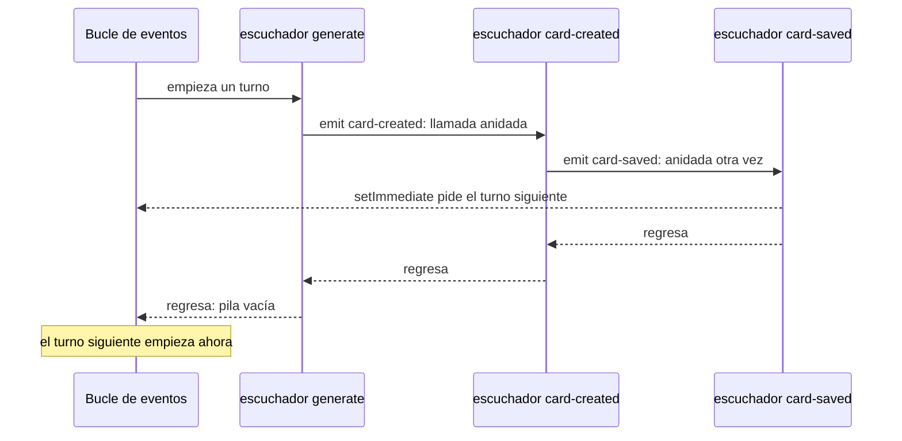

# Guía de estudio de eventos, funciones de devolución de llamada y control reactivo

## Para qué sirve esta guía

"¿Qué se ejecuta después?" tiene tres respuestas en este repositorio. *El programa decide*: un bucle se lo pregunta a sí mismo antes de cada tarjeta. *El consumidor decide*: una demanda (*pull*), donde no pasa nada hasta que alguien pide. *El productor decide*: un *push*, donde algo anuncia que ocurrió y se ejecuta cada función registrada para él. Esta guía trata de la tercera. La pregunta central es: **¿quién es dueño del siguiente turno y qué cambia la reentrada?**

Cuando termines, deberías poder:

1. Decir, para una entrada, si el programa, el consumidor o el productor decide qué se ejecuta después.
2. Explicar la diferencia entre un `emit()` síncrono y una llamada que entrega el paso siguiente al bucle de eventos, y qué hace cada uno a la pila de llamadas.
3. Hacer la traza de `javascript-events` a lo largo de tres tarjetas y nombrar los turnos y la profundidad de anidamiento.
4. Explicar la reentrada: qué pasa cuando una función de devolución de llamada (*callback*) dispara aquello que la llamó, y cómo lo evitan o lo limitan las entradas.
5. Distinguir un evento real de uno que lo imita (el bucle propio de una ventana, un disparador o un callout).
6. Etiquetar afirmaciones como garantizado, permitido por la implementación o aprovechado por accidente.

**Límites del alcance.** La guía usa el `EventEmitter` de Node.js como ejemplo principal y lo compara con otros mecanismos de funciones de devolución de llamada de las entradas. No enseña marcos de trabajo de GUI, async/await ni bibliotecas reactivas. Su capítulo de origen es [Eventos, funciones de devolución de llamada y flujo de control reactivo](../../informatica/10-eventos-retrollamadas-y-flujo-de-control-reactivo.md).

## Antes de empezar

**Modelo de seguridad.** Las tarjetas son datos ficticios marcados con **DEMO ONLY**. Los programas pueden escribir en archivos o bases de datos locales de prueba y pueden iniciar procesos o temporizadores. Lee primero el código fuente y ejecútalo antes en un entorno aislado (*sandbox*) que limita el acceso al sistema anfitrión (`sandbox/container/run-image.sh src/javascript-events`). Trabaja con copias ([Ejecutar cosas con seguridad](../../exercises.md#ejecutar-con-seguridad)). Un límite de turno quitado a propósito puede hacer fallar una ejecución: usa una carpeta de datos de prueba.

**Regla de predicción.** Antes de cada ejecución, escribe el *orden* de los eventos. Marca qué flechas son llamadas simples (la pila crece) y cuáles son saltos a un turno posterior (la pila se desenrolla). En este tema el orden es el programa.

**Vocabulario.**

| Término | Significado aquí |
| --- | --- |
| Función de devolución de llamada | Una función que entregas a otra parte para que se llame más tarde o desde otro lugar. |
| Evento | Un aviso de que algo ocurrió. |
| Emisor | Un objeto que llama a los escuchadores de eventos registrados para un evento. |
| Turno | Una pasada del bucle de eventos. El trabajo puesto en cola con `setImmediate` se ejecuta en un turno posterior. |
| Reentrada | Una función de devolución de llamada que se ejecuta mientras lo que la disparó sigue en curso. |
| Contrapresión (*backpressure*) | Una forma de que un consumidor lento frene a un productor. |

## El reto compartido

La [especificación del reto](../../introduccion.md#qué-hace-el-reto) pide tarjetas con una categoría y de 10 a 19 horas enteras. Las categorías se repiten en ciclo: `Meetings`, `Coding`, `Debugging` y `Learning`. Suma las horas de cada tarjeta al total acumulado. Detente cuando el total pasa de 40. Conserva la **primera tarjeta con la que el total pasa de 40**. Un total de exactamente 40 continúa. Cuatro tarjetas de 10 horas necesitan una quinta tarjeta, de la categoría `Meetings`. Las ejecuciones conformes tienen de 3 a 5 tarjetas y un total de 41 a 59 horas.

En el programa de eventos la regla es una línea: `total-updated` emite `finished` cuando `total > limit` (así que un total de exactamente 40 continúa). De lo contrario, programa `generate` para un turno posterior. La categoría de la tarjeta *n* es `(n - 1) % 4`, así que una quinta tarjeta vuelve a ser Meetings. El programa recibe un objeto `world` (`rng`, `schedule`, `open`, ...) para que una prueba pueda inyectar el suyo.

## La máquina que hay que identificar

**Qué se repite.** Un ciclo de eventos: `generate`, `card-created`, `card-saved`, `total-updated` y de vuelta a `generate`. No se repite ninguna sentencia. Cada evento tiene un escuchador de eventos que hace una cosa pequeña y emite el evento siguiente.

**Dónde vive el estado.** En un objeto `s` (`n`, `total`, `db`, `frame`, `stop`) que comparten los escuchadores de eventos y en los *registros* del emisor: qué escuchadores existen forma parte del programa. Quitar todos los escuchadores al final (`removeAllListeners`) es la forma en que el programa se vuelve incapaz de ejecutarse otra vez.

**Qué hace avanzar el paso siguiente.** Un `emit` simple llama a cada escuchador de eventos *ahora*, antes de regresar, en el orden de registro. `later(name)` llama a `setImmediate`, así que el paso siguiente espera a un turno nuevo. Dos tipos de flecha, dos máquinas distintas.

**Qué lo detiene.** `total-updated` emite `finished` en lugar de programar otro `generate`. Después de `finished`, `done` quita todos los escuchadores de eventos.

**Qué confirma.** `start` ejecuta `BEGIN`, `card-created` inserta una fila de forma síncrona (`node:sqlite` es síncrono) y `finished` ejecuta `COMMIT`. Una excepción lanzada en cualquier escuchador de eventos se captura y se emite como `failed`. Eso ejecuta `ROLLBACK` *una vez* y quita todos los escuchadores, de modo que un segundo fallo no encuentra a nadie a quien avisar.

<!-- diagram-source: lessons/cs-source/chapters/10-events-callbacks-and-reactive-control-flow.md#block-1 -->



La imagen del libro de un turno de eventos programados: `emit` anida y el bucle de eventos separa los turnos. La traza siguiente la sigue con números reales.

## Traza una ejecución

Con `SEED=1105` las horas son 15, 19, 12. Un script de prueba envolvió `emit` y `schedule` de la entrada para registrar cada emisión (con sangría según la profundidad) y cada salto. La ejecución imprimió:

```text
--- event loop turn 1 ---
emit start
  [setImmediate queued: next step waits for a new turn]
--- event loop turn 2 ---
emit generate
  emit card-created
    emit card-saved
      emit total-updated
  [setImmediate queued: next step waits for a new turn]
--- event loop turn 3 ---
emit generate  ...  (Coding 19 34, same shape)
--- event loop turn 4 ---
emit generate
  emit card-created
    emit card-saved
      emit total-updated
        emit finished
          emit done
```

(Las filas y el resumen aparecen entre estas líneas en la salida real.) Lee tres hechos en ella. **`emit start` regresó antes de que existiera cualquier tarjeta**: la primera tarjeta se crea en el turno 2. **Cada tarjeta es su propio turno**, con cuatro emisiones de profundidad, y la pila se desenrolla antes del turno siguiente. **El último turno es distinto**: el total es 46, así que `total-updated` emite `finished` directamente, y `finished` y `done` anidan uno y dos niveles más hondo. La confirmación de la transacción se ejecuta dentro del mismo turno, antes de que pueda intervenir nada más.

| Turno | Qué se ejecuta | Profundidad de la pila en su punto más hondo | Total después |
| --- | --- | ---: | ---: |
| 1 | `start`: abrir, `BEGIN`, poner `generate` en cola | 1 | 0 |
| 2 | Meetings 15 | 4 | 15 |
| 3 | Coding 19 | 4 | 34 |
| 4 | Debugging 12, luego `finished` y `done` | 6 | 46 |

**Las mismas tarjetas, tres máquinas.** El libro compara un bucle, un emisor síncrono y eventos programados. Todos producen las mismas filas en una ejecución pequeña. Difieren cuando la ejecución es grande: el bucle y los eventos programados mantienen la pila plana, mientras que el emisor síncrono añade unos pocos marcos por tarjeta.

**Exactamente 40.** Con cuatro tarjetas de 10 horas el total es 40, y `40 > 40` es falso, así que `total-updated` programa una quinta `generate`. Este programa no tiene una lista fija de cuatro nombres, así que continúa.

## Compara los diseños ordinarios y los raros

| Dimensión | Un bucle | `javascript-events` | Otras entradas con funciones de devolución de llamada |
| --- | --- | --- | --- |
| **Representación** | Una sentencia | Escuchadores de eventos registrados en un emisor | Callouts de PCRE2, puntos de control de tar, disparadores de SQLite |
| **Observabilidad** | Avanza el bucle paso a paso | Registra cada `emit`: el programa entero es su traza de eventos | Callouts: imprime en el despachador. tar: la cuenta de ticks. Disparadores: el registro de `born`. |
| **Pruebas** | Llamar a la función | Inyectar un `world`: un `rng` falso, un `schedule` síncrono, un `out` que registra | `check.sh` con una simulación (tar), mutación (banderas de PCRE2) |
| **Debugging** | Una traza de pila | Una excepción lanzada viaja *hacia arriba* por `emit` hasta quien la llamó, que puede ser una función de devolución de llamada programada que nadie espera | Los errores mezclan la pila del anfitrión con la del motor |
| **Portabilidad** | Cualquier lenguaje | La semántica de `EventEmitter` de Node (orden de los escuchadores de eventos, `emit` síncrono) | Los puntos de control de GNU tar, los callouts de PCRE2 |
| **Costo** | Normal | Un salto por tarjeta, una pila plana | Inicio de procesos por tick, llamadas por callout |

**Quién es dueño del turno siguiente.** En `javascript-events`, lo es el *entorno de ejecución*: después de `setImmediate`, el bucle de eventos decide cuándo se ejecuta el siguiente `generate`. Cualquier otra cosa del bucle (temporizadores, E/S) puede ejecutarse antes. En `tar-gnu-weird`, lo es *tar*: llama al tick una vez por registro, y el programa no puede detenerlo. En PCRE2, lo es el *motor*: llama a un callout cuando el patrón llega a ese punto. En cada caso, el programa es un conjunto de funciones de devolución de llamada y el entorno sostiene el bucle.

## Qué demuestran los ejercicios

| Ejercicio | Predice primero | Qué muestra la evidencia |
| --- | --- | --- |
| [B22. JavaScript, dirigido por eventos](../../exercises.md#b22-javascript-dirigido-por-eventos-predice-la-traza-y-luego-elimina-el-límite-verificado), paso 2 | `listener`, `after emit`, `immediate`: ¿en qué orden? | `listener`, `after emit`, `immediate`. `emit()` llama antes de regresar y `setImmediate()` solo pide. |
| B22, paso 3 | La traza de tres tarjetas de 19 horas. | `>start <start main is done`, luego tres turnos, con `<start` antes del primer `>generate`. |
| B22, paso 4 | Reemplaza `later('generate')` por `events.emit('generate')`. | Una ejecución normal sigue funcionando. El laboratorio falla dos pruebas y una ejecución muy larga imprime `Maximum call stack size exceeded` y sale con 1. Con el límite de vuelta y `limit: 30_000`, unas 2000 tarjetas se ejecutan y no se imprime nada. |
| [B17. tar, más raro: predice el reloj](../../exercises.md#b17-tar-más-raro-predice-el-reloj-verificado) | `--ticks 45` frente a `46`. | Funciones de devolución de llamada que el programa no controla: con muy pocas, la máquina se atasca, con `the clock ran out` y estado de salida 3. |
| [B12. Tcl: edita el programa en la base de datos](../../exercises.md#b12-tcl-edita-el-programa-en-la-base-de-datos-verificado) | `recursive_triggers = OFF`. | Se imprimió una fila, `entries=2`: la inserción propia de un disparador no vuelve a activar un disparador a menos que se habilite la recursión. La reentrada hay que activarla de forma expresa. |
| [B21. JavaScript, más raro](../../exercises.md#b21-javascript-más-raro-mueve-la-regla-de-parada-a-una-clausura-closure-y-observa-la-demanda-verificado) | `take(1)` frente a `take(2)`. | La versión por demanda: el consumidor decide cuántas tarjetas existen. |

## Modos de fallo, costos y límites

| Comportamiento | Etiqueta | Por qué |
| --- | --- | --- |
| `emit()` llama a los escuchadores de eventos de forma síncrona, en orden de registro, antes de regresar | **garantizado** | Comportamiento documentado de Node.js. |
| `emit('error', e)` sin un escuchador de eventos de `error` lanza `e` | **garantizado** | Está documentado. El programa lo convierte en `failed`. |
| `setImmediate` ejecuta su función de devolución de llamada en un turno posterior | **garantizado** | Programación documentada. |
| `node:sqlite` es síncrono | **permitido por la implementación** | Una propiedad del módulo integrado. La garantía de `card-saved` depende de ella. |
| tar ejecuta una función de devolución de llamada por registro escrito e ignora su estado de salida | **permitido por la implementación** (la función de devolución de llamada) y **aprovechado por accidente** (el estado de salida) | Opción documentada de GNU; el comportamiento del estado de salida se observó. |
| SQLite limita la recursión de los disparadores (1000 por defecto) | **garantizado** | El reto necesita de 3 a 5. |
| El valor de retorno de un callout de PCRE2: 0 continúa, positivo hace fallar el camino, negativo aborta | **garantizado** | API documentada. |

**Costos que hay que declarar.**

- **La trampa del medio.** Un emisor síncrono *parece* eventos y se comporta como recursión. Es correcto para los tamaños que pruebas y falla con un tamaño que no pruebas.
- **Las excepciones lanzadas no tienen quien las llame.** Una excepción lanzada dentro de una función de devolución de llamada programada terminaría el proceso. Cada escuchador de eventos la captura y emite `failed`.
- **Orden oculto.** El orden de los escuchadores de eventos es el orden de registro. Reordenar los registros cambia el programa.
- **Contrapresión.** Un push no tiene freno: un productor anuncia haya o no alguien listo. El programa de eventos marca su propio ritmo (una tarjeta por turno), y el programa por demanda deja que el consumidor fije el ritmo. Consulta [Contrapresión](../../informatica/10-eventos-retrollamadas-y-flujo-de-control-reactivo.md#backpressure).
- **Imitaciones.** El bucle propio de una ventana (`Application.Run`, Tk, GTK) alimenta un bucle de mensajes, pero nada en la lógica se suscribe a nada. El disparador `Loaded` de XAML solo inicia una animación. Son contraejemplos del libro, no eventos.
- **Dónde es legítimo.** Las interfaces de usuario, los servidores y las canalizaciones están dirigidos por eventos. Hacer un generador de tarjetas con un emisor es una acrobacia que muestra cómo.

## Conexiones a lo largo del repositorio

- **La guía de JavaScript.** [JavaScript](../lenguajes/javascript.md) traza los tres estilos. Esta guía generaliza B22.
- **Funciones de devolución de llamada que posee el motor.** [Motores de expresiones regulares y sed](../lenguajes/motores-de-regex-y-sed.md) (callouts de PCRE2) y [tar](../lenguajes/tar.md) (puntos de control) son funciones de devolución de llamada síncronas de un anfitrión, no un bucle de eventos.
- **Disparadores como reentrada.** [Tcl](../lenguajes/tcl.md) usa un disparador recursivo como bucle.
- **Afinidad de hilo.** [C#, LINQ, XAML y adaptaciones](../lenguajes/csharp-linq-xaml-y-adaptaciones.md) trata el despachador de WPF y el hilo STA.
- **Demanda y estado.** [Evaluación, demanda y pereza](evaluacion-demanda-y-pereza.md) es la versión por demanda de esta pregunta, y [Estado y control más allá de las variables](estado-y-control-mas-alla-de-las-variables.md) pregunta dónde se guarda cada paso.
- **En el libro.** [Programación dirigida por eventos](../../informatica/10-eventos-retrollamadas-y-flujo-de-control-reactivo.md#event-driven-programming), [Funciones de devolución de llamada](../../informatica/10-eventos-retrollamadas-y-flujo-de-control-reactivo.md#callbacks), [Publicación y suscripción](../../informatica/10-eventos-retrollamadas-y-flujo-de-control-reactivo.md#publish-and-subscribe), [El bucle de eventos y los turnos de programación](../../informatica/10-eventos-retrollamadas-y-flujo-de-control-reactivo.md#the-event-loop-and-scheduling-turns) y [Contrapresión](../../informatica/10-eventos-retrollamadas-y-flujo-de-control-reactivo.md#backpressure).

## Autoevaluación

Responde cada pregunta con tus propias palabras antes de leer el texto en cursiva. Di qué evidencia respaldaría cada respuesta.

1. **Traza.** En `javascript-events`, las horas son 12, 14, 13, 11 (totales 12, 26, 39, 50). ¿Cuántos turnos dura la ejecución y en cuál se ejecuta `finished`? *(Cinco turnos: uno para `start` y luego uno por tarjeta. `finished` se ejecuta en el turno 5, anidado dentro de `total-updated`, porque la cuarta tarjeta hace 50.)*
2. **Explica.** ¿Qué sale mal si `total-updated` llama a `events.emit('generate')` en lugar de `later('generate')`? *(Cada tarjeta añade unos pocos marcos a la pila de llamadas, porque cada `emit` regresa solo después de todo el resto de la ejecución. Una ejecución larga excede el límite de la pila y falla con `Maximum call stack size exceeded`.)*
3. **Transfiere.** En un lenguaje que uses, ¿qué hace el papel de `setImmediate`, la llamada que termina una pila y empieza un turno nuevo? *(Por ejemplo `setTimeout(fn, 0)`, `queueMicrotask`, `asyncio.create_task`, un mensaje enviado a un despachador de WPF o una goroutine iniciada con `go`.)*
4. **Evidencia.** Un revisor dice: "El programa de eventos mantiene una pila plana para cualquier número de tarjetas." Diseña una prueba que pueda fallar. *(Envuelve `emit` con un contador de profundidad y ejecuta con un `limit` muy grande, como en B22 y luego verifica la profundidad máxima. El control negativo es la versión con el límite quitado, cuya profundidad crece con el número de tarjetas.)*

## Lecturas adicionales

- [Bucle de eventos](https://en.wikipedia.org/wiki/Event_loop) (Wikipedia): la idea detrás de los turnos.
- [El bucle de eventos de Node.js](https://nodejs.org/en/learn/asynchronous-work/event-loop-timers-and-nexttick) (Node.js): la explicación del propio entorno de ejecución sobre `setImmediate` y los turnos.
- [Eventos](https://nodejs.org/api/events.html) (Node.js): la documentación de `EventEmitter`, que incluye `emit` síncrono y el evento especial `error`.
- [Función de devolución de llamada (programación)](https://en.wikipedia.org/wiki/Callback_(computer_programming)) (Wikipedia): la idea general.
- [Contrapresión](https://en.wikipedia.org/wiki/Back_pressure) (Wikipedia): por qué un push necesita un freno.
