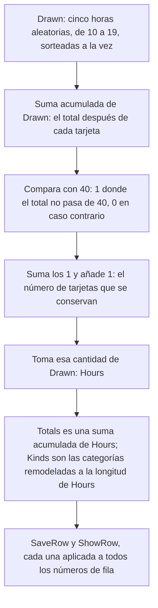
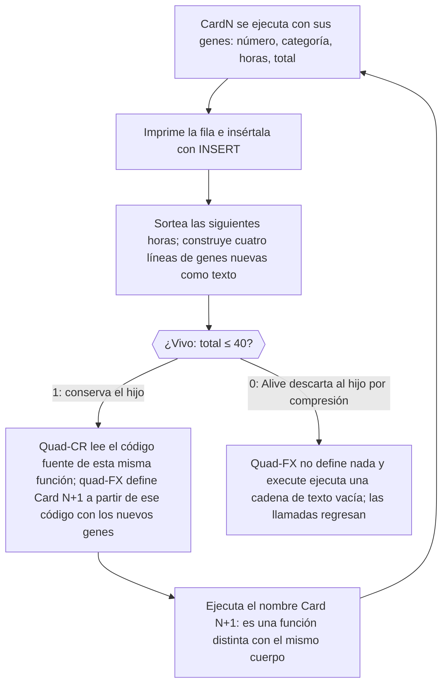

# Guía de estudio de APL

## Para qué sirve esta guía

En esta guía analizarás dos programas de GNU APL. El primero es [`src/apl`](../../../src/apl/README.md), cuyo cálculo de la tarjeta usa cuatro asignaciones a arreglos con nombre. El segundo es [`src/apl-weird`](../../../src/apl-weird/README.md), donde cada tarjeta es una función *escrita como texto por la tarjeta anterior* y luego ejecutada. La pregunta es: **cuando el programa trabaja con arreglos completos, o con su propio texto fuente, ¿qué reemplaza al bucle y qué mantiene el estado?**

Cuando termines, deberías poder:

1. Leer `Hours←Drawn↑⍨1++/40≥+\Drawn` de derecha a izquierda y decir qué produce cada primitiva con una entrada de datos dada.
2. Explicar por qué un programa con evaluación inmediata, que trabaja sobre el arreglo completo, genera más valores de los que necesita. Explicar también por qué eso es una *cota* y no un número de repeticiones del bucle.
3. Explicar cómo `⎕CR` y `⎕FX` permiten que una función lea y escriba funciones. Explicar también por qué la regla de parada de `apl-weird` es una compresión sobre texto.
4. Trazar ambos programas con las mismas tres tarjetas, mostrando los arreglos en uno y el código fuente generado en el otro.
5. Etiquetar cada comportamiento como garantizado, permitido por la implementación o aprovechado por accidente.

**Límites del alcance.** Necesitas leer APL básico: `⍳`, `⍴`, `+\` (escaneo), `+/` (reducción), `/` (compresión) y `↑` (tomar). La guía no enseña el conjunto completo de glifos, las funciones de archivo `⎕FIO` de GNU APL más allá de lo que usan los programas, ni SQL. Si los glifos de APL aparecen como recuadros vacíos, consulta [Cómo ver los glifos](../../../src/apl/README.md#cómo-ver-los-glifos).

La página del libro es [APL](../../lenguajes/apl.md). Las ideas están en [Programación con arreglos](../../informatica/04-evaluacion-y-demanda.md#programación-con-arreglos), [Homoiconicidad: código como datos](../../informatica/06-estado-mas-alla-de-las-variables.md#homoiconicidad-código-como-datos) y [Código automodificable](../../informatica/03-flujo-de-control-y-continuaciones.md#código-automodificable).

## Antes de empezar

**Modelo de seguridad.** Cada entrada escribe datos ficticios marcados con **DEMO ONLY**. Los dos programas inician un fragmento de código para el intérprete de comandos (*shell*) que crea una carpeta y ejecuta `sqlite3`, y `apl-weird` *define funciones nuevas mientras se ejecuta*. Lee el código fuente antes de ejecutarlo y ejecútalo primero en un entorno aislado (*sandbox*) que limita el acceso al sistema anfitrión:

```bash
sandbox/container/run-image.sh src/apl
sandbox/container/run-image.sh src/apl-weird
```

Edita solo copias ([Ejecutar cosas de forma segura](../../exercises.md#ejecutar-con-seguridad)). Un programa automodificable con un error puede no terminar: fija `SANDBOX_TIMEOUT=40` para cualquier cambio en `apl-weird`.

**Regla de predicción.** Antes de cada ejecución, anota qué arreglos o qué texto de función generada esperas, e indica qué salida refutaría tu predicción.

**Vocabulario.**

| Término | Significado aquí |
| --- | --- |
| Escaneo `+\` | Total acumulado: `+\ 15 19 12` es `15 34 46`. |
| Reducción `+/` | Total: `+/ 1 1 0` es `2`. |
| Compresión `/` | Un booleano a la izquierda selecciona elementos de la derecha. Un escalar `0` no selecciona nada y un escalar `1` selecciona todo. |
| `⎕CR` / `⎕FX` | "Representación canónica": el código fuente de una función como matriz de caracteres. "Fix": define una función a partir de ese texto. |
| `⎕IO` | El origen de índices (*index origin*): indica si el primer índice es 0 o 1. |

## El reto compartido

La [especificación del reto](../../introduccion.md#qué-hace-el-reto) pide tarjetas con una categoría y de 10 a 19 horas enteras. Las categorías se repiten en ciclo: `Meetings`, `Coding`, `Debugging` y `Learning`. Suma las horas de cada tarjeta al total acumulado. Detente cuando el total pasa de 40. Conserva la **primera tarjeta con la que el total pasa de 40**. Un total de exactamente 40 continúa. Cuatro tarjetas de 10 horas necesitan una quinta tarjeta, de la categoría `Meetings`. Las ejecuciones conformes tienen de 3 a 5 tarjetas y un total de 41 a 59 horas.

APL expresa el límite en una sola comparación, `40≥`, "¿el total es como máximo 40?". Es verdadera para 40. El programa cuenta las tarjetas para las que es verdadera y después suma una, para incluir la tarjeta con la que el total pasa del límite.

## La máquina que hay que identificar

**Qué se repite.** En `apl`, en el código no se repite nada: las primitivas de arreglos se aplican a todos los elementos. [Cuatro asignaciones con nombre](../../../src/apl/timecards.apl#L30-L39) contienen el cálculo: cinco extracciones en `Drawn`, y luego tres resultados derivados de ella en `Hours`, `Totals` y `Kinds`. En `apl-weird` hay una *cadena de llamadas*: `Card0` llama a `Card1`, que fue escrita por `Card0`. Esa función llama a su vez a `Card2`, y así sucesivamente ([L43-55](../../../src/apl-weird/timecards.apl#L43-L55)). La cadena tiene forma de recursión, pero cada eslabón es una *función distinta*.

**Dónde vive el estado.** En `apl`, en arreglos: `Drawn`, `Hours`, `Totals`, `Kinds`. Los cinco valores se extraen a la vez, así que el estado es *el vector completo*. En `apl-weird`, en el **texto fuente** de cada función. Las líneas 1 a 4 de cada tarjeta son cuatro líneas de "genes": `N←` (número de tarjeta), `C←` (categoría), `H←` (horas) y `T←` (total acumulado). Cada hijo recibe líneas de genes nuevas.

**Qué hace avanzar el paso siguiente.** En `apl`, nada hace avanzar: cada primitiva se ejecuta una vez sobre su argumento. En `apl-weird`, una tarjeta construye el texto de la tarjeta siguiente, lo define con `⎕FX` y lo ejecuta con `⍎`.

**Qué lo detiene.** En `apl`, `+/40≥+\Drawn` cuenta las primeras tarjetas cuyo total acumulado no pasa de 40. Como los totales acumulados solo crecen, "todavía no pasa de 40" es verdadero para un prefijo y falso para las demás tarjetas. Por eso el conteo *es* la posición del límite. En `apl-weird`, `Alive←40≥T` vale 1 o 0. `Alive/` comprime el código fuente del hijo: un 0 escalar no conserva ninguna línea, así que `⎕FX` no define nada. El mismo `Alive/` vacía la llamada, así que `⍎` ejecuta una cadena de texto vacía.

**Qué confirma.** En `apl`, las filas se escriben en una tubería hacia `sqlite3` *después* de calcular los arreglos. Siguen `COMMIT;` y un cierre de la tubería que espera a `sqlite3`. En `apl-weird`, cada tarjeta escribe su `INSERT` mientras se ejecuta, y `COMMIT;` se escribe cuando el control vuelve al punto desde el que se inició la cadena ([L67-68](../../../src/apl-weird/timecards.apl#L67-L68)). La impresión de filas en `apl-weird` ocurre al *bajar* por la cadena. La tarjeta con la que el total pasa del límite imprime y se guarda. Luego descubre que no está viva y no escribe ningún hijo.

<!-- diagram-source: src/apl/README.md#program-flow -->



El primer diagrama muestra datos que fluyen por pasos sobre arreglos. No hay ninguna arista de bucle.

<!-- diagram-source: src/apl-weird/README.md#program-flow -->



El segundo diagrama tiene un ciclo, pero cada vuelta pasa por una función que no existía un momento antes.

## Traza una ejecución

Los programas generan números aleatorios. Usa las horas **15, 19, 12** para la traza. Para comprobarla con el comportamiento real, se ejecutaron copias de prueba en el entorno aislado. En ellas, las extracciones se reemplazaron por valores fijos (y, para `apl`, se añadieron unas líneas para imprimir los arreglos intermedios).

**`apl`: cuatro arreglos con nombre.** La ejecución de prueba original en GNU APL usó `Drawn←15 19 12 10 10`. Los valores de abajo se volvieron a derivar de las cuatro asignaciones, en el orden del código fuente. Imprimió:

```text
Drawn         15 19 12 10 10
+\Drawn       15 34 46 56 66
40≥+\Drawn    1 1 0 0 0
+/40≥+\Drawn  2
1++/40≥+\Drawn  3
```

| Paso | Expresión | Resultado | Significado |
| --- | --- | --- | --- |
| 1 | `Drawn` | `15 19 12 10 10` | Cinco extracciones. Cinco tarjetas de 10 horas siempre suman 50, así que cinco es una cota. |
| 2 | `+\Drawn` | `15 34 46 56 66` | El total acumulado después de cada tarjeta. |
| 3 | `40≥+\Drawn` | `1 1 0 0 0` | "El total sigue siendo como máximo 40": verdadero, verdadero y luego falso para las tarjetas restantes. |
| 4 | `+/` de eso | `2` | Los totales de las dos primeras tarjetas son de 40 horas o menos. |
| 5 | `1+` | `3` | Suma la única tarjeta con la que el total pasa del límite. |
| 6 | `Drawn↑⍨3` | `15 19 12` | Toma ese número de elementos. |

La salida fue `Meetings 15 15`, `Coding 19 34`, `Debugging 12 46` y `# committed total=46 entries=3 DEMO ONLY`. `Totals` contiene `15 34 46`. `Kinds` ajusta los cuatro nombres de categoría a la longitud de `Hours`. Llena tres posiciones en esta ejecución y hasta cinco en cualquier ejecución conforme. Se examinaron y descartaron las extracciones 4 y 5 (aquí, 10 y 10). Ese desperdicio es el precio de la evaluación inmediata.

**`apl-weird`: la cadena de funciones.** En la copia de prueba, `Card0` recibió 15 horas y cada tarjeta tomó las horas de la tarjeta siguiente de la lista 19, 12, 10, ... El código fuente generado de `Card2`, impreso con `⎕CR`, fue:

```text
Card2;N;C;H;T;D;Alive;Kid;Genes
N←2
C←2
H←12
T←46
_←(Show (⊃Categories[C]) H T Week) ⎕FIO[22] 1
_←(Insert RunId (⊃Categories[C]) H T Week) ⎕FIO[22] Sqlite
D←(19 12 10 10 10)[N]
Genes←('N←',⍕N+1) ('C←',⍕4|C+1) ('H←',⍕D) ('T←',⍕T+D)
Alive←40≥T
Kid←⎕FX Alive/(⊂'Card',(⍕N+1),Locals),Genes,5↓⊂[1]⎕CR 'Card',⍕N
⍎Alive/'Card',⍕N+1
```

(La línea `D←` es la edición de prueba. En el programa real es `D←10+?10`.) Las líneas 2 a 5 son los genes: tarjeta número 2, categoría 2 (Debugging, con `⎕IO←0`), horas 12, total 46. Todo lo que está debajo de ellas se copia sin cambios del padre.

| Función | Genes (N, C, H, T) | Imprime | `Alive←40≥T` | Qué hace después |
| --- | --- | --- | --- | --- |
| `Card0` (escrito por el anfitrión) | 0, 0, 15, 15 | Meetings 15 15 | `40≥15` = 1 | Escribe `Card1` con los genes 1, 1, 19, 34. La llama. |
| `Card1` | 1, 1, 19, 34 | Coding 19 34 | `40≥34` = 1 | Escribe `Card2` con los genes 2, 2, 12, 46. La llama. |
| `Card2` | 2, 2, 12, 46 | Debugging 12 46 | `40≥46` = **0** | Comprime el texto de la función hija y lo descarta. `⎕FX` no define nada. `⍎` ejecuta una cadena de texto vacía. Las llamadas regresan. |

Luego el informe obtiene la lista de funciones del espacio de trabajo con `⎕NL 3` y lee las horas codificadas en cada función: `Card0 ⇐ H←15`, `Card1 ⇐ H←19`, `Card2 ⇐ H←12`. El programa escribió dos de esas tres funciones. La tarjeta con la que el total pasa del límite, `Card2`, se *conserva*, porque sus genes se escribieron cuando su padre aún estaba vivo. La regla de parada suprime la tarjeta *siguiente*.

**Exactamente 40.** Con cuatro tarjetas de 10 horas, `+\Drawn` es `10 20 30 40 50`, `40≥` da `1 1 1 1 0`, `+/` da 4, al sumar 1 el resultado es 5 y se usan las cinco extracciones. En `apl-weird`, `Card3` tiene `T←40`, así que `Alive←40≥40` es 1 y escribe `Card4`.

## Compara los diseños ordinarios y los raros

| Dimensión | `apl` | `apl-weird` |
| --- | --- | --- |
| **Representación** | Arreglos. Los datos son el programa: cada línea es una función del arreglo anterior. | Funciones como texto. El estado de cada tarjeta consiste en cuatro líneas literales en su código fuente. |
| **Observabilidad** | Imprime cualquier arreglo intermedio y ve todo el estado. | El estado está en el texto fuente. `⎕CR 'Card2'` lo muestra, pero solo para las funciones que existen. Una tarjeta que nunca se escribió no deja evidencia. |
| **Pruebas** | Expresiones puras sobre arreglos: fija `Drawn` y compara `Hours`. | Debes ejecutar la cadena. La comprobación del libro se ejecuta bajo `timeout` porque una regla de parada defectuosa puede impedir que la recursión se detenga. |
| **Depuración** (Debugging) | Lee un arreglo. | Lee el código fuente generado y recuerda que las variables locales tienen *ámbito dinámico*. Un hijo ve las variables de su padre, a menos que cada tarjeta declare las suyas (para eso sirve `Locals`). |
| **Portabilidad** | Primitivas estándar de arreglos, más `⎕FIO` de GNU APL para archivos y tuberías. | Necesita `⎕CR` y `⎕FX`, y el error de una línea en la copia (`5↓`) es invisible a menos que lo ejecutes. |
| **Costo** | Extrae cinco valores y recorre los cinco, incluso cuando bastan tres. | Barato: cada tarjeta extrae un valor. Pero define una función nueva por cada tarjeta y las deja en el espacio de trabajo. |

El resumen honesto: el primer programa desperdicia datos para evitar una decisión, y el segundo desperdicia claridad para evitar un bucle. El primero necesita que la cota (cinco extracciones siempre bastan) sea verdadera. El segundo necesita que la copia sea exactamente correcta.

## Qué demuestran los ejercicios

| Ejercicio | Predice primero | Qué muestra la evidencia |
| --- | --- | --- |
| [B6. APL: la reescritura con error de una línea](../../exercises.md#b6-apl-la-reescritura-del-error-por-uno-verificada), pasos de 1 a 2 | Cambia `,5↓⊂[1]` a `,4↓⊂[1]` en `apl-weird`. ¿Qué conserva cada hijo de su padre? | Cada hijo conserva una línea de más de los genes de su padre. Eso reinicia el total acumulado, así que la regla de parada nunca se activa. La ejecución solo termina al agotarse el tiempo o la memoria del contenedor. No hay ninguna línea `# committed`, y las filas tienen un total igual a sus propias horas. El código automodificable falla de forma *estructural* y en silencio. Por eso la comprobación de la entrada se ejecuta bajo `timeout`. |
| B6, paso 3 | Cambia `⎕IO←0` por `⎕IO←1`. ¿Qué pasa? | Aparece un `INDEX ERROR` y ninguna fila. `Categories[C]` y las búsquedas indexadas con `N` asumen el origen 0. La entrada simple `apl` evita esto porque nunca asume un origen. |
| [C1. Lo raro junto a lo aburrido](../../exercises.md#c1-lo-raro-junto-a-lo-aburrido-verificado) | ¿En qué programa puedes señalar el estado? | `apl` muestra el estado como arreglos que puedes imprimir. `apl-weird` lo guarda en líneas de código fuente que existen solo mientras el programa se ejecuta. |
| [A1. Lee las filas](../../exercises.md#a1-lee-las-filas-verificado) | ¿Qué tarjeta pasó de 40 aquí? | Para `apl`, comprueba que `+/40≥+\Drawn` contó las tarjetas con 40 o menos. Para `apl-weird`, comprueba qué función `Card` tiene el último `T←`. |
| [F. Prueba una afirmación del README](../../exercises.md#f-demuestra-una-afirmación-del-readme-verificada) | ¿Qué mostraría que "cinco extracciones siempre bastan" es una cota? | Una prueba que saca cinco tarjetas de 10 horas y comprueba que el quinto total es 50. Un control negativo sacaría solo cuatro y mostraría que el conteo de 4 se queda en exactamente 40. |

## Modos de fallo, costos y límites

| Comportamiento | Etiqueta | Por qué |
| --- | --- | --- |
| `+\`, `+/`, `/` y `↑` tienen una semántica fija para los arreglos | **garantizado** | Definiciones del núcleo del lenguaje. Verificado en la traza anterior. |
| Cinco extracciones bastan porque cinco tarjetas de al menos 10 horas suman al menos 50 horas | **garantizado** | Aritmética sobre este reto, no sobre APL. |
| El programa resta `⎕IO` del resultado de `?`, que depende del origen de índices | **garantizado** | Comportamiento especificado. Se escribió `apl` para que funcione en cualquiera de los dos orígenes. |
| `⎕CR` devuelve el código fuente de una función como una matriz y `⎕FX` define una función a partir de una | **permitido por la implementación** | Forman parte de la familia APL2, pero su comportamiento exacto, incluido lo que `⎕FX` devuelve con una entrada de datos vacía, es un detalle del intérprete. Los programas usan GNU APL. |
| Comprimir las líneas de una función con `0` hace que `⎕FX` no defina nada | **permitido por la implementación** | Se observó en GNU APL. El listado final del espacio de trabajo muestra solo las funciones que deberían existir. |
| GNU APL empieza con `⎕RL←16807`, así que cada ejecución saca las mismas tarjetas a menos que establezcas una semilla | **permitido por la implementación** | El programa vuelve a establecer la semilla con el reloj. |
| `⎕FIO[24]`, `⎕FIO[22]` y similares | **permitido por la implementación** | Extensión de GNU APL para archivos y procesos. No es portable a otros APL. |
| El informe encuentra la última tarjeta a partir del orden de nombres que devuelve `⎕NL 3` | **aprovechado por accidente** | `Card0` a `Card4` se ordenan correctamente como texto. Con diez o más tarjetas, `Card10` se ordenaría antes que `Card2`. El máximo del reto es de cinco tarjetas, así que la dependencia nunca falla. Nadie prometió el orden para otros límites. |

**Costos que declarar.**

- **Ámbito dinámico.** Las variables locales de APL son visibles para todo lo que una función *llama*. Cada tarjeta debe declarar `N;C;H;T;...` en su encabezado; si no, los genes de una tarjeta hija sobrescribirían los de su tarjeta madre.
- **Fallo estructural silencioso.** Un número de líneas incorrecto en la copia no genera un error: cambia el *programa*, y la regla de parada puede no activarse nunca.
- **`⊃` no es "primero".** En GNU APL, `⊃` desencapsula un elemento anidado y `↑` se usa aquí para tomar elementos. En las formas que usan estos programas, Dyalog APL intercambia esos significados, así que necesitarían cambios para ejecutarse allí.
- **Contaminación del espacio de trabajo.** Las funciones definidas por `⎕FX` permanecen en el espacio de trabajo hasta que se cierra la sesión.
- **En qué casos es legítimo.** Los lenguajes de arreglos hacen natural "calcular todo y luego recortar", y a menudo es la forma rápida. Escribir código en tiempo de ejecución es como algunos sistemas APL implementan macros y metaherramientas. Reescribir tu propio código fuente para evitar un bucle es un truco de exhibición.

## Conexiones a lo largo del repositorio

- **Código como datos en otros lenguajes.** [Tcl](tcl.md) guarda el texto de un programa en una fila de la base de datos y lo define cuando hace falta. [Common Lisp](common-lisp.md) puede construir y ejecutar formas. [COBOL](cobol.md) parchea un salto en lugar de texto.
- **Evaluación inmediata frente a perezosa.** `apl` calcula cinco valores y descarta dos. [Haskell](haskell.md) lee de una lista infinita solo lo que necesita. Las canalizaciones diferidas de LINQ en [C#, LINQ, XAML y adaptaciones](csharp-linq-xaml-y-adaptaciones.md) esperan a la enumeración. En la versión de C# con `for`, el encabezado enumera con evaluación inmediata mediante `Sum()` cada vez que evalúa la condición. La guía de concepto [Evaluación, demanda y pereza](../conceptos/evaluacion-demanda-y-pereza.md) pone estos tres casos uno junto a otro.
- **Estado fuera de las variables.** `apl-weird` guarda su estado en líneas de código fuente, como [Make](make-y-cmake.md) lo guarda en archivos y [Forth](forth.md) en una posición de lectura del intérprete. Consulta [Estado y control más allá de las variables](../conceptos/estado-y-control-mas-alla-de-las-variables.md).
- **Reproducibilidad de "aleatorio".** Las entradas de APL reinician la semilla a partir del reloj. La entrada de sed en [Motores de expresiones regulares y sed](motores-de-regex-y-sed.md) usa un registro de desplazamiento con semilla y da las mismas tarjetas con la misma semilla.
- **En el libro.** [APL](../../lenguajes/apl.md), [Programación con arreglos](../../informatica/04-evaluacion-y-demanda.md#programación-con-arreglos), [Evaluación inmediata](../../informatica/04-evaluacion-y-demanda.md#evaluación-inmediata) y [Homoiconicidad: el código como datos](../../informatica/06-estado-mas-alla-de-las-variables.md#homoiconicidad-código-como-datos).

## Autoevaluación

Responde cada pregunta con tus propias palabras antes de leer el texto en cursiva. Di qué evidencia respaldaría cada respuesta.

1. **Traza.** `Drawn` es `12 14 13 10 11`. Para `apl`, indica `+\Drawn`, el vector de valores booleanos de `40≥`, el conteo y el contenido final de `Hours`. *(Los totales `12 26 39 49 60`. El booleano es `1 1 1 0 0`. El conteo es 3, más 1 es 4. `Hours` es `12 14 13 10`, con un total final de 49. La tarjeta con la que el total pasa del límite es la cuarta.)*
2. **Explica.** En `apl-weird`, ¿por qué `Card2` en la traza todavía imprime y guarda una fila aunque su `Alive` es 0? *(Imprimir y guardar ocurren *antes* de la prueba de `Alive` en el cuerpo de la tarjeta. `Alive` solo controla si la *siguiente* tarjeta se escribe y se llama. Un padre cuyo total todavía era de 40 o menos escribió la tarjeta con la que el total pasa del límite.)*
3. **Transfiere.** En la entrada rara de Haskell, la regla de parada es "cuánto de la lista leo". En `apl`, es "cuántos elementos indica tomar un conteo de prefijo". ¿Cuál es la diferencia principal en el *trabajo realizado*? *(Haskell construye solo el prefijo solicitado. APL construye cinco valores y recorta. Ambos responden "qué tarjetas se conservan" de la misma manera. Difieren en si se hace el trabajo que no se usa.)*
4. **Evidencia.** Un estudiante dice: "`apl-weird` nunca saca más de cinco horas". Diseña una prueba que pueda fallar. *(Ejecuta el programa muchas veces en el entorno aislado y cuenta las funciones `Card` que aparecen en el informe. El conteo nunca debe superar 5. Como control negativo, usa la modificación del ejercicio B6 y muestra que el conteo y el tiempo de ejecución se disparan. Recuerda el límite de tiempo.)*

## Lecturas adicionales

- [APL (lenguaje de programación)](https://en.wikipedia.org/wiki/APL_(programming_language)) (Wikipedia): la historia de la notación de arreglos y del conjunto de glifos.
- [Programación con arreglos](https://en.wikipedia.org/wiki/Array_programming) (Wikipedia): por qué las operaciones sobre arreglos completos reemplazan los bucles y qué efecto tiene eso en el costo del trabajo que no se usa.
- [Homoiconicidad](https://en.wikipedia.org/wiki/Homoiconicity) (Wikipedia): el código como datos. APL no es homoicónico en el sentido de Lisp. `⎕CR` y `⎕FX` dan una vía de texto al mismo efecto.
- [GNU APL](https://www.gnu.org/software/apl/) (Proyecto GNU): el intérprete que usan estas entradas y la fuente de su extensión `⎕FIO`.
