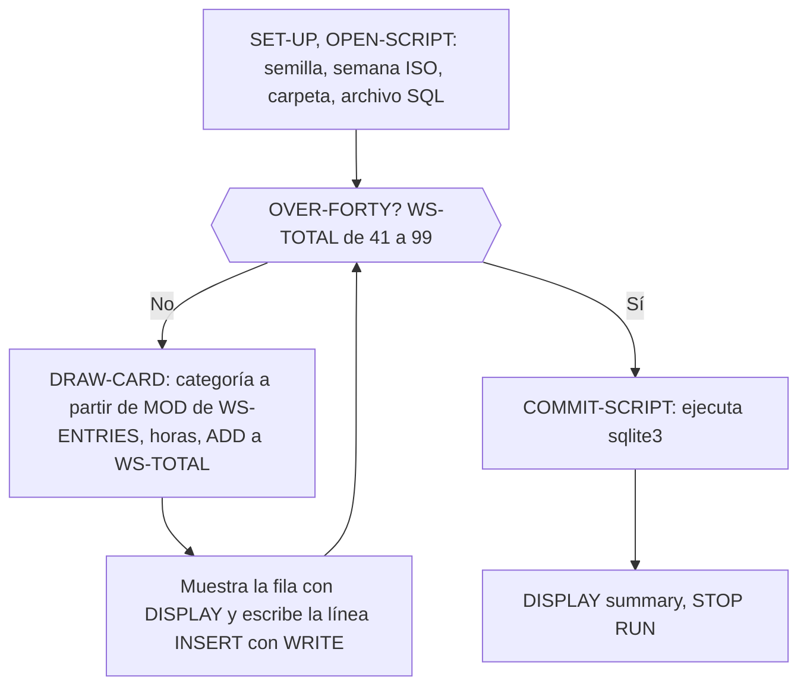
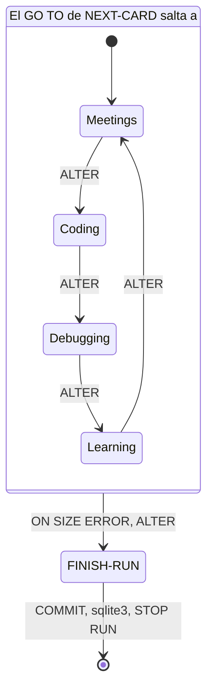

# Guía de estudio de COBOL

## Para qué sirve esta guía

Esta guía lee dos programas COBOL uno junto al otro. [`src/cobol`](../../../src/cobol/README.md) declara su regla de parada como dato. [`src/cobol-weird`](../../../src/cobol-weird/README.md) guarda su bucle en el destino de un `GO TO` que se reescribe a sí mismo. Los trata como dos respuestas a una misma pregunta: *¿dónde guarda un programa "qué pasa después" y "cuándo parar"?*

Empezó como una guía de estudio que escribió Ken Astl, coautor del libro, para el capítulo de COBOL. Conserva su método: predice el cambio de estado, luego ejecuta y después compara.

Al terminar, deberías poder:

1. Explicar cómo un nombre de condición de nivel 88 vuelve la regla de parada una propiedad de los datos, y por qué el bucle idiomático no contiene ninguna comparación.
2. Trazar ambos programas con las mismas tres tarjetas. Nombrar el estado que decide cada paso: `WS-TOTAL` y `WS-ENTRIES` en un programa, el destino de `NEXT-CARD` y `WS-HEADROOM` en el otro.
3. Decir exactamente qué cambia `ALTER`, qué deja intacto y por qué necesita un párrafo que es solo un `GO TO`.
4. Explicar por qué un error de tamaño es un condicional, y qué puede significar un campo que contiene 99.
5. Etiquetar cada comportamiento de COBOL de los programas como garantizado, permitido por la implementación o aprovechado por accidente, y decir qué evidencia respalda la etiqueta.

**Límites del alcance.** Esto no es un tutorial de COBOL: no enseña divisiones, archivos ni el lenguaje `PICTURE` completo. Cubre GnuCOBOL 3.1 o posterior en formato fijo. No enseña el SQL que ambos programas construyen como texto y pasan a `sqlite3`. Para la lección general, lee [COBOL en el libro](../../lenguajes/cobol.md) antes o después.

## Antes de empezar

**Modelo de seguridad.** Cada entrada escribe datos ficticios marcados con **DEMO ONLY** en un archivo SQLite de trabajo, y nada se conecta a un sistema real de control de horas. Los programas inician procesos (`mkdir`, `sqlite3`), así que lee el código fuente antes de ejecutarlos y ejecútalos primero en el entorno aislado (*sandbox*). Desde la raíz del repositorio, con la configuración única de [`SANDBOX-SETUP.md`](../../../SANDBOX-SETUP.md) ya hecha:

```bash
sandbox/container/run-image.sh src/cobol
sandbox/container/run-image.sh src/cobol-weird
```

Trabaja en una copia cuando un ejercicio te pida editar (consulta [Ejecutar cosas de forma segura](../../exercises.md#running-things-safely)). La salida es aleatoria, así que tus números serán distintos de todos los que se imprimen aquí. Las propiedades no cambiarán.

**Regla de predicción.** Antes de cada ejecución, anota qué estado va a cambiar, qué sentencia se ejecutará a continuación y qué salida demostraría que te equivocaste. El script de comprobación te dice si obtuviste un resultado. Solo la predicción te dice si entendiste.

**Vocabulario que necesitas.**

| Término | Significado aquí |
| --- | --- |
| `PIC 99` | Un campo que contiene exactamente dos dígitos decimales, de 00 a 99. Su forma es parte de su significado. |
| Nivel 88 | Una condición con nombre sobre el campo que tiene encima. No tiene almacenamiento propio. |
| Párrafo | Un bloque de sentencias con nombre. El control sigue de un párrafo al siguiente, salvo que un salto lo redirija. |
| `GO TO` /`ALTER` | `GO TO` salta. `ALTER` cambia adónde saltará un `GO TO` dado la próxima vez que se ejecute. |
| Error de tamaño | Un resultado aritmético que no cabe en el campo que lo recibe. |

## El reto compartido

La [especificación del reto](../../introduccion.md#what-the-challenge-does) pide tarjetas con una categoría y de 10 a 19 horas enteras. Las categorías se repiten en ciclo: `Meetings`, `Coding`, `Debugging` y `Learning`. Suma las horas de cada tarjeta al total acumulado. Detente cuando el total pasa de 40. Conserva la **primera tarjeta con la que el total pasa de 40**. Un total de exactamente 40 continúa. Cuatro tarjetas de 10 horas necesitan una quinta tarjeta, de la categoría `Meetings`. Las ejecuciones conformes tienen de 3 a 5 tarjetas y un total de 41 a 59 horas.

Dos tarjetas suman 38 horas como máximo, así que una ejecución conforme necesita al menos tres tarjetas.

Las dos entradas de COBOL guardan una ejecución completa como una sola transacción en un archivo SQLite e imprimen un resumen. El verificador compartido, [`lessons/tools/check-demo.sh`](../../tools/check-demo.sh), comprueba la *forma* de la salida. Revisa el marcador `DEMO ONLY`, las horas en el rango, las sumas acumuladas correctas, una parada en el primer cruce y un resumen que coincide con las filas.

Para una regla de parada exactamente de esta forma, fíjate en cómo la dice COBOL. En el programa idiomático la regla es `88 OVER-FORTY VALUE 41 THRU 99`: el primer total que está *por encima de* 40. No hay ningún `<=` ni `>` en el que equivocarse.

## La máquina que hay que identificar

Nombra la máquina antes de leer el código. Los dos programas responden las mismas cinco preguntas, con partes distintas del lenguaje.

**Qué se repite.** En `cobol`, una sentencia repite un párrafo: `PERFORM DRAW-CARD UNTIL OVER-FORTY` ([L93](../../../src/cobol/timecards.cob#L93)). En `cobol-weird`, nada se *ejecuta con PERFORM*. El control forma un circuito: `NEXT-CARD` salta a un párrafo de categoría. Ese párrafo desemboca en `RECORD-CARD`. Luego `RECORD-CARD` vuelve a saltar a `NEXT-CARD` ([L150-200](../../../src/cobol-weird/timecards.cob#L150-L200)).

**Dónde vive el estado.** En `cobol`, el total acumulado `WS-TOTAL` y el conteo `WS-ENTRIES` son campos comunes, y la categoría se calcula a partir del conteo: `MOD(WS-ENTRIES, 4) + 1` ([L106](../../../src/cobol/timecards.cob#L106)). En `cobol-weird`, "qué categoría toca después" no está en ninguna variable. Existe solo como el destino actual del `GO TO` dentro de `NEXT-CARD`. Un segundo número, `WS-HEADROOM`, empieza en 59 y sigue la pista de `59 + total` ([L44](../../../src/cobol-weird/timecards.cob#L44)).

**Qué hace avanzar el paso siguiente.** En `cobol`, la sentencia `PERFORM` decide, al comprobar la condición antes de cada pasada. En `cobol-weird`, cada párrafo de categoría ejecuta `ALTER NEXT-CARD TO PROCEED TO <next category>` ([L157](../../../src/cobol-weird/timecards.cob#L157), [L162](../../../src/cobol-weird/timecards.cob#L162), [L167](../../../src/cobol-weird/timecards.cob#L167), [L172](../../../src/cobol-weird/timecards.cob#L172)), así que el *mismo* `GO TO` lleva a otro destino en la vuelta siguiente.

**Qué lo detiene.** En `cobol`, la declaración de datos `88 OVER-FORTY VALUE 41 THRU 99` sobre `WS-TOTAL` ([L41-42](../../../src/cobol/timecards.cob#L41-L42)). En `cobol-weird`, un desbordamiento: `ADD WS-HOURS TO WS-HEADROOM ON SIZE ERROR ...` ([L196-199](../../../src/cobol-weird/timecards.cob#L196-L199)). `59 + total` cabe en dos dígitos mientras el total no pase de 40. La primera tarjeta que lo deja en 100 o más es un error de tamaño, y el manejador reescribe `NEXT-CARD` por última vez, a `FINISH-RUN`.

**Qué confirma.** Ambos programas escriben líneas `INSERT` en un archivo de script secuencial por líneas e imprimen cada fila a medida que avanzan. Nada llega a la base de datos hasta que el párrafo final cierra el archivo y ejecuta `sqlite3` sobre él. El script tiene un `BEGIN` y un `COMMIT`, así que la ejecución se aplica como una sola transacción o no se aplica en absoluto. Las filas `DISPLAY` *no* forman parte de esa transacción: ya están en la terminal, haga lo que haga `sqlite3` después.

<!-- diagram-source: src/cobol/README.md#program-flow -->



El primer diagrama es un bucle convencional. La prueba es un nodo real y el ciclo es una arista real. El nodo de prueba le hace una pregunta a los datos.

<!-- diagram-source: src/cobol-weird/README.md#program-flow -->



El segundo diagrama no tiene ningún nodo de prueba. Es un diagrama de estados cuyo único estado es el *destino de un salto*. La salida es una reescritura más de ese mismo destino, provocada por el desbordamiento.

## Traza una ejecución

Los programas sacan horas aleatorias, así que una ejecución real no se puede fijar de antemano. Para la traza, usa las horas **15, 19, 12**, en ese orden. Para comprobar la traza con el comportamiento real, se ejecutó en el entorno aislado una copia de trabajo de `cobol-weird`. Las horas se leyeron de una cadena de texto fija. Se añadieron dos líneas `DISPLAY` para mostrar `WS-HEADROOM` alrededor de la suma. (Esas líneas están en `RECORD-CARD`. Un `DISPLAY` dentro de `NEXT-CARD` sería otro asunto: consulta los ejercicios.) La salida fue:

```text
Meetings	15	15	DEMO ONLY
before add: headroom=59
after add:  headroom=74
Coding	19	34	DEMO ONLY
before add: headroom=74
after add:  headroom=93
Debugging	12	46	DEMO ONLY
before add: headroom=93
SIZE ERROR; headroom stays 93
after add:  headroom=93
# committed total=46 entries=3 DEMO ONLY
```

(Se quitó la columna de la semana ISO por falta de ancho.) Las tablas siguientes muestran el estado que decide cada paso.

**`cobol`, la versión idiomática.** La prueba se hace *antes* de cada pasada.

| Paso | `OVER-FORTY` se prueba con | Sacar | `WS-HOURS` | `WS-TOTAL` después | `WS-ENTRIES` después |
| --- | --- | --- | ---: | ---: | ---: |
| 1 | total 0: falso | `MOD(0,4)+1` = 1, Meetings | 15 | 15 | 1 |
| 2 | total 15: falso | `MOD(1,4)+1` = 2, Coding | 19 | 34 | 2 |
| 3 | total 34: falso | `MOD(2,4)+1` = 3, Debugging | 12 | 46 | 3 |
| fin | total 46: **verdadero** | ninguno | ninguno | 46 | 3 |

La tercera tarjeta se conserva porque la prueba ocurre *antes* de la pasada siguiente, así que solo ve el efecto de la tarjeta que acaba de completarse. Por eso la tarjeta del cruce forma parte del resultado.

**`cobol-weird`, la versión que se reescribe a sí misma.** `NEXT-CARD` empieza apuntando a Meetings.

| Paso | Destino de `NEXT-CARD` en la entrada | Se ejecuta la categoría y luego `ALTER` fija el destino en | `WS-TOTAL` después | `WS-HEADROOM` antes y después | Resultado de la suma |
| --- | --- | --- | ---: | --- | --- |
| 1 | Meetings | Coding | 15 | 59, luego 74 | cabe |
| 2 | Coding | Debugging | 34 | 74, luego 93 | cabe |
| 3 | Debugging | Learning, luego **FINISH-RUN** | 46 | 93, luego 93 | error de tamaño: 93 + 12 = 105 |
| fin | FINISH-RUN | ninguna | 46 | 93 | confirma y se detiene |

Fíjate en el paso 3. El párrafo de la categoría Debugging ya fijó el destino en Learning. Luego el manejador del error de tamaño en `RECORD-CARD` sobrescribe ese destino con `FINISH-RUN`. Gana el último `ALTER`. La sentencia `GO TO NEXT-CARD` que sigue es, byte por byte, la misma sentencia que en los pasos 1 y 2.

**El caso límite: exactamente 40.** Usa diez horas en cada tarjeta. Esto también se ejecutó en la copia de trabajo.

| Tarjeta | Categoría | Total real | Margen antes | Después de la suma |
| --- | --- | ---: | ---: | --- |
| 1 | Meetings | 10 | 59 | 69 |
| 2 | Coding | 20 | 69 | 79 |
| 3 | Debugging | 30 | 79 | 89 |
| 4 | Learning | 40 | 89 | 99, cabe |
| 5 | Meetings | 50 | 99 | error de tamaño, sigue en 99 |

En la tarjeta 4 el total es exactamente 40 y el margen es 99, el mayor valor que pueden contener dos dígitos. Todavía cabe, así que la ejecución continúa. La quinta tarjeta lo desborda. Ahora cambia el valor inicial de 59 a 49 y ejecuta las mismas tarjetas de diez horas. El margen llega a 99 en la tarjeta **5** (total 50), todavía cabe y se desborda en la tarjeta 6 (total 60). El total final fue 60. El campo contiene 99 en dos momentos distintos con dos significados distintos: "esta suma cupo exactamente" y "esta suma falló y dejó el valor anterior". Para distinguirlos, comprueba si se ejecutó la cláusula de error y adónde apunta ahora `NEXT-CARD`.

## Compara los diseños ordinarios y los raros

El número de líneas es la comparación más débil. Según la convención de conteo del libro (líneas que no son comentarios, incluidas las líneas en blanco), el programa idiomático tiene 156 líneas y el programa raro tiene 170. Tienen casi el mismo tamaño. Lo que cambia es dónde está la información.

| Dimensión | `cobol` (idiomático) | `cobol-weird` |
| --- | --- | --- |
| **Representación** | La regla de parada es un rango con nombre sobre los datos: `OVER-FORTY` es verdadera de 41 a 99. La categoría es aritmética sobre un contador. | La categoría siguiente es el destino de un `GO TO`. La regla de parada es la capacidad de un campo de dos dígitos más una cláusula de error. |
| **Observabilidad** | Imprime `WS-TOTAL`, `WS-ENTRIES` y `OVER-FORTY` y ya tienes la máquina. | Las variables no muestran la categoría siguiente. Debes saber cuál fue el último `ALTER` que se ejecutó. El texto fuente de `NEXT-CARD` dice `GO TO MEETINGS-CARD` y, en tiempo de ejecución, casi nunca lo hace. |
| **Pruebas** | Fija `WS-TOTAL` en 40, luego en 41 y comprueba la condición. | Debes manejar el programa con horas controladas y observar si el siguiente despacho termina. La regla no se puede probar con una prueba unitaria aparte de los párrafos. |
| **Debugging** | Basta con vigilar tres campos. | Vigilar solo los campos numéricos es incompleto. Necesitas el destino de salto actual, que la mayoría de los depuradores no muestran. |
| **Portabilidad** | COBOL estándar: la semántica de `PIC`, del nivel 88 y de `PERFORM UNTIL` forma parte del lenguaje. | `ALTER` se declaró obsoleto en 1985 y se eliminó del estándar en 2002. GnuCOBOL lo acepta y advierte cinco veces. Un compilador en modo estándar puede no aceptarlo. |
| **Costo** | Un bucle legible. Cambiar el límite significa editar un rango de `VALUE`, y cambiar el nombre de la condición si quieres que el nombre siga siendo honesto. | El programa no se puede reentrar de forma segura, porque dos llamadores compartirían un mismo `NEXT-CARD` reescrito. Los optimizadores pueden suponer poco sobre un `GO TO` que podría cambiar. |

Fíjate en la asimetría de lo que cada diseño *no puede* decir. La versión idiomática no puede hacer que el destino del bucle sea un dato. La versión rara no puede hacer legible la regla de parada. Ninguna es moralmente mejor. El caso histórico que da el libro a favor de `ALTER` es un sistema por lotes muy controlado. Allí, un interruptor fijado una vez y probado con un `GO TO` incondicional costaba menos que probar una bandera en cada pasada. La memoria y los ciclos eran la limitación. Eso es una afirmación sobre 1978. No es una recomendación para código nuevo.

## Qué demuestran los ejercicios

Todos estos ejercicios están marcados como verificados en el libro: las soluciones de referencia se ejecutaron contra las entradas reales. Predice antes de ejecutar cada uno y anota la predicción.

| Ejercicio | Predice primero | Qué muestra la evidencia |
| --- | --- | --- |
| [A1. Lee las filas](../../exercises.md#a1-read-the-rows-verified) | ¿Qué tarjeta pasó de 40 y cuál era el total justo antes? ¿Podría una ejecución dar un total de exactamente 40 y continuar? | La regla de parada es un límite preciso, no una aproximación. La salida sola prueba el invariante "el total de cada fila es el total anterior más las horas". También deja ver un error de desfase en una posición (*off-by-one*) aunque las horas cambien en cada ejecución. |
| [B1, parte 1. Cambia el valor inicial](../../exercises.md#b1-cobol-predict-then-break-alter-verified) | ¿Por encima de qué total se detendrá la ejecución si `WS-HEADROOM` empieza en 49 en vez de 59? | El punto de parada pasa a ser "el primer total por encima de 50" (totales finales de 51 a 69). El verificador compartido pasa con el límite 50, y el `check.sh` propio de la entrada, que fija 40 en el código, falla. Un solo número codifica la regla de negocio. |
| [B1, parte 2. Añade un `DISPLAY` a `NEXT-CARD`](../../exercises.md#b1-cobol-predict-then-break-alter-verified) | ¿Llegarás a ver impreso `x`? ¿En qué etapa fallará? | Falla en *tiempo de compilación*, no en tiempo de ejecución: `'NEXT-CARD' is not an alterable paragraph`, una vez por cada `ALTER` (cinco veces). El compilador comprueba la regla estructural que permite parchear el destino. |
| [C1. Lo raro junto a lo aburrido](../../exercises.md#c1-weird-next-to-boring-verified) | En cada programa, ¿qué campos vigilarías, aislarías y cambiarías? | Dos programas pueden cumplir el mismo contrato de salida y exponer un estado distinto. La legibilidad y la capacidad de prueba dependen de dónde vive la regla. |
| [F. Demuestra una afirmación del README](../../exercises.md#f-prove-a-readme-claim-verified) | ¿Cómo sería una aserción en tiempo de compilación para "GnuCOBOL advierte cinco veces sobre `ALTER`"? | Una afirmación solo es evidencia si puede fallar. Un control negativo (quita un `ALTER` y espera que el conteo cambie) muestra que tu prueba puede detectar el cambio. |

Dos precauciones de la clave de respuestas del libro. En B1 parte 1, una sola ejecución aleatoria puede satisfacer a *ambos* verificadores. Esto ocurre si pasa de 40 y de 50 en la misma tarjeta. Usa la comprobación propia de la entrada como evidencia del fallo. En F, la solución resuelta del libro usa Haskell. Una versión en COBOL es una adaptación que diseñas tú, y la afirmación que prueba es solo el comportamiento de la compilación probada.

## Modos de fallo, costos y límites

Etiqueta cada comportamiento según la fuerza de su promesa (consulta [Tres tipos de conocimiento](../../introduccion.md#three-kinds-of-knowledge)). La etiqueta cambia aquello en lo que puedes confiar con seguridad.

| Comportamiento | Etiqueta | Por qué |
| --- | --- | --- |
| Un error de tamaño deja sin cambios el campo receptor y ejecuta la cláusula `ON SIZE ERROR` | **garantizado** | Semántica especificada de COBOL. Verificado en una ejecución de trabajo: `ADD 1 TO B ON SIZE ERROR ...` dejó B en 99. |
| Sin `ON SIZE ERROR`, una suma de dos dígitos descarta en silencio el dígito inicial (99 + 1 da 00) | **permitido por la implementación** | El estándar no promete un resultado utilizable cuando ocurre un error de tamaño y no se escribió ningún manejador. La compilación probada de GnuCOBOL guardó `00`: verificado con `ADD 1 TO A` y A = 99. Confía en la cláusula, no en el truncamiento. |
| Guardar 17.9 en `PIC 99` da 17 | **garantizado** | Truncamiento según la escala declarada del receptor. Verificado: imprimió `17`. |
| `STRING` deja intactos los bytes a la derecha de lo que escribe | **garantizado** | Comportamiento definido de `STRING`. Verificado: escribir `XY` en un búfer que contenía `ABCDEFGH` dejó `XYCDEFGH`. De ahí que `MOVE SPACES` vaya primero. |
| `ALTER` se acepta y se ejecuta | **permitido por la implementación** | Se eliminó del estándar en 2002. GnuCOBOL todavía lo admite e imprime cinco advertencias de obsolescencia. |
| `CALL "SYSTEM"` devuelve un estado de espera sin procesar (el código de salida 3 aparece como 768) | **permitido por la implementación** | Un detalle del anfitrión, propio de la compilación de Linux probada. El programa divide entre 256 para recuperar el código de salida. |
| `ACCEPT ... FROM ENVIRONMENT` deja el campo en blanco cuando la variable no está definida | **permitido por la implementación** | Así se comporta el entorno de ejecución probado. El programa raro lo convierte a propósito en un subíndice de tabla (consulta más abajo). |
| El programa necesita `mkdir` y `sqlite3` en el anfitrión | **permitido por la implementación** | Son comandos del anfitrión, no de COBOL. |

Nada en las dos entradas de COBOL es simplemente *aprovechado por accidente*. `ALTER` tiene un lugar documentado en la historia del compilador, que no es lo mismo que un accidente. La etiqueta existe para programas como la [entrada de Make](make-y-cmake.md), cuyo comportamiento de reinicio nadie prometió.

**Costos que debes poder enunciar.**

- **No puedes entender un párrafo leyéndolo.** Esta es la queja que acabó con `ALTER`. El texto de `NEXT-CARD` y su comportamiento son cosas distintas.
- **El formato fijo hace significativos los espacios en blanco.** Las columnas 1 a 6 son el área de secuencia antigua. `*` en la columna 7 inicia un comentario. El área A empieza en la columna 8 y el área B en la 12. El texto posterior a la columna 72 se ignora. El `check.sh` de la entrada rechaza cualquier línea de más de 72 caracteres. Una cola ignorada en silencio puede cambiar el programa que una persona cree haber escrito. En el ejercicio B1 parte 2, alinea el nuevo `DISPLAY` con el `GO TO` existente.
- **Elegir sin `IF`.** El programa raro elige una carpeta de datos con `1 + FUNCTION MIN(WS-XDG-LENGTH, 1)` ([L119](../../../src/cobol-weird/timecards.cob#L119)): la longitud 0 selecciona la ranura 1 de la tabla y cualquier longitud mayor selecciona la ranura 2. Un condicional se puede escribir como un cálculo más una búsqueda, y el lector paga el costo.
- **Se filtran detalles del anfitrión.** `TAB` es una palabra reservada en GnuCOBOL, por eso el campo se llama `WS-TAB`. La semana ISO se construye a mano a partir de `FUNCTION INTEGER-OF-DATE`. Esto se debe a que una semana ISO pertenece al año que contiene su jueves, así que las fechas cercanas al Año Nuevo exigen cuidado.
- **SQL construido con cadenas de texto.** Ambos programas ensamblan texto `INSERT`. Aquí es seguro solo porque cada valor es un número que calcula el programa o una de cuatro palabras fijas. No lo copies.

## Conexiones a lo largo del repositorio

- **Estado de control fuera de las variables.** `ALTER` es una de varias formas que hay en este repositorio de guardar el paso siguiente en un lugar distinto de una variable. [Forth](forth.md) lo guarda en la posición de análisis `>in`. [Make](make-y-cmake.md) lo guarda en qué archivos existen. CMake lo guarda en las capturas de una expresión regular. [Tcl](tcl.md) lo guarda en un disparador de base de datos. La guía de concepto [Estado y control más allá de las variables](../conceptos/estado-y-control-mas-alla-de-las-variables.md) los compara directamente.
- **Comportamiento automodificable.** [El `apl-weird` de APL](apl.md) reescribe una función mientras se ejecuta. La comparación con `ALTER` es útil porque la reescritura de APL es texto explícito y la de COBOL es un salto parcheado.
- **Reglas de parada declarativas.** La regla de nivel 88 se parece a las reglas de parada de [Haskell](haskell.md) (cuánto de una lista lees) y al literal de 41 caracteres de CMake. En cada caso, la regla es *dato o estructura* y no una comparación en un bucle.
- **Error aritmético como flujo de control.** El truco del error de tamaño es pariente de las ideas de excepción y de estado de salida de [Efectos, errores y confirmación](../conceptos/efectos-errores-y-confirmacion.md).
- **Qué significa la etiqueta.** [Portabilidad, abstracción y costo](../conceptos/portabilidad-abstraccion-y-costo.md) explica el vocabulario del comportamiento garantizado y permitido por la implementación.
- **En el libro.** Los capítulos de conceptos son [¿Qué cuenta como máquina?](../../informatica/02-que-cuenta-como-maquina.md), [Flujo de control y continuaciones](../../informatica/03-flujo-de-control-y-continuaciones.md), [Efectos, errores y confirmación](../../informatica/07-efectos-errores-y-confirmacion.md) y [Fugas de abstracción y dependencia de la implementación](../../informatica/08-fugas-de-abstraccion-y-dependencia-de-la-implementacion.md). La página del lenguaje es [COBOL](../../lenguajes/cobol.md).

## Autoevaluación

Responde cada pregunta con tus propias palabras antes de leer el texto en cursiva. Di qué evidencia respaldaría cada respuesta.

1. **Traza.** Las horas son 12, 17, 11, 10, en ese orden. Para `cobol-weird`, escribe el total real y `WS-HEADROOM` después de cada tarjeta y di qué pasa en la cuarta. *(Totales 12, 29, 40, 50. Margen 71, 88, 99, y luego un error de tamaño en la cuarta. La tercera tarjeta deja el total en exactamente 40, así que la ejecución continúa.)*
2. **Explica.** ¿Por qué `DISPLAY "x"` dentro de `NEXT-CARD` no compila, cuando el mismo `DISPLAY` dentro de `RECORD-CARD` funciona? ¿Qué necesitaría saber un compilador para parchear un salto? *(El destino de `ALTER` debe ser un párrafo que sea exactamente un `GO TO` incondicional, algo que el compilador puede comprobar antes de que el programa se ejecute.)*
3. **Transfiere.** Cambia el programa idiomático para que se detenga en el primer total por encima de 50. ¿Qué editas? ¿Qué editarías en el programa raro, y cuál de las dos ediciones es más fácil de revisar? *(Idiomático: `OVER-FORTY` pasa a ser `51 THRU 99`. Conviene cambiarle el nombre. Raro: el valor inicial 59 pasa a ser 49. Ambas son ediciones de una línea, pero la primera enuncia la regla y la segunda la oculta en un desplazamiento.)*
4. **Evidencia.** Una colega dice: "GnuCOBOL advierte cinco veces sobre `ALTER` en `cobol-weird`". Diseña una prueba que pueda fallar. ¿Cuál es tu control negativo y qué etiqueta recibe la afirmación? *(Compila la entrada sin modificar, captura los diagnósticos y verifica que haya cinco advertencias `ALTER`. Para el control, quita un `ALTER` en una copia y espera cuatro. La afirmación describe un comportamiento permitido por la implementación, porque se refiere a los diagnósticos de una sola compilación.)*

## Lecturas adicionales

- [COBOL](https://en.wikipedia.org/wiki/COBOL) (Wikipedia): una orientación general, con la historia del lenguaje y los estándares posteriores a 1985.
- [Goto y la programación estructurada](../../informatica/03-flujo-de-control-y-continuaciones.md#goto-and-structured-programming) (este libro): el argumento del que `ALTER` es el mejor ejemplo.
- [Código automodificable](https://en.wikipedia.org/wiki/Self-modifying_code) (Wikipedia): dónde encaja `ALTER` entre otras formas en que los programas se cambian a sí mismos. `ALTER` cambia un destino de salto, no bytes de instrucciones. La diferencia importa.
- [Comportamiento indefinido, no especificado y definido por la implementación](../../informatica/08-fugas-de-abstraccion-y-dependencia-de-la-implementacion.md#undefined-unspecified-and-implementation-defined-behavior) (este libro): los tres términos de los estándares detrás de las etiquetas de esta guía.
