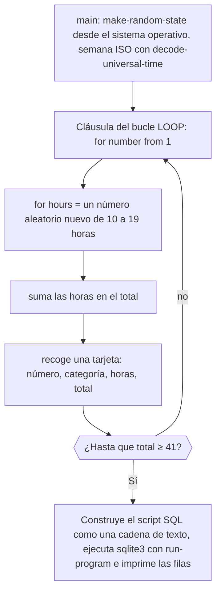
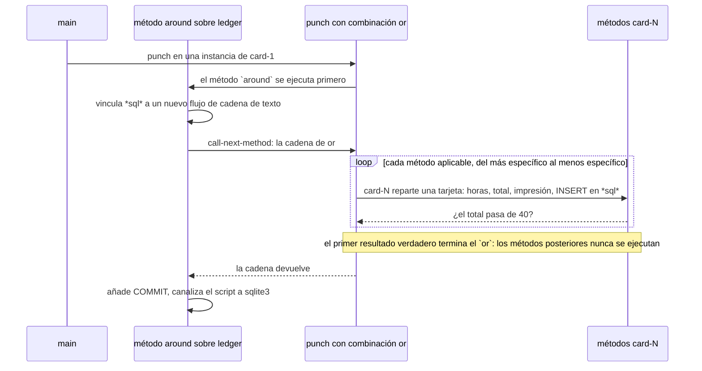

# Guía de estudio de Common Lisp

## Para qué sirve esta guía

Esta guía lee dos programas de Common Lisp. [`src/lisp`](../../../src/lisp/README.md) es una sola forma `LOOP`. [`src/lisp-weird`](../../../src/lisp-weird/README.md) no tiene ningún bucle ni condicional debajo de la línea marcada "RUN TIME". En el programa raro, cada tarjeta es un *método* de una misma función genérica, y las tarjetas se encadenan mediante la lista de precedencia de clases. La pregunta es: **cuando el sistema de objetos elige y ordena el código, ¿pueden sus reglas de despacho servir como bucle y como regla de parada?**

Al terminar, deberías poder:

1. Explicar qué es una lista de precedencia de clases y en qué orden se ejecutan los métodos aplicables de una función genérica.
2. Explicar qué hace la combinación de métodos `or` integrada y por qué su cortocircuito es la regla de parada.
3. Explicar cómo una macro traslada la repetición del tiempo de ejecución al tiempo de compilación.
4. Trazar ambos programas con las mismas tres tarjetas.
5. Decir por qué cinco es el máximo de tarjetas que puede repartir el programa raro y qué cambiarías para subirlo.
6. Etiquetar cada comportamiento como garantizado, permitido por la implementación o aprovechado por accidente.

**Límites del alcance.** Necesitas saber leer la sintaxis de Lisp y saber qué son una clase y un método. La guía no enseña todo CLOS, ni las macros del lector aparte de la lista circular, ni el SQL. Usa SBCL 2.x (`sbcl --script`). La página del libro es [Common Lisp](../../lenguajes/lisp.md). Para las ideas, consulta [Evaluación de cortocircuito](../../informatica/04-evaluacion-y-demanda.md#short-circuit-evaluation) y [Flujo de control](../../informatica/03-flujo-de-control-y-continuaciones.md#control-flow).

## Antes de empezar

**Modelo de seguridad.** Cada entrada escribe datos ficticios marcados con **DEMO ONLY** en un archivo SQLite de trabajo. Ambos programas inician `sqlite3` como un proceso hijo, y el programa raro construye SQL como texto. Lee el código fuente antes de ejecutarlo y ejecútalo primero en un entorno aislado (*sandbox*) que limita el acceso al sistema anfitrión:

```bash
sandbox/container/run-image.sh src/lisp
sandbox/container/run-image.sh src/lisp-weird
```

Edita solo copias ([Ejecutar cosas de forma segura](../../exercises.md#running-things-safely)). Tus números serán distintos de los que se imprimen aquí; la estructura no.

**Regla de predicción.** Antes de cada ejecución, anota qué métodos se ejecutarán, en qué orden y qué devuelve el método que detiene la cadena.

**Vocabulario.**

| Término | Significado aquí |
| --- | --- |
| Función genérica | Una función cuyo código es un conjunto de *métodos*, elegidos según las clases de los argumentos. |
| Lista de precedencia de clases | La lista ordenada de una clase y todos sus ancestros, de la más específica a la menos específica. |
| Combinación de métodos | La regla que dice cómo se combinan los métodos aplicables en un único resultado. |
| Combinación `or` | Ejecuta los métodos aplicables del más específico al menos específico, devuelve el primer valor que no sea `NIL` y se detiene. |
| Método `:around` | Un método que envuelve a los demás y decide cuándo se ejecutan, mediante `call-next-method`. |

## El reto compartido

La [especificación del reto](../../introduccion.md#what-the-challenge-does) pide tarjetas con una categoría y de 10 a 19 horas enteras. Las categorías se repiten en ciclo: `Meetings`, `Coding`, `Debugging` y `Learning`. Suma las horas de cada tarjeta al total acumulado. Detente cuando el total pasa de 40. Conserva la **primera tarjeta con la que el total pasa de 40**. Un total de exactamente 40 continúa. Cuatro tarjetas de 10 horas necesitan una quinta tarjeta, de la categoría `Meetings`. Las ejecuciones conformes tienen de 3 a 5 tarjetas y un total de 41 a 59 horas.

Ambas entradas de Lisp guardan las tarjetas en una sola transacción de SQLite e imprimen un resumen. Lisp escribe el límite como `(> total 40)`: es falso para 40. En `LOOP` la prueba es `until (> total +limit+)` y va *después de* `collect`, por eso se conserva la tarjeta que cruza el límite ([L39-46](../../../src/lisp/timecards.lisp#L39-L46)). En el programa raro, cada método termina con `(> (total ledger) 40)`, y el método que devuelve verdadero detiene la cadena ([L84](../../../src/lisp-weird/timecards.lisp#L84)).

## La máquina que hay que identificar

**Qué se repite.** En `lisp`, una forma `LOOP` en `draw-cards`: `for number from 1`, `for hours = ...`, `sum hours into total`, `collect ...`, `until ...`. En `lisp-weird`, no se repite nada. Cinco métodos *distintos* se ejecutan en un orden fijo, uno por tarjeta. El "bucle" es una cadena.

**Dónde vive el estado.** En `lisp`, en las variables propias del bucle (`number`, `hours`, `total`) y en la lista que recoge. En `lisp-weird`, en dos lugares: un objeto `ledger` guarda `total`, `entries` y el estado aleatorio. Además, la *posición en la lista de precedencia de clases* dice cuántas tarjetas se han repartido. La jerarquía de clases es el contador del bucle.

**Qué hace avanzar el paso siguiente.** En `lisp`, el propio `LOOP`. En `lisp-weird`, la combinación de métodos `or`: cuando un método devuelve `NIL`, la combinación llama al siguiente método aplicable, que es la tarjeta siguiente. La tarjeta siguiente es un método de la clase *padre*.

**Qué lo detiene.** En `lisp`, la cláusula `until`. En `lisp-weird`, un método que devuelve verdadero, porque `or` se detiene en el primer valor verdadero. Si ningún método devuelve verdadero, la cadena simplemente termina después de la tarjeta 5.

**Qué confirma.** En `lisp`, el SQL se construye a partir de la lista terminada de tarjetas. Luego se ejecuta `sqlite3` con ella y después se imprimen las filas ([L154-165](../../../src/lisp/timecards.lisp#L154-L165)). En `lisp-weird`, cada tarjeta escribe su `INSERT` en un flujo de cadena de texto enlazado dinámicamente e imprime su fila a medida que se reparte. Un método `:around` sobre toda la cadena añade `BEGIN` al principio. Cuando `call-next-method` devuelve, añade `COMMIT` y ejecuta `sqlite3` una sola vez ([L93-107](../../../src/lisp-weird/timecards.lisp#L93-L107)).

<!-- diagram-source: src/lisp/README.md#program-flow -->



El primer diagrama es un bucle convencional con una sola cláusula de salida.

<!-- diagram-source: src/lisp-weird/README.md#program-flow -->



El segundo no tiene ninguna arista de bucle. La secuencia queda fijada en la jerarquía de clases antes de que se ejecute el programa.

## Traza una ejecución

Los programas sortean horas aleatorias. Usa las horas **15, 19, 12** para la traza. Para comprobarla, se ejecutó en el entorno aislado una copia de trabajo de `lisp-weird` con las horas tomadas de una lista. Se le añadieron dos sentencias de impresión: la lista de precedencia de clases y una línea de cada método que dice qué devolvió. La salida fue:

```text
# class precedence list: CARD-1 -> CARD-2 -> CARD-3 -> CARD-4 -> CARD-5 -> LEDGER -> STANDARD-OBJECT -> SLOT-OBJECT -> T
Meetings	15	15	DEMO ONLY
  [method of card-1 ran: total 15, returns NIL (OR goes on)]
Coding	19	34	DEMO ONLY
  [method of card-2 ran: total 34, returns NIL (OR goes on)]
Debugging	12	46	DEMO ONLY
  [method of card-3 ran: total 46, returns T (OR stops)]
# committed total=46 entries=3 DEMO ONLY
# PUNCH had 5 OR methods and 3 ran: the class precedence list is the loop, and OR is the stop rule
```

(Se quitó la columna de la semana ISO para ganar ancho.) La instancia se crea como `card-1`, así que la lista de precedencia empieza en la tarjeta 1 y termina en `ledger`.

**`lisp-weird`: qué método se ejecuta.**

| Paso | Método ejecutado | Horas | Total | Devuelve | Qué hace `or` |
| --- | --- | ---: | ---: | --- | --- |
| 1 | `punch` en `card-1` | 15 | 15 | `NIL` | pasa al siguiente método aplicable |
| 2 | `punch` en `card-2` | 19 | 34 | `NIL` | sigue |
| 3 | `punch` en `card-3` | 12 | 46 | **`T`** | se detiene: `card-4` y `card-5` nunca se ejecutan |
| fin | el método `:around` continúa después de `call-next-method` | ninguno | 46 | ninguno | escribe `COMMIT` y ejecuta `sqlite3` una sola vez |

Cinco métodos eran aplicables y se ejecutaron tres. La tarjeta que cruza el límite es el método que devolvió verdadero, así que ya repartió su tarjeta.

**`lisp`: las cláusulas `LOOP`.** En cada pasada: `number` aumenta desde 1, se sortea `hours`, `total` lo acumula, se recoge la tarjeta y *luego* prueba `until`. Con 15, 19, 12 los totales son 15, 34, 46, y la prueba es verdadera después de la tercera pasada. La lista recogida son las tres tarjetas en orden. Como `until` va después de `collect`, la tercera tarjeta ya está en la lista cuando termina el bucle.

**Exactamente 40.** Con cuatro tarjetas de 10 horas, los totales son 10, 20, 30 y 40. Ningún método devuelve verdadero. `card-5` es aplicable y se ejecuta, porque es el último eslabón. Su total es de al menos 50, así que devuelve verdadero. La cadena tiene justo los métodos suficientes para el peor caso, y por eso el programa tiene cinco clases.

## Compara los diseños ordinarios y los raros

| Dimensión | `lisp` | `lisp-weird` |
| --- | --- | --- |
| **Representación** | Una lista de estructuras de tarjeta y un bucle. | Una cadena de cinco clases y un método en cada una. |
| **Observabilidad** | Imprime la lista. | El orden existe en la jerarquía de clases. `class-precedence-list` y `compute-applicable-methods` lo revelan. |
| **Pruebas** | El bucle es una función: pásale un estado aleatorio y compara las tarjetas. | La cadena necesita una instancia. La regla de parada es un `or` y no se puede cambiar sin editar el calificador de cada método. |
| **Debugging** | Recorre un bucle paso a paso. | Qué método se ejecuta después depende de la herencia. Un método con el calificador equivocado produce una advertencia del compilador, no un fallo que puedas pasar por alto en tiempo de ejecución. |
| **Portabilidad** | Common Lisp ANSI, más las llamadas de SBCL para `run-program` y las variables de entorno. | También el `sb-mop:compute-applicable-methods` de SBCL para la nota de cierre. |
| **Costo** | Un bucle y una lista. | Cinco clases definidas por una macro, que se ejecuta una sola vez. Un límite por encima de lo que pueden sumar cinco tarjetas exige más clases. |

Una macro hace la repetición en tiempo de compilación. `defcard` se expande cinco veces mientras se compila el archivo, y las expansiones son código lineal. Es la separación entre tiempo de compilación y tiempo de ejecución en acción. Existe un bucle, pero se ejecuta mientras se construye el *programa* y nunca toca una tarjeta de horas.

## Qué demuestran los ejercicios

| Ejercicio | Predice primero | Qué muestra la evidencia |
| --- | --- | --- |
| [B10. Lisp: cambia la combinación de métodos](../../exercises.md#b10-lisp-swap-the-method-combination-verified), paso 1 | Sustituye `or` por `progn` en los dos lugares. ¿Cuántas tarjetas salen en cada ejecución? | Exactamente cinco en cada ejecución; además, `PUNCH had 0 OR methods and 5 ran`. `progn` ejecuta todos los métodos, así que la regla de parada desaparece. La comprobación propia de la entrada falla. |
| B10, paso 2 | Cambia solo la combinación de la función genérica a `progn` y deja los calificadores `or`. | SBCL advierte `Invalid qualifiers for PROGN method combination`. Los calificadores de un método deben pertenecer a la combinación de su función genérica. |
| B10, paso 3 | Cambia la prueba de parada a `(> (total ledger) 100)`. | Exactamente cinco filas en cada ejecución y un total de 95 como máximo. `check-demo.sh out.txt 100` falla. Cinco es lo máximo que el programa puede repartir. Para admitir 100 hacen falta más clases. |
| [C1. Lo raro junto a lo aburrido](../../exercises.md#c1-weird-next-to-boring-verified) | ¿En qué programa vive la regla de parada en una sola palabra? | En `lisp-weird` es la palabra `or`. Quitarla no provoca ningún error: el programa reparte las cinco tarjetas. |
| [F. Demuestra una afirmación del README](../../exercises.md#f-prove-a-readme-claim-verified) | ¿Qué prueba falla si la cadena no va del más específico al menos específico? | Comprueba que los métodos se ejecutan en el orden card-1 a card-5. El control negativo invierte la herencia y espera que el orden de las tarjetas cambie. |

La respuesta de una frase que el libro pide en B10 es la mejor prueba. *¿Qué palabra es la regla de parada y por qué quitarla no hace fallar al programa?* La palabra es `or`. Sin ella los métodos se siguen ejecutando, y un programa que reparte demasiadas tarjetas parece un programa que funciona.

## Modos de fallo, costos y límites

| Comportamiento | Etiqueta | Por qué |
| --- | --- | --- |
| Los métodos aplicables se ejecutan en orden de precedencia de clases, del más específico al menos específico | **garantizado** | Lo define ANSI Common Lisp. |
| La combinación de métodos `or` integrada devuelve el primer valor que no sea `NIL` y omite el resto | **garantizado** | Una combinación de métodos estándar. Verificado: las tarjetas 4 y 5 no se ejecutaron. |
| Un método calificado `or` en una función genérica que usa `progn` no es válido | **garantizado** | El estándar exige que los calificadores coincidan con la combinación. SBCL advierte, como muestra el paso 2 de B10. |
| `#1=(... . #1#)` lee una lista circular, así que `(nth 4 *week*)` vuelve a ser Meetings | **garantizado** | Sintaxis estándar del lector. El programa no modifica el literal, lo que estaría indefinido. |
| `make-random-state t` toma la semilla del sistema operativo | **garantizado** que el estado se inicializa al azar | El origen exacto lo define la implementación. |
| `sb-mop:compute-applicable-methods`, `sb-ext:run-program`, `sb-ext:posix-getenv` | **permitido por la implementación** | Nombres propios de SBCL. Por eso los programas necesitan SBCL y no cualquier Common Lisp. |
| Cinco clases bastan porque cinco tarjetas de 10 horas llegan a 50 | **garantizado** | Aritmética, no Lisp. El número de clases es una *cota*. |

Aquí ningún comportamiento es simplemente *aprovechado por accidente*: la entrada rara usa funciones documentadas exactamente como están documentadas, en un orden que nadie elegiría.

**Costos que debes poder enunciar.**

- **El flujo de control está en una declaración.** Leer `punch` no te dice con qué frecuencia se ejecuta. Tienes que leer las formas `defclass`.
- **Un error de despacho parece un éxito.** Un calificador no válido o una combinación equivocada produce una advertencia (ejercicio B10, paso 2) y el programa se sigue ejecutando. El script de comprobación tiene que contar filas.
- **Cambiar el límite es un cambio estructural.** Subir el límite a 100 significa definir más clases, no editar un número.
- **Entrecomillado del SQL.** El `sql-quote` de la entrada rara no escapa. El de la entrada idiomática sí. La entrada rara es segura solo porque cada valor es un número o una de cuatro palabras fijas.
- **Dónde es legítima la técnica.** La combinación de métodos es como CLOS compone comportamiento: los métodos `:before`, `:after` y `:around` son rutinarios, y las combinaciones `or`, `and` y `progn` sirven para comprobaciones de complementos. Encadenar para contar tarjetas es una acrobacia.

## Conexiones a lo largo del repositorio

- **Flujo de control guardado en una declaración.** La misma idea aparece en [COBOL](cobol.md), donde una declaración de datos (`88 OVER-FORTY`) es la regla de parada. También aparece en [Tcl](tcl.md), donde los disparadores de la base de datos activan el paso siguiente. La guía de concepto [Estado y control más allá de las variables](../conceptos/estado-y-control-mas-alla-de-las-variables.md) las compara.
- **El cortocircuito como regla de parada.** `or` se detiene en el primer resultado verdadero, igual que un `span` perezoso deja de leer en [Haskell](haskell.md). Ambos se detienen *sin pedir más*. Lisp lo logra al no llamar al método siguiente.
- **Repetición en tiempo de compilación.** [m4](m4.md) es un procesador de macros para texto. Las macros de Lisp transforman código. La guía de concepto [Lenguajes formales y máquinas raras](../conceptos/lenguajes-formales-y-maquinas-raras.md) sitúa a ambos.
- **Una cadena con un límite fijo.** Las entradas de expresiones regulares en [Motores de regex y sed](motores-de-regex-y-sed.md) están limitadas a cuatro tarjetas por la longitud de un sujeto. Lisp-weird está limitado a cinco por la longitud de una cadena de clases.
- **En el libro.** [Common Lisp](../../lenguajes/lisp.md), [Evaluación de cortocircuito](../../informatica/04-evaluacion-y-demanda.md#short-circuit-evaluation) y [Macros y expansión de texto](../../informatica/05-lenguajes-formales-como-sustratos-de-computacion.md#macros-and-text-expansion).

## Autoevaluación

Responde cada pregunta con tus propias palabras antes de leer el texto en cursiva. Di qué evidencia respaldaría cada respuesta.

1. **Traza.** En `lisp-weird`, las horas son 11, 12, 10, 14. ¿Cuántos métodos se ejecutan y qué devuelve cada uno? *(Cuatro métodos. Totales 11, 23, 33, 47. Las tarjetas 1, 2 y 3 devuelven `NIL` y la tarjeta 4 devuelve `T`. `card-5` no se ejecuta.)*
2. **Explica.** ¿Por qué hay que llamar a `defcard` primero para la tarjeta 5 y al final para la tarjeta 1? *(Una clase debe existir antes de que otra pueda heredar de ella, y la tarjeta 1 hereda de la tarjeta 2, y así sucesivamente. La cadena se construye desde la cola.)*
3. **Transfiere.** ¿Qué construcción de Python, Java o Go cumpliría el papel de la combinación de métodos `or`? *(Una cadena de manejadores. Cada uno devuelve un booleano y quien llama se detiene en el primer valor verdadero, como en una cadena de intermediarios (middleware) o una serie de llamadas `||`. En Java, `Stream.anyMatch` tiene la misma forma de cortocircuito.)*
4. **Evidencia.** Un revisor dice: "El programa raro nunca puede repartir más de cinco tarjetas". Diseña una prueba que pueda fallar. *(Ejecútalo muchas veces y cuenta las filas, como hace B10. Para un control negativo, cambia el límite a 100 y comprueba que el conteo sigue siendo cinco. El número de clases garantiza la afirmación.)*

## Lecturas adicionales

- [Common Lisp](https://en.wikipedia.org/wiki/Common_Lisp) (Wikipedia): el lenguaje y su estándar.
- [Sistema de objetos de Common Lisp](https://en.wikipedia.org/wiki/Common_Lisp_Object_System) (Wikipedia): funciones genéricas, despacho múltiple y combinación de métodos.
- [Evaluación de cortocircuito](https://en.wikipedia.org/wiki/Short-circuit_evaluation) (Wikipedia): la idea general detrás de la parada de `or`.
- [Flujo de control](../../informatica/03-flujo-de-control-y-continuaciones.md#control-flow) y [Evaluación de cortocircuito](../../informatica/04-evaluacion-y-demanda.md#short-circuit-evaluation) (este libro): los conceptos que rodean al tema.
