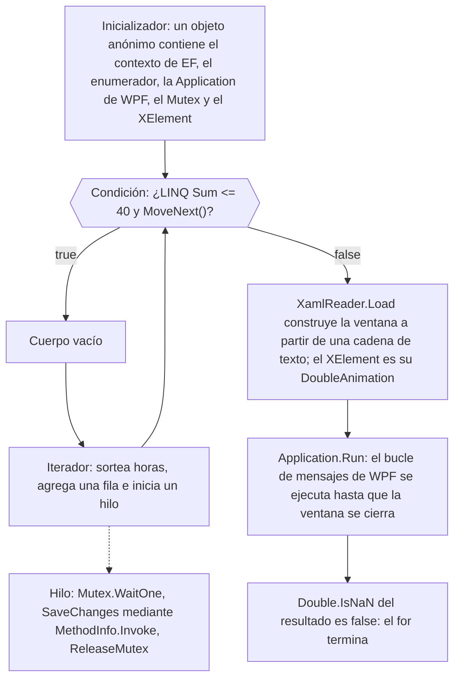
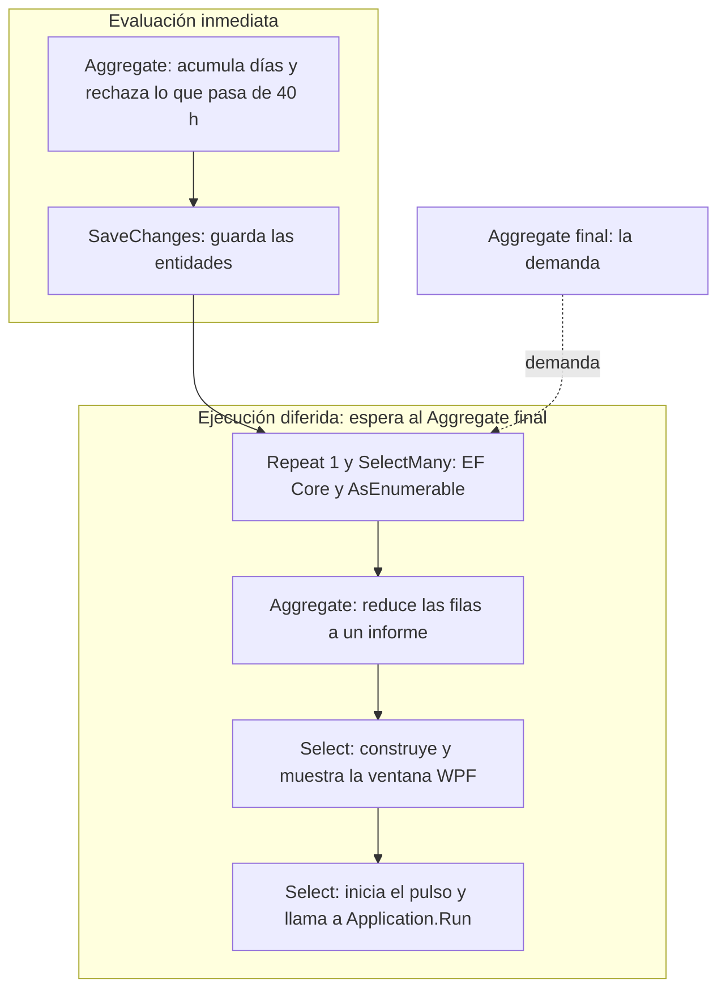
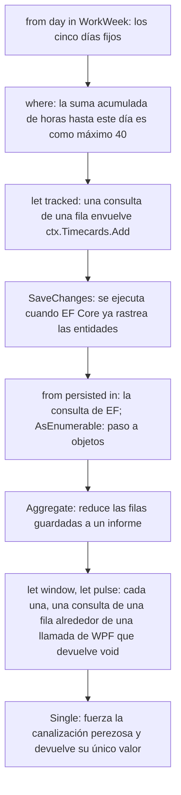
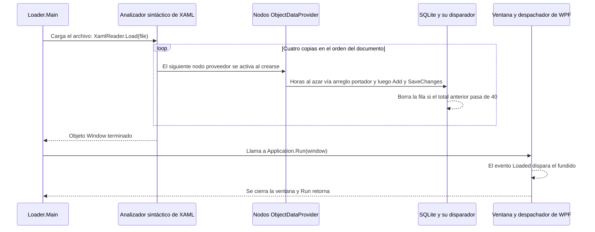

# Guía de estudio de C#, LINQ, XAML y adaptaciones

## Para qué sirve esta guía

Esta guía estudia en conjunto la familia C# del repositorio y sus adaptaciones de una sola sentencia. Incluye el original [`ModernChallenge1`](../../../src/ModernChallenge1/README.md) (una sentencia `for` con el cuerpo vacío). Incluye también las dos entradas LINQ [`LinqChallenge1`](../../../src/LinqChallenge1/README.md) y [`LinqChallenge2`](../../../src/LinqChallenge2/README.md), el intérprete de marcado [`xaml`](../../../src/xaml/README.md) y las adaptaciones a [Java](../../../src/JavaChallenge1/README.md), [Go](../../../src/GoChallenge1/README.md), [Kotlin](../../../src/KotlinChallenge1/README.md), [Python](../../../src/PythonChallenge1/README.md) y [Rust](../../../src/RustChallenge1/README.md). La pregunta es: **cuando una sentencia, una expresión o un documento es todo el programa, ¿para qué sirve cada ranura de la construcción? ¿Cuándo se ejecuta cada parte y quién es dueño del hilo en que se ejecuta?**

Al terminar, deberías poder:

1. Nombrar las tres ranuras del encabezado `for` (inicializador, condición e iterador) y decir qué lleva cada una en el original y en cada adaptación.
2. Explicar la ejecución diferida: qué guarda una consulta LINQ, cuándo se ejecuta y por qué enumerarla dos veces la ejecuta dos veces.
3. Explicar dónde está el límite del proveedor (de `IQueryable` a `IEnumerable`) y por qué importa la posición de `AsEnumerable()`.
4. Explicar cómo un analizador sintáctico de marcado puede ejecutar un programa y por qué hubo que desenrollar el bucle en los archivos XAML.
5. Explicar la afinidad de hilo: por qué WPF necesita un hilo STA y un despachador, y por qué el original protege el contexto de EF Core con un mutex.
6. Etiquetar cada comportamiento como garantizado, permitido por la implementación o aprovechado por accidente, y decir qué afirmaciones se ejecutaron y cuáles solo se leyeron.

**Límites del alcance.** Necesitas leer C# 9 o posterior y saber qué es LINQ. La guía no enseña el diseño de WPF, el mapeo de EF Core, Swing ni Tk. Usa .NET 10. La página del libro es [C#, LINQ y XAML (más las adaptaciones de una sola sentencia)](../../lenguajes/csharp-linq-xaml.md). Para las ideas, consulta [Ejecución diferida](../../informatica/04-evaluacion-y-demanda.md#ejecución-diferida), [Seguridad entre hilos y afinidad de hilo](../../informatica/07-efectos-errores-y-confirmacion.md#seguridad-entre-hilos-y-afinidad-de-hilo) y [Lectura de un programa adversarial](../../informatica/01-lectura-de-un-programa-adversarial.md).

**Qué se ejecutó para esta guía.** Las partes de WPF, EF Core, XAML, Swing, Tk y GTK necesitan Windows o una pantalla, y **no se ejecutaron aquí**. Sus trazas se leen del código fuente y se marcan como "leído". Se ejecutaron dos cosas: una reducción en consola del encabezado `for` (sin WPF ni EF, con .NET 10) y el experimento de ejecución diferida del ejercicio B7. Todo lo demás está etiquetado.

## Antes de empezar

**Modelo de seguridad.** Toda entrada escribe datos ficticios de **DEMO ONLY** en una base de datos o un archivo locales, y ninguna se conecta a un sistema real de reporte de horas. La entrada XAML es la peligrosa: ejecuta *métodos durante el análisis sintáctico*, y un archivo de marcado que hace eso es un programa. El [ejemplo del modelo de amenazas](../../informatica/01-lectura-de-un-programa-adversarial.md#modelo-de-amenazas) del libro y el proyecto relacionado del repositorio [xaml-write-and-run](https://github.com/dullroar/xaml-write-and-run) muestran lo que eso hace posible. Lee primero el código fuente y ejecuta las entradas de WPF solo en Windows Sandbox:

```powershell
sandbox\windows\run.ps1 src\LinqChallenge1
sandbox\windows\run.ps1 src\xaml -RunArgs strict.xaml
```

Las adaptaciones a Go, Java, Kotlin, Python y Rust se ejecutan en el entorno aislado (*sandbox*) de Linux, que limita el acceso al sistema anfitrión, con `sandbox/container/run-image.sh src/<entry>`. Edita solo copias ([Ejecutar cosas con seguridad](../../exercises.md#ejecutar-con-seguridad)).

**Regla de predicción.** Antes de cada ejecución, anota qué se ejecuta *primero*, qué queda diferido y en qué hilo. En esta familia el orden de evaluación es el programa.

**Vocabulario.**

| Término | Significado aquí |
| --- | --- |
| Ejecución diferida | Una consulta es una descripción. Se ejecuta cuando algo la enumera, y otra vez cada vez que se enumera. |
| Proveedor | Lo que convierte una consulta en trabajo: LINQ to Objects la ejecuta en memoria; el `IQueryable` de EF Core la traduce a SQL. |
| `ObjectDataProvider` | Un tipo de WPF que construye un objeto y llama a un método *durante el análisis sintáctico*. |
| STA / despachador de WPF | Un apartamento de un solo hilo (*single-threaded apartment*) y la cola de mensajes de WPF. Los objetos de la interfaz pertenecen al hilo que los creó. |

## El reto compartido

La [especificación del reto](../../introduccion.md#qué-hace-el-reto) pide tarjetas con una categoría y de 10 a 19 horas enteras. Las categorías se repiten en ciclo: `Meetings`, `Coding`, `Debugging` y `Learning`. Suma las horas de cada tarjeta al total acumulado. Detente cuando el total pasa de 40. Conserva la **primera tarjeta con la que el total pasa de 40**. Un total de exactamente 40 continúa. Cuatro tarjetas de 10 horas necesitan una quinta tarjeta, de la categoría `Meetings`. Las ejecuciones conformes tienen de 3 a 5 tarjetas y un total de 41 a 59 horas.

Las dos demos de LINQ y XAML se apartan de ese contrato. Los encabezados antiguos de cuatro nombres explican cómo afectaba antes el mismo caso límite a las adaptaciones.

1. **`LinqChallenge1` y `LinqChallenge2` no sortean horas al azar.** Su semana laboral son cinco días fijos de 8 horas, y rechazan cualquier día que haga que el total pase de 40. El resultado es exactamente 40.0 horas en cinco filas, en cada ejecución. Enseñan la ejecución diferida, no la regla de parada. El ejercicio E1 lo indica.
2. **Las entradas con encabezado `for` solían detenerse tras cuatro tarjetas, y `xaml` todavía lo hace.** El original y las adaptaciones a Java, Go, Kotlin, Python y Rust prueban `total <= 40 && a category remains` y toman cada categoría una sola vez. En `ModernChallenge1` la condición es `Sum() <= 40d && i.categories.MoveNext()`, donde `categories` es un enumerador de una sola pasada. Con cuatro nombres de categoría, una reducción de ese encabezado ejecutada en un proyecto de consola, con todas las tarjetas de 10 horas, se detuvo con `stop: total 40 after 4 cards`. Eso ocurre una vez de cada 10,000 con horas al azar y contradice la regla de que un total de exactamente 40 continúa. El original de 2008 tenía cuatro nombres, y los README de las entradas lo describían con fidelidad. Ahora está corregido en `ModernChallenge1` y en las cinco adaptaciones con un quinto nombre (`Meetings` se repite). Tras la corrección, la misma reducción se detiene con `stop: total 50 after 5 cards`. El proyecto de C# compila. Las pruebas unitarias de Rust pasan (ahora afirman que un total de exactamente 40 continúa). Go, Java y Kotlin compilan. Las cuatro pasadas desenrolladas de la entrada XAML conservan el techo. No se pudo probar una quinta pasada sin Windows, así que no se agregó. Con la semilla incluida (`Random(42)`: 16, 11, 11, 15) reparte cuatro tarjetas y termina en 53. Por eso el caso nunca se da, salvo que cambies la semilla (ejercicio E2).
3. **El almacenamiento depende de la variante de XAML.** La variante con EF Core tiene un disparador de SQLite que borra una fila si las filas anteriores ya suman más de 40. La variante de SQLite directo pone la prueba equivalente en la sentencia de inserción. Ambas conservan la tarjeta que cruza el tope. La variante estricta escribe XML. Consulta [dónde difieren las entradas](../../introduccion.md#dónde-difieren-las-entradas).

## La máquina que hay que identificar

**Qué se repite.** En `ModernChallenge1`, el encabezado `for`: una sentencia, un cuerpo vacío y tres ranuras que hacen todo el trabajo. En `LinqChallenge1`, nada se repite: una expresión es una cadena de operadores LINQ y `Aggregate` reduce (*fold*). En `LinqChallenge2`, lo mismo, con sintaxis de consulta. En `xaml`, *nada*: cuatro pasadas copiadas, en el orden del documento. En las adaptaciones: un `for` de tres cláusulas (Java, Go), `generateSequence` (Kotlin), `iter(step, False)` (Python), `std::iter::successors` (Rust).

**Dónde vive el estado.** En `ModernChallenge1`, en un objeto anónimo en la ranura del inicializador (lista de horas, enumerador de categorías, contexto de base de datos, generador aleatorio, aplicación WPF, mutex). Un inicializador `for` admite una sola declaración, y un objeto anónimo es la única declaración que contiene muchos tipos de estado. En las entradas LINQ, en los acumuladores de `Aggregate` y en el rastreador de cambios de EF Core. En `xaml`, en arreglos "portadores": un proveedor llena un `char[]` o un `byte[]` y el siguiente lo lee. En Rust, en un lote inmutable: "agregar" una tarjeta devuelve un lote nuevo.

**Qué hace avanzar el paso siguiente.** En la familia `for`, la ranura del iterador: sortea horas y guarda una tarjeta. En las entradas LINQ, el `Aggregate` final, que *demanda* las etapas diferidas. En `xaml`, el analizador sintáctico al llegar al nodo siguiente.

**Qué lo detiene.** En la familia `for`, la ranura de la condición. Cuando el total pasa de 40 (o se acaban las categorías), la rama else del condicional muestra la ventana y devuelve `false`. En las entradas LINQ, un tope aplicado a un prefijo (`where` recalcula un total acumulado; `Aggregate` rechaza un día). En `xaml`, el disparador borra las filas tardías. En Rust, `extended` devuelve `None`.

**Qué confirma.** En `ModernChallenge1`, cada tarjeta se agrega al contexto de EF Core bajo un mutex y se guarda. La ventana se muestra después del bucle. En `LinqChallenge1`, un único `SaveChanges()` guarda las entidades rastreadas con evaluación inmediata, dentro de la única sentencia pero antes de las etapas diferidas. Los proveedores de XAML invocan `Add` y `SaveChanges` en la variante de EF Core, `ExecuteNonQuery` en la variante de SQLite directo y `WriteXml` en la variante estricta.

<!-- diagram-source: src/ModernChallenge1/README.md#program-flow -->



El flujo del original es un bucle con una salida condicional. Su condición es de evaluación inmediata: la expresión de consulta construye un `Select` diferido, y el `Sum()` terminal lo enumera de inmediato, en esa comprobación de la condición. Es la misma colocación del trabajo que el `reduce` de JavaScript. Las demos de LINQ siguientes tienen etapas diferidas propias y usan operadores terminales para ejecutarlas.

<!-- diagram-source: src/LinqChallenge1/README.md#program-flow -->



LinqChallenge1 no tiene bucle. Tiene un grupo de evaluación inmediata que se ejecuta primero y un grupo diferido que el último `Aggregate` pone en marcha con una demanda (pull).

<!-- diagram-source: src/LinqChallenge2/README.md#program-flow -->



LinqChallenge2 es la misma idea en sintaxis de consulta, que el compilador reescribe como las mismas llamadas a métodos.

<!-- diagram-source: src/xaml/README.md#program-flow -->



El flujo de XAML no tiene arista de bucle. El analizador sintáctico recorre el documento una sola vez.

## Traza una ejecución

**`ModernChallenge1`: las ranuras del encabezado (encabezado reducido y ejecutado).** Con las horas 15, 19 y 12, las evaluaciones son:

| Evaluación | Condición: `Sum() <= 40 && MoveNext()` | Ranura del iterador (después del cuerpo vacío) | Suma después |
| --- | --- | --- | ---: |
| 1 | `0 <= 40` es true, `MoveNext()` da Meetings: **true** | Se suman 15 horas, tarjeta Meetings | 15 |
| 2 | `15 <= 40` es true, `MoveNext()` da Coding | Se suman 19, Coding | 34 |
| 3 | `34 <= 40` es true, `MoveNext()` da Debugging | Se suman 12, Debugging | 46 |
| 4 | `46 <= 40` es false: `&&` **hace cortocircuito** y no se llama a `MoveNext()` | ninguna | rama else: muestra la ventana y devuelve `false` |

El enumerador de categorías avanza solo cuando la prueba del total tiene éxito, así que se consume exactamente una vez por tarjeta. En la reducción con todas las tarjetas de 10 horas y cuatro nombres (antes de la corrección), la evaluación 5 daba `40 <= 40` true. Entonces `MoveNext()` devolvía `false` (el enumerador estaba agotado) y el bucle se detenía con un total de 40. Con cinco nombres, la misma evaluación devuelve el quinto nombre y se agrega una quinta tarjeta de 10 horas. La evaluación 6 ve `50 <= 40` false y se detiene. La ranura que hay que nombrar: el enumerador de categorías es estado oculto en la *condición*.

**LINQ: ejecución diferida (ejecutado).** El experimento B7 declara `q = Enumerable.Range(1, 3).Select(i => { print "effect i"; return i; })`. En un proyecto de consola imprimió:

```text
declared q:             (no effect lines)
q.Sum():                effect 1, effect 2, effect 3
q.Sum() then q.ToList():  effect 1..3, then effect 1..3 again
q.ToList() once, then Sum on the list:  effect 1..3 once
```

Al ejecutar la [prueba de consola B7](../../solutions/b7-linq/Program.cs) con el SDK de .NET 10.0.401 se reproducen 0, 3, 6 y 3 líneas de efecto. `Select` guarda una descripción; cada enumeración la ejecuta de nuevo. Un segundo experimento es propio de esta guía. Construye un generador perezoso de tarjetas (15, 19, 12, 10, 10) y toma `TakeWhile(c => c.total - c.hours <= 40)`, que conserva la tarjeta que cruza el tope. Imprimió *cuatro* líneas `drew` para tres tarjetas conservadas. Para conservar esa tarjeta, `TakeWhile` debe mirar la tarjeta *siguiente* y ver que la prueba falla, así que el generador sorteó una tarjeta de más. El `span` de Haskell no tiene ese costo (consulta [Haskell](haskell.md)). Un tope que conserva esa tarjeta sin sortear de más necesita un iterador con estado. Un ejemplo es la bandera `over` de la máquina rara de JavaScript. Otro es un `Aggregate` que rechaza.

**`LinqChallenge1`: evaluación inmediata primero, diferida después (leído).** El `Aggregate` más interno reduce los cinco días fijos a entidades rastreadas y se ejecuta primero, porque es el argumento más interno. La tupla `(..., ctx.SaveChanges())` se evalúa de izquierda a derecha, así que `SaveChanges()` se ejecuta después de que todas las entidades estén rastreadas. Luego viene una cadena de etapas `Select` y `SelectMany`. No hace nada hasta que el `Aggregate` final la pone en marcha con una demanda (pull). Esa demanda recorre la consulta, la reducción, la construcción de la ventana, el pulso y `Application.Run`. El total informado es 40.0 para cinco filas.

**`xaml`: el orden del documento (leído).** Las horas son 15, 19 y 12, con un cuarto sorteo de 14. La pasada 1 inserta 15 (total 15). La pasada 2 inserta 19. La pasada 3 inserta 12. La pasada 4 inserta 14. Un disparador de inserción borra toda fila cuyas filas anteriores ya suman más de 40. Las filas 1 a 3 tienen totales anteriores de 0, 15 y 34, así que se quedan. Las filas anteriores a la fila 4 suman 46, así que se borra. Quedan tres tarjetas. Entonces el analizador sintáctico devuelve la ventana.

## Compara los diseños ordinarios y los raros

| Dimensión | Programa ordinario | `ModernChallenge1` | Entradas LINQ | `xaml` |
| --- | --- | --- | --- | --- |
| **Representación** | Un bucle y una lista | `for` con cuerpo vacío; estado en un objeto anónimo | Una expresión: operadores LINQ y `Aggregate` | Un documento de nodos `ObjectDataProvider` |
| **Observabilidad** | Depurador sobre un bucle | Igual, pero el trabajo real está en el encabezado | El *orden* de la expresión es el programa, y un punto de interrupción ve solo una sentencia | El análisis sintáctico es ejecución: no hay nada que recorrer paso a paso salvo el analizador sintáctico |
| **Pruebas** | Prueba unitaria de una función | Comprobaciones estructurales al estilo de `check.ps1` | `check.ps1` prohíbe nombres auxiliares como `RunEverything` y comprueba las 40.0 h persistidas | Ejecución en Windows Sandbox: el arnés cierra la ventana |
| **Debugging** | Estándar | Estándar | Las etapas diferidas ocultan cuándo se ejecutan los efectos | Un proveedor defectuoso falla en el *momento del análisis sintáctico*, y el error apunta al marcado |
| **Portabilidad** | Cualquier C# | Solo Windows (WPF) | Solo Windows (WPF, EF Core, SQLite) | Solo Windows; `strict.xaml` solo necesita .NET, las demás añaden paquetes |
| **Costo** | Normal | Normal | Enumerar de nuevo vuelve a ejecutar los efectos | El bucle está desenrollado: cuatro copias, con el número de categorías fijado en el marcado |

### Las adaptaciones, lado a lado

Las cinco adaptaciones conservan "una sentencia, cuerpo vacío". Cada una encuentra sus propias tres cláusulas. El resultado usa la interfaz del anfitrión de cada adaptación; por ejemplo, Go sirve su resumen por HTTP local.

| Adaptación | Mecanismo del encabezado | Contenedor del estado | Prueba de parada |
| --- | --- | --- | --- |
| Java | `for (init; condition; update) { }` | clase anónima | `sum <= 40d && categories.hasNext()` |
| Go | un `for` real de tres cláusulas | una estructura; auxiliares como `Seq` y `After` en `helpers.go` | `Sum(i.hours) <= 40 && len(i.categories) > 0` |
| Kotlin | `for (pass in generateSequence(...) { ... })`; un `null` desde `takeIf` lo termina | una clase con un iterador de categorías | `totalHours.sum() <= 40.0 && categories.hasNext()`; el cuerpo se ejecuta una vez antes de la primera comprobación |
| Python | `for _ in iter(<lambda>, False):` | un objeto que contiene un `deque` de categorías | `sum(...) <= 40 and categories` |
| Rust | `for _ in std::iter::successors(...) {}` | un `DemoBatch` inmutable; agregar una tarjeta devuelve un lote nuevo | `extended` devuelve `None` |

Las adaptaciones muestran que el "bucle sin cuerpo" es una *forma*, no una característica de C#. Cambia lo que carga con el peso. Puede ser un objeto anónimo, una estructura con auxiliares ocultos o una secuencia perezosa. También puede ser una función a la que se llama hasta que devuelve `False` o un iterador de valores. Go necesitó auxiliares porque está orientado a sentencias, y su README lo dice como el costo de la adaptación.

## Qué demuestran los ejercicios

| Ejercicio | Predice primero | Qué muestra la evidencia |
| --- | --- | --- |
| [B7. LINQ: enumerar dos veces](../../exercises.md#b7-linq-enumera-dos-veces-verificado) | ¿Cuántas líneas `effect` hay después de (a) declarar `q`, (b) un `q.Sum()`, (c) `Sum` y `ToList`, (d) `ToList` y luego `Sum` sobre la lista? | 0, 3, 6, 3. `Select` es diferido y cada enumeración lo vuelve a ejecutar. También se verificó en esta guía. |
| B7, la semilla | ¿Cuáles son las cinco horas para la semilla 42? | `16 11 11 15 11`. Un `Random` con semilla da las mismas tarjetas en cada ejecución, y por eso un archivo `.xaml` con la semilla 42 es reproducible. |
| B7, el operador de evaluación inmediata | ¿Qué operador de `LinqChallenge1` es de evaluación inmediata y fuerza las etapas diferidas que le siguen? | `Aggregate`. |
| [E1. Ejecuta y lee la evidencia](../../exercises.md#e1-ejecuta-y-lee-la-evidencia) (Windows) | ¿Las filas de qué entrada dan un total de exactamente 40 porque los datos son fijos? | `LinqChallenge1`. `xaml` es la aleatoria. |
| [E2. Cambia la semilla del intérprete de XAML](../../exercises.md#e2-cambia-la-semilla-del-intérprete-xaml) (Windows) | Cambia `42` por `7` en `strict.xaml`. ¿Cambian las horas? | Sí, y la misma secuencia en cada ejecución con la misma semilla. El bucle se desenrolló cuatro veces porque XAML no tiene bucle. No se agregó una quinta pasada, así que `xaml` es la única entrada que no puede repartir una quinta tarjeta. Los portadores `x:Array` hacen el papel de variables. |
| [C1. Lo raro junto a lo aburrido](../../exercises.md#c1-lo-raro-junto-a-lo-aburrido-verificado) | Compara `ModernChallenge1` con un bucle ordinario de C#. | Mismo contrato de salida; el original expone su estado en un único objeto anónimo. |

## Modos de fallo, costos y límites

| Comportamiento | Etiqueta | Por qué |
| --- | --- | --- |
| La proyección `Enumerable.Select` de B7 se ejecuta al enumerarla, y el efecto se vuelve a ejecutar en una segunda enumeración de esa canalización | **garantizado** | El contrato `Select` de LINQ to Objects; verificado por B7. En el encabezado, `Sum()` enumera la proyección en cada comprobación. |
| `Aggregate` es de evaluación inmediata | **garantizado** | Por definición: consume la secuencia. |
| Los elementos de una tupla se evalúan de izquierda a derecha | **garantizado** | Regla del lenguaje C#. Por eso `SaveChanges()` se ejecuta después de rastrear las entidades. |
| `&&` hace cortocircuito | **garantizado** | Regla del lenguaje C#. Por eso el enumerador de categorías avanza una vez por tarjeta. |
| Los operadores `IQueryable` se traducen a SQL hasta `AsEnumerable()` y luego se ejecutan en memoria | **permitido por la implementación** | Comportamiento del proveedor: lo que EF Core puede traducir es cosa suya, y un límite mal colocado cambia dónde se ejecuta el trabajo. |
| `XamlReader.Load` ejecuta métodos `ObjectDataProvider` en el momento del análisis sintáctico | **aprovechado por accidente** | El README de XAML lo clasifica así. WPF documenta una interfaz de usuario declarativa. Ejecutar un programa es un efecto secundario de cómo el analizador sintáctico construye los objetos. |
| `Refresh` vuelve a ejecutar un proveedor, y un `x:Array` impide que el analizador sintáctico desenvuelva la llamada | **aprovechado por accidente** | Comportamiento observado en el que se apoya la entrada. |
| Un inicializador `for` admite una declaración, así que el estado va en un objeto anónimo | **garantizado** | Una regla de la gramática de C#. |
| `Random.Shared` admite el uso desde varios hilos | **garantizado** | Está documentado. |
| Los objetos de WPF pertenecen al hilo que los creó, y `Application.Run` mantiene en marcha el despachador de WPF | **garantizado** | El modelo de hilos de WPF. Se requiere `[STAThread]`. |
| Un `Mutex` con nombre puede proteger el contexto de EF Core, que no admite el acceso desde varios hilos | **permitido por la implementación** | Funciona como un bloqueo entre hilos. El original mantiene un hilo en segundo plano solo como "un contraste histórico". |

**Costos que hay que declarar.**

- **La afinidad de hilo forma parte del diseño.** El original guarda en un hilo en segundo plano y protege el contexto de EF Core con un mutex, porque el contexto no admite el acceso desde varios hilos. La ventana debe crearse y ejecutarse en el hilo STA. En las entradas LINQ se llama a `Application.Run()` desde una lambda `Select`. Eso mantiene en marcha el despachador de WPF para que la ventana se dibuje. Consulta [Seguridad entre hilos y afinidad de hilo](../../informatica/07-efectos-errores-y-confirmacion.md#seguridad-entre-hilos-y-afinidad-de-hilo).
- **El límite del proveedor mueve el trabajo.** Un `where` que EF Core puede traducir se ejecuta en la base de datos. El mismo `where` después de `AsEnumerable()` se ejecuta en memoria sobre todas las filas.
- **Evaluación inmediata oculta.** `SaveChanges()` se ejecuta en un momento concreto de la única sentencia, no en la enumeración final. "Todo perezoso" no es cierto ni siquiera en la entrada perezosa.
- **Un analizador sintáctico que ejecuta código.** Cualquier programa que carga XAML de una fuente que no controla está ejecutando esa fuente. El propio README de la entrada XAML lo dice.
- **Dónde son legítimas las técnicas.** Las consultas diferidas, los proveedores y el despachador de WPF son habituales. Una sentencia hecha de un solo `for` es un ejercicio de clase de 2008.

## Conexiones a lo largo del repositorio

- **La misma pregunta que en Haskell y JavaScript.** Las canalizaciones LINQ diferidas, las listas perezosas de [Haskell](haskell.md) y la iteración por demanda (pull) de [JavaScript](javascript.md) preguntan lo mismo: cuándo se ejecuta una descripción. [Evaluación, demanda y pereza](../conceptos/evaluacion-demanda-y-pereza.md) las compara. La diferencia que conviene recordar: Haskell recuerda un valor calculado y LINQ vuelve a ejecutar.
- **El orden del documento como programa.** La entrada XAML, [tar](tar.md) y [Tcl](tcl.md) convierten datos en un programa. La guía de concepto [Lectura de programas adversariales](../conceptos/lectura-de-programas-adversariales.md) las toma como un solo caso.
- **El mismo techo de cuatro tarjetas, ya corregido.** Las entradas de regex de [Motores de regex y sed](motores-de-regex-y-sed.md) también lo tenían y se corrigieron del mismo modo. [Diseño comparativo de máquinas](../conceptos/diseno-comparativo-de-maquinas.md) da la lista de las entradas que cumplen que un total de exactamente 40 continúa.
- **Hilos y funciones de devolución de llamada.** [Eventos, funciones de devolución de llamada y control reactivo](../conceptos/eventos-retrollamadas-y-control-reactivo.md) compara quién es dueño del turno siguiente, que es lo que decide aquí el despachador de WPF.
- **En el libro.** [C#, LINQ y XAML](../../lenguajes/csharp-linq-xaml.md), [Ejecución diferida](../../informatica/04-evaluacion-y-demanda.md#ejecución-diferida), [Lenguajes específicos de dominio](../../informatica/05-lenguajes-formales-como-sustratos-de-computacion.md#lenguajes-específicos-de-dominio) y [Ejecución arbitraria de código](../../informatica/01-lectura-de-un-programa-adversarial.md#ejecución-de-código-arbitrario).

## Autoevaluación

Responde cada pregunta con tus propias palabras antes de leer el texto en cursiva. Di qué evidencia respaldaría cada respuesta.

1. **Traza.** En el encabezado `ModernChallenge1`, las horas son 13, 14, 13 y 10. Da la suma cuando se ejecuta cada condición y di cuándo se llama a `MoveNext()`. *(Las condiciones ven las sumas 0, 13, 27, 40 y luego 50. Se llama a `MoveNext()` en las cuatro primeras y da Meetings, Coding, Debugging y Learning. La quinta condición tiene la suma 50, así que `&&` omite `MoveNext()`. La cuarta tarjeta es la que cruza el tope.)*
2. **Explica.** ¿Por qué `q.Sum()` seguido de `q.ToList()` imprime los efectos dos veces? ¿Qué predice eso para el encabezado de C#? *(Cada llamada enumera la canalización `Select`, así que sus efectos se ejecutan dos veces. En el encabezado, cada comprobación de la condición construye su proyección y la suma de inmediato, así que la suma se calcula antes de cualquier sorteo siguiente. Materializar la proyección de B7 con `ToList()` permite que los consumidores posteriores reutilicen sus resultados.)*
3. **Transfiere.** ¿Qué construcción de Python hace el papel de la ranura de condición del encabezado `for` de C# en `iter(step, False)`? *(El centinela: el bucle termina cuando `step` devuelve `False`, así que la prueba de parada vive dentro de la función que produce la tarjeta siguiente.)*
4. **Evidencia.** Una revisora dice: "Cuatro tarjetas de 10 horas en una entrada con encabezado `for` continúan con una quinta". Diseña una prueba que pueda fallar. *(Reproduce el encabezado con todas las horas en 10, como hizo la reducción anterior, y comprueba que haya cinco tarjetas y un total de 50. El control negativo es el encabezado con cuatro nombres, que se detiene en cuatro tarjetas y 40. La reducción se ejecutó para C#. Las pruebas unitarias de Rust lo afirman directamente, y Go, Java y Kotlin solo se compilaron, así que en esos casos se lee del código fuente.)*

## Lecturas adicionales

- [Consulta integrada en el lenguaje](https://en.wikipedia.org/wiki/Language_Integrated_Query) (Wikipedia): LINQ y su sintaxis de consulta.
- [Evaluación perezosa](https://en.wikipedia.org/wiki/Lazy_evaluation) (Wikipedia): la idea general detrás de la ejecución diferida.
- [XAML](https://en.wikipedia.org/wiki/Extensible_Application_Markup_Language) (Wikipedia): para qué sirve XAML y para qué nunca se pensó su analizador sintáctico.
- [Seguridad entre hilos y afinidad de hilo](../../informatica/07-efectos-errores-y-confirmacion.md#seguridad-entre-hilos-y-afinidad-de-hilo) y [Ejecución diferida](../../informatica/04-evaluacion-y-demanda.md#ejecución-diferida) (este libro): las dos ideas que sostienen esta familia.
