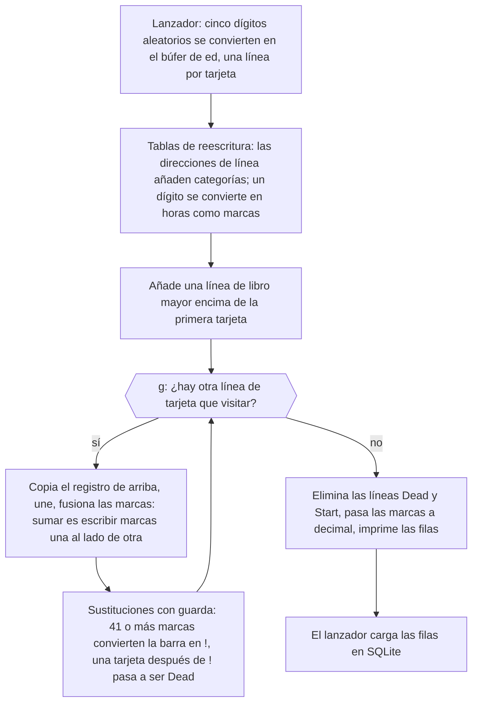
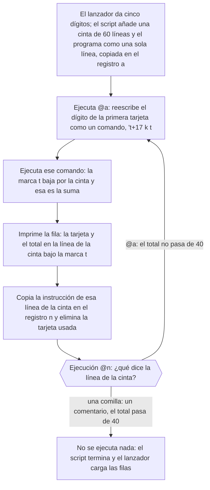

# Guía de estudio de ed y Ex

## Para qué sirve esta guía

Esta guía examina dos scripts que resuelven el reto en un búfer de texto. En [`src/ed-weird`](../../../src/ed-weird/README.md), las categorías son direcciones de línea y las horas son reglas de reescritura. Un solo comando global ejecuta el programa. En [`src/ex-weird`](../../../src/ex-weird/README.md), un registro guarda el programa. Una cinta en el búfer guarda la regla de parada y una marca es el contador de programa. **¿Dónde están las direcciones, los registros y el contador de programa cuando el programa edita un búfer?**

Al terminar, deberías poder:

1. Explicar qué son una dirección de línea, una marca y un registro en `ed` y `ex`, y qué guarda cada uno.
2. Explicar por qué una sustitución fallida dentro de un comando global es un `if`, no un error.
3. Trazar ambos programas con los mismos cinco dados, y nombrar el contenido del búfer en cada etapa.
4. Explicar cómo funciona el bucle del programa de Ex: un registro ejecuta un registro, y la cinta decide si la siguiente ejecución es un comando o un comentario.
5. Explicar por qué cinco dados siempre bastan, y cómo se reparten el trabajo el lanzador y el editor.
6. Etiquetar cada comportamiento como garantizado, permitido por la implementación o aprovechado por accidente.

**Límites del alcance.** Necesitas leer comandos básicos de `ed`: `s/re/new/`, `g/re/cmd`, `a`, `d`, `j`, `t`, `p`. La guía no enseña todos los comandos de Ex, ni el SQL ni Vim. Usa `ed` y `ex` de POSIX tal como se entregan en el entorno aislado (*sandbox*). Ese entorno limita el acceso al sistema anfitrión. Para Ex se usa nvi (Vim en modo Ex funciona con otras banderas). La página del libro es [ed y Ex](../../lenguajes/editores.md). Para las ideas, consulta [Cómputo frente a orquestación](../../informatica/02-que-cuenta-como-maquina.md#cálculo-frente-a-orquestación), [Capacidad y autoridad](../../informatica/01-lectura-de-un-programa-adversarial.md#capacidad-y-autoridad) y [Representar el estado](../../informatica/02-que-cuenta-como-maquina.md#cómo-representar-el-estado).

## Antes de empezar

**Modelo de seguridad.** Cada entrada escribe datos ficticios marcados con **DEMO ONLY** en un archivo SQLite de trabajo. Los editores pueden ejecutar comandos de un intérprete de comandos (*shell*). `ed` y `ex` aceptan ambos `!command`. Un script de editor es un programa con la autoridad de quien lo ejecuta. Los scripts de aquí no llaman a un intérprete de comandos, y un script lanzador mantiene separados el editor y SQLite. Lee el código fuente antes de ejecutarlo y ejecútalo primero en el entorno aislado:

```bash
sandbox/container/run-image.sh src/ed-weird
sandbox/container/run-image.sh src/ex-weird
```

Edita solo copias ([Ejecutar cosas de forma segura](../../exercises.md#ejecutar-con-seguridad)). Ambos lanzadores aceptan `DICE="a b c d e"`: cinco dígitos, y las horas de cada tarjeta son 10 más su dígito. Usa `DICE="5 9 2 0 0"` para las horas 15, 19, 12, 10, 10.

**Regla de predicción.** Antes de cada ejecución, escribe el búfer, línea por línea, como esperas que quede después de cada etapa.

**Vocabulario.**

| Término | Significado aquí |
| --- | --- |
| Búfer | El texto que guarda el editor: una línea por tarjeta al principio. |
| Dirección | Un número de línea, o un patrón, que dice a qué líneas se aplica un comando. |
| `g/re/cmd` | Ejecuta `cmd` en cada línea que coincide con `re`. |
| Marca | Una posición con nombre en el búfer, guardada en una ranura parecida a un registro. Ex usa `k t` para fijar una y `'t` para ir a ella. |
| Registro | Un almacén de texto con nombre. En Ex, `@a` *ejecuta* el registro `a` como comandos. |

## El reto compartido

La [especificación del reto](../../introduccion.md#qué-hace-el-reto) pide tarjetas con una categoría y de 10 a 19 horas enteras. Las categorías se repiten en ciclo: `Meetings`, `Coding`, `Debugging` y `Learning`. Suma las horas de cada tarjeta al total acumulado. Detente cuando el total pasa de 40. Conserva la **primera tarjeta con la que el total pasa de 40**. Un total de exactamente 40 continúa. Cuatro tarjetas de 10 horas necesitan una quinta tarjeta, de la categoría `Meetings`. Las ejecuciones conformes tienen de 3 a 5 tarjetas y un total de 41 a 59 horas.

Los lanzadores cargan la salida del editor en SQLite. Ambos scripts limitan la entrada de datos de la misma manera: el lanzador da **cinco** dados, porque cinco tarjetas de al menos 10 horas siempre llegan a 50. El script del editor decide cuántos de los cinco cuentan. ed marca la primera tarjeta cuyas marcas llegan a 41 (`x\{41,\}`, [L46](../../../src/ed-weird/timecards.ed#L46)) y convierte cada tarjeta posterior en una tarjeta "Dead". Ex lee una línea de la cinta por cada total nuevo. Las líneas de 0 a 40 dicen `@a` (sigue) y las líneas de 41 a 59 dicen `"` (un comentario: no hagas nada) ([L53](../../../src/ex-weird/timecards.ex#L53)). Un total de exactamente 40 lee la línea 40 de la cinta, que dice que siga.

## La máquina que hay que identificar

El lanzador sortea cinco dígitos, carga el editor y después guarda las filas en SQLite. Es orquestación, no cómputo: "ed toma cada decisión sobre las tarjetas, el total y la parada" (o Ex). Consulta [Cómputo frente a orquestación](../../informatica/02-que-cuenta-como-maquina.md#cálculo-frente-a-orquestación).

**Qué se repite.** En `ed-weird`, un comando global sobre las líneas de tarjeta, en el orden del búfer: `g/^[A-Za-z]* [0-9][0-9] x*$/` ([L42-46](../../../src/ed-weird/timecards.ed#L42-L46)). El comando global es el bucle propio de ed. En `ex-weird`, `@n`: el registro `n` ejecuta el programa otra vez, así que el programa se ejecuta a sí mismo ([L91](../../../src/ex-weird/timecards.ex#L91)).

**Dónde vive el estado.** En `ed-weird`, en el texto de las líneas: una tarjeta es `Name hours marks` y el total acumulado es el número de marcas `x`. Una línea de "libro mayor" encima de la primera tarjeta guarda el total hasta ese punto. Sumar es escribir marcas una junto a otra. En `ex-weird`, en una *posición*. Una marca `t` dice en qué punto de la cinta de 60 líneas estamos. Bajarla tantas líneas como horas tiene la tarjeta es la suma. La línea de la cinta bajo la marca tiene el total como número.

**Qué hace avanzar el paso siguiente.** En `ed-weird`, el comando global visita la siguiente línea de tarjeta. En `ex-weird`, `@n` ejecuta la instrucción que se copió de la línea de la cinta bajo la marca.

**Qué lo detiene.** En `ed-weird`, tres sustituciones del comando global están protegidas por sus propios patrones. La primera necesita un libro mayor que diga "40 o menos" (`|`). La segunda necesita un libro mayor que diga "ya se pasó" (`!`) y convierte la tarjeta en `Dead`. La tercera cambia `|` por `!` cuando las marcas llegan a 41. En `ex-weird`, la línea de la cinta bajo la marca es `"` cuando el total es 41 o más, así que `@n` ejecuta un comentario y no pasa nada.

**Qué confirma.** El editor no confirma nada. Imprime filas en la salida estándar. El lanzador las carga en SQLite en una sola operación, con las restricciones `CHECK` que hacen cumplir DEMO ONLY y el rango de horas. La confirmación de la transacción ocurre en el lanzador: es un ejemplo limpio de frontera de autoridad. El editor no tiene acceso a la base de datos, y la base de datos no tiene acceso al editor.

<!-- diagram-source: src/ed-weird/README.md#program-flow -->



El diagrama de ed es una canalización de reescrituras sobre líneas, con un comando global en el centro.

<!-- diagram-source: src/ex-weird/README.md#program-flow -->



El diagrama de Ex tiene un ciclo que pasa por un registro, y el ciclo termina cuando el registro guarda un comentario.

## Traza una ejecución

Usa `DICE="5 9 2 0 0"`: horas 15, 19, 12, 10, 10. Ambas trazas se produjeron ejecutando copias de trabajo de los scripts en el entorno aislado, con algunos comandos de impresión añadidos.

En GNU ed 1.20.1 y Vim Ex 9.1, los lanzadores con `DICE="5 9 2 0 0"` reprodujeron 15, 34 y 46 en la salida estándar y en SQLite 3.45.1. La cinta de Ex se puede inspeccionar en una copia de trabajo si añades `'tp` justo después de `@d`.

### ed: el búfer después de cada etapa

La copia de trabajo imprimió el búfer (`,p`) después de cada etapa:

```text
after step 1 (categories are addresses):        after step 2 (hours as rewrite rules):
Meetings 5                                      Meetings 15 xxxxxxxxxxxxxxx
Coding 9                                        Coding 19 xxxxxxxxxxxxxxxxxxx
Debugging 2                                     Debugging 12 xxxxxxxxxxxx
Learning 0                                      Learning 10 xxxxxxxxxx
Meetings 0                                      Meetings 10 xxxxxxxxxx
```

Después del paso 3 hay una línea de libro mayor `Start 0|` al principio. Después del paso 4 (el comando global), con las marcas abreviadas aquí como cuentas, el búfer era:

```text
Start 0|
Meetings 15|(15 x)
Coding 19|(34 x)
Debugging 12!(46 x)
Dead 0!(46 x)
Dead 0!(46 x)
```

Después del paso 5 se borran las líneas `Dead` y `Start`, y una reescritura decimal convierte las marcas en dígitos. La salida final fue `Meetings 15 15`, `Coding 19 34`, `Debugging 12 46`.

| Tarjeta | Libro mayor sobre ella | Sustitución que se activa | Resultado |
| --- | --- | --- | --- |
| Meetings 15 | `Start 0\|` | la primera: el libro mayor tiene `\|` | `Meetings 15\|` y 15 marcas |
| Coding 19 | `...\|` (15 marcas) | la primera | `Coding 19\|` y 34 marcas |
| Debugging 12 | `...\|` (34 marcas) | la primera y luego la tercera: las marcas llegan a 41 | `Debugging 12!` y 46 marcas: el `!` significa "ya se pasó" |
| Learning 10 | `...!` | la segunda: el libro mayor tiene `!` | `Dead 0!` y 46 marcas |
| Meetings 10 | `...!` | la segunda | `Dead 0!` |

La tarjeta que cruza el tope (Debugging) se conserva porque la *tercera* sustitución la marca, y cada tarjeta posterior ve `!` y muere. Una `s` fallida dentro de un comando `g` no hace nada y no es un error. Así, las tres sustituciones actúan como una cadena `if`/`else if` según el patrón que coincida.

### Ex: la marca en la cinta

La copia de trabajo del programa de Ex añadió un comando (`'tp`, "imprime la línea con la marca `t`") después de cada suma. Imprimió:

```text
15 @a
Meetings 15 15
34 @a
Coding 19 34
46 "
Debugging 12 46
```

Después de la tarjeta 1, la línea de la cinta es `15 @a`. El script copia esa línea al final del búfer y quita los dígitos iniciales y el espacio con `$s/^[0-9]* //`. Luego copia el resto, `@a`, en el registro `n` y borra la copia ([fuente](../../../src/ex-weird/timecards.ex#L85-L88)). Esta es una segunda copia de la línea de la cinta. La primera copia dio el total de la fila impresa. Después de la tarjeta 3, la línea de la cinta es `46 "`, así que `n` recibe solo el comentario y `@n` termina la ejecución.

| Pasada | Marca `t` antes | Horas de la tarjeta | Marca `t` después (= total) | Instrucción de la cinta | Qué ejecuta `@n` |
| --- | ---: | ---: | ---: | --- | --- |
| 1 | 0 | 15 | 15 | `@a` | el registro `a` otra vez: la siguiente pasada |
| 2 | 15 | 19 | 34 | `@a` | la siguiente pasada |
| 3 | 34 | 12 | 46 | `"` | un comentario: **parada** |

Sumar es bajar la marca por la cinta tantas líneas como horas tiene la tarjeta. La cinta tiene una línea para cada total de 0 a 59, así que el total *es* la posición. Los dados 4 y 5 nunca se usan.

**Exactamente 40.** Con `DICE="0 0 0 0 0"` (todas de 10 horas) los totales son 10, 20, 30, 40, 50. La línea de la cinta para 40 dice `@a`, así que se saca una quinta tarjeta, con la categoría Meetings (B18 paso 1, B19 paso 1). Ambos scripts limitan la ejecución a cinco tarjetas, que es justo el peor caso.

## Compara los diseños ordinarios y los raros

| Dimensión | Programa ordinario | `ed-weird` | `ex-weird` |
| --- | --- | --- | --- |
| **Representación** | Variables y un bucle | Líneas de texto; los números son series de `x` | Una cinta de líneas; un total es una posición |
| **Observabilidad** | Imprime la variable | `,p` muestra toda la máquina en cualquier etapa | `'tp` muestra la línea de la cinta; los registros y las marcas hay que imprimirlos a propósito |
| **Pruebas** | Prueba unitaria de una función | `DICE` fija la entrada de datos, así que la salida se puede probar | Igual; `EX_PROGRAM` cambia el script |
| **Debugging** | Paso | Inserta `,p` donde quieras | El programa es un registro que se reescribe mientras se ejecuta, así que imprime su contenido |
| **Portabilidad** | Un solo lenguaje | Solo GNU ed: busybox ed no puede ejecutarlo | Necesita un Ex con marcas, registros y `@`: nvi funciona, Vim necesita `-s -u NONE -N` |
| **Costo** | Ninguno | Tres tablas de reglas de diez reescrituras | Una cinta de 60 líneas y un límite que no puede superarla |

Los dos scripts reparten el mismo trabajo de forma distinta. ed representa *qué se sumó* (marcas) y Ex representa *dónde estamos* (una posición). Esa es la diferencia entre llevar un recuento y llevar una regla graduada.

## Qué demuestran los ejercicios

| Ejercicio | Predice primero | Qué muestra la evidencia |
| --- | --- | --- |
| [B18. ed: mueve la regla de parada y rompe la limpieza](../../exercises.md#b18-ed-mueve-la-regla-de-parada-y-rompe-la-limpieza-verificado), paso 1 | `DICE="0 0 0 0 0"` y `"9 9 9 9 9"`: ¿cuántas tarjetas? | Cinco (10, 20, 30, 40, 50) y tres (19, 38, 57). Un total de exactamente 40 no detiene la ejecución, y la quinta categoría vuelve a Meetings. |
| B18, paso 2 | Cambia `x\{41,\}` por `x\{31,\}`. | La ejecución se detiene después del primer total que pasa de 30. Un número en una expresión regular movió la regla de parada. |
| B18, paso 3 | Borra `g/^Dead /d`. | Una línea extra `Dead 0 52`. La regla `Dead` impide que las tarjetas cuenten. La limpieza solo las oculta. |
| [B19. Ex: mueve el límite en la cinta y corta el bucle](../../exercises.md#b19-ex-mueve-el-límite-en-la-cinta-y-corta-el-bucle-verificado), pasos 1-2 | `DICE="1 1 1 1 1"`: ¿cuántas tarjetas? Luego haz que la cinta diga "sigue" hasta 45. | Cuatro tarjetas (11, 22, 33, 44) y luego cinco (de 11 a 55). El programa no cambió: solo cambió una línea de datos. |
| B19, paso 3 | Quita `\|@n`. | Una tarjeta. Nada ejecuta el registro `n`, así que el programa nunca vuelve a iniciarse solo. |
| [C1. Lo raro junto a lo aburrido](../../exercises.md#c1-lo-raro-junto-a-lo-aburrido-verificado) | ¿En qué script es dato la regla de parada? | En Ex, es una línea de la cinta. En ed, es un patrón. |

Una buena respuesta de una frase para B18 es esta. El comando `g` hizo el bucle, la `s` fallida hizo el `if` y el conteo de repeticiones de la expresión regular hizo el límite.

## Modos de fallo, costos y límites

| Comportamiento | Etiqueta | Por qué |
| --- | --- | --- |
| Un comando `g/re/cmd` ejecuta `cmd` en cada línea coincidente | **garantizado** | Comportamiento documentado de ed. |
| Una `s` fallida dentro de un comando `g` no hace nada y no detiene el comando | **aprovechado por accidente** | El README de la entrada la clasifica así. El manual de GNU dice que una lista de comandos se detiene en el primer error. No dice que una sustitución que no encuentra nada no sea un error. En GNU ed 1.20.1 no lo es y sin eso no hay `if`. |
| El programa se ejecuta en GNU ed | **permitido por la implementación** | El README probó GNU ed 1.20.1. busybox ed no tiene ninguno de `t`, `m`, `j`, `g`, `v` ni `Q`. Tampoco tiene comentarios `#` y no puede sustituir en `^`. Por eso no puede ejecutar el script, y la comprobación lo dice. |
| `x\{41,\}` (un intervalo en una expresión regular básica) | **permitido por la implementación** | BRE de POSIX, y GNU ed lo admite. busybox ed no admite intervalos. |
| Marcas, registros y `@` en Ex | **permitido por la implementación** | Forman parte de Ex tal como lo implementan nvi y Vim. El contenido de los registros y la semántica exacta de `@` difieren en detalles pequeños. |
| Una línea que empieza con `"` es un comentario en Ex | **garantizado** por el lenguaje Ex | Es lo que hace que una línea de la cinta sea una "parada". |
| nvi imprime `Error: stderr: Inappropriate ioctl for device` cuando no tiene terminal | **permitido por la implementación** | Un mensaje conocido que el lanzador filtra. Cualquier otra cosa que no sea una fila es un error. |
| Vim en modo Ex necesita `-s -u NONE -N` | **permitido por la implementación** | El lanzador elige las banderas según el `--version` del editor. |
| Cinco dados siempre bastan | **garantizado** | Aritmética: cinco tarjetas de al menos 10 horas llegan a 50. |
| La cinta termina en 59, igual que el total máximo | **garantizado** por el rango del reto | Un cambio en el rango de horas necesitaría una cinta más larga. |

La mayor parte de esto son funciones documentadas usadas como se documentan. La excepción es la `s` fallida y silenciosa, que el README de ed clasifica como comportamiento aprovechado por accidente. El `if` del que depende toda la cadena es comportamiento de una sola implementación, no una promesa. Lo inusual en el resto es la *combinación*, como usar un registro a la vez como programa y como bucle.

**Costos que debes poder enunciar.**

- **Un script de editor tiene la autoridad de quien lo llama.** `!` ejecuta un intérprete de comandos. Los scripts lo evitan, y el lanzador es la única parte que habla con SQLite. Consulta [Capacidad y autoridad](../../informatica/01-lectura-de-un-programa-adversarial.md#capacidad-y-autoridad).
- **Es fácil escribir una operación nula silenciosa.** Una `s` fallida dentro de `g` no hace nada y no da ningún mensaje. Así, un error tipográfico en un patrón parece un programa que funciona y no hace nada.
- **El estado es difícil de ver en Ex.** Las marcas y los registros no están en el búfer. Hay que imprimirlos.
- **Un techo duro.** El script de ed admite cinco tarjetas como máximo y la cinta de Ex, 59, que son los límites del reto. Subir el límite necesita una cinta más larga y más dados (consulta la guía de Lisp para la misma forma).
- **Dónde es legítimo.** Los scripts de `ed` son herramientas reales para ediciones por lotes, y los scripts de `ex` se usan en herramientas de compilación y de migración. Los bucles y los registros son la acrobacia.

## Conexiones a lo largo del repositorio

- **Un contador de programa guiado por datos.** En Ex, la posición en una cinta *es* el total y la regla de parada es una línea de texto. [COBOL](cobol.md) guarda el paso siguiente en un destino de salto, [Forth](forth.md) en la posición de análisis y [Make y CMake](make-y-cmake.md) en archivos y capturas. La guía de concepto [Estado y control más allá de las variables](../conceptos/estado-y-control-mas-alla-de-las-variables.md) los alinea.
- **Reescribir como aritmética.** ed suma escribiendo marcas una junto a otra, como hace la entrada de sed en [Motores de regex y sed](motores-de-regex-y-sed.md) con `#`. Ambas son máquinas que reescriben cadenas de texto.
- **Una coincidencia fallida como `if`.** La `s` fallida dentro de `g` es la misma jugada que el `MATCHES` fallido en CMake y que la pasada fallida en las entradas de regex. Como el comportamiento de CMake, es un comportamiento aprovechado por accidente.
- **Orquestación frente a cómputo.** El lanzador es el mismo tipo de anfitrión que el de [tar](tar.md): el trabajo real lo hace la herramienta, y el intérprete de comandos la une con SQLite.
- **En el libro.** [ed y Ex](../../lenguajes/editores.md), [Algoritmos de Markov](../../informatica/02-que-cuenta-como-maquina.md#algoritmos-de-markov) y [Reescritura de términos y de cadenas de texto](../../informatica/05-lenguajes-formales-como-sustratos-de-computacion.md#reescritura-de-términos-y-de-cadenas-de-texto).

## Autoevaluación

Responde cada pregunta con tus propias palabras antes de leer el texto en cursiva. Di qué evidencia respaldaría cada respuesta.

1. **Traza.** `DICE="2 2 2 2 2"` (12 horas cada una). Para el script de Ex, da la posición de la marca después de cada pasada y la instrucción de la cinta en ese punto. *(Posiciones 12, 24, 36, 48. Instrucciones `@a`, `@a`, `@a`, `"`. Cuatro tarjetas, la cuarta es la tarjeta que cruza el tope, y el quinto dado no se usa.)*
2. **Explica.** ¿Por qué una tarjeta `Dead` conserva el `!` y las marcas? *(La regla `Dead` copia el `!` y las marcas del libro mayor en la tarjeta, así que la tarjeta siguiente ve un libro mayor con `!` y también muere. La regla pasa el estado "ya se pasó" por el búfer hacia abajo.)*
3. **Transfiere.** La cinta de Ex guarda la regla de parada como 60 líneas de datos. ¿Qué usa en su lugar un lenguaje con variables ordinarias, y cuál es la contrapartida? *(Una comparación sobre una variable. Es más corta y más fácil de leer, y no se puede cambiar editando una línea de datos mientras el programa no se está ejecutando.)*
4. **Evidencia.** Una revisora dice: "Estos scripts nunca ejecutan un comando del intérprete de comandos". Diseña una prueba que pueda fallar. *(Busca en el script comandos `!` fuera de comentarios y cadenas de texto, como hacen las pruebas de estilo `check.sh` con las palabras prohibidas. El control negativo es una copia con un `!true` añadido, que la prueba debe señalar.)*

## Lecturas adicionales

- [ed (editor de texto)](https://en.wikipedia.org/wiki/Ed_(text_editor)) (Wikipedia): el editor de líneas, su historia y por qué `g/re/p` pasó a ser `grep`.
- [Ex (editor de texto)](https://en.wikipedia.org/wiki/Ex_(text_editor)) (Wikipedia): el editor de líneas que hay bajo `vi`.
- [Algoritmo de Markov](https://en.wikipedia.org/wiki/Markov_algorithm) (Wikipedia): el modelo que hay detrás de reescribir marcas para sumar.
- [Cómputo frente a orquestación](../../informatica/02-que-cuenta-como-maquina.md#cálculo-frente-a-orquestación) (este libro): dónde cae la línea entre el editor y el lanzador.
