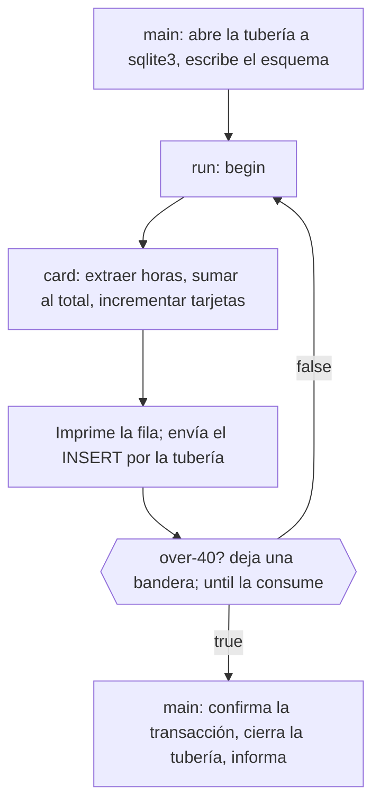
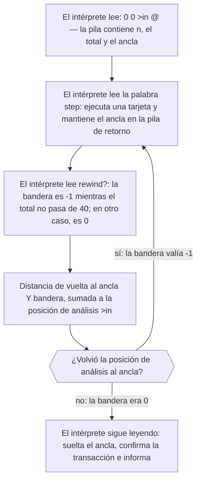

# Guía de estudio de Forth

## Para qué sirve esta guía

En esta guía analizarás dos programas en Forth. El primero, [`src/forth`](../../../src/forth/README.md), usa un bucle `begin ... until` normal y dos variables. El segundo, [`src/forth-weird`](../../../src/forth-weird/README.md), no tiene ninguna palabra de bucle ni ninguna variable. Su bucle es una línea de texto fuente que el intérprete vuelve a leer, porque una palabra movió la posición de lectura hacia atrás. La pregunta es: **¿qué puede servir como contador de programa y qué puede servir como memoria?**

Cuando termines, deberías poder:

1. Leer un comentario de efecto de pila y usarlo para trazar qué efecto tiene una palabra sobre la pila de datos.
2. Explicar qué es `>in` y por qué cambiarlo vuelve a ejecutar texto que ya se leyó.
3. Trazar el programa raro a lo largo de tres tarjetas, nombrando el contenido de la pila y el valor de `>in` en cada paso.
4. Explicar por qué el bucle raro funciona solo en una línea de entrada y por qué mover el ancla cambia la máquina.
5. Etiquetar cada comportamiento como garantizado, permitido por la implementación o aprovechado por accidente.

**Límites del alcance.** Esta guía no enseña la sintaxis de Forth desde cero. Necesitas saber que las palabras toman sus argumentos de la pila de datos y apilan sus resultados, y que una definición se escribe `: name ... ;`. Usa Gforth 0.7.3 o posterior. No cubre la tubería de SQLite ni `random.fs` más allá de lo que la traza necesita.

La página del libro es [Forth](../../lenguajes/forth.md). Las ideas están en [¿Qué cuenta como máquina?](../../informatica/02-que-cuenta-como-maquina.md#stack-machines) y [El contador de programa](../../informatica/03-flujo-de-control-y-continuaciones.md#the-program-counter).

## Antes de empezar

**Modelo de seguridad.** Cada entrada escribe datos ficticios de **DEMO ONLY**. Los programas de Forth inician un proceso del intérprete de comandos (*shell*) que crea una carpeta y ejecuta `sqlite3`. Lee el código fuente antes de ejecutarlo y ejecútalo primero en un entorno aislado (*sandbox*) que limita el acceso al sistema anfitrión:

```bash
sandbox/container/run-image.sh src/forth
sandbox/container/run-image.sh src/forth-weird
```

Edita solo copias ([Cómo ejecutar los ejemplos de forma segura](../../exercises.md#ejecutar-con-seguridad)). Define `SANDBOX_TIMEOUT=30` en los ejercicios donde el bucle pueda continuar indefinidamente. Una ejecución que supere ese límite imprime `TIMEOUT after 30s`.

**Regla de predicción.** Anota la pila y el valor de `>in` que esperas antes de cada ejecución. Una traza que no predijiste enseña poco.

**Vocabulario.**

| Término | Significado aquí |
| --- | --- |
| Pila de datos | Donde las palabras toman sus argumentos y dejan sus resultados. La única memoria del programa raro. |
| Pila de retorno | Una segunda pila. Una palabra puede guardar allí un valor por un momento (`>r` y `r>`). |
| Efecto de pila | Un comentario como `( n total -- n' total' )`: la pila antes y después. Es una convención y el intérprete no verifica ese comentario. |
| Intérprete de texto | El bucle que lee una palabra, la busca y la ejecuta (o la compila). |
| `>in` | Una variable que guarda la posición de lectura actual del intérprete de texto, como desplazamiento en el búfer de entrada. |

## El reto compartido

La [especificación del reto](../../introduccion.md#qué-hace-el-reto) pide tarjetas con una categoría y de 10 a 19 horas enteras. Las categorías se repiten en ciclo: `Meetings`, `Coding`, `Debugging` y `Learning`. Suma las horas de cada tarjeta al total acumulado. Detente cuando el total pasa de 40. Conserva la **primera tarjeta con la que el total pasa de 40**. Un total de exactamente 40 continúa. Cuatro tarjetas de 10 horas necesitan una quinta tarjeta, de la categoría `Meetings`. Las ejecuciones conformes tienen de 3 a 5 tarjetas y un total de 41 a 59 horas.

Las dos entradas de Forth guardan las tarjetas en una sola transacción de SQLite e imprimen un resumen. Forth escribe el límite de dos maneras distintas, y vale la pena ver la diferencia. El programa simple dice `total @ 40 >` ([L105](../../../src/forth/timecards.fs#L105)): se detiene cuando el total *pasa de* 40. El programa raro dice `over 41 <` ([L93](../../../src/forth-weird/timecards.fs#L93)): *continúa* mientras el total sea *menor que 41*. Las dos son la misma regla. Un total de exactamente 40 es menor que 41, así que el bucle continúa.

## La máquina que hay que identificar

**Qué se repite.** En `forth`, un bucle `begin ... until` dentro de la palabra `run` ([L108](../../../src/forth/timecards.fs#L108)). En `forth-weird`, un *segmento de texto fuente*: las palabras `step rewind?` en una línea, que el intérprete de texto lee repetidamente ([L101](../../../src/forth-weird/timecards.fs#L101)).

**Dónde vive el estado.** En `forth`, dos variables (`total` y `cards`) y unos pocos valores. En `forth-weird`, la pila de datos y solo la pila de datos. El archivo no usa la palabra `variable`. Entre pasadas, la pila guarda tres números: `( n total anchor )`. Aquí `n` es el número de tarjetas hasta ahora, `total` es el total acumulado y `anchor` es el valor de `>in` al que se debe volver.

**Qué hace avanzar el paso siguiente.** En `forth`, `until` consume una bandera que `over-40?` deja en la pila, y repite el bucle o sale de él. En `forth-weird`, el intérprete de texto simplemente lee la palabra siguiente de la línea. El bucle existe porque la palabra `rewind?` puede mover la posición de lectura del intérprete *hacia atrás*. El contador de programa es `>in`.

**Qué lo detiene.** En `forth`, la condición detiene el bucle: `until` recibe una bandera verdadera. En `forth-weird`, el predicado permite otra pasada. `rewind?` calcula la bandera `-1` (verdadero, con todos los bits activados) mientras el total no pasa de 40, y `0` en caso contrario. Después usa esa bandera para enmascarar la distancia de regreso al ancla. Cuando la bandera es `0`, la distancia pasa a ser `0`, `>in` no se mueve y el intérprete sigue leyendo la línea siguiente.

**Qué confirma.** Es igual en ambos: el texto de `INSERT` pasa por una tubería a `sqlite3` cada vez que se crea una tarjeta, entre un `BEGIN` y un `COMMIT`. La confirmación ocurre una sola vez, después de la última tarjeta. Las filas impresas son independientes y ya se ven en la terminal. El programa raro no tiene ninguna rama para omitir la confirmación, porque no hay `if`. Llega a la confirmación porque llega al final de la línea del bucle.

<!-- diagram-source: src/forth/README.md#program-flow -->



El primer diagrama es un bucle con una prueba de bandera. La bandera se calcula *después* de la tarjeta, así que se conserva la tarjeta con la que el total pasa del límite.

<!-- diagram-source: src/forth-weird/README.md#program-flow -->



El segundo no tiene ninguna prueba que elija entre dos *sentencias*. La arista del bucle existe porque `>in` vuelve a fijarse en el ancla. La única "decisión" es aritmética sobre la bandera.

## Traza una ejecución

Los programas eligen horas al azar. Usa las horas **15, 19, 12** para la traza. Para comprobar la traza con el comportamiento real, se ejecutó una copia de prueba de `forth-weird` en el entorno aislado. En esa copia, el paso que elige las horas al azar se reemplazó por una tabla fija (15, 19, 12). También se añadieron tres sentencias de impresión: la pila y `>in` después de cada `step`, y `>in` antes y después de `rewind?`. Estos son los valores impresos.

La línea que se interpreta es la línea 101: `0 0 >in @ step rewind?`. Los desplazamientos cuentan caracteres desde el inicio de esa línea.

| Momento | Pila de datos `( n total anchor )` | `>in` | Qué pasó |
| --- | --- | ---: | --- |
| Después de `0 0 >in @` | `0 0 10` | 10 | `>in @` puso en la pila el desplazamiento justo después de `@`, que es donde empieza la palabra `step`. Ese valor, 10, es el **ancla**. |
| Después de `step`, pasada 1 | `1 15 10` | 15 | `card` tomó 15 horas, dejó el total en 15, imprimió la fila y escribió el `INSERT`. El ancla viajó en la pila de retorno, así que `card` no pudo tocarla. |
| `rewind?`, pasada 1 | la bandera es `-1` (15 < 41) | 23, luego **10** | La distancia 10 − 23 = −13 se conservó (bandera verdadera) y se sumó a `>in`. El intérprete de texto está de vuelta antes de `step`. |
| Después de `step`, pasada 2 | `2 34 10` | 15 | Coding, 19 horas, total 34. Los `0 0` *no* se leyeron de nuevo: el ancla está después de ellos. |
| `rewind?`, pasada 2 | la bandera es `-1` (34 < 41) | 23, luego **10** | Se rebobina otra vez. |
| Después de `step`, pasada 3 | `3 46 10` | 15 | Debugging, 12 horas, total 46. |
| `rewind?`, pasada 3 | la bandera es `0` (46 no es menor que 41) | 23, luego **23** | La máscara deja la distancia en 0. `>in` no se mueve. El intérprete sigue leyendo y ejecuta `drop` en la línea siguiente. |

La ejecución de prueba imprimió estas tarjetas: `Meetings 15 15`, `Coding 19 34`, `Debugging 12 46` y después `# committed total=46 entries=3 DEMO ONLY`.

Fíjate en dos cosas. Primero, `>in` vale 15 después de cada `step` y 23 en cada `rewind?`. El intérprete de texto no "sabe" que está en un bucle: lee los mismos caracteres en los mismos lugares cada vez. Segundo, los números 10, 15 y 23 son desplazamientos dentro de una línea concreta. Edita los espacios de la línea 101 y los desplazamientos cambian, pero el ancla se calcula de nuevo en tiempo de ejecución a partir de la posición real. Por eso el programa sobrevive al reformateo y por eso falla si lees el ancla *después* del estado (consulta el ejercicio de abajo).

**El programa simple para comparar.** `run` ejecuta `card`, luego `over-40?` deja `total @ 40 >` como bandera y `until` la consume. Con las horas 15, 19 y 12, los totales son 15, 34 y 46. Las banderas son falso, falso y verdadero. Las variables `total` y `cards` contienen 46 y 3 al final.

**Exactamente 40.** Con las horas 10, 10, 10, 10, los totales son 10, 20, 30, 40. Con un total de 40, la bandera del programa raro es `-1` (40 < 41), así que el intérprete retrocede y saca una quinta tarjeta. Predice la categoría de la quinta tarjeta antes de comprobarla: la categoría se elige con `n` módulo 4 ([L29](../../../src/forth-weird/timecards.fs#L29)) y `n` es 4.

## Compara los diseños ordinarios y los raros

| Dimensión | `forth` | `forth-weird` |
| --- | --- | --- |
| **Representación** | El estado está en dos variables con nombre. El bucle es `begin ... until`. | El estado son tres números en la pila de datos. El bucle se forma cuando el intérprete retrocede en el búfer. |
| **Observabilidad** | Inspecciona `total @` y `cards @` en cualquier momento. | El estado existe solo como profundidad de la pila y orden: solo puedes identificar los valores por su posición en la pila. `.s` lo imprime, pero nada tiene nombre. Un efecto de pila incorrecto aparece como basura varias palabras después. |
| **Pruebas** | Llama a `over-40?` después de establecer `total`. | La regla está dentro de `rewind?`, que necesita una pila y un `>in` activo. Pruebas la línea completa, no la regla. |
| **Depuración** (Debugging) | Estándar: haz la traza de las variables. | El contador de programa es un dato. Un depurador que muestra la pila, pero no `>in`, no puede decir dónde leerá a continuación. |
| **Portabilidad** | Palabras de control de Forth estándar dentro de una definición. | Depende de que `>in` se pueda escribir y de que el intérprete vuelva a leer la misma línea. El programa funciona porque la entrada viene de un archivo, línea por línea. |
| **Costo** | Normal. | Cada pasada vuelve a analizar las palabras (una búsqueda en el diccionario por palabra). Un error de tecleo en los efectos de pila da datos incorrectos en silencio, sin producir un error. |

El estándar de Forth dice que las palabras de control como `begin` funcionan solo dentro de definiciones. Por eso el programa normal debe encerrar su bucle en la definición de `run`. El programa raro hace lo contrario: usa el bucle del *intérprete*, que no necesita ninguna definición.

## Qué demuestran los ejercicios

| Ejercicio | Predice primero | Lo que muestra la evidencia |
| --- | --- | --- |
| [B3. Forth: mueve el ancla](../../exercises.md#b3-forth-mueve-el-ancla-verificado), cambio (a) | Pon `0 0` en su propia línea *antes* de `>in @ step rewind?`. ¿Se rompe algo? | Es inofensivo. El ancla se sigue leyendo después de apilar los `0 0`, así que al rebobinar nunca se vuelven a leer. |
| B3, cambio (b) | Escribe la línea como `>in @ 0 0 step rewind?`. ¿Qué pasa? | No se detiene. Ahora, rebobinar hasta el ancla vuelve a leer `0 0`. Esa línea apila un conteo de tarjetas y un total nuevos en cada pasada. Por eso el estado se reinicia cada vez. La comprobación del libro: no aparece ninguna línea `# committed`, salen cientos de filas y el total de cada fila es igual a sus propias horas. **Debes crear el estado antes del ancla.** |
| B3, cambio (c) | Cambia `41 <` a `51 <`. ¿Cuál es la nueva regla de parada? | La regla de parada queda como "el total pasa de 50" y `check-demo.sh out.txt 50` pasa. El límite se expresa mediante una sola constante dentro de `rewind?`. |
| [C2. Haz real la restricción](../../exercises.md#c2-haz-real-la-restricción-verificada) | ¿Qué debería ignorar una comprobación que prohíbe las palabras de bucle? | El [verificador de referencia](../../solutions/c2-forth-rule-check.sh) elimina los comentarios de línea con barra invertida, los comentarios entre paréntesis y `." strings"` antes de buscar las palabras prohibidas. Una comprobación de restricciones es en sí misma un pequeño analizador sintáctico. |
| [C1. Lo raro junto a lo aburrido](../../exercises.md#c1-lo-raro-junto-a-lo-aburrido-verificado) | ¿En qué programa puedes nombrar el estado del bucle? | `forth` lo nombra (`total`, `cards`). `forth-weird` tiene tres números sin nombre y una posición de lectura. |

La pregunta que el libro hace sobre el cambio (b) es la mejor prueba de comprensión: *¿por qué solo (b) rompe el bucle?* Tu respuesta debería ser esta: "porque `>in @` captura la posición después de apilar el estado, y (b) mueve el estado al otro lado de esa posición". Si no lo es, lee otra vez la tabla de traza.

## Modos de fallo, costos y límites

| Comportamiento | Etiqueta | Por qué |
| --- | --- | --- |
| Las palabras toman sus argumentos de una pila de datos y dejan sus salidas en ella, según sus efectos de pila | **garantizado** | El modelo central del lenguaje. |
| `>in` contiene un desplazamiento dentro del búfer de entrada actual, y escribir en él cambia dónde lee el intérprete a continuación | **garantizado** que `>IN` existe, contiene el desplazamiento en el búfer de entrada y se puede escribir | Ese es su propósito documentado. Mantener el nuevo valor dentro de la línea actual es responsabilidad del propio programa, y este programa lo hace. |
| `-1` es verdadero y `0` es falso, así que `AND` puede enmascarar un número con una bandera | **garantizado** | Las banderas de Forth tienen todos los bits activados o son cero. Una palabra que devuelva `1` para verdadero rompería el truco de la máscara, porque ese valor no tiene todos los bits activados. |
| La entrada viene de un archivo, una línea a la vez, así que `>in` es relativo a *esa línea* | **permitido por la implementación** | El sistema decide cómo se vuelve a llenar el búfer de línea. El programa se verificó con Gforth. |
| Después de `>in @`, el valor almacenado apunta justo después de `@` y antes de `step` (aquí, 10) | **permitido por la implementación** | El desplazamiento exacto depende de si el sistema consume el delimitador después de una palabra. Sigue el analizador sintáctico del sistema probado. |
| La semana ISO viene de `date +%G-W%V` ejecutado a través de una tubería | **permitido por la implementación** | Un comando del anfitrión, no de Forth. |

Ningún comportamiento de las entradas de Forth es solo aprovechado por accidente. Lo más cercano es la dependencia del desplazamiento exacto de arriba. Ese desplazamiento se puede observar, se probó y se documentó en el README. Aun así, otro Forth podría colocar el ancla a un carácter de distancia. Para este programa eso sería inofensivo, porque retroceder hasta el delimitador o hasta el inicio de la palabra vuelve a leer el mismo texto.

**Costos que debes declarar.**

- **El mismo retroceso dentro de una definición no funciona.** Una vez que una línea se compila en una palabra, el intérprete de texto ya no la lee. El bucle necesita el *intérprete*. La nota del libro: esto funciona porque las palabras se leen desde una línea de entrada.
- **Errores silenciosos de la pila.** Los efectos de pila se documentan en comentarios y el intérprete no los comprueba. Una palabra que deja un número de más convierte el total de la pasada siguiente en un número equivocado.
- **Datos comunes pueden corromper el contador de programa.** `rewind?` suma un *número calculado* a `>in`. Un bicho en ese cálculo hace que el intérprete lea otro fragmento de texto sin avisar, en lugar de mostrar un mensaje de error.
- **Dónde la idea es legítima.** Quien implementa Forth, una palabra de análisis sintáctico o un depurador puede retroceder `>in` a propósito. El truco consiste en usar esa técnica para un bucle de aplicación.

## Conexiones a lo largo del repositorio

- **La posición de lectura como estado de control.** [COBOL](cobol.md) guarda el siguiente paso en un destino de salto. [Make y CMake](make-y-cmake.md) lo guardan en qué archivos existen y en las capturas de regex. [Tcl](tcl.md) lo guarda en un disparador de base de datos. La guía de concepto [Estado y control más allá de las variables](../conceptos/estado-y-control-mas-alla-de-las-variables.md) los compara con una sola hoja de trabajo.
- **Memoria sin nombres.** El programa raro de [Haskell](haskell.md) también guarda su total acumulado en un lugar sin nombre: dentro de la lista de tarjetas que construye. Allí cada tarjeta lee la anterior.
- **Relectura del texto.** [m4](m4.md) vuelve a leer sus propias expansiones (reescaneo). Es el pariente, a nivel de texto, de "leer el mismo texto otra vez". [ed y Ex](ed-y-ex.md) ejecutan líneas desde un búfer, así que su contador de programa también es un dato.
- **Guías de concepto.** [Cómo leer programas adversariales](../conceptos/lectura-de-programas-adversariales.md) y [Diseño comparado de máquinas](../conceptos/diseno-comparativo-de-maquinas.md).
- **En el libro.** [Forth](../../lenguajes/forth.md), [Máquinas de pila](../../informatica/02-que-cuenta-como-maquina.md#stack-machines) y [La pila como estructura de datos](../../informatica/06-estado-mas-alla-de-las-variables.md#the-stack-as-a-data-structure).

## Autoevaluación

Responde cada pregunta con tus propias palabras antes de leer el texto en cursiva. Di qué evidencia respaldaría cada respuesta.

1. **Traza.** En el programa raro, las horas son 11, 11, 11, 11. Da la pila `( n total anchor )` después de `step` por cuarta vez y la bandera de `rewind?`. ¿El programa saca una quinta tarjeta? *(Pila `4 44 10`. La bandera es `0`, porque 44 no es menor que 41. No saca una quinta tarjeta. Los totales son 11, 22, 33, 44, y la cuarta tarjeta es aquella con la que el total pasa del límite.)*
2. **Explica.** ¿Por qué el ancla se mantiene en la pila de retorno mientras se ejecuta `card`, y no en la pila de datos? *(`card` cambia la profundidad de la pila de datos: consume el número de tarjeta y el total, y los reemplaza. Dejar el ancla en la pila de retorno la aparta del camino, y `step` la recupera con `r>`.)*
3. **Transfiere.** El contador de programa de la máquina rara (*weird machine*: la máquina que el programa raro forma con sus propias piezas) es `>in`. Nombra el contador de programa (o lo más parecido a uno) de la entrada rara de COBOL y de la de Make. *(COBOL: el destino actual de `GO TO` en `NEXT-CARD`, más el paso normal de un párrafo al siguiente. Make: el conjunto de archivos `.tc-N.mk` que existen, que decide si Make se reinicia. La guía de concepto sobre estado y control desarrolla ambos.)*
4. **Evidencia.** Un revisor dice: "Solo la posición del ancla determina si el bucle se detiene". Diseña una prueba que pueda fallar. Compara dos ediciones. Predice cuál impide que el bucle se detenga. *(Mueve `0 0` después de `>in @`: el estado se reinicia en cada pasada y el bucle no se detiene. Mueve `0 0` a una línea propia anterior: sigue superando la comprobación. Ejecuta ambas con `SANDBOX_TIMEOUT=30`.)*

## Lecturas adicionales

- [Forth (lenguaje de programación)](https://en.wikipedia.org/wiki/Forth_(programming_language)) (Wikipedia): la historia del lenguaje, las dos pilas y el diccionario.
- [Máquina de pila](https://en.wikipedia.org/wiki/Stack_machine) (Wikipedia): por qué una pila puede ser toda la memoria de un programa.
- [Máquinas de pila](../../informatica/02-que-cuenta-como-maquina.md#stack-machines) y [El contador de programa](../../informatica/03-flujo-de-control-y-continuaciones.md#the-program-counter) (este libro): las dos ideas que este programa une.
