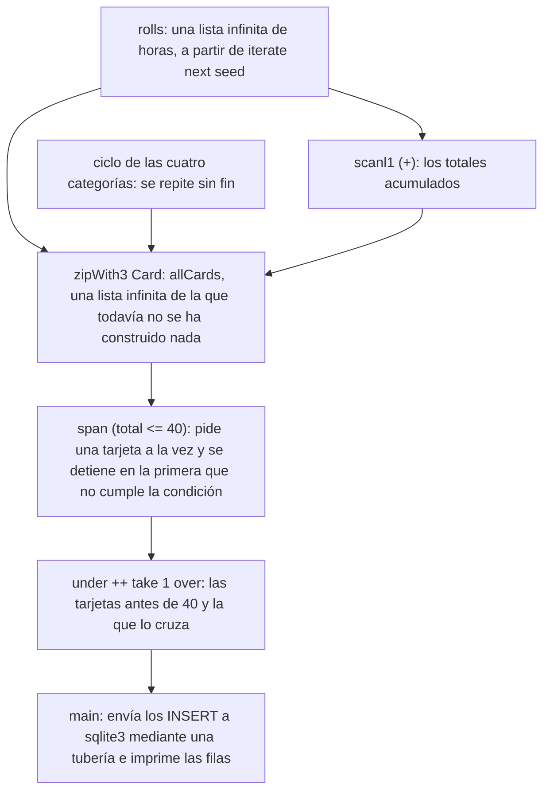
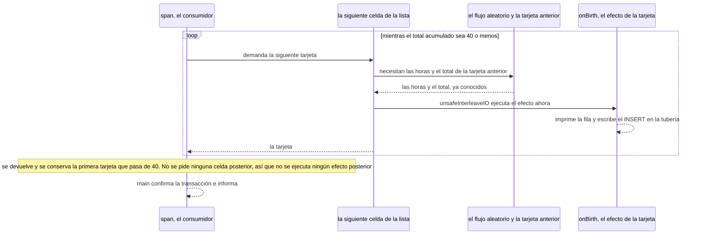
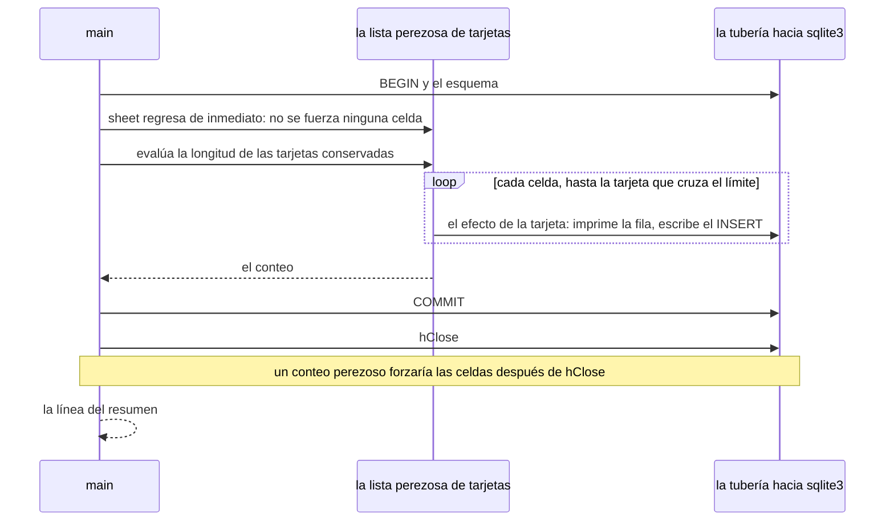

# Guía de estudio de Haskell

## Para qué sirve esta guía

Esta guía lee dos programas de Haskell que resuelven el reto de las tarjetas de horas sin ningún bucle. [`src/haskell`](../../../src/haskell/README.md) es una sola función pura sobre listas infinitas. En [`src/haskell-weird`](../../../src/haskell-weird/README.md), *leer* la lista es lo que ejecuta los efectos. La pregunta es: **¿quién demanda trabajo y cuándo?**

Al terminar, deberías poder:

1. Explicar cómo `span` convierte "cuánto de una lista infinita leo" en una regla de parada, y por qué `takeWhile` daría la respuesta equivocada.
2. Decir qué partes de cada programa se *demandan* en un paso dado y cuáles nunca se construyen.
3. Explicar qué añade `unsafeInterleaveIO` y por qué ahí el programa deja de ser referencialmente transparente.
4. Predecir qué ocurre cuando el momento de forzar una celda se mueve respecto a la vida de un recurso (la tubería hacia `sqlite3`).
5. Etiquetar cada comportamiento como garantizado, permitido por la implementación o aprovechado por accidente.

**Límites del alcance.** Necesitas saber leer las firmas de tipos de Haskell y saber qué hacen `map`, `zip` y `fix`. La guía no enseña las mónadas, las clases de tipos del código fuente ni el SQL. Usa el `runghc` de GHC; los programas solo necesitan paquetes que se distribuyen con GHC.

El material correspondiente del libro es [Haskell](../../lenguajes/haskell.md) y, para la idea en sí, [Evaluación y demanda](../../informatica/04-evaluacion-y-demanda.md).

## Antes de empezar

**Modelo de seguridad.** Cada entrada escribe registros ficticios marcados con **DEMO ONLY** en un archivo SQLite de trabajo. Ambos programas inician el proceso `sqlite3`, así que lee primero el código fuente y ejecútalo primero en el entorno aislado (*sandbox*) que limita el acceso al sistema anfitrión:

```bash
sandbox/container/run-image.sh src/haskell
sandbox/container/run-image.sh src/haskell-weird
```

Trabaja sobre una copia para cualquier edición ([Ejecutar cosas de forma segura](../../exercises.md#running-things-safely)). La salida es aleatoria, así que compara propiedades, no números.

**Regla de predicción.** Antes de cada ejecución, anota (a) qué celdas de la lista se forzarán, (b) qué efectos se dispararán y (c) qué salida demostraría que te equivocas.

**Vocabulario.**

| Término | Significado aquí |
| --- | --- |
| Perezoso / no estricto | Un valor se calcula solo cuando algo lo demanda. |
| Thunk | Un cálculo suspendido que ocupa el lugar de un valor hasta que se fuerza. |
| Forzar | Evaluar un thunk hasta donde lo necesite el código que lo demanda (normalmente hasta su constructor más externo). |
| `fix` | `fix f = f (fix f)`: da a una función su propio resultado, así que un valor puede definirse en términos de sí mismo. |
| `unsafeInterleaveIO` | Aplaza una acción de IO hasta que se demanda su *resultado*. |

## El reto compartido

La [especificación del reto](../../introduccion.md#what-the-challenge-does) pide tarjetas con una categoría y de 10 a 19 horas enteras. Las categorías se repiten en ciclo: `Meetings`, `Coding`, `Debugging` y `Learning`. Suma las horas de cada tarjeta al total acumulado. Detente cuando el total pasa de 40. Conserva la **primera tarjeta con la que el total pasa de 40**. Un total de exactamente 40 continúa. Cuatro tarjetas de 10 horas necesitan una quinta tarjeta, de la categoría `Meetings`. Las ejecuciones conformes tienen de 3 a 5 tarjetas y un total de 41 a 59 horas.

Ambas entradas de Haskell guardan las tarjetas en una sola transacción de SQLite e imprimen un resumen. En Haskell la regla aparece como el predicado `(<= 40)` dentro de `span`. Ese detalle importa. `<= 40` es verdadero para exactamente 40, así que un total de exactamente 40 se queda en la mitad "under" y se lee la tarjeta siguiente. La tarjeta que cruza el límite es el *primer elemento de la otra mitad*, y por eso el programa escribe `under ++ take 1 over`.

## La máquina que hay que identificar

Ambos programas se mueven por la demanda. La diferencia es lo que *hace* una demanda.

**Qué se repite.** Nada se repite en una sentencia. Las listas son infinitas (`cycle [minBound ..]` y un flujo aleatorio), así que "repetir" es que el consumidor pida un elemento más. En `haskell`, `span` es el consumidor ([L56-59](../../../src/haskell/timecards.hs#L56-L59)). En `haskell-weird`, `span` dentro de `untilOver40` también es el consumidor ([L82-85](../../../src/haskell-weird/timecards.hs#L82-L85)).

**Dónde vive el estado.** En `haskell`, el estado es la *posición en las listas*: el total acumulado es `scanl1 (+) hs` sobre las horas ([L49](../../../src/haskell/timecards.hs#L49)), así que cada tarjeta lleva su propio total. En `haskell-weird`, el total de la tarjeta *n* se lee de la tarjeta *n-1*, un elemento de la lista que se está construyendo. `fixIO` entrega a `sheet` su propio resultado antes de que exista ([L74-78](../../../src/haskell-weird/timecards.hs#L74-L78)). El flujo aleatorio también se refiere a sí mismo: `fix (\xs -> seed : map next xs)` ([L53](../../../src/haskell-weird/timecards.hs#L53)).

**Qué hace avanzar el paso siguiente.** La demanda del consumidor. Forzar la celda *n* necesita las horas (del flujo) y el total (de la tarjeta *n-1*). No hay contador ni acumulador. La dependencia de datos pone el orden.

**Qué lo detiene.** El consumidor deja de pedir. `span` termina cuando el predicado falla por primera vez, y `take 1 over` toma solo la tarjeta que cruza el límite. Nunca se fuerza ninguna celda posterior.

**Qué confirma.** Aquí es donde más se diferencian los dos programas. `haskell` construye todo el script SQL como una cadena de texto, ejecuta `sqlite3` sobre ella con `readProcess` y solo entonces imprime las filas ([L103-120](../../../src/haskell/timecards.hs#L103-L120)). En `haskell-weird`, cada celda forzada *imprime su fila y escribe su `INSERT` en una tubería abierta* como efecto secundario. El `COMMIT` lo escribe después `main`. Luego `hClose` cierra el flujo ([L144-146](../../../src/haskell-weird/timecards.hs#L144-L146)). Las filas que salen en el terminal no forman parte de la transacción, y una fila puede imprimirse antes de confirmar la transacción.

<!-- diagram-source: src/haskell/README.md#program-flow -->



Los datos fluyen de izquierda a derecha por las descripciones, y la demanda fluye en sentido contrario, desde `span` hacia las listas. Solo se construye el prefijo demandado.

<!-- diagram-source: src/haskell-weird/README.md#program-flow -->



Aquí una demanda tiene una *consecuencia*: el efecto se ejecuta en medio de la evaluación. El diagrama siguiente es nuevo. Añade lo que el diagrama de origen deja fuera: la vida útil de la tubería.

<!-- diagram-new: lazy-demand-trace - shows when the cells are forced relative to hClose, which the source diagram omits -->



## Traza una ejecución

Los programas sortean horas al azar. Para la traza, usa las horas **15, 19, 12**. Para comprobar la traza con el comportamiento real, se ejecutaron copias de trabajo de ambos programas en el entorno aislado. En ellas, el flujo aleatorio se sustituyó por `[15, 19, 12] ++ error "a 4th card was demanded"`. Si algún código hubiera forzado un cuarto valor de horas, el programa habría fallado con ese mensaje. Ninguno lo hizo. La copia rara también imprimió un marcador en el error estándar cada vez que se disparaba el efecto de una tarjeta:

```text
# DEMO ONLY run <id>
  [effect fired for a card of 15 hours]
Meetings	15	15	DEMO ONLY
  [effect fired for a card of 19 hours]
Coding	19	34	DEMO ONLY
  [effect fired for a card of 12 hours]
Debugging	12	46	DEMO ONLY
# committed total=46 entries=3 DEMO ONLY
```

(Se quitó la columna de la semana ISO para ahorrar ancho.) Ambas copias terminaron con normalidad, con tres filas y un total de 46. Las tablas siguientes nombran la *demanda*, que es el estado decisivo en un programa perezoso.

**`haskell`: qué fuerza `span`.** `span p xs` prueba un elemento a la vez.

| Paso | `span` demanda | La prueba `total <= 40` | Resultado |
| --- | --- | --- | --- |
| 1 | celda 1: Meetings, 15 horas, total 15 | verdadero | entra en `under` |
| 2 | celda 2: Coding, 19 horas, total 34 | verdadero | entra en `under` |
| 3 | celda 3: Debugging, 12 horas, total 46 | **falso** | pasa a ser la cabeza de `over`, y `span` se detiene |
| después | `take 1 over` toma la celda 3 | ninguna | no se demanda la celda 4, así que el 4.º valor de horas nunca se evalúa |

La tarjeta que cruza el límite ya está construida cuando `span` la rechaza, porque el predicado necesitó su total. Por eso la regla de "conservar la tarjeta que cruza el límite" no tiene ningún costo:`take 1 over` devuelve un elemento que ya existe. También por eso `takeWhile` es incorrecto aquí. `takeWhile (<= 40)` se detiene en el mismo punto, pero descarta la tarjeta que cruza el límite.

**`haskell-weird`: qué hace cada demanda.**

| Paso | Demanda | Necesita | Efecto disparado ahora | Estado de la tubería |
| --- | --- | --- | --- | --- |
| 0 | se llama a `sheet` | nada | ninguno: la lista es solo una promesa | abierta, BEGIN y el esquema escritos |
| 1 | `span` fuerza la celda 1 | horas 15, total anterior 0 | fila 1 impresa, INSERT 1 escrito | abierta |
| 2 | `span` fuerza la celda 2 | horas 19, total 15 de la tarjeta 1 | fila 2 impresa, INSERT 2 escrito | abierta |
| 3 | `span` fuerza la celda 3 | horas 12, total 34 de la tarjeta 2 | fila 3 impresa, INSERT 3 escrito | abierta |
| 4 | `span` ve 46 > 40 y se detiene | nada | **ninguno**: la celda 4 nunca se fuerza | abierta |
| 5 | `main` escribe `COMMIT` y luego `hClose` | nada | transacción confirmada | cerrada |

**Las mismas celdas, forzadas demasiado tarde.** Mueve el paso 5 *antes* de forzar las tarjetas y los efectos no tienen adónde ir. En el propio historial del repositorio, el primer borrador contaba con `let entries = length cards`. Ese enlace es perezoso, así que nada forzó las tarjetas hasta que se imprimió la línea del resumen, después de cerrar la tubería. La salida empezó con `# committed total=` y falló con `handle is closed`. La solución es `entries <- evaluate (length cards)` ([L144](../../../src/haskell-weird/timecards.hs#L144)). `evaluate` no es decoración: es la línea que decide *cuándo* existen las filas.

**Exactamente 40.** Con cuatro tarjetas de 10 horas, los totales son 10, 20, 30, 40. La prueba `40 <= 40` es verdadera, así que la tarjeta 4 entra en `under`, y `span` demanda la tarjeta 5. Su total es de al menos 50, así que es la tarjeta que cruza el límite. Predice la categoría de la tarjeta 5 y luego compruébalo. (`cycle [minBound ..]` se repite desde `Meetings`.)

## Compara los diseños ordinarios y los raros

| Dimensión | `haskell` | `haskell-weird` |
| --- | --- | --- |
| **Representación** | Todo el reto es una sola función pura, `timecards :: Word64 -> [Card]`. La salida y el SQL se derivan de su resultado. | La lista de tarjetas *es* el programa. Cada celda lleva una acción de `IO` que se ejecuta cuando se fuerza la celda. |
| **Observabilidad** | Determinista: la misma semilla da siempre la misma lista, y puedes imprimirla. | La lista parece pura y no lo es. Mirar `cards` en un depurador fuerza celdas y dispara efectos. |
| **Pruebas** | Llama a `timecards seed` y comprueba la lista. No hace falta E/S. | El efecto se inyecta (`sheet` recibe `onBirth`), así que una prueba puede pasar un registrador en lugar de una tubería. Pero el orden de los efectos depende del consumidor, así que también debes controlarlo. |
| **Debugging** | Estándar. Un valor incorrecto tiene una sola causa pura. | El *orden de los efectos* lo decide el evaluador. Un cambio que añade un segundo consumidor, o un consumidor distinto, cambia lo que se escribe. |
| **Portabilidad** | Haskell 2010 a secas más los paquetes `time`, `directory`, `process` y `unix` que distribuye GHC. | Los mismos paquetes, más `unsafeInterleaveIO` y `fixIO`, que son funciones de la biblioteca de GHC con un comportamiento documentado pero delicado. |
| **Costo** | Una lista se construye de forma perezosa, así que se construyen pocas tarjetas. La salida ocurre después de generar el SQL. | Los efectos se intercalan con la evaluación, así que un fallo a medias deja una salida parcial y una tubería escrita a medias. |

La versión rara renuncia a una propiedad importante: ya no puedes tratar una expresión como un valor. En la versión idiomática, `timecards seed` puede evaluarse dos veces y da lo mismo, y no pasa nada en el mundo. En la versión rara, evaluar una celda es un *evento*.

## Qué demuestran los ejercicios

| Ejercicio | Predice primero | Qué muestra la evidencia |
| --- | --- | --- |
| [B2. Haskell: rompe la pereza](../../exercises.md#b2-haskell-break-the-laziness-verified), cambio 1 | ¿Qué pasa cuando `evaluate (length cards)` se convierte en un `let` perezoso? | La salida contiene `handle is closed` y el verificador compartido falla. Las tarjetas se demandaron *después* de cerrar la tubería. Una vez que hay efectos, el orden de forzar las celdas forma parte del significado del programa. |
| B2, cambio 2 | ¿Qué pasa si se quita `unsafeInterleaveIO` de `lazily`? ¿Se cuelga? | Se detiene con `cyclic evaluation in fixIO`, no se cuelga. La lista de acciones se fuerza ahora antes de que exista la lista de tarjetas, así que cada valor necesita al otro. |
| [C1. Lo raro junto a lo aburrido](../../exercises.md#c1-weird-next-to-boring-verified) | En cada programa, ¿qué necesitaría controlar una prueba? | Una función pura se prueba llamándola. Una lista de efectos perezosos se prueba controlando a su consumidor. |
| [F. Demuestra una afirmación del README](../../exercises.md#f-prove-a-readme-claim-verified) | ¿Demandará alguna vez un `span` evaluado de forma perezosa una cuarta tarjeta? | La solución resuelta del libro prueba que "`takeWhile` no basta". Una buena prueba de evidencia necesita un control negativo: mostrar que la prueba falla cuando la afirmación es falsa. |
| *Experimento de la guía* (verificado en el entorno aislado) | En una copia de trabajo, sustituye el flujo aleatorio por `[15, 19, 12] ++ error "a 4th card was demanded"`. ¿Fallará el programa? | No falla. Se disparan tres efectos y ninguno más. Es evidencia directa de que `take 1 over` no fuerza la celda posterior a la tarjeta que cruza el límite. No está en la lista de ejercicios del libro, así que trátalo como propio de esta guía. |

## Modos de fallo, costos y límites

| Comportamiento | Etiqueta | Por qué |
| --- | --- | --- |
| `span` y `take` leen de una lista solo lo que necesita su resultado | **garantizado** | Semántica no estricta de Haskell. Verificado con el experimento de la cola con error. |
| El total de la tarjeta *n* depende de la tarjeta *n-1*, así que la celda *n* no puede forzarse primero | **garantizado** | Una dependencia de datos del programa. Es la razón por la que el programa es correcto, haga lo que haga el evaluador. |
| `unsafeInterleaveIO` ejecuta su acción cuando se demanda su resultado, no antes | **garantizado** | La biblioteca documenta este contrato. La palabra "unsafe" del nombre se refiere a lo que el contrato *no* dice. |
| Dónde cae un efecto intercalado respecto a efectos *no relacionados* | **permitido por la implementación** | El lenguaje no los ordena. Este programa es correcto solo porque cada celda depende de la anterior. Por eso el orden de los efectos de las tarjetas sale de la dependencia de datos, no de una promesa del evaluador. |
| `evaluate (length cards)` fuerza todas las celdas conservadas antes de `COMMIT` | **garantizado** | `evaluate` fuerza hasta la forma normal de cabeza débil, y `length` recorre la espina, así que la espina se construye y construirla fuerza las celdas. La redacción exacta de esta cadena importa: cambia un eslabón y los efectos se mueven. |
| `fixIO` entrega a una función el resultado que aún está construyendo | **garantizado** | La biblioteca lo documenta. Forzar ese resultado demasiado pronto es un error que ves en tiempo de ejecución (`cyclic evaluation in fixIO`), que es lo que produce el cambio 2 del ejercicio B2. |
| El generador de 64 bits da la vuelta al llegar al ancho de `Word64` | **garantizado** | Desbordamiento cíclico documentado del tipo. El generador usa las constantes de Knuth y los bits altos. |

Ningún comportamiento de aquí es *aprovechado por accidente* en el sentido del libro: nada depende de un efecto que nadie prometió. La entrada rara se acerca a ese límite todo lo que lo hacen las entradas de Haskell, y por eso importa la fila de los efectos no relacionados.

**Costos que declarar.**

- **La vida de la tubería es una dependencia invisible.** Nada en el tipo de `cards :: [Card]` dice "válido solo mientras este manejador esté abierto". Es el mismo riesgo que hizo que la gente pasara del `getContents` perezoso a las bibliotecas de procesamiento por flujos.
- **Fallo parcial.** Si el efecto de una tarjeta sufre un fallo a medias, ya se han impreso filas. SQLite protege la transacción, pero el terminal no está protegido.
- **Un segundo consumidor lo rompe.** Llamar a `length cards` dos veces es inofensivo porque las celdas se ejecutan una sola vez. Leer `cards` desde dos hilos o añadir un consumidor antes de `COMMIT` cambia cuándo se ejecutan los efectos.
- **Dónde es legítima la técnica.** El flujo perezoso de entradas grandes es real. Atar el nudo (`fix`) es una técnica respetable para datos circulares y tablas de memoización.

## Conexiones a lo largo del repositorio

- **La misma pregunta que en LINQ.** [C#, LINQ, XAML y adaptaciones](csharp-linq-xaml-y-adaptaciones.md) pregunta "¿cuándo se ejecuta una descripción?" con ejecución diferida. Una canalización de LINQ se vuelve a ejecutar cuando se enumera de nuevo, mientras que una celda de Haskell se evalúa una sola vez y se recuerda.
- **Iteración por demanda (pull) en JavaScript.** El iterador perezoso de [JavaScript](javascript.md) en `javascript-weird` es un consumidor que demanda una tarjeta a la vez. El mecanismo es distinto y la forma de la regla de parada es la misma.
- **Los lenguajes de arreglos van en sentido contrario.** [APL](apl.md) usa evaluación inmediata: construye más valores de los que necesita y recorta el resultado.
- **Una regla de parada como estructura.** [COBOL](cobol.md) declara la regla sobre los datos. Haskell la elige según cuánto lee. CMake usa un literal de 41 caracteres de largo. Los tres evitan una condición de bucle visible.
- **Guías de concepto.** [Evaluación, demanda y pereza](../conceptos/evaluacion-demanda-y-pereza.md) pone a Haskell, LINQ y JavaScript en una misma escala. [Efectos, errores y confirmación](../conceptos/efectos-errores-y-confirmacion.md) explica qué sobrevive a un fallo.
- **En el libro.** [Haskell](../../lenguajes/haskell.md) y [Evaluación y demanda](../../informatica/04-evaluacion-y-demanda.md).

## Autoevaluación

Responde cada pregunta con tus propias palabras antes de leer el texto en cursiva. Di qué evidencia respaldaría cada respuesta.

1. **Traza.** Las horas son 10, 10, 10, 10, 14. Para `haskell`, enumera las tarjetas que fuerza `span`, di cuál es la tarjeta que cruza el límite y di cuántas tarjetas tiene la lista final. *(Se fuerzan cinco tarjetas. Los totales son 10, 20, 30, 40, 54. La quinta, Meetings con 14 horas, es la tarjeta que cruza el límite. La lista final tiene cinco tarjetas.)*
2. **Explica.** En `haskell-weird`, ¿por qué el programa no necesita un contador ni un acumulador para saber el total de la tarjeta *n*? ¿Qué característica del lenguaje permite usar `cards` antes de que exista? *(El total de cada tarjeta se lee de la tarjeta anterior, un elemento de la misma lista. `fixIO` pasa la lista a `sheet` de forma perezosa, así que leer la tarjeta *n-1* funciona una vez que esa celda existe.)*
3. **Transfiere.** En un lenguaje con generadores, como las entradas de JavaScript o de Python, ¿qué construcción hace el papel de `span` y cuál es el equivalente de "dejar de demandar"? *(El consumidor que demanda elementos al generador, y detenerse significa no volver a llamar a `next`. Un bucle `for` que se interrumpe es la forma habitual.)*
4. **Evidencia.** Un revisor dice: "`take 1 over` nunca construye una cuarta tarjeta". Diseña una prueba que pueda fallar. ¿Cuál es el control negativo? *(Sustituye el flujo de horas por una lista fija cuya cola sea un error que se dispara si se fuerza. El programa debe terminar. Para el control, escribe una variante que haga correspondencia de patrones con una celda más allá de la tarjeta que cruza el límite. Entonces el error debe dispararse.)*

## Lecturas adicionales

- [Evaluación perezosa](https://en.wikipedia.org/wiki/Lazy_evaluation) (Wikipedia): llamada por necesidad, thunks y compartición, con el vocabulario que se usa aquí.
- [Transparencia referencial](https://en.wikipedia.org/wiki/Referential_transparency) (Wikipedia): la propiedad que `unsafeInterleaveIO` deja de respetar.
- [Evaluación y demanda](../../informatica/04-evaluacion-y-demanda.md) (este libro): las mismas ideas en Haskell, LINQ, APL y JavaScript, con la tabla de la estrategia de cada entrada.
- [Mónadas y sistemas de efectos](../../informatica/07-efectos-errores-y-confirmacion.md#monads-and-effect-systems) (este libro): la forma habitual y segura en que Haskell mantiene en orden los efectos, y que `unsafeInterleaveIO` rodea a propósito.
