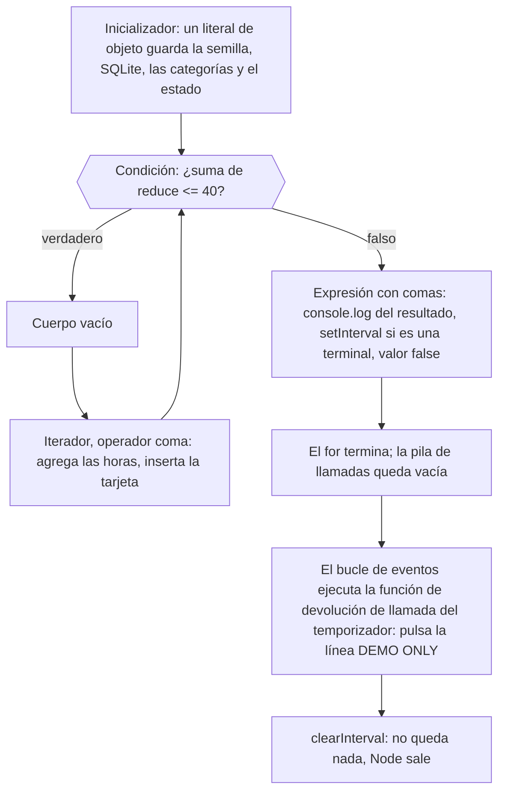
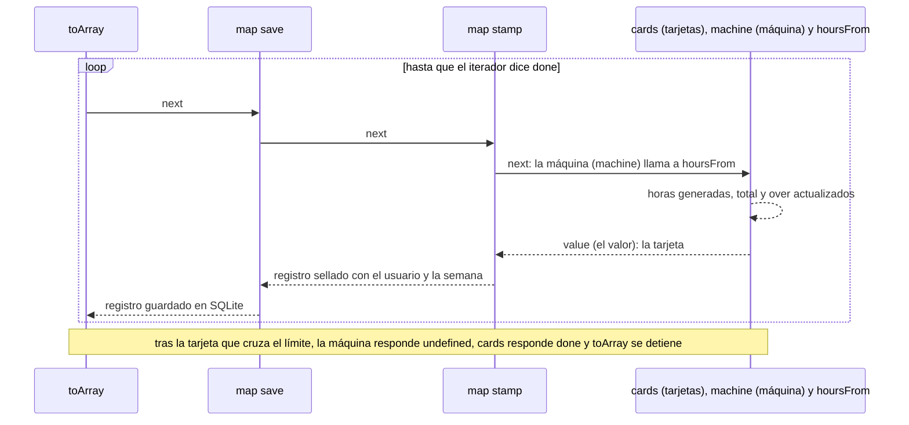
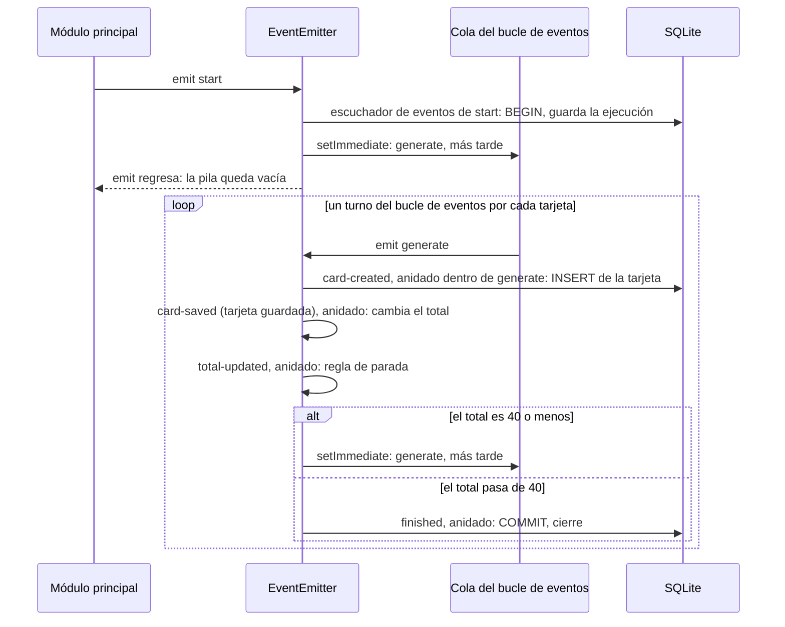

# Guía de estudio de JavaScript

## Para qué sirve esta guía

Esta guía lee tres programas de Node.js que resuelven el mismo reto con tres estilos de control distintos. [`src/javascript`](../../../src/javascript/README.md): una sola sentencia `for` sin cuerpo, cuyas tres cláusulas lo hacen todo. [`src/javascript-weird`](../../../src/javascript-weird/README.md): tres clausuras (*closures*) y un iterador perezoso, sin ninguna sentencia de bucle. [`src/javascript-events`](../../../src/javascript-events/README.md): diez escuchadores de eventos sobre un mismo `EventEmitter`. La pregunta es: **¿quién es dueño del paso siguiente: el encabezado del bucle, el consumidor que demanda o el bucle de eventos?**

Al terminar, deberías poder:

1. Decir qué hace cada cláusula del encabezado de `for` y por qué la prueba de parada ve la tarjeta que el iterador acaba de añadir.
2. Explicar cómo una clausura guarda un estado al que nada más puede llegar, y por qué la regla de parada del programa raro es una sola asignación (`over = total > 40`).
3. Explicar la iteración por demanda (pull): no se genera ninguna tarjeta hasta que un consumidor la pide, y el consumidor decide cuántas tarjetas existen.
4. Explicar la diferencia entre `emit()` (una llamada síncrona) y `setImmediate()` (un turno nuevo del bucle de eventos), y qué le pasa a la pila de llamadas sin esa frontera.
5. Hacer la traza de los tres programas con las mismas tres tarjetas.
6. Etiquetar cada comportamiento como garantizado, permitido por la implementación o aprovechado por accidente.

**Límites del alcance.** Necesitas saber leer JavaScript moderno: funciones flecha, literales de objeto, propagación (*spread*) y el operador coma. La guía no enseña SQLite ni el pulso de la terminal. Usa Node.js 24 con `node:sqlite` integrado y los métodos auxiliares de iteradores. La página del lenguaje es [JavaScript](../../lenguajes/javascript.md). Para los eventos en general, consulta el capítulo [Eventos, funciones de devolución de llamada y flujo de control reactivo](../../informatica/10-eventos-retrollamadas-y-flujo-de-control-reactivo.md).

## Antes de empezar

**Modelo de seguridad.** Cada entrada escribe datos ficticios marcados con **DEMO ONLY** en un archivo SQLite de trabajo. Estos programas abren archivos y, en el caso del pulso, programan temporizadores. Lee el código fuente antes de ejecutarlo. Ejecútalo primero en el entorno aislado (*sandbox*):

```bash
sandbox/container/run-image.sh src/javascript
sandbox/container/run-image.sh src/javascript-weird
sandbox/container/run-image.sh src/javascript-events
```

Edita solo copias ([Ejecutar cosas de forma segura](../../exercises.md#running-things-safely)). Las tres entradas aceptan `SEED` (un entero) para repetir una ejecución y `NOW=YYYY-MM-DD` para fijar la fecha. Esta guía usa `SEED=1105`, que da las horas 15, 19 y 12 en las tres.

**Regla de predicción.** Antes de cada ejecución, anota el orden en que ocurren las cosas. En esta familia, el *orden* es toda la lección.

**Vocabulario.**

| Término | Significado aquí |
| --- | --- |
| Clausura | Una función junto con las variables que tenía a su lado cuando se creó. Aquí esas variables son el estado del programa. |
| Protocolo de iteradores | Un objeto con `next()` que responde con `{ value, done }`. |
| Demanda (pull) | El consumidor pide el siguiente valor. No se produce nada hasta que lo hace. |
| `emit()` | Llama a todos los escuchadores de eventos de un evento, en el orden de registro, *antes de regresar*. |
| Turno | Una pasada del bucle de eventos. `setImmediate` ejecuta su función en un turno posterior. |

## El reto compartido

La [especificación del reto](../../introduccion.md#what-the-challenge-does) pide tarjetas con una categoría y de 10 a 19 horas enteras. Las categorías se repiten en ciclo: `Meetings`, `Coding`, `Debugging` y `Learning`. Suma las horas de cada tarjeta al total acumulado. Detente cuando el total pasa de 40. Conserva la **primera tarjeta con la que el total pasa de 40**. Un total de exactamente 40 continúa. Cuatro tarjetas de 10 horas necesitan una quinta tarjeta, de la categoría `Meetings`. Las ejecuciones conformes tienen de 3 a 5 tarjetas y un total de 41 a 59 horas.

Las tres se detienen en el primer cruce e imprimen un resumen, pero sus límites de escritura en SQLite son distintos. Las dos primeras insertan sobre la marcha. La versión de eventos envuelve la ejecución en una sola transacción. Cada estilo escribe la prueba de parada de forma distinta. En `for`, la condición es `reduce(...) <= 40 ? true : (...show the result..., false)`: `<= 40` es verdadero para 40, así que el bucle se repite ([L54](../../../src/javascript/timecards.mjs#L54)). En el programa raro, `over = total > 40` es falso para 40, así que la máquina sigue respondiendo ([core.mjs L14](../../../src/javascript-weird/core.mjs#L14)). En el programa de eventos, `total > limit` es falso para 40, así que se programa la tarjeta siguiente ([L115](../../../src/javascript-events/timecards.mjs#L115)).

## La máquina que hay que identificar

**Qué se repite.** En `javascript`, una sentencia `for` con el cuerpo vacío: se repiten las tres cláusulas del *encabezado* ([L10-67](../../../src/javascript/timecards.mjs#L10-L67)). En `javascript-weird`, un consumidor que pide una y otra vez la tarjeta siguiente a un iterador: `.toArray()` ([L30](../../../src/javascript-weird/timecards.mjs#L30)). En `javascript-events`, una secuencia circular de eventos: `generate` lleva a `card-created`, `card-saved` y `total-updated`; `total-updated` programa el siguiente `generate`.

**Evaluación.** Las tres entradas originales se siembran mediante el `crypto.getRandomValues` global de Web Crypto cuando falta `SEED`. En el `for` sin cuerpo, `reduce` suma el arreglo de inmediato en cada comprobación de la condición. El [encabezado de C#](csharp-linq-xaml-y-adaptaciones.md) hace el mismo trabajo con `Sum()`, aunque su proyección LINQ interna se aplaza hasta que `Sum()` la enumera. El iterador por demanda de más abajo usa otro mecanismo de avance.

**Dónde vive el estado.** En `javascript`, las propiedades de un literal de objeto que crea el inicializador de `for`: horas acumuladas, base de datos, clausura aleatoria y reloj. En `javascript-weird`, tres clausuras: una fuente de horas sobre un número; una máquina de tarjetas sobre `n`, `total` y `over`; y un envoltorio de iterador. A nada de ese estado se llega si no es llamando a la función ([core.mjs](../../../src/javascript-weird/core.mjs)). En `javascript-events`, un objeto `s` (`n`, `total`, `db`, ...) compartido por los escuchadores de eventos, más los registros del propio emisor.

**Qué hace avanzar el paso siguiente.** En `javascript`, la tercera cláusula de `for` genera una tarjeta y la guarda. En `javascript-weird`, una llamada a `next()` del iterador. En `javascript-events`, un escuchador de eventos emite el evento que espera el siguiente escuchador de eventos.

**Qué lo detiene.** En `javascript`, la condición devuelve `false` después de mostrar el resultado. En `javascript-weird`, la bandera `over` de la máquina: tras la tarjeta que cruza el límite, cada petición recibe `undefined` como respuesta y el iterador dice `done`. En `javascript-events`, `total-updated` emite `finished` en lugar de programar otro `generate`.

**Qué confirma.** En `javascript`, la cláusula del iterador guarda las filas a medida que se crean, y la condición imprime. En `javascript-weird`, cada petición guarda su registro en una etapa `.map(save)`, y el resumen se imprime cuando la canalización está completa. En `javascript-events`, `start` ejecuta `BEGIN`, `card-created` inserta una fila de forma síncrona y `finished` ejecuta `COMMIT`. Una excepción lanzada en cualquier escuchador de eventos se convierte en un evento `failed`, que hace un `ROLLBACK` exactamente una vez.

<!-- diagram-source: src/javascript/README.md#program-flow -->



El primer diagrama es un bucle cuyo encabezado es el programa. El segundo muestra quién le pide algo a quién.

<!-- diagram-source: src/javascript-weird/README.md#program-flow -->



En el segundo, la demanda fluye hacia atrás desde `toArray` hasta la máquina. No ocurre nada hasta que pide.

<!-- diagram-source: src/javascript-events/README.md#program-flow -->



El tercero distingue dos clases de flecha: un `emit` simple, que regresa después de que se ejecutaron los escuchadores de eventos, y un salto a un turno posterior.

## Traza una ejecución

Con `SEED=1105`, los tres programas sortean las horas 15, 19 y 12. Las trazas usan copias de trabajo con registros alrededor de las funciones propias de cada entrada. En Node 24.15.0, se ejecutó el `timecards.mjs` original de cada entrada con esa semilla y un `XDG_DATA_HOME` nuevo. Reprodujo las filas informadas y los totales guardados 15, 34 y 46.

**`javascript`: las cláusulas de `for`.** El total empieza en 0 y no hay tarjetas.

| Evaluación | Condición (`sum <= 40`) | La cláusula del iterador genera | Suma después |
| --- | --- | --- | ---: |
| 1 | 0 ≤ 40: verdadero | `10 + rnd() % 10` = 15, guarda Meetings | 15 |
| 2 | 15 ≤ 40: verdadero | 19, guarda Coding | 34 |
| 3 | 34 ≤ 40: verdadero | 12, guarda Debugging | 46 |
| 4 | 46 ≤ 40: **falso** | ninguna | imprime el resultado y termina |

La condición se ejecuta *después* de cada paso del iterador, excepto el primero. Por eso el iterador guarda la tarjeta que cruza el límite (12 horas) antes de que la prueba se niegue a continuar. La salida fue `Meetings 15 15`, `Coding 19 34`, `Debugging 12 46`.

**`javascript-weird`: quién pidió.** Un script de trabajo envolvió la máquina para registrar cada petición:

```text
building the pipeline: nothing asked yet (asks = 0)
pipeline built: asks = 0
ask 1: machine answers {"category":"Meetings","hours":15,"total":15}
ask 2: machine answers {"category":"Coding","hours":19,"total":34}
ask 3: machine answers {"category":"Debugging","hours":12,"total":46}
ask 4: machine answers undefined (over)
toArray done: asks = 4 cards = 3
```

Importan dos hechos. Construir la canalización no pidió nada. Y hubo *cuatro* peticiones para tres tarjetas. La tercera respuesta activó `over = true` (46 > 40), y hizo falta la cuarta petición para saber que ya no había más. La parada está en la máquina, no en el consumidor.

**`javascript-events`: los turnos.** Un script de trabajo registró cada `emit` (con sangría según la profundidad de anidamiento) y cada salto a un turno nuevo:

```text
--- event loop turn 1 ---
emit start
  [setImmediate queued: next step waits for a new turn]
--- event loop turn 2 ---
emit generate
  emit card-created
    emit card-saved
      emit total-updated
  [setImmediate queued: next step waits for a new turn]
--- event loop turn 3 ---
emit generate
  ...same shape: Coding 19 34...
--- event loop turn 4 ---
emit generate
  emit card-created
    emit card-saved
      emit total-updated
        emit finished
          emit done
```

(Las filas impresas y el resumen aparecen entre las líneas en la salida real y aquí se omiten.) `emit start` regresó antes de que existiera ninguna tarjeta. Cada tarjeta se ejecutó en su propio turno, a cuatro emits de profundidad, y la pila quedó desenrollada antes del turno siguiente. En el turno 4 el total era 46, así que `total-updated` emitió `finished` directamente en vez de programar, y `finished` confirmó la transacción.

**Exactamente 40.** Con cuatro tarjetas de 10 horas, la prueba `for` `40 <= 40` es verdadera, así que se genera una quinta tarjeta. La máquina rara (*weird machine*) tiene `over = 40 > 40`, falso, así que vuelve a responder. El escuchador de eventos del programa de eventos evalúa `40 > 40` (falso) y programa un quinto `generate`. Los tres programas continúan.

## Compara los diseños ordinarios y los raros

| Dimensión | `javascript` | `javascript-weird` | `javascript-events` |
| --- | --- | --- | --- |
| **Representación** | Una sentencia, con un objeto de estado en el inicializador | Tres clausuras; ningún bucle a nivel de sentencia | Escuchadores de eventos registrados en un solo emisor |
| **Observabilidad** | Abre el objeto de estado en un depurador | El estado es *inaccesible* por diseño: solo puedes llamar a la clausura | Registra cada `emit`: todo el programa es su traza de eventos |
| **Pruebas** | Comprobación de estructura: el cuerpo debe estar vacío y el programa debe ser una sola sentencia | Un "laboratorio de clausuras" (`node --test check.mjs`) fija las reglas de la máquina, con funciones puras sin `world` | El programa recibe un objeto `world` (`rng`, `schedule`, `open`, ...), así que una prueba puede inyectar el suyo y ejecutar la traza |
| **Debugging** | Recorre paso a paso las cláusulas del encabezado | Recorre paso a paso las llamadas a `next()` | Una excepción lanzada sube a través de `emit()`; cada escuchador de eventos la captura y emite `failed` una vez |
| **Portabilidad** | Node 22 o posterior para `node:sqlite` | También necesita métodos auxiliares de iteradores (`Iterator.from`, `.map`, `.toArray`) | Solo la semántica de `EventEmitter` de Node (orden de los escuchadores de eventos, `emit` síncrono) |
| **Costo** | Una pasada | Perezoso: una tarjeta se crea solo cuando se pide | Un salto por tarjeta y una pila de llamadas plana |

Los tres programas separan tres preguntas que la mayor parte del código mantiene atadas.

1. ¿Cuál es el paso siguiente? El encabezado, `next()` o un evento.
2. ¿Quién decide darlo? El bucle, el consumidor o el bucle del entorno de ejecución.
3. ¿Dónde está el estado? En un objeto, en una clausura o en un objeto compartido.

Un `emit` síncrono llama directamente a sus escuchadores de eventos. La cadena de eventos hace recursión hasta que una frontera de planificación deja que esas llamadas regresen.

## Qué demuestran los ejercicios

| Ejercicio | Predice primero | Qué muestra la evidencia |
| --- | --- | --- |
| [B20. JavaScript: lee las cláusulas, mueve el límite y haz fallar la comprobación de estructura](../../exercises.md#b20-javascript-read-the-clauses-move-the-limit-and-fail-the-structure-check-verified) | Con `SEED=42`, ¿qué tarjeta hace que el total pase de 40? Cambia `<= 40` por `<= 20`: ¿cuántas tarjetas? | Tres tarjetas (12, 17, 17: total 46) y, con `<= 20`, dos tarjetas (12 y luego 29). La condición se evalúa después de que el iterador añadió una tarjeta. Una sentencia añadida al cuerpo sigue funcionando bien y la *comprobación de estructura* falla: la restricción era real. |
| B20, paso 4 | `NOW=2026-12-31` y `NOW=2024-12-30` con `SEED=42`: ¿qué semana? | `2026-W53` y `2025-W01`. El año ISO puede diferir del año civil en Año Nuevo. |
| [B21. JavaScript, más raro](../../exercises.md#b21-javascript-weirder-move-the-stop-rule-in-a-closure-and-watch-the-demand-verified) | Cambia `over = total > 40` por `total > 20`. ¿Qué filas salen? ¿Pasa el laboratorio de clausuras? | Dos tarjetas. El laboratorio falla 7 de 12 pruebas (las que fijan la regla de parada) y pasa las 5 sobre clausuras, a las que no les importa el límite. |
| B21, pasos 3 y 4 | `take(1)` frente a `take(2)` en la canalización: ¿cuántas líneas `drawn`? | `built`, luego un `drawn` para `take(1)`; dos para `take(2)`. El consumidor decide cuántas tarjetas existen. |
| [B22. JavaScript, dirigido por eventos](../../exercises.md#b22-javascript-event-driven-predict-the-trace-then-remove-the-boundary-verified), pasos 2 y 3 | `listener`, `after emit` y `immediate`: ¿en qué orden? ¿Y la traza de tres tarjetas de 19 horas? | `listener`, `after emit`, `immediate`. `emit()` llama a los escuchadores de eventos antes de regresar; `setImmediate()` solo pide. En la traza de las tarjetas, `emit('start')` regresa antes de que exista ninguna tarjeta. |
| B22, paso 4 | Reemplaza `later('generate')` por `events.emit('generate')`. ¿Qué pasa con una ejecución muy larga? | Una ejecución normal sigue funcionando, pero el laboratorio falla 2 pruebas y una ejecución larga imprime `Maximum call stack size exceeded` y sale con 1. La frontera es lo que mantiene plana la pila. |

El paso 4 de B22 es el fallo más instructivo de esta familia. El programa es *correcto* para los tamaños que pruebas y se rompe con uno que no pruebas. Una cadena de llamadas `emit` síncronas es una recursión cuya profundidad crece con el número de tarjetas.

## Modos de fallo, costos y límites

| Comportamiento | Etiqueta | Por qué |
| --- | --- | --- |
| Una clausura mantiene vivas y privadas las variables que captura | **garantizado** | Semántica del lenguaje. |
| En el arreglo denso de horas, el reductor visita cada tarjeta en cada llamada | **garantizado** | `Array.prototype.reduce` ejecuta la función de devolución de llamada (*callback*) para cada elemento presente, salvo que la evaluación lance una excepción. La entrada simple la llama en cada comprobación de la condición. La entrada rara pliega una sola vez después de reunir las tarjetas. |
| `emit()` llama a los escuchadores de eventos de forma síncrona, en el orden de registro, antes de regresar | **garantizado** | Comportamiento documentado de Node.js (consulta [`emitter.emit`](https://nodejs.org/api/events.html)). |
| `emit('error', e)` sin un escuchador de eventos de `error` lanza `e` | **garantizado** | Documentado. El programa registra un escuchador de eventos de `error` para convertir un error perdido en `failed`. |
| `setImmediate` ejecuta su función de devolución de llamada cuando termina el código actual y antes de los temporizadores de una fase posterior | **garantizado** | Planificación documentada de Node.js. |
| La clausura de Park-Miller reproduce una ejecución para un `SEED` dado | **garantizado** | Es aritmética simple. `Math.random` no admite semilla. Por eso no se usa. |
| `node:sqlite` es síncrono, así que se escribe una fila cuando `run()` regresa | **permitido por la implementación** | Es una propiedad del módulo integrado de Node en la versión probada. Si la API pasara a ser asíncrona, la garantía de `card-saved` ("nada aguas abajo ve una tarjeta sin guardar") se rompería. |
| `Iterator.from(...).map(...).toArray()` | **permitido por la implementación** | Los métodos auxiliares de iteradores son recientes. Existen en el Node 24 al que apuntan las entradas, no en entornos de ejecución más antiguos. |
| Una pila plana a lo largo de unas 2000 tarjetas depende de la frontera de `setImmediate` | **garantizado** por diseño y probado | Quitarla hace fallar una prueba y una ejecución larga, como muestra el ejercicio B22. |

Ningún comportamiento de JavaScript de esta guía es simplemente un comportamiento aprovechado por accidente. Lo más cercano es que el encabezado `for` usa el operador coma dentro de una función flecha porque un inicializador `for` acepta una sola declaración. Eso es una regla del lenguaje, pero una que el código esquiva en vez de aprovechar.

**Costos que conviene declarar.**

- **Una excepción lanzada en una función de devolución de llamada programada no tiene quien la reciba.** Terminaría el proceso. El programa de eventos envuelve cada escuchador de eventos para que una excepción lanzada se convierta en `failed`. Además, `failed` quita todos los escuchadores de eventos para que se ejecute exactamente una vez.
- **Reentrada.** Un escuchador de eventos que emite puede volver a entrar en otros escuchadores de eventos. Los programas lo evitan haciendo que cada escuchador de eventos haga una sola cosa y emita una sola vez.
- **Dependencia oculta del orden.** El orden de los escuchadores de eventos es el orden de registro. Reordenar las llamadas a `on(...)` cambia el programa.
- **Dónde son legítimas las técnicas.** Las clausuras como estado privado, los iteradores perezosos para fuentes grandes o infinitas y un emisor con fronteras de turno explícitas son JavaScript corriente. Las acrobacias son el `for` de cuerpo vacío y la ausencia de cualquier bucle como sentencia.

## Conexiones a lo largo del repositorio

- **La misma pregunta que en Haskell y LINQ.** La iteración por demanda (pull) en `javascript-weird` es la versión JavaScript de la lista perezosa de [Haskell](haskell.md). Corresponde también a las canalizaciones diferidas de [C#, LINQ, XAML y adaptaciones](csharp-linq-xaml-y-adaptaciones.md). La guía de concepto [Evaluación, demanda y pereza](../conceptos/evaluacion-demanda-y-pereza.md) las pone lado a lado.
- **El encabezado `for` como programa completo.** Otras cuatro adaptaciones (C#, Java, Go y Kotlin) usan la misma forma de `for` sin cuerpo. Consulta la comparación en la guía de C#.
- **Fronteras de turno y reentrada.** [Eventos, funciones de devolución de llamada y control reactivo](../conceptos/eventos-retrollamadas-y-control-reactivo.md) generaliza B22. [XAML y afinidad de hilo](csharp-linq-xaml-y-adaptaciones.md) es un riesgo relacionado: importa *dónde* se ejecuta una función de devolución de llamada.
- **Funciones de devolución de llamada en otras entradas.** Los *callouts* de PCRE2 de [Motores de expresiones regulares y sed](motores-de-regex-y-sed.md) y las acciones de punto de control de [tar](tar.md) también son funciones de devolución de llamada síncronas. Pero las llama el motor, no un bucle de eventos.
- **En el libro.** [JavaScript](../../lenguajes/javascript.md), [Iteradores y generadores](../../informatica/04-evaluacion-y-demanda.md#iterators-and-generators), [Clausuras y entornos léxicos](../../informatica/06-estado-mas-alla-de-las-variables.md#closures-and-lexical-environments), [Funciones de devolución de llamada](../../informatica/10-eventos-retrollamadas-y-flujo-de-control-reactivo.md#callbacks) y [El bucle de eventos y los turnos de planificación](../../informatica/10-eventos-retrollamadas-y-flujo-de-control-reactivo.md#the-event-loop-and-scheduling-turns).

## Autoevaluación

Responde cada pregunta con tus propias palabras antes de leer el texto en cursiva. Di qué evidencia respaldaría cada respuesta.

1. **Traza.** Las horas son 10, 10, 10, 10, 13. Para `javascript-weird`, ¿cuántas veces le pide algo a la máquina `toArray` y qué devuelve la última petición? *(Seis peticiones. La quinta tarjeta (13 horas, total 53) activa `over`. La sexta petición devuelve `undefined`. Cinco peticiones producen tarjetas, porque exactamente 40 no activa `over`.)*
2. **Explica.** En `javascript-events`, ¿por qué `total-updated` llama a `later('generate')` pero llama directamente a `events.emit('finished')`? *(`later` salta a un turno nuevo para que la pila se desenrolle entre tarjetas. `finished` termina la cadena, así que no hay recursión que evitar. Se ejecuta dentro del mismo turno, para que la confirmación de la transacción ocurra antes de que nada pueda intervenir.)*
3. **Transfiere.** ¿Qué usarías en Python o en Rust para obtener el mismo comportamiento de "no se produce nada hasta que se pide" que da la canalización de iteradores? *(Un generador o una cadena de adaptadores de iteradores. No se ejecuta nada hasta que algo lo consume, y el consumidor decide cuántos elementos existen.)*
4. **Evidencia.** Una revisora dice: "El programa de eventos nunca anida más de cinco llamadas de profundidad". Diseña una prueba que pueda fallar. *(Envuelve `emit` con un contador de profundidad en una ejecución muy larga, como en el ejercicio B22. Comprueba la profundidad máxima. El control negativo es la versión en la que `later('generate')` se reemplaza por un `emit` directo, cuya profundidad crece con el número de tarjetas. La afirmación describe un comportamiento garantizado por diseño y probado.)*

## Lecturas adicionales

- [Clausura (informática)](https://en.wikipedia.org/wiki/Closure_(computer_programming)) (Wikipedia): qué captura una clausura y por qué puede servir como estado privado.
- [Iteradores y generadores](https://developer.mozilla.org/en-US/docs/Web/JavaScript/Guide/Iterators_and_generators) (MDN): el protocolo de iteradores que el programa raro implementa a mano.
- [Uso de los métodos auxiliares de iteradores](https://developer.mozilla.org/en-US/docs/Web/JavaScript/Reference/Global_Objects/Iterator) (MDN): `Iterator.from`, `map` y `toArray` con su semántica perezosa.
- [El bucle de eventos de Node.js](https://nodejs.org/en/learn/asynchronous-work/event-loop-timers-and-nexttick) (Node.js): por qué `setImmediate` se ejecuta en un turno posterior, según la propia documentación del entorno de ejecución.
- [Bucle de eventos](https://en.wikipedia.org/wiki/Event_loop) (Wikipedia): la idea general, fuera de Node.
