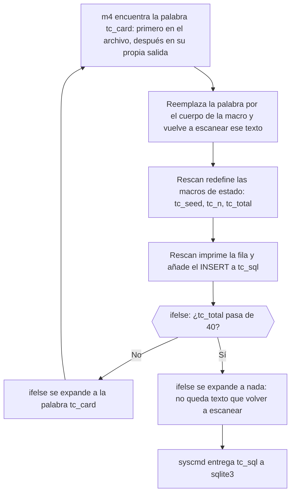

# Guía de estudio de m4

## Para qué sirve esta guía

Esta guía lee un programa: [`src/m4`](../../../src/m4/README.md). No tiene un hermano raro, porque usar un procesador de macros para ejecutar un programa ya es la acrobacia. El programa no tiene sentencia de bucle ni variable. Tiene macros, y **lo que una macro expande se escanea de nuevo**. La pregunta es la siguiente. **Si todo el lenguaje es "leer texto, reemplazar nombres, leer el resultado", ¿qué deciden las comillas, el orden de expansión y el reescaneo?**

Al terminar, deberías poder:

1. Decir qué hace m4 con un nombre de macro, con una cadena de texto entre comillas y con el texto de reemplazo, y en qué orden.
2. Explicar por qué los corchetes alrededor de `[tc_card()]` son la regla de parada, en términos de *cuándo expande m4 los argumentos*.
3. Hacer la traza del programa con tres tarjetas, nombrando las macros que cambian y el texto que se reescanea.
4. Explicar por qué la recursión no aumenta la profundidad del anidamiento, y qué la aumentaría.
5. Explicar por qué todas las macros de este archivo empiezan con `tc_`.
6. Etiquetar cada comportamiento como garantizado, permitido por la implementación o aprovechado por accidente.

**Límites del alcance.** Necesitas saber que una macro es un nombre con un texto de reemplazo. La guía no enseña todas las macros integradas, ni el generador de 32 bits en detalle, ni el SQL. Usa GNU m4 1.4.x; el entorno aislado (*sandbox*) que limita el acceso al sistema anfitrión trae la 1.4.19. La página del libro es [m4](../../lenguajes/m4.md). Para las ideas, consulta [Macros y expansión de texto](../../informatica/05-lenguajes-formales-como-sustratos-de-computacion.md#macros-and-text-expansion), [Iteración de punto fijo](../../informatica/03-flujo-de-control-y-continuaciones.md#fixed-point-iteration) y [Recursión](../../informatica/03-flujo-de-control-y-continuaciones.md#recursion).

## Antes de empezar

**Modelo de seguridad.** Cada entrada escribe datos ficticios marcados con **DEMO ONLY** en un archivo SQLite de trabajo. m4 puede ejecutar comandos en el intérprete de comandos (*shell*) con `syscmd` y `esyscmd`. Este programa los usa para obtener entropía, leer el reloj y pasar el SQL terminado a `sqlite3`. Lee el código fuente antes de ejecutarlo. Ejecútalo primero en el entorno aislado:

```bash
sandbox/container/run-image.sh src/m4
```

Edita solo copias ([Ejecutar cosas de forma segura](../../exercises.md#ejecutar-con-seguridad)). Puedes fijar la ejecución con `m4 -Dtc_seed=N -Dtc_week=2026-W47 timecards.m4`. Una semilla fija debe ir de 1 a 2147483646.

**Regla de predicción.** Antes de cada ejecución, anota qué leerá m4 a continuación, no solo lo que imprimirá. En m4 el *flujo de entrada de datos* es el estado de la máquina.

**Vocabulario.**

| Término | Significado aquí |
| --- | --- |
| Macro | Un nombre con un texto de reemplazo. |
| Comillas | `[` y `]` aquí. El texto entre comillas se pasa sin expandir. |
| Reescaneo | Después de reemplazar una macro, m4 devuelve el reemplazo al flujo de entrada de datos y lo lee otra vez. |
| Desvío | Un búfer de salida numerado. `divert(-1)` descarta lo que sigue. |
| `dnl` | "Descartar hasta la nueva línea": elimina el resto de una línea, incluido el salto de línea. |

## El reto compartido

La [especificación del reto](../../introduccion.md#qué-hace-el-reto) pide tarjetas con una categoría y de 10 a 19 horas enteras. Las categorías se repiten en ciclo: `Meetings`, `Coding`, `Debugging` y `Learning`. Suma las horas de cada tarjeta al total acumulado. Detente cuando el total pasa de 40. Conserva la **primera tarjeta con la que el total pasa de 40**. Un total de exactamente 40 continúa. Cuatro tarjetas de 10 horas necesitan una quinta tarjeta, de la categoría `Meetings`. Las ejecuciones conformes tienen de 3 a 5 tarjetas y un total de 41 a 59 horas.

La entrada envía el SQL que genera a SQLite como una sola transacción e imprime un resumen. La regla de parada de m4 es la última línea de `tc_card`: `ifelse(eval(tc_total > 40), 1, [], [tc_card()])` ([L82](../../../src/m4/timecards.m4#L82)). `eval(40 > 40)` vale `0`, así que `ifelse` toma la rama del else y la macro se llama a sí misma. Existe una ejecución de 5 tarjetas: la semilla 4020 da cuatro tarjetas de 10 horas (total 40) y luego una quinta tarjeta de 15, que termina en 55. Esa ejecución se comprobó en el entorno aislado y ahora es un caso de `check.sh` de la entrada.

## La máquina que hay que identificar

**Qué se repite.** Una macro, `tc_card`, cuya última palabra es ella misma. No hay ninguna construcción de bucle. Después de que `tc_card` se reemplaza por su cuerpo, m4 *reescanea* ese cuerpo. El `ifelse` final no produce nada o produce el texto `tc_card()`, que se lee como otra llamada.

**Dónde vive el estado.** En macros que se redefinen a sí mismas. Son `tc_n` (número de tarjeta), `tc_total` (total acumulado) y `tc_seed` (el estado del generador). También `tc_sql`, un script que crece por "redefinirse a sí mismo más algo", mediante `defn` ([L28-29](../../../src/m4/timecards.m4#L28-L29), [L69](../../../src/m4/timecards.m4#L69)). No hay variables. Una redefinición es la única asignación.

**Qué hace avanzar el paso siguiente.** El flujo de entrada de datos. `ifelse` devuelve texto, y ese texto se devuelve al flujo de entrada de datos y se lee. El contador del bucle es *lo que m4 todavía no ha leído*.

**Qué lo detiene.** `ifelse` devuelve la cadena de texto vacía `[]`. El flujo de entrada de datos se agota y m4 pasa al código que sigue a la llamada.

**Qué confirma.** Cada tarjeta añade un `INSERT` a `tc_sql` e imprime su fila, ambas cosas mientras la macro se expande. Tras el bucle, un solo `syscmd` entrega el script terminado (con `BEGIN` al principio y `COMMIT` al final) a `sqlite3` mediante un here-document ([L95-98](../../../src/m4/timecards.m4#L95-L98)). Las filas aparecen en la terminal *antes* de la confirmación de la transacción. Si `sqlite3` falla, `sysval` es distinto de cero y `m4exit(1)` termina la ejecución, pero las filas ya están impresas.

<!-- diagram-source: src/m4/README.md#program-flow -->



El diagrama es un ciclo, y el ciclo pasa por el flujo de entrada de datos: el `ifelse` final escribe de vuelta la palabra `tc_card` para que se lea.

## Traza una ejecución

El programa saca horas pseudoaleatorias de un generador de Park-Miller escrito con aritmética de `eval` de 32 bits. Una semilla fija lo vuelve determinista. La semilla **230** da las horas **15, 19, 12** (calculadas fuera de m4 y confirmadas al ejecutar la entrada en el entorno aislado con `-Dtc_seed=230`). La salida fue `Meetings 15 15`, `Coding 19 34`, `Debugging 12 46` y luego `# committed total=46 entries=3 DEMO ONLY`.

| Pasada | `tc_seed` después de `tc_next` | Horas (`10 + seed / 1024 % 10`) | `tc_n` | `tc_total` | `eval(tc_total > 40)` | `ifelse` da |
| --- | ---: | ---: | ---: | ---: | --- | --- |
| 1 | 3865610 | 15 | 1 | 15 | 0 | el texto `tc_card()` |
| 2 | 544797860 | 19 | 2 | 34 | 0 | el texto `tc_card()` |
| 3 | 1694845859 | 12 | 3 | 46 | 1 | nada |

Después de la pasada 3 se agota el flujo de entrada de datos, se imprimen las líneas del resumen y se ejecuta `syscmd`.

**¿Es recursión?** La lectura habitual es que cada tarjeta anida un nivel más. La propia traza de m4 dice otra cosa. Al ejecutar con `-t tc_card -t tc_total` se imprimieron tres veces las marcas de traza `m4trace: -1- tc_card`, todas a profundidad 1. Después, la opción del límite de anidamiento lo confirmó: con `-L 3` la ejecución falla (m4 dice `recursion limit ... exceeded`). Con `-L 4` funciona. Ese mínimo fue el mismo, 4, para la ejecución de 3 tarjetas (semilla 230) y para la de 5 tarjetas (semilla 4020). La expansión de `tc_card` termina antes de que su salida se reescanee. Así, el `tc_card()` siguiente se lee desde el *flujo de entrada de datos*, y no se llama desde dentro del anterior. El bucle es iteración escrita como texto.

**Exactamente 40.** Con la semilla 4020 las tarjetas son 10, 10, 10, 10 (total 40, así que `eval(40 > 40)` vale 0 y la macro continúa). Luego viene una quinta tarjeta de 15, total 55. La categoría de la tarjeta 5 es `tc_category(5)`: `(5 - 1) % 4` vale 0, que es Meetings.

## Compara los diseños ordinarios y los raros

m4 no tiene ningún bucle idiomático, así que la comparación es entre cómo haría cada trabajo un lenguaje ordinario y cómo lo hace este programa.

| Dimensión | Programa ordinario | `m4` |
| --- | --- | --- |
| **Representación** | Un bucle y variables. | Una macro que termina nombrándose a sí misma, y macros que se redefinen a sí mismas. |
| **Observabilidad** | Un depurador. | Las opciones de traza: `-t name` sigue una macro, `-d` pone una bandera en la salida de depuración y la propia salida muestra la expansión. `m4 -L N` hace visible la profundidad al fallar. |
| **Pruebas** | Llamar a una función con una semilla. | Fija `tc_seed` y `tc_week` con `-D` y compara con una referencia: la misma semilla da las mismas tarjetas. |
| **Debugging** | Busca el valor equivocado. | Busca el *momento de expansión equivocado*. Una comilla fuera de lugar hace que m4 llame a una macro demasiado pronto, y el programa nunca se detiene. |
| **Portabilidad** | Lenguaje estándar. | Extensiones de GNU m4: `esyscmd`, `format` y un `eval` de 32 bits. `syscmd` es POSIX. |
| **Costo** | Un bucle no tiene ningún costo extra. | Cada pasada vuelve a leer y a expandir texto. El script SQL es una macro que se redefine con un cuerpo más largo en cada tarjeta, así que el texto se copia de nuevo cada vez. Es inofensivo con 5 tarjetas y es la razón de que una versión de mil tarjetas pida otra forma. |

**Por qué `tc_` en cada nombre.** m4 expande *cada* palabra que sea el nombre de una macro, incluidas las palabras dentro del texto SQL. Una macro llamada `row` o `total` reescribiría el SQL sin avisar. Un prefijo compartido mantiene los nombres de las macros fuera del vocabulario de los datos. Es el equivalente en m4 de una defensa contra la inyección.

**Por qué se cambiaron primero las comillas.** De forma predeterminada, `#` inicia un comentario y `'` cierra una comilla, y la salida necesita líneas `# DEMO ONLY` y cadenas de texto de SQL. Las primeras líneas, `changecom()` y `changequote([, ])`, arreglan ambas cosas antes de que ocurra nada más. Todo lo que hay hasta `divert(0)` se envía al desvío -1, así que las definiciones no imprimen nada.

## Qué demuestran los ejercicios

| Ejercicio | Predice primero | Qué muestra la evidencia |
| --- | --- | --- |
| [B11. m4: pon comillas a la recursión](../../exercises.md#b11-m4-cita-la-recursión-verificado), paso 1 | Ejecuta el programa dos veces con `-Dtc_seed=12345`. ¿Qué cambia? | Las filas de las tarjetas son idénticas (`Meetings 19`, `Coding 13`, `Debugging 16`; totales 19, 32, 48). Solo puede cambiar el identificador de la ejecución, que contiene el reloj. El generador es una fórmula, así que fijar la semilla determina las tarjetas. |
| B11, paso 2 | Quita los corchetes: `[tc_card()]` pasa a ser `tc_card()`. ¿Qué pasa? | Sin `-L`: `TIMEOUT after 20s` y ninguna salida. Con `-L 50`: `recursion limit of 50 exceeded`, un estado de salida distinto de cero y ninguna línea `# committed`. m4 expande los argumentos *antes* de llamar a la macro, así que la llamada se ejecuta mientras `ifelse` todavía está reuniendo sus argumentos, antes de que haya decidido nada. Los corchetes convierten el nombre en texto que solo se lee después de que `ifelse` lo elige. |
| B11, paso 3 | Cambia `tc_total > 40` por `> 60`. | `check-demo.sh out.txt 60` pasa. Un número es la regla. |
| [C1. Lo raro junto a lo aburrido](../../exercises.md#c1-lo-raro-junto-a-lo-aburrido-verificado) | ¿Qué macro de estado inspeccionarías primero? | `tc_total` te dice la entrada de datos de la regla. `tc_sql` te dice lo que se confirmará. |
| *Experimento de la guía* (verificado en el entorno aislado) | Ejecuta con `-L 3`, `-L 4` y `-L 5`. Predice dónde funciona por primera vez. | `-L 4`. La profundidad no depende del número de tarjetas. Muestra que la recursión *con corchetes* no anida, mientras que la recursión *sin corchetes* de B11 sí. |

El paso 2 de B11 y el experimento con `-L` son dos mitades de un mismo hecho. Con los corchetes, la llamada se lee del flujo de entrada de datos después de que `ifelse` ha elegido, así que la pila se mantiene plana. Sin ellos, la llamada se hace mientras se reúnen los argumentos, así que cada pasada se anida dentro de la anterior hasta llegar al límite.

## Modos de fallo, costos y límites

| Comportamiento | Etiqueta | Por qué |
| --- | --- | --- |
| El texto de reemplazo de una macro se devuelve a la entrada y se reescanea | **garantizado** | El comportamiento que define a m4 y en el que descansa todo el programa. |
| `ifelse` agrupa sus argumentos de tres en tres y trata un último argumento suelto como el else | **garantizado** | Está documentado. Por eso `tc_pick` repite el valor probado en cada grupo. |
| El texto entre comillas no se expande; los argumentos se expanden antes de la llamada | **garantizado** | Está documentado. Esta es la regla de parada. |
| `esyscmd` y `format` | **permitido por la implementación** | Extensiones de GNU m4. Un m4 que no sea de GNU no ejecutará el archivo. |
| `eval` es de 32 bits, así que el generador necesita el truco de Schrage | **permitido por la implementación** | Comportamiento de GNU m4 1.4.x. El README de la entrada señala que el producto ingenuo se desborda sin avisar (`2147483647*4` da `-4`). |
| `syscmd` ejecuta el intérprete de comandos y fija `sysval` | **garantizado** por POSIX | Sirve para entregar el SQL a `sqlite3`. |
| El bucle no aumenta la profundidad del anidamiento | **garantizado** por cómo funciona el reescaneo, observado con `-t` y `-L` | Comprobado en esta guía y ahora afirmado por `check.sh` en la entrada. El `-L` mínimo que funciona es igual en una ejecución de 3 tarjetas y en una de 5. |

**Una nota de documentación, ya corregida.** Mientras se preparaba esta guía, el README de la entrada decía, en "Profundidad de recursión", que "cada tarjeta anida una expansión más". La traza y el experimento con `-L` lo contradecían: la profundidad del anidamiento es constante. Ahora el README lo dice así, y explica que lo que sí crece con el número de tarjetas es la copia de `tc_sql`.

**Costos que conviene declarar.**

- **Los errores de comillas fallan tarde y en silencio.** Una comilla que falta no da un error en la línea que escribiste. Cambia *cuándo* se expande algo.
- **Cada palabra es una macro candidata.** Los datos y el código comparten un solo espacio de nombres. El prefijo `tc_` es la única separación.
- **El SQL no se escapa.** Cada valor es un número o una de cuatro palabras fijas. No introduzcas texto de usuarios en `tc_insert`.
- **El intérprete de comandos se encarga de cómo viaja el dato.** m4 calcula; `syscmd` guarda.
- **Dónde es legítimo esto.** m4 es el motor detrás de los scripts `configure` y de muchos archivos generados. Ahí el reescaneo es una herramienta real. Usarlo como bucle es una acrobacia.

## Conexiones a lo largo del repositorio

- **El reescaneo como bucle de punto fijo.** El bucle `sed` de [Motores de regex y sed](motores-de-regex-y-sed.md) reescribe una línea hasta que un patrón deja de coincidir. [Make](make-y-cmake.md) vuelve a empezar hasta que ningún archivo se rehace. Los tres se ejecutan "hasta que nada cambie".
- **Código y datos en un solo espacio de nombres.** [Tcl](tcl.md) guarda el código como cadenas de texto en una base de datos. Los datos de m4 y los nombres de sus macros comparten un solo espacio, con la misma lección: quien controla el texto controla el programa.
- **Evaluación perezosa frente a inmediata, en un lenguaje sin valores.** Las comillas que deciden cuándo se expande `tc_card()` son la forma que toma en m4 la pregunta de [Evaluación, demanda y pereza](../conceptos/evaluacion-demanda-y-pereza.md).
- **Los lenguajes formales como máquinas.** [Lenguajes formales y máquinas raras](../conceptos/lenguajes-formales-y-maquinas-raras.md) sitúa el reescaneo de m4 junto al algoritmo de Markov.
- **En el libro.** [m4](../../lenguajes/m4.md), [Macros y expansión de texto](../../informatica/05-lenguajes-formales-como-sustratos-de-computacion.md#macros-and-text-expansion), [Iteración de punto fijo](../../informatica/03-flujo-de-control-y-continuaciones.md#fixed-point-iteration) y [Reescritura de términos y de cadenas de texto](../../informatica/05-lenguajes-formales-como-sustratos-de-computacion.md#term-and-string-rewriting).

## Autoevaluación

Responde cada pregunta con tus propias palabras antes de leer el texto en cursiva. Di qué evidencia respaldaría cada respuesta.

1. **Traza.** Las horas son 18, 12, 10, 14. Al final de cada pasada, da `tc_total` y lo que devuelve `ifelse`. *(Totales 18, 30, 40, 54. En las tres primeras pasadas la prueba `eval(tc_total > 40)` vale 0 y `ifelse` devuelve `tc_card()`. Tras la cuarta pasada el total es 54, la prueba vale 1 y `ifelse` no devuelve nada. La tercera pasada, con exactamente 40, continúa.)*
2. **Explica.** ¿Por qué el último argumento de `ifelse` debe ser `[tc_card()]` con corchetes? *(m4 expande los argumentos antes de llamar a la macro. Sin corchetes, `tc_card()` se llamaría mientras `ifelse` todavía está reuniendo sus argumentos, así que el bucle nunca llegaría a la decisión.)*
3. **Transfiere.** ¿Qué construcción de un lenguaje con optimización de llamadas de cola hace el papel de "el texto de reemplazo se reescanea"? *(Una llamada de cola (la última acción de una función es llamarse a sí misma) reutiliza el marco de la pila en lugar de añadir uno. Ambas son iteración escrita como recursión.)*
4. **Evidencia.** El README dice: "Cada tarjeta añade una expansión anidada". Diseña una prueba que pueda fallar. ¿Cuál es el control negativo? *(Ejecuta con un `-L` pequeño sobre una semilla de 3 tarjetas y otra de 5 tarjetas. Si el `-L` mínimo que funciona es el mismo, la profundidad no crece con las tarjetas. Como control, ejecuta la variante sin corchetes de B11, donde la profundidad sí crece y cualquier `-L` falla.)*

## Lecturas adicionales

- [m4 (lenguaje de programación)](https://en.wikipedia.org/wiki/M4_(computer_language)) (Wikipedia): el lenguaje, su historia y dónde se usa.
- [Macro (informática)](https://en.wikipedia.org/wiki/Macro_(computer_science)) (Wikipedia): macros de texto frente a macros sintácticas.
- [Manual de GNU M4](https://www.gnu.org/software/m4/manual/m4.html) (Proyecto GNU): la autoridad en `ifelse`, `defn`, `divert`, `eval` y las opciones de traza. Lee las secciones sobre las comillas y sobre el orden de expansión antes de cambiar cualquier corchete.
- [Macros y expansión de texto](../../informatica/05-lenguajes-formales-como-sustratos-de-computacion.md#macros-and-text-expansion) (este libro): la idea general.
